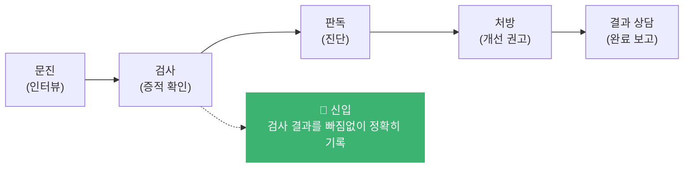
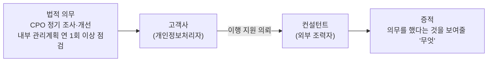
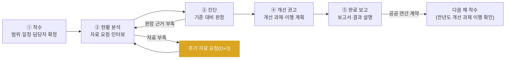
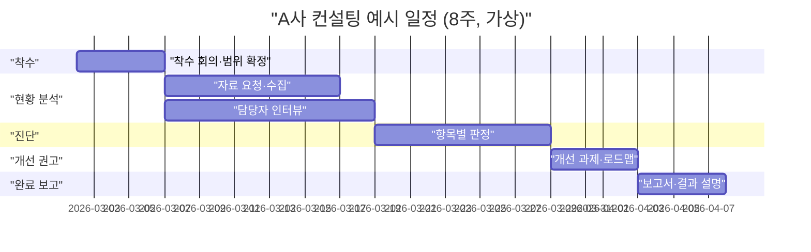
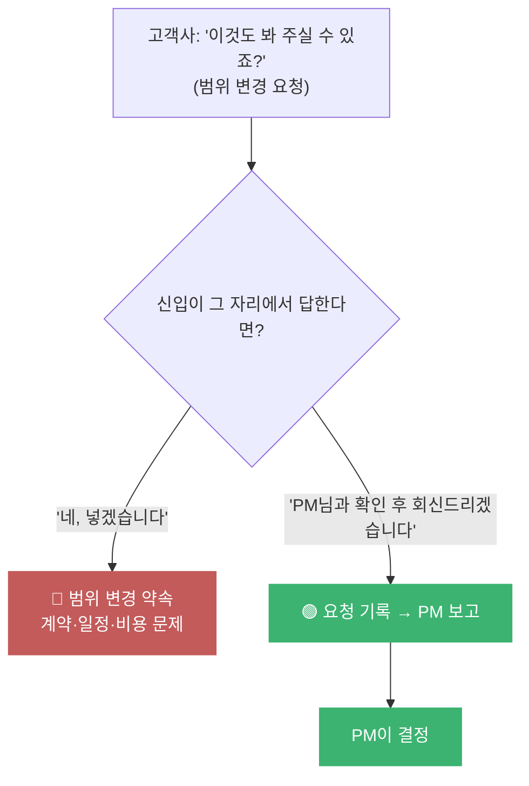
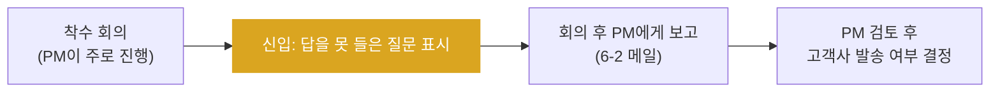
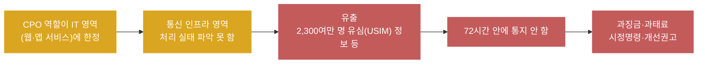

# 1주차-01. 컨설팅 업무 흐름과 신입의 역할

| 구분 | 내용 |
|---|---|
| 고객사 | A사(민간), B기관(공공) 공통 |
| 관련 산출물 | `./2_산출물_양식/01_자료요청_목록.md` (착수 단계에서 처음 사용) |
| 선행 챕터 | 없음 (레포 첫 챕터) |
| 예상 학습 시간 | 2.5시간 (읽기 1시간 + 실습 1.5시간) |

> [!IMPORTANT]
> **🎯 이 챕터 핵심 3줄**
> 1. 컨설팅은 착수 → 현황 분석 → 진단 → 개선 권고 → 완료 보고 5단계로 진행되고, 신입은 의무 이행을 보여줄 증적을 모으고 정리하고 기록한다.
> 2. 개인정보 보호 의무의 주체는 고객사(개인정보처리자)이고, 컨설팅 수요는 대부분 CPO의 정기 조사·연 1회 이상 점검 의무에서 나온다.
> 3. 범위 변경·최종 판정·법적 결론은 신입이 혼자 결정하지 않는다. 착수 회의에서 CPO의 관할 범위를 반드시 확인한다(SKT 사례).

---

## 1. 학습 목표

1. 개인정보보호 컨설팅의 5단계(착수 → 현황 분석 → 진단 → 개선 권고 → 완료 보고)와 단계별 산출물을 설명할 수 있다.
2. 각 단계에서 신입이 맡는 업무와 PM·선임이 맡는 업무를 구분할 수 있다.
3. 착수 회의 자료를 보고 진단 범위가 빠지거나 모호한 곳을 찾아 확인 질문을 작성할 수 있다.

---

## 2. 현장 비유와 기초 개념

> [!TIP]
> 🏗️ 💡 현장 비유: 컨설팅은 **건강검진**이다. 문진(인터뷰) → 검사(증적 확인) → 판독(진단) → 처방(개선 권고) → 결과 상담(완료 보고) 순서로 진행되고, 신입은 검사 결과를 빠짐없이 정확히 기록하는 사람이다.



> [!NOTE]
> 📌 **기초 개념 짚기**
>
> 개인정보 보호 의무의 주체는 고객사(개인정보처리자)이고, 컨설턴트는 그 의무 이행을 돕는 외부 조력자다. 고객사의 개인정보 보호책임자(CPO)는 "개인정보 처리 실태와 관행의 정기적인 조사 및 개선"을 맡고, 내부 관리계획 이행 실태를 연 1회 이상 점검·관리해야 한다. 컨설팅 수요는 대부분 이 의무에서 나온다.
> - 근거: 「개인정보 보호법」 제31조제4항제4호[^law31], 「개인정보의 안전성 확보조치 기준」 제4조제4항[^safe4]



시험에서는 "누가 무엇을 해야 하는가"를 외우면 됐지만, 현장에서는 **"그 의무를 했다는 것을 무엇으로 보여줄 것인가"**를 고객사와 함께 찾아야 합니다. 신입의 일은 대부분 그 "무엇"을 모으고, 정리하고, 기록하는 일입니다.

> ✅ **2절 한 줄 정리**: 의무의 주체는 고객사이고, 신입은 그 의무 이행을 보여줄 증적을 모으고 정리하고 기록한다.

---

## 3. 근거 법령·기준

컨설팅 단계 자체를 정한 법령은 없습니다. 아래는 **고객사가 컨설팅을 의뢰하게 되는 법적 의무**와, 단계별 일정에 영향을 주는 규정입니다.

| 근거 | 키워드 | 출처 |
|---|---|---|
| ① 법 제31조제4항 | CPO의 업무 | [^law31] |
| ② 안전성 기준 제4조제4항 | 이행 실태 연 1회 이상 점검 | [^safe4] |
| ③ 법 제11조의2 · 영 제13조의2 | 매년 보호수준 평가 | [^law11] [^dec13] |
| ④ 법 제33조제1항·제2항 | 공공기관 영향평가 | [^law33] |
| ⑤ ISMS-P 고시 제17조제1항 | 최소 2개월 이상 운영 | [^isms17] |
| ⑥ 영향평가 고시 제9조 | 영향평가 3단계 | [^pia9] |

**🔎 번호별 보충 설명** (요지 / 쉬운 풀이: 현장에서 확인할 것)

- ① 요지: CPO의 업무: 보호 계획 수립·시행, 실태와 관행의 정기 조사·개선, 내부통제시스템 구축, 교육 계획 등
  - 풀이: 착수 때 **CPO가 누구이고 어디까지 관할하는지** 먼저 확인한다. 컨설팅 결과를 받아 실행할 사람이다.
- ② 요지: CPO는 접근권한, 접속기록, 암호화 등 내부 관리계획 이행 실태를 연 1회 이상 점검·관리
  - 풀이: 고객사가 "연간 정기 점검"을 맡기는 대표적 이유. 이번 컨설팅 결과가 **올해 점검 증적**이 되는지 확인한다.
- ③ 요지: 보호위원회는 공공기관 등을 대상으로 매년 보호수준 평가
  - 풀이: B기관 연간 컨설팅의 큰 축. 평가 일정이 컨설팅 일정을 결정한다(4주차).
- ④ 요지: 공공기관은 일정 기준의 개인정보파일에 대해 영향평가를 하고, 지정된 평가기관에 의뢰
  - 풀이: B기관 차세대 시스템이 대상이면 별도 사업이 된다(4주차).
- ⑤ 요지: 인증 신청 전 관리체계를 구축해 **최소 2개월 이상** 운영
  - 풀이: A사 ISMS-P 준비 일정을 짤 때 "구축 완료 → 2개월 운영 → 신청" 순서를 거꾸로 계산한다(3주차).
- ⑥ 요지: 영향평가는 사전 준비 → 영향평가 수행 → 이행 단계로 진행
  - 풀이: 공공 영향평가는 이 3단계에 컨설팅 단계를 맞춘다.

> [!WARNING]
> 컨설팅 5단계(착수 → 현황 분석 → 진단 → 개선 권고 → 완료 보고)는 업계에서 널리 쓰는 일반적인 구분입니다. 회사마다 이름과 단계 수가 다를 수 있습니다. [출처: 일반 지식, 원문 확인 권장]

> ✅ **3절 한 줄 정리**: 컨설팅 단계를 정한 법령은 없고, CPO 의무·보호수준 평가·영향평가·ISMS-P 운영 기간 같은 고객사의 법적 의무가 컨설팅 의뢰와 일정을 만든다.

---

## 4. 컨설팅 수행 절차



### 단계별 설명

| 단계 | 결과물 | 소요 (예시) |
|---|---|---|
| ① 착수 | 착수 보고서, 자료 요청 목록 v0.1 | 1주 |
| ② 현황 분석 | 인터뷰 회의록, 증적 목록, 현황 정리표 | 2~3주 |
| ③ 진단 | 진단표·갭 분석표 (판정 + 근거) | 2주 |
| ④ 개선 권고 | 개선 과제 목록, 이행 계획(로드맵) | 1주 |
| ⑤ 완료 보고 | 최종 보고서, 결과 설명 자료 | 1주 |

**🔎 번호별 보충 설명** (하는 일 / 입력 자료)

- ① 착수
  - 하는 일: 계약 범위 확인, 고객사 담당자 지정, 일정·보고 체계 합의, 보안서약
  - 입력 자료: 계약서·제안서, 고객사 조직도
- ② 현황 분석
  - 하는 일: 자료 요청·수집, 담당자 인터뷰, 시스템·현장 확인
  - 입력 자료: 자료 요청 목록, 인터뷰 질문지
- ③ 진단
  - 하는 일: 법령·고시·인증기준 대비 항목별 판정
  - 입력 자료: 현황 정리표, 증적
- ④ 개선 권고
  - 하는 일: 미흡 항목별 개선 과제, 우선순위, 담당·기한
  - 입력 자료: 진단 결과
- ⑤ 완료 보고
  - 하는 일: 결과 보고서 작성, 고객사 결과 설명, 산출물 인계
  - 입력 자료: 위 결과물 전부



> [!NOTE]
> 위 일정은 이해를 돕기 위한 **예시 일정**입니다.

### Windows 11 실무 도구 팁

<details>
<summary>🛠️ Windows 11 실무 도구 팁 3가지 펼치기</summary>

| 작업 | 도구 |
|---|---|
| ① 프로젝트 폴더 구조 한 번에 만들기 | PowerShell |
| ② 파일 확장자 보이게 하기 (증적 파일 형식 확인용) | 파일 탐색기 |
| ③ 날짜 형식 통일 | 설정 |

**🔎 번호별 보충 설명** (도구·경로 / 방법)

- ① 방법:

  ```powershell
  "01_착수","02_현황분석","03_진단","04_개선권고","05_완료보고","99_증적" | ForEach-Object { New-Item -ItemType Directory -Path "D:\A사_2026\$_" -Force }
  ```

- ② 경로: 파일 탐색기 → 보기 → 표시 → **파일 확장명** 체크
  - 방법: `.pdf.exe` 같은 위장 파일을 걸러낼 수 있다.
- ③ 경로: 설정 → 시간 및 언어 → 언어 및 지역 → 지역 형식 → 형식 변경 → 간단한 날짜 `yyyy-MM-dd`
  - 방법: 회의록·파일명·Excel의 날짜를 `YYYY-MM-DD`로 통일한다.

</details>

> ✅ **4절 한 줄 정리**: 5단계는 착수 1주 → 현황 분석 2~3주 → 진단 2주 → 개선 권고 1주 → 완료 보고 1주(예시)로 흐르고, 자료·근거가 부족하면 현황 분석으로 되돌아간다.

---

## 5. 업무 분담표

| 단계 | 🙋 신입 담당 | 🧑‍💼 PM·선임 담당 |
|---|---|---|
| ① 착수 | 착수 회의록, 자료 요청 목록 초안, 연락처·일정표 | 범위·일정 확정 |
| ② 현황 분석 | 자료 요청 메일 발송·추적, 회의록, 증적 정리 | 인터뷰 진행(주 질문자) |
| ③ 진단 | 판정 초안과 근거 | 판정 확정 |
| ④ 개선 권고 | 개선 과제 초안 | 우선순위·로드맵 확정 |
| ⑤ 완료 보고 | 보고서 표·부록, 검수 | 보고서 본문, 경영진 결과 설명 |

**🔎 번호별 보충 설명** (단계별 전체 업무와 🏢 고객사 담당)

- ① 착수
  - 🙋 신입: 착수 회의록 작성, 자료 요청 목록 초안, 연락처·일정표 정리
  - 🧑‍💼 PM·선임: 계약 범위 해석, 범위·일정 확정, 보고 체계 합의
  - 🏢 고객사: 담당자 지정, 범위 확인, 보안서약·출입 절차 안내
- ② 현황 분석
  - 🙋 신입: 자료 요청 메일 발송·추적, 인터뷰 질문지 초안, 회의록, 증적 정리
  - 🧑‍💼 PM·선임: 인터뷰 진행(주 질문자), 추가 요청 범위 판단
  - 🏢 고객사: 자료 제출, 인터뷰 참석
- ③ 진단
  - 🙋 신입: 항목별 현황 정리, **판정 초안과 근거** 작성
  - 🧑‍💼 PM·선임: 판정 확정, 해석이 갈리는 항목 판단
  - 🏢 고객사: 사실 관계 확인, 이의 제기
- ④ 개선 권고
  - 🙋 신입: 개선 과제 초안, 참고 사례·문안 조사
  - 🧑‍💼 PM·선임: 우선순위·로드맵 확정
  - 🏢 고객사: 실행 가능성 검토, 담당 부서 지정
- ⑤ 완료 보고
  - 🙋 신입: 보고서 표·부록 작성, 오탈자·근거 각주 검수
  - 🧑‍💼 PM·선임: 보고서 본문 작성, 경영진 대상 결과 설명
  - 🏢 고객사: 결과 수령, 개선 이행

> [!WARNING]
> 🚫 **신입이 혼자 결정하지 않는 것**:
> - 진단 범위 변경 약속
> - 최종 판정
> - "과태료 대상입니다" 같은 법적 결론 단정
> - 고객사 경영진 대상 결과 설명



> ✅ **5절 한 줄 정리**: 신입은 기록·초안·정리·검수를 맡고, 범위·판정·우선순위 확정과 경영진 설명은 PM·선임이 맡는다.

---

## 6. 고객 커뮤니케이션 예시

### 6-1. 착수 회의 확인 질문 리스트

착수 회의에서 PM이 주로 말하고, 신입은 아래 질문 중 **답을 못 들은 것**을 표시해 두었다가 회의 후 PM에게 보고합니다.



| No | 확인 주제 | 답변 후 요청할 증적 |
|---|---|---|
| 1 | 진단 범위 | 진단 범위 정의서 또는 계약서 과업 범위 |
| 2 | CPO·실무 부서 | CPO 지정 문서, 조직도·업무분장 |
| 3 | 처리시스템 목록 | 개인정보처리시스템 목록 |
| 4 | 이전 점검 결과 | 이전 점검 결과서, 조치 결과 |
| 5 | 자료 전달 방식 | 공유 폴더 경로, 마스킹 기준 |
| 6 | 보고 일정 | 착수 보고서에 반영 |

**🔎 번호별 보충 설명** (질문 / 질문 의도)

- 1
  - 질문: 이번 진단 대상 서비스·시스템·조직은 어디까지인가요? 제외되는 곳이 있나요?
  - 의도: 범위 확정. 제외 영역은 보고서에 "범위 제외"로 명시해야 함
- 2
  - 질문: 개인정보 보호책임자와 실무 담당 부서는 누구이며, CPO가 관할하는 범위는 어디까지인가요?
  - 의도: 결과를 받아 실행할 주체와 거버넌스 범위 확인
- 3
  - 질문: 개인정보를 처리하는 시스템 목록이 있나요? 파일서버·공유 폴더도 포함되어 있나요?
  - 의도: 정형 시스템 외 저장소 누락 방지
- 4
  - 질문: 최근 1년 안에 받은 점검·감사·인증 심사 결과가 있나요?
  - 의도: 중복 진단 방지, 기존 지적 사항 확인
- 5
  - 질문: 자료는 어떤 방식으로 주고받을까요? 개인정보가 들어간 자료는 어떻게 할까요?
  - 의도: 자료 전달 보안
- 6
  - 질문: 중간 보고와 최종 보고 일정, 보고 대상은 어떻게 되나요?
  - 의도: 일정·보고 체계

### 6-2. 착수 회의 후 PM에게 보내는 보고 (내부)

```text
제목: [A사] 착수 회의 결과 및 미확인 사항 보고 (2026-03-02)

PM님, 오늘 착수 회의 결과 정리해서 보고드립니다.

■ 확정된 사항
 - 진단 범위: 쇼핑몰 웹·앱, 회원 DB, 콜센터 시스템
 - 고객사 담당: 정보보호팀 김○○ 과장 (CPO: 정보보호실장)
 - 자료 1차 회신 기한: 2026-03-09

■ 회의에서 답을 듣지 못한 사항 (확인 필요)
 1. 물류센터(배송 관리 시스템)가 범위에 포함되는지
 2. 파일서버·공유 폴더가 처리시스템 목록에 들어 있는지

■ 첨부: 착수 회의록 v0.1, 자료 요청 목록 v0.1

검토 후 고객사 발송 여부 알려주시면 반영하겠습니다.
```

> ✅ **6절 한 줄 정리**: 착수 회의에서는 6개 확인 질문 중 답을 못 들은 것을 표시하고, 회의 후 확정 사항·미확인 사항·첨부를 PM에게 보고한다.

---

## 7. 처분 사례: SK텔레콤 개인정보 유출사고 (2025.8. 의결)

| 구분 | 내용 |
|---|---|
| 사건 | 2,300여만 명 유심(USIM) 정보 등 유출 |
| 위반 조항 | 안전조치의무 위반, 유출 통지 위반 (보도자료 기준) |
| 처분 | 과징금 1,347억 9,100만 원, 과태료 960만 원 + 시정명령·개선권고 |
| 출처 | 2025.8.28. 보도자료, 2025.8.27. 전체회의 의결[^skt] |



<details>
<summary>📄 사건 상세 (사건 개요·처분·결과·출처 원문 펼치기)</summary>

- 사건 개요: 이동통신 핵심 네트워크·시스템 관리 소홀로 2,300여만 명의 유심(USIM) 정보 등 개인정보가 유출됨. 조사 결과 CPO의 역할이 IT 영역(웹·앱 서비스)에 한정되도록 구성·운영되어, 사고가 난 **통신 인프라 영역은 CPO가 개인정보 처리 실태조차 파악하지 못한** 것으로 확인됨. 유출 통지도 72시간 안에 하지 않음.
- 위반 조항: 안전조치의무 위반, 유출 통지 위반 (보도자료 기준)
- 처분·결과: 과징금 1,347억 9,100만 원, 과태료 960만 원. CPO가 회사 전반의 개인정보 처리 업무를 총괄하도록 거버넌스 정비 시정명령, 재발방지 대책 수립·보고, 사고 발생 네트워크·시스템에 대한 ISMS-P 인증 취득 개선권고
- 출처: 2025.8.28. 보도자료 「개인정보위, 'SK텔레콤 개인정보 유출사고' 제재처분 의결」, 2025.8.27. 전체회의 의결[^skt]

</details>

### 컨설팅 시사점

🔴 **CPO 관할 밖에서 개인정보를 처리하는 영역은 실태 파악이 안 되고, 사고·제재로 이어질 수 있다.**

- [ ] **① 진단 범위 확인**: 진단 범위가 조직 전체의 개인정보 처리를 포괄하는지 착수 단계에서 확인합니다. 고객사가 "웹·앱만 봐 주세요"라고 해도, 다른 영역에서 개인정보를 처리한다면 그 사실과 "범위 제외"를 회의록과 보고서에 남깁니다.
- [ ] **② CPO 관할 범위 질문**: 착수 회의에서 CPO의 관할 범위를 묻는 질문(6-1의 2번)을 빼먹지 않습니다.

> ✅ **7절 한 줄 정리**: CPO 관할이 IT 영역에 한정되어 인프라 영역 실태를 몰랐던 것이 제재로 이어졌으니, 착수 때 진단 범위와 CPO 관할 범위를 함께 확인한다.

---

## 8. 오답노트

| No | 상황 | ✅ 핵심 |
|---|---|---|
| ① | 자료 요청 목록 작성 | 계약서 과업 범위와 대조 |
| ② | "이것도 봐 주실 수 있죠?" | PM 확인 후 회신 |
| ③ | 법적 결론 단정 | 사실과 근거만 |
| ④ | CPO 관할 범위 | 지정 문서·관할 범위 확인 |
| ⑤ | 파일명 | `v0.1 → v0.2 → v1.0` 버전 규칙 |

**🔎 번호별 보충 설명** (❌ 신입의 실수 / ✅ 올바른 수행 / 근거)

- ①
  - ❌ 계약서·과업 범위를 읽지 않고 고객사 담당자 말만 듣고 자료 요청 목록을 만듦
  - ✅ 계약서 과업 범위와 착수 회의록을 대조해 범위를 확정한 뒤 목록을 만듦
  - 근거: 범위 밖 자료 요청은 고객사 부담과 일정 지연을 만든다 [출처: 일반 지식, 원문 확인 권장]
- ②
  - ❌ 고객사가 "이것도 봐 주실 수 있죠?"라고 하자 그 자리에서 "네, 넣겠습니다"라고 답함
  - ✅ "PM님과 확인 후 회신드리겠습니다"라고 답하고 PM에게 보고
  - 근거: 범위 변경은 계약·일정·비용 문제라 PM이 결정
- ③
  - ❌ 고객사에 "이건 과태료 대상입니다"라고 단정함
  - ✅ "법 제○조 요구사항과 차이가 있어 보입니다. 정리해서 말씀드리겠습니다"처럼 사실과 근거만 말함
  - 근거: 법 위반 여부와 처분은 보호위원회가 판단한다
- ④
  - ❌ 착수 회의에서 CPO의 관할 범위를 묻지 않음
  - ✅ CPO 지정 문서와 관할 범위를 확인하고, 범위 밖 처리 영역이 있으면 기록
  - 근거: SKT 사례(2025.8.)[^skt]
- ⑤
  - ❌ 회의록·산출물을 `최종.docx`, `최종_수정.docx`로 저장
  - ✅ `v0.1 → v0.2 → v1.0` 버전 규칙과 날짜를 파일명에 씀
  - 근거: 1주차-02 증적 파일명 규칙

> ✅ **8절 한 줄 정리**: 범위는 계약서로 확정하고, 범위 변경과 법적 판단은 PM·보호위원회 몫으로 넘기며, 산출물은 버전 규칙으로 관리한다.

---

## 9. 고객사 점검용 체크리스트: 착수 단계 준비도

각 항목: **점검 항목** → 확인 방법 / 요청 증적 → 판정 기준

### ① 보호 조직 확인 (No 1~2)

- [ ] **No 1. CPO 지정·관할 범위**: 개인정보 보호책임자가 지정되어 있고 관할 범위가 문서로 정해져 있다
  - 확인 방법: 문서·인터뷰 / 요청 증적: CPO 지정 문서, 업무분장
  - 판정 기준: 🟢 지정·범위 문서 있음 · 🟡 지정만 있고 범위 불명확 · 🔴 지정 문서 없음
- [ ] **No 2. 보호 조직**: 개인정보 보호 조직(담당 부서·담당자)이 정해져 있다
  - 확인 방법: 문서 / 요청 증적: 조직도, 업무분장표
  - 판정 기준: 🟢 문서로 지정 · 🔴 없음

### ② 처리 현황·이력 확인 (No 3~4)

- [ ] **No 3. 처리시스템 목록**: 개인정보처리시스템 목록이 있고 최신이다
  - 확인 방법: 문서·인터뷰 / 요청 증적: 처리시스템 목록 (작성일 포함)
  - 판정 기준: 🟢 1년 이내 갱신 · 🟡 1년 넘게 갱신 안 됨 · 🔴 없음
- [ ] **No 4. 이전 점검 결과**: 이전 점검·감사 결과와 조치 결과를 보관하고 있다
  - 확인 방법: 문서 / 요청 증적: 이전 점검 결과서, 조치 결과
  - 판정 기준: 🟢 결과·조치 모두 있음 · 🟡 결과만 · ⚪ 이전 점검 이력 없음

### ③ 자료 공유 합의 (No 5)

- [ ] **No 5. 자료 공유 기준**: 자료 공유 방식과 개인정보 포함 자료 처리 기준이 합의되었다
  - 확인 방법: 인터뷰 / 요청 증적: 착수 회의록
  - 판정 기준: 🟢 합의·기록 · 🔴 미합의

> ✅ **9절 한 줄 정리**: 착수 준비도는 보호 조직 → 처리 현황·이력 → 자료 공유 합의 순서로 5개 항목을 문서·인터뷰로 확인한다.

---

## 10. 실무 산출물 연계 팁

| 이 챕터의 결과 | 들어가는 산출물 | 위치 |
|---|---|---|
| 착수 회의록, 범위 확정 내용 | 착수 보고서 | 1장 '컨설팅 범위 및 일정' |
| 착수 회의 미확인 사항 | 자료 요청 목록 (`./2_산출물_양식/01_자료요청_목록.md`) | `GEN` 영역 행 |
| 범위에서 제외한 영역 | 최종 보고서 | 1장 '진단 범위 및 제한사항' |
| 착수 단계 준비도 체크리스트 결과 | 현황 분석 보고서 | '관리체계 현황' 절 |

> [!TIP]
> 💡 착수 회의가 끝나면 **당일 안에** 회의록 초안과 미확인 사항 목록을 PM에게 보냅니다. 기억이 흐려지기 전에 정리하는 것이 가장 정확합니다.

---

## 11. 실습 과제 / 퀴즈

> [!NOTE]
> 정답과 해설은 [정답과_해설.md](../../정답과_해설.md)의 **「1주차-01. 컨설팅 업무 흐름과 신입의 역할」** 절에 있습니다. 먼저 스스로 풀어 보세요.

### 객관식

**Q1.** 다음 중 컨설팅 단계와 그 단계의 대표 산출물을 잘못 짝지은 것은?

① 착수 – 자료 요청 목록 초안
② 현황 분석 – 인터뷰 회의록
③ 진단 – 개선 이행 로드맵
④ 완료 보고 – 최종 보고서

**Q2.** 수탁사 현장 점검 중 고객사(A사) 담당자가 "온 김에 물류센터 CCTV도 같이 봐 주실 수 있죠?"라고 물었다. 신입 컨설턴트의 가장 적절한 대응은?

① 고객 만족을 위해 바로 CCTV 점검을 추가로 진행한다.
② "계약 범위 밖이라 안 됩니다"라고 단호히 거절한다.
③ "PM님과 확인한 뒤 회신드리겠습니다"라고 답하고 요청 내용을 기록해 PM에게 보고한다.
④ 점검은 하되 결과는 보고서에 넣지 않는다.

**Q3.** 다음 중 「개인정보의 안전성 확보조치 기준」상 개인정보 보호책임자가 연 1회 이상 해야 하는 일로 옳은 것은?

① 개인정보 영향평가 수행
② 내부 관리계획 이행 실태 점검·관리
③ ISMS-P 사후심사 신청
④ 개인정보 처리방침 전면 개정

### 실습

**상황**: 당신은 A사 컨설팅에 투입된 신입이다. PM이 착수 회의록 초안을 주며 "범위에서 빠졌거나 애매한 부분 찾아서 확인 질문 만들어 줘"라고 했다.

**제공 자료**

```text
[A사 개인정보보호 컨설팅 착수 회의록 (초안)]
- 일시: 2026-03-02 14:00~15:30
- 참석: A사 정보보호팀 김과장, 마케팅팀 이대리 / 컨설팅사 PM, 신입
- 진단 범위: 온라인 쇼핑몰(웹), 회원 DB
- A사 설명:
  · 모바일 앱도 운영 중이며 앱 회원은 웹 회원과 같은 DB를 씀
  · 고객 상담은 외부 콜센터(B사)에 맡기고 있음
  · 마케팅팀은 회원 데이터를 엑셀로 내려받아 문자 발송 업체에 전달함
  · CPO는 IT본부장이며, 마케팅·물류 부서는 각 부서장이 자체 관리함
- 자료 요청: 추후 메일로 요청 예정
- 다음 회의: 미정
```

**과제**

1. 진단 범위에서 빠졌거나 모호한 부분을 3개 이상 찾고, 각각 왜 문제인지 한 줄로 쓰시오.
2. 각 문제에 대해 고객사에 물어볼 확인 질문을 쓰시오 (6-1 표 형식: 질문 / 의도 / 요청할 증적).
3. PM에게 보낼 보고 메일을 6-2 예시 형식으로 쓰시오.

**작성 양식**: 6-1 질문 리스트 표, 6-2 보고 메일 형식

---

## 12. 더 읽을거리

| 자료 | 읽을 부분 |
|---|---|
| 개인정보의 안전성 확보조치 기준 | 제4조 (내부 관리계획) |
| SK텔레콤 제재처분 보도자료 | 2) 개인정보 보호책임자 지정 및 업무 수행 소홀, 6. 시정명령·개선권고 |
| 개인정보 영향평가 수행안내서 | p.18 '영향평가 수행 절차 요약' (공공 컨설팅 흐름 미리 보기) |
| ISMS-P 고시 | 제17조 (신청인의 사전 준비사항) |

<details>
<summary>📂 참고자료 파일명·링크 펼치기 (4개)</summary>

- 개인정보의 안전성 확보조치 기준: [`개인정보의 안전성 확보조치 기준(개인정보보호위원회고시)(제2026-9호)(20260701).pdf`](<../../3_참고자료/개인정보의 안전성 확보조치 기준(개인정보보호위원회고시)(제2026-9호)(20260701).pdf>)
- SK텔레콤 제재처분 보도자료: [`250828 (석간) 개인정보위  ‘SK텔레콤 개인정보 유출사고’ 제재처분 의결(조사2과)_최종(붙임 포함).pdf`](<../../3_참고자료/250828 (석간) 개인정보위  ‘SK텔레콤 개인정보 유출사고’ 제재처분 의결(조사2과)_최종(붙임 포함).pdf>)
- 개인정보 영향평가 수행안내서: [`개인정보 영향평가 수행안내서(25.10.).pdf`](<../../3_참고자료/개인정보 영향평가 수행안내서(25.10.).pdf>)
- ISMS-P 고시: [`정보보호 및 개인정보보호 관리체계 인증 등에 관한 고시(개인정보보호위원회고시)(제2024-8호)(20240724).pdf`](<../../3_참고자료/정보보호 및 개인정보보호 관리체계 인증 등에 관한 고시(개인정보보호위원회고시)(제2024-8호)(20240724).pdf>)

</details>

---

## 각주

[^law31]: [출처: [개인정보 보호법(법률)(제21445호)(20260911).pdf](<../../3_참고자료/개인정보 보호법(법률)(제21445호)(20260911).pdf>), 제31조제4항]
[^safe4]: [출처: [개인정보의 안전성 확보조치 기준(개인정보보호위원회고시)(제2026-9호)(20260701).pdf](<../../3_참고자료/개인정보의 안전성 확보조치 기준(개인정보보호위원회고시)(제2026-9호)(20260701).pdf>), 제4조제4항]
[^law11]: [출처: [개인정보 보호법(법률)(제21445호)(20260911).pdf](<../../3_참고자료/개인정보 보호법(법률)(제21445호)(20260911).pdf>), 제11조의2]
[^dec13]: [출처: [개인정보 보호법 시행령(대통령령)(제36804호)(20261110).pdf](<../../3_참고자료/개인정보 보호법 시행령(대통령령)(제36804호)(20261110).pdf>), 제13조의2]
[^law33]: [출처: [개인정보 보호법(법률)(제21445호)(20260911).pdf](<../../3_참고자료/개인정보 보호법(법률)(제21445호)(20260911).pdf>), 제33조제1항·제2항]
[^isms17]: [출처: [정보보호 및 개인정보보호 관리체계 인증 등에 관한 고시(개인정보보호위원회고시)(제2024-8호)(20240724).pdf](<../../3_참고자료/정보보호 및 개인정보보호 관리체계 인증 등에 관한 고시(개인정보보호위원회고시)(제2024-8호)(20240724).pdf>), 제17조제1항]
[^pia9]: [출처: [개인정보 영향평가에 관한 고시(개인정보보호위원회고시)(제2025-7호)(20250905).pdf](<../../3_참고자료/개인정보 영향평가에 관한 고시(개인정보보호위원회고시)(제2025-7호)(20250905).pdf>), 제9조]
[^skt]: [출처: [250828 (석간) 개인정보위  ‘SK텔레콤 개인정보 유출사고’ 제재처분 의결(조사2과)_최종(붙임 포함).pdf](<../../3_참고자료/250828 (석간) 개인정보위  ‘SK텔레콤 개인정보 유출사고’ 제재처분 의결(조사2과)_최종(붙임 포함).pdf>), p.1·6·11·12, 2025.8.27. 의결]
