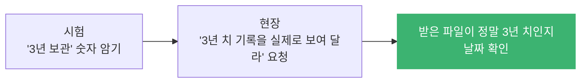
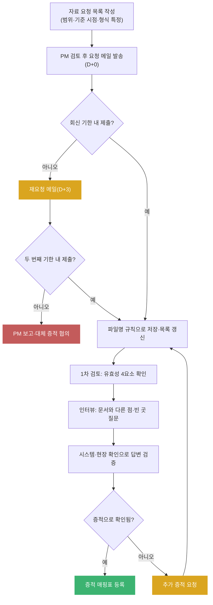
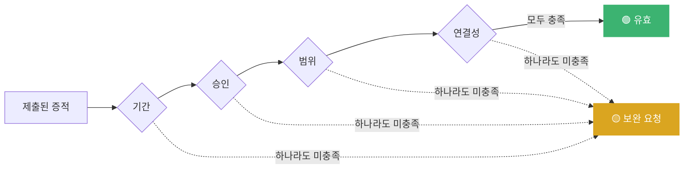
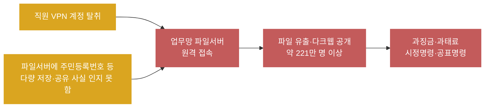

# 1주차-02. 자료 요청과 인터뷰, 증적 관리

| 구분 | 내용 |
|---|---|
| 고객사 | A사(민간), B기관(공공) 공통 |
| 관련 산출물 | `./2_산출물_양식/01_자료요청_목록.md`, `./2_산출물_양식/05_증적_매핑표.md` |
| 선행 챕터 | 1주차-01. 컨설팅 업무 흐름과 신입의 역할 |
| 예상 학습 시간 | 3시간 (읽기 1.5시간 + 실습 1.5시간) |

> [!IMPORTANT]
> **🎯 이 챕터 핵심 3줄**
> 1. 자료 요청은 기간·범위를 특정한다. "권한 대장 주세요"가 아니라 "최근 3년 치 시스템별 권한 부여·변경·말소 내역"으로 요청한다.
> 2. 받은 증적은 유효성 4요소(기간·승인·범위·연결성)로 1차 검토하고, 파일명 규칙에 맞춰 관리한다.
> 3. 인터뷰 답변은 증적 요청으로 바꾸고, 시스템·현장에서 다시 확인한다. 파일서버 같은 비정형 저장소를 빠뜨리지 않는다(골프존 사례).

---

## 1. 학습 목표

1. 진단 범위에 맞춰 자료 요청 목록을 만들고, 요청·재요청 메일을 쓸 수 있다.
2. 인터뷰 질문지를 준비하고, 구두 답변을 증적 요청으로 바꿀 수 있다.
3. 받은 증적의 유효성(기간·승인·범위·연결성)을 확인하고 파일명 규칙에 맞춰 관리할 수 있다.

---

## 2. 현장 비유와 기초 개념

> [!TIP]
> 🏗️ 💡 현장 비유: 증적 관리는 **사건 현장의 증거 보관**이다. 증거가 아무리 많아도 언제, 어디서, 누가 수집했는지 기록이 없으면 법정에서 쓸 수 없다.

> [!NOTE]
> 📌 **기초 개념 짚기**
>
> 안전성 확보조치 기준은 여러 조치에 기록과 보관을 요구한다. 접근 권한 부여·변경·말소 내역은 최소 3년, 접속기록은 1년(일정 경우 2년) 이상 보관하고, 내부 관리계획은 수정 이력을 관리해야 한다. 이 기록들이 곧 컨설팅에서 확인하는 증적이다.
> - 근거: 「개인정보의 안전성 확보조치 기준」 제4조제3항, 제5조제3항, 제8조제1항[^safe]



시험에서는 "3년 보관"이라는 숫자를 외웠다면, 현장에서는 **"3년 치 기록을 실제로 보여 달라"고 요청하고, 받은 파일이 정말 3년 치인지 날짜를 확인**해야 합니다.

> ✅ **2절 한 줄 정리**: 보관 의무가 있는 기록이 곧 증적이고, 신입은 그 기록을 실제로 요청해 기간을 날짜로 확인한다.

---

## 3. 근거 법령·기준

| 근거 | 키워드 | 출처 |
|---|---|---|
| ① ISMS-P 고시 제17조제2항제1호 | 문서와 증거자료 준비 | [^isms] |
| ② ISMS-P 고시 제25조제2항·제3항 | 서면심사 + 현장심사 | [^isms] |
| ③ 영향평가 수행안내서 3.1 | 인터뷰 대상·실사 | [^piag36] |
| ④ 안전성 기준 제4조제3항 | 수정 이력 관리 | [^safe] |
| ⑤ 안전성 기준 제5조제3항 | 권한 내역 최소 3년 보관 | [^safe] |
| ⑥ 안전성 기준 제8조 | 접속기록 보관·점검 | [^safe] |

**🔎 번호별 보충 설명** (요지 / 쉬운 풀이: 현장에서 확인할 것)

- ① 요지: 신청인은 인증심사 전에 인증심사를 위한 **문서와 증거자료**를 준비해야 함
  - 풀이: 인증 컨설팅의 목표는 "정책 문서"가 아니라 "증거자료"까지 갖추는 것
- ② 요지: 서면심사는 정책·지침·절차와 **이행의 증거자료** 검토, 현장심사는 담당자 면담·시스템 확인·취약점 점검
  - 풀이: 컨설팅도 같은 방식으로 한다. 문서 검토(서면) + 인터뷰·시스템 확인(현장)
- ③ 요지: 인터뷰 대상에 시스템 개발·운영 담당자와 현장 업무담당자를 포함하고, 운영 중인 시스템은 실사로 산출물·인터뷰 내용의 **정합성과 누락**을 검증. 실사는 업무 현장 실사와 화면·DB 시스템 실사로 진행
  - 풀이: 인터뷰 답변은 반드시 시스템·현장에서 다시 확인한다
- ④ 요지: 내부 관리계획에 중요한 변경이 있으면 즉시 반영하고 **수정 이력**을 관리
  - 풀이: 문서 증적은 개정일·개정 이력까지 받는다
- ⑤ 요지: 권한 부여·변경·말소 내역을 기록하고 **최소 3년** 보관
  - 풀이: "권한 대장 주세요"가 아니라 "최근 3년 치 권한 변경 이력"으로 요청
- ⑥ 요지: 접속기록 보관(1년/2년 이상)과 내부 관리계획으로 정한 주기·방법에 따른 점검
  - 풀이: 접속기록은 **원본 로그 + 점검 결과 기록** 두 가지를 모두 요청

> ✅ **3절 한 줄 정리**: 심사·평가는 문서뿐 아니라 이행의 증거자료와 현장 확인을 보므로, 컨설팅도 기록 보관 의무에 맞춰 기간·이력·점검 결과까지 요청한다.

---

## 4. 컨설팅 수행 절차



### 단계별 설명

| 단계 | 결과물 | 소요 (예시) |
|---|---|---|
| 1. 목록 작성 | 자료 요청 목록 v0.1 | 0.5일 |
| 2. 요청·추적 | 제출 현황 (상태 열) | 1~2주 |
| 3. 1차 검토 | 검토 메모, 추가 요청 목록 | 자료당 10~30분 |
| 4. 인터뷰 | 인터뷰 회의록 | 회당 1시간 |
| 5. 검증·등록 | 증적 매핑표 | 수시 |

**🔎 번호별 보충 설명** (하는 일 / 입력 자료)

- 1. 목록 작성
  - 하는 일: 진단 범위에 맞는 자료를 특정해 목록화
  - 입력 자료: 착수 회의록, 기본 목록 양식
- 2. 요청·추적
  - 하는 일: 요청 메일 발송, 회신 추적, 재요청
  - 입력 자료: 자료 요청 목록
- 3. 1차 검토
  - 하는 일: 기간·승인·범위·연결성 확인
  - 입력 자료: 제출 자료
- 4. 인터뷰
  - 하는 일: 문서에 없는 운영 실태, 문서와 다른 점 확인
  - 입력 자료: 질문지, 1차 검토 메모
- 5. 검증·등록
  - 하는 일: 답변을 시스템·현장으로 확인, 증적 등록
  - 입력 자료: 회의록, 화면 캡처

### 유효성 4요소 (증적 1차 검토 기준)



| 요소 | 확인 질문 | 흔한 문제 |
|---|---|---|
| 기간 | 점검 대상 기간 안에 작성·실행되었는가? | 2년 전 교육 결과를 "올해 교육"으로 제출 |
| 승인 | 정해진 결재권자의 승인이 있는가? | 결재 없는 초안 파일 |
| 범위 | 진단 대상 시스템·조직 전체를 포괄하는가? | 시스템 5개 중 2개 것만 제출 |
| 연결성 | 정책에 정한 주기·방법과 실제 기록이 맞는가? | 지침은 "분기 점검", 기록은 연 1회 |

### Windows 11 실무 도구 팁

<details>
<summary>🛠️ Windows 11 실무 도구 팁 5가지 펼치기</summary>

| 작업 | 도구 |
|---|---|
| ① 받은 증적 파일 목록과 수정일 뽑기 | PowerShell |
| ② 증적 원본이 바뀌지 않았음을 기록 (해시값) | PowerShell |
| ③ 파일명 일괄 정리 | PowerShell |
| ④ 상태 열 입력 실수 방지 | Excel |
| ⑤ 파일 속성 날짜 확인 | 파일 탐색기 |

**🔎 번호별 보충 설명** (도구·경로 / 방법)

- ① 방법:

  ```powershell
  Get-ChildItem "D:\A사_2026\99_증적" -Recurse -File | Select-Object Name, LastWriteTime | Export-Csv "D:\증적목록.csv" -Encoding UTF8 -NoTypeInformation
  ```

- ② 방법: `Get-FileHash "D:\...\IMP_내부관리계획_20260215_v01.pdf" -Algorithm SHA256` 결과를 증적 매핑표 비고에 기록
- ③ 방법: `Rename-Item "내부관리계획(최종).pdf" "IMP_내부관리계획_20260215_v01.pdf"`
- ④ 경로: Excel → 데이터 → 데이터 유효성 검사 → 제한 대상 `목록`, 원본 `요청,제출,보완 요청,완료,해당 없음`
  - 방법: 상태 값이 제각각이 되는 것을 막는다
- ⑤ 경로: 파일 우클릭 → 속성 → 자세히
  - 방법: 파일 속성 날짜는 복사할 때 바뀔 수 있으므로 **문서 본문의 작성일·결재일**을 우선 확인

</details>

> ✅ **4절 한 줄 정리**: 요청(D+0) → 재요청(D+3) → 1차 검토(유효성 4요소) → 인터뷰 → 시스템·현장 검증 → 매핑표 등록 순서로 돌고, 확인되지 않으면 추가 요청으로 되돌아간다.

---

## 5. 업무 분담표

| 단계 | 🙋 신입 담당 | 🧑‍💼 PM·선임 담당 |
|---|---|---|
| 목록 작성 | 범위에 맞게 초안 작성 | 요청 범위·우선순위 확정 |
| 요청·추적 | 요청·재요청 메일, 상태 관리 | 2차 미제출 시 협의 |
| 1차 검토 | 유효성 4요소 확인 | 대체 증적 인정 여부 판단 |
| 인터뷰 | 질문지 초안, 회의록 | 인터뷰 진행(주 질문자) |
| 검증·등록 | 화면 캡처, 매핑표 등록 | 판정 확정 |

**🔎 번호별 보충 설명** (단계별 전체 업무와 🏢 고객사 담당)

- 목록 작성
  - 🙋 신입: 기본 목록에서 범위에 맞게 초안 작성
  - 🧑‍💼 PM·선임: 요청 범위·우선순위 확정
  - 🏢 고객사: —
- 요청·추적
  - 🙋 신입: 요청·재요청 메일 발송, 상태 관리, 미제출 보고
  - 🧑‍💼 PM·선임: 2차 미제출 시 고객사 책임자와 협의
  - 🏢 고객사: 자료 취합·제출
- 1차 검토
  - 🙋 신입: 유효성 4요소 확인, 추가 요청 목록 작성
  - 🧑‍💼 PM·선임: 대체 증적 인정 여부 판단
  - 🏢 고객사: —
- 인터뷰
  - 🙋 신입: 질문지 초안, 회의록 작성, 보조 질문
  - 🧑‍💼 PM·선임: 인터뷰 진행(주 질문자)
  - 🏢 고객사: 담당자 참석, 답변
- 검증·등록
  - 🙋 신입: 화면 캡처·확인 기록, 매핑표 등록
  - 🧑‍💼 PM·선임: 판정 확정
  - 🏢 고객사: 시스템 화면 시연

> [!WARNING]
> 🚫 **신입이 혼자 결정하지 않는 것**:
> - 회신 기한 연장
> - 대체 증적 인정
> - 인터뷰 중 판정 결과 언급

> ✅ **5절 한 줄 정리**: 신입은 목록·메일·상태 관리·1차 검토·기록을 맡고, 범위·대체 증적·판정은 PM·선임이 정한다.

---

## 6. 고객 커뮤니케이션 예시

### 6-1. 자료 요청 메일

```text
제목: [A사 개인정보보호 컨설팅] 1차 자료 요청드립니다 (회신 요청일: 2026-03-09)

김○○ 과장님, 안녕하세요.
○○컨설팅 신입 컨설턴트 홍길동입니다.

지난 3월 2일 착수 회의에서 말씀드린 대로, 현황 분석을 위한 1차 자료를 요청드립니다.
세부 목록은 첨부한 「자료 요청 목록 v0.2」를 참고 부탁드립니다.

■ 주요 요청 자료 (총 18건)
 1. 개인정보 처리방침 현행본과 직전 버전 (변경일 포함)
 2. 내부 관리계획 현행본과 승인(결재) 문서
 3. 개인정보처리시스템 접근 권한 부여·변경·말소 내역 (최근 3년, 시스템별)
 ... (첨부 목록 참고)

■ 회신 요청일: 2026-03-09(월)
■ 제출 방법: 착수 회의에서 정한 공유 폴더 (\\share\A사_컨설팅\01_제출자료)
  ※ 회원 DB 추출본처럼 개인정보가 들어간 원본은 보내지 마시고,
     테이블 정의서(컬럼명·설명)나 마스킹한 화면 캡처로 보내 주시기 바랍니다.

자료 범위가 불분명한 항목은 편하게 연락 주세요. (010-0000-0000)
감사합니다.
```

### 6-2. 재요청 메일 (D+3)

```text
제목: [A사 개인정보보호 컨설팅] 미제출 자료 재요청드립니다 (5건, 2026-03-12까지)

김○○ 과장님, 안녕하세요. ○○컨설팅 홍길동입니다.

1차 자료 보내 주셔서 감사합니다. 확인해 보니 아래 5건이 아직 제출되지 않았거나
보완이 필요해 다시 요청드립니다.
```

| No | 자료명 | 상태 | 요청 사항 |
|---|---|---|---|
| 3 | 권한 부여·변경·말소 내역 | 보완 필요 | 2025년 이후분만 있어 2023~2024년분 추가 요청 |
| 7 | 수탁사 목록 | 미제출 | - |
| … | | | |

```text
일정상 3월 12일(목)까지 회신 부탁드립니다.
어려운 항목이 있으면 말씀해 주시면 PM과 협의해 방법을 찾겠습니다.
```

### 6-3. 인터뷰 질문 리스트 (예: 내부 관리계획·접속기록 담당자)

| No | 확인 주제 | 답변 후 요청할 증적 |
|---|---|---|
| 1 | 접속기록 점검 주기·방법 | 최근 점검 결과서 2회분 |
| 2 | 이상 징후 사후조치 | 소명 요청·조치 기록 |
| 3 | 엑셀 다운로드 파일 저장 위치 | 파일서버 폴더 구조 캡처, 다운로드 기록 |
| 4 | 퇴사자 계정 삭제 | 최근 퇴사자 3명의 퇴사일·계정 삭제일 비교 자료 |
| 5 | 내부 관리계획 최근 개정 | 개정 이력표, 결재 문서 |

**🔎 번호별 보충 설명** (질문 / 질문 의도)

- 1
  - 질문: 접속기록 점검은 어떤 주기로, 누가, 어떤 방법으로 하시나요?
  - 의도: 내부 관리계획에 정한 주기·방법과 실제 운영이 같은지 확인
- 2
  - 질문: 점검에서 이상 징후가 나오면 그다음엔 어떻게 처리하시나요? 최근 사례가 있나요?
  - 의도: 사후조치 절차가 실제로 작동하는지 확인
- 3
  - 질문: 직원이 개인정보를 엑셀로 내려받으면 그 파일은 보통 어디에 저장되나요?
  - 의도: 파일서버·공유 폴더·개인 PC 등 비정형 저장소 파악
- 4
  - 질문: 퇴사자 계정은 퇴사 후 언제, 누가 삭제하나요?
  - 의도: 권한 말소 절차의 실제 소요 시간 확인
- 5
  - 질문: 내부 관리계획은 언제 마지막으로 바뀌었고, 무엇이 바뀌었나요?
  - 의도: 수정 이력 관리 여부

> [!TIP]
> 💡 질문은 **열린 질문**("어떻게 하시나요?")으로 합니다. "점검하시죠?"처럼 예/아니오로 끝나는 유도 질문은 사실을 가립니다.

> ✅ **6절 한 줄 정리**: 요청·재요청 메일은 건수·기한·제출 방법을 분명히 쓰고, 인터뷰는 열린 질문으로 묻고 답마다 확인할 증적을 정해 둔다.

---

## 7. 처분 사례: ㈜골프존 개인정보 유출사고 (2024.5. 의결)

| 구분 | 내용 |
|---|---|
| 사건 | VPN 계정 탈취 → 파일서버 유출, 약 221만 명 이상 |
| 위반 조항 | 법 제29조, 제21조, 제24조의2제2항 (보도자료 붙임 기준) |
| 처분 | 과징금 75억 4백만 원, 과태료 540만 원, 시정명령, 공표명령 |
| 출처 | 2024.5.9. 보도자료, 2024.5.8. 전체회의 의결[^golf] |



<details>
<summary>📄 사건 상세 (사건 개요·위반 조항·처분·출처 원문 펼치기)</summary>

- 사건 개요: 해커가 직원의 가상사설망(VPN) 계정을 탈취해 업무망 파일서버에 원격 접속하고 파일을 유출해 다크웹에 공개함. 약 221만 명 이상의 이용자·임직원 개인정보가 유출되었고, 일부는 주민등록번호(5,831명)·계좌번호(1,647명)도 유출됨. 회사는 **전 직원이 쓰는 파일서버에 주민등록번호를 포함한 다량의 개인정보가 저장·공유되고 있다는 사실을 인지하지 못했고**, 파일서버에 대한 주기적 점검 등 관리체계를 미흡하게 운영함.
- 위반 조항: 법 제29조(안전조치의무) 위반 → 과징금 / 법 제21조(파기) 위반 → 과태료 / 법 제24조의2제2항(주민등록번호 처리제한: 암호화하지 않고 저장) 위반 (보도자료 붙임 기준)
- 처분·결과: 과징금 75억 4백만 원, 과태료 540만 원, 시정명령(회사 내 개인정보 처리 흐름에 대한 면밀한 분석을 통한 실질적인 내부 관리계획 수립·시행 등), 공표명령
- 출처: 2024.5.9. 보도자료 「개인정보위, ㈜골프존 개인정보 유출사고에 대해 과징금 75억 원, 과태료 540만 원 및 시정명령 부과」, 2024.5.8. 전체회의 의결[^golf]

</details>

### 컨설팅 시사점

🔴 **파일서버·공유 폴더 같은 비정형 저장소와 내부 업무영역이 자료 요청에서 빠지면 관리 공백이 생긴다.**

- [ ] **① 비정형 저장소 요청**: 자료 요청을 "개인정보처리시스템 목록"으로만 끝내면 파일서버·공유 폴더 같은 비정형 저장소가 빠집니다. 자료 요청 목록과 인터뷰 질문(6-3의 3번)에 반드시 넣습니다.
- [ ] **② 내부 업무 부서 인터뷰**: 보도자료는 이 처분이 "다양한 고객정보를 취급하는 내부 업무영역에서도 철저한 보호조치가 적용되어야 함을 강조한 사례"라고 설명합니다. 인터뷰 대상에 서비스 운영 부서뿐 아니라 인사·고객응대 등 내부 업무 부서도 넣습니다.

> ✅ **7절 한 줄 정리**: 회사가 파일서버에 쌓인 개인정보를 몰랐던 것이 대규모 유출로 이어졌으니, 자료 요청과 인터뷰에 비정형 저장소와 내부 업무 부서를 넣는다.

---

## 8. 오답노트

| No | 상황 | ✅ 핵심 |
|---|---|---|
| ① | "매달 점검합니다" 답변 | 결과서 2회분으로 확인 |
| ② | 교육 결과 등록 | 날짜(기간) 먼저 확인 |
| ③ | "권한 관리 대장 주세요" | 기간·범위 특정 |
| ④ | 실제 개인정보 엑셀 수신 | 정의서·마스킹본 요청 |
| ⑤ | 인터뷰 중 "미흡이네요" | 사실만 기록 |
| ⑥ | `(최종)(수정)` 파일명 | 영역코드·기준일·버전 규칙 |

**🔎 번호별 보충 설명** (❌ 신입의 실수 / ✅ 올바른 수행 / 근거)

- ①
  - ❌ 담당자가 "접속기록 매달 점검합니다"라고 하자 '양호'로 판정함
  - ✅ "최근 점검 결과서 2회분을 보여 주세요"로 바꿔 요청하고, 결과서로 확인한 뒤 판정 초안을 씀
  - 근거: 서면심사는 이행의 증거자료로 확인[^isms]
- ②
  - ❌ 제출된 교육 결과의 날짜를 보지 않고 증적으로 등록함
  - ✅ 작성일·실시일이 점검 대상 기간 안인지 먼저 확인
  - 근거: 유효성 4요소 중 '기간'
- ③
  - ❌ "권한 관리 대장 주세요"라고만 요청함
  - ✅ "최근 3년 치 시스템별 권한 부여·변경·말소 내역"처럼 기간·범위를 특정
  - 근거: 안전성 기준 제5조제3항[^safe]
- ④
  - ❌ 회원 DB 추출 엑셀(실제 개인정보)을 메일로 받음
  - ✅ 테이블 정의서나 마스킹본을 요청하고, 이미 받았다면 PM에게 보고 후 삭제 절차를 따름
  - 근거: 컨설턴트가 불필요한 개인정보를 받으면 그 자체가 위험
- ⑤
  - ❌ 인터뷰 중 "이건 미흡이네요"라고 판정 결과를 말함
  - ✅ 사실만 확인하고 기록. 판정은 PM 검토 후 결과 보고 때 전달
  - 근거: 판정 확정은 PM 업무
- ⑥
  - ❌ 파일명을 `내부관리계획(최종)(수정).pdf`로 저장
  - ✅ `IMP_내부관리계획_20260215_v01.pdf`처럼 영역코드·기준일·버전 규칙을 따름
  - 근거: `./2_산출물_양식/01_자료요청_목록.md` 파일명 규칙

> ✅ **8절 한 줄 정리**: 말이 아니라 증적으로 확인하고, 요청은 기간·범위를 특정하며, 개인정보 원본은 받지 않고, 판정은 PM에게 맡긴다.

---

## 9. 고객사 점검용 체크리스트: 증적 관리 수준

각 항목: **점검 항목** → 확인 방법 / 요청 증적 → 판정 기준

### ① 문서·권한 기록 (No 1~2)

- [ ] **No 1. 내부 관리계획 수정 이력**: 내부 관리계획의 수정 이력이 관리되고 있다
  - 확인 방법: 문서 / 요청 증적: 개정 이력표, 개정 결재 문서
  - 판정 기준: 🟢 이력표·결재 있음 · 🟡 이력표만 · 🔴 없음
- [ ] **No 2. 권한 내역 보관**: 접근 권한 부여·변경·말소 내역을 3년 이상 보관한다
  - 확인 방법: 문서·시스템 / 요청 증적: 최근 3년 권한 변경 이력
  - 판정 기준: 🟢 3년분 있음 · 🟡 일부 기간 · 🔴 없음

### ② 점검·저장소 관리 (No 3~4)

- [ ] **No 3. 접속기록 점검 기록**: 접속기록 점검 결과를 기록으로 남긴다
  - 확인 방법: 문서 / 요청 증적: 점검 결과서 (최근 2회분)
  - 판정 기준: 🟢 정한 주기대로 기록 · 🟡 기록은 있으나 주기와 다름 · 🔴 기록 없음
- [ ] **No 4. 파일서버·공유 폴더 파악**: 개인정보가 저장된 파일서버·공유 폴더를 파악하고 있다
  - 확인 방법: 인터뷰·시스템 / 요청 증적: 파일서버 목록, 폴더 구조, 점검 기록
  - 판정 기준: 🟢 목록·점검 기록 있음 · 🟡 목록만 · 🔴 파악 안 됨

### ③ 교육 기록 (No 5)

- [ ] **No 5. 교육 결과**: 교육 실시 결과가 대상자별로 남아 있다
  - 확인 방법: 문서 / 요청 증적: 교육 계획, 이수 명단
  - 판정 기준: 🟢 계획·이수 기록 · 🟡 계획만 · 🔴 없음

> ✅ **9절 한 줄 정리**: 증적 관리 수준은 수정 이력·권한 내역 → 점검 기록·저장소 파악 → 교육 기록 순서로 5개 항목을 확인한다.

---

## 10. 실무 산출물 연계 팁

| 이 챕터의 결과 | 들어가는 산출물 | 위치 |
|---|---|---|
| 자료 요청 목록·제출 현황 | `./2_산출물_양식/01_자료요청_목록.md` | 영역별 기본 목록, 미제출 자료 추적 |
| 인터뷰 회의록 | 현황 분석 보고서 | 부록 '인터뷰 결과' |
| 유효성 확인을 마친 증적 | `./2_산출물_양식/05_증적_매핑표.md` | A. 증적 목록 |
| 미제출·대체 증적 협의 결과 | 최종 보고서 | 1장 '진단 범위 및 제한사항' |

> [!TIP]
> 💡 매주 금요일에 자료 요청 목록의 상태 열을 기준으로 "제출 ○건 / 미제출 ○건 / 보완 ○건"을 PM에게 보고하면 일정 관리가 쉬워집니다.

---

## 11. 실습 과제 / 퀴즈

> [!NOTE]
> 정답과 해설은 [정답과_해설.md](../../정답과_해설.md)의 **「1주차-02. 자료 요청과 인터뷰, 증적 관리」** 절에 있습니다.

### 객관식

**Q1.** 다음 중 자료 요청 항목을 가장 잘 특정한 것은?

① 보안 정책 일체
② 접속기록 관련 자료
③ 회원관리시스템의 2025.10.~2026.9. 접속기록 점검 결과서(월별) 및 이상 징후 조치 기록
④ 권한 관리 대장

**Q2.** 「개인정보의 안전성 확보조치 기준」상 개인정보처리시스템 접근 권한의 부여·변경·말소 내역의 최소 보관 기간은?

① 6개월
② 1년
③ 2년
④ 3년

**Q3.** A사 담당자가 2026년 9월 컨설팅에서 "올해 개인정보 보호 교육 결과"라며 파일을 냈다. 파일 내용의 교육 실시일은 2024년 11월 12일이고, 결재란이 비어 있다. 이 증적의 유효성 판단으로 가장 적절한 것은?

① 교육 내용이 충실하면 날짜와 상관없이 유효하다.
② 기간과 승인 요소를 충족하지 못해 보완 요청이 필요하다.
③ 파일 속성의 수정일이 2026년이면 유효하다.
④ 담당자가 올해 것이라고 했으므로 유효하다.

### 실습

**상황**: A사 1차 자료가 들어왔다. PM이 "제출 자료 1차 검토하고, 내일 인터뷰 질문지 만들어 줘"라고 했다.

**제공 자료**

```text
[A사 1차 제출 자료 현황 - 2026-03-09 기준]
1. 내부관리계획_최종.hwp
   - 표지 작성일 2023-05-10, 결재란 공란, 개정 이력표 없음
   - 본문: "접속기록은 월 1회 이상 점검한다"
2. 접속기록점검_2025.xlsx
   - 2025년 3월, 9월 2회분 점검 결과만 있음
3. 권한변경이력.xlsx
   - 회원관리시스템 2025-07-01 ~ 2026-02-28 기록
   - 진단 범위 시스템: 회원관리, 주문관리, 콜센터 (3개)
4. 교육결과_2026.pdf
   - 교육일 2026-02-14, 정보보호팀장 결재 완료, 대상자 380명 중 이수 210명
5. (미제출) 수탁사 목록
```

**과제**

1. 1~4번 자료 각각에 대해 유효성 4요소(기간·승인·범위·연결성)를 ✅/❌로 판단하고, ❌인 이유를 쓰시오.
2. 보완이 필요한 자료와 미제출 자료에 대한 재요청 메일을 6-2 형식으로 쓰시오.
3. 위 자료를 바탕으로 담당자 인터뷰 질문 5개를 6-3 표 형식(질문 / 의도 / 요청할 증적)으로 쓰시오.

**작성 양식**: `./2_산출물_양식/05_증적_매핑표.md`의 A표, 6-2 재요청 메일, 6-3 질문 리스트

---

## 12. 더 읽을거리

| 자료 | 읽을 부분 |
|---|---|
| 개인정보 영향평가 수행안내서 | p.31~36 '평가자료 수집', '개인정보 처리업무 현황 분석' (인터뷰·실사 방법) |
| ISMS-P 고시 | 제17조, 제25조 |
| 개인정보의 안전성 확보조치 기준 안내서 | 제5조(접근 권한), 제8조(접속기록) 해설 |
| 골프존 처분 보도자료 | 전문 |

<details>
<summary>📂 참고자료 파일명·링크 펼치기 (4개)</summary>

- 개인정보 영향평가 수행안내서: [`개인정보 영향평가 수행안내서(25.10.).pdf`](<../../3_참고자료/개인정보 영향평가 수행안내서(25.10.).pdf>)
- ISMS-P 고시: [`정보보호 및 개인정보보호 관리체계 인증 등에 관한 고시(개인정보보호위원회고시)(제2024-8호)(20240724).pdf`](<../../3_참고자료/정보보호 및 개인정보보호 관리체계 인증 등에 관한 고시(개인정보보호위원회고시)(제2024-8호)(20240724).pdf>)
- 개인정보의 안전성 확보조치 기준 안내서: [`개인정보의 안전성 확보조치 기준 안내서(2026.11).pdf`](<../../3_참고자료/개인정보의 안전성 확보조치 기준 안내서(2026.11).pdf>)
- 골프존 처분 보도자료: [`240509 (석간) 개인정보위, ㈜골프존 개인정보 유출사고에 대해 과징금 75억 원, 과태료 540만 원 및 시정명령 부과(조사1과).pdf`](<../../3_참고자료/240509 (석간) 개인정보위, ㈜골프존 개인정보 유출사고에 대해 과징금 75억 원, 과태료 540만 원 및 시정명령 부과(조사1과).pdf>)

</details>

---

## 각주

[^safe]: [출처: [개인정보의 안전성 확보조치 기준(개인정보보호위원회고시)(제2026-9호)(20260701).pdf](<../../3_참고자료/개인정보의 안전성 확보조치 기준(개인정보보호위원회고시)(제2026-9호)(20260701).pdf>), 제4조제3항, 제5조제3항, 제8조]
[^isms]: [출처: [정보보호 및 개인정보보호 관리체계 인증 등에 관한 고시(개인정보보호위원회고시)(제2024-8호)(20240724).pdf](<../../3_참고자료/정보보호 및 개인정보보호 관리체계 인증 등에 관한 고시(개인정보보호위원회고시)(제2024-8호)(20240724).pdf>), 제17조제2항제1호, 제25조제2항·제3항]
[^piag36]: [출처: [개인정보 영향평가 수행안내서(25.10.).pdf](<../../3_참고자료/개인정보 영향평가 수행안내서(25.10.).pdf>), p.36 '3.1 개인정보 처리업무 현황 분석']
[^golf]: [출처: [240509 (석간) 개인정보위, ㈜골프존 개인정보 유출사고에 대해 과징금 75억 원, 과태료 540만 원 및 시정명령 부과(조사1과).pdf](<../../3_참고자료/240509 (석간) 개인정보위, ㈜골프존 개인정보 유출사고에 대해 과징금 75억 원, 과태료 540만 원 및 시정명령 부과(조사1과).pdf>), p.1~2·4(붙임), 2024.5.8. 의결]
