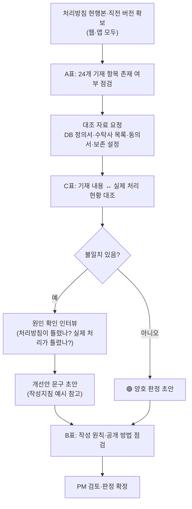

# 1주차-03. 개인정보처리방침 진단

| 구분 | 내용 |
|---|---|
| 고객사 | A사(민간) · 4주차에 B기관(공공)으로 응용 |
| 관련 산출물 | `./2_산출물_양식/02_처리방침_진단표.md` |
| 선행 챕터 | 1주차-02. 자료 요청과 인터뷰, 증적 관리 |
| 예상 학습 시간 | 3.5시간 (읽기 1.5시간 + 실습 2시간) |

---

## 1. 학습 목표

1. 처리방침의 법정 기재사항과 작성지침 기재 항목을 근거 조문과 함께 점검할 수 있다.
2. 처리방침 기재 내용을 실제 처리 현황(DB, 수탁사 목록, 동의서, 보존 설정)과 대조해 불일치를 찾을 수 있다.
3. 불일치 항목에 대해 작성지침에 맞는 개선안 문구를 작성할 수 있다.

---

## 2. 현장 비유와 기초 개념

> 🏗️ **현장 비유**: 처리방침 진단은 **식당 메뉴판과 실제 주방 재료를 대조하는 일**이다. 메뉴판에 쓴 재료가 다 갖춰져 있는지(누락)만이 아니라, 메뉴판에 없는 재료를 몰래 쓰고 있지 않은지(불일치)까지 확인한다.

> 📌 **기초 개념 짚기**
> 개인정보처리자는 처리 목적, 처리·보유 기간, 제3자 제공, 파기, 위탁, 정보주체 권리, CPO 연락처 등을 담은 처리방침을 정해 정보주체가 쉽게 확인할 수 있게 공개해야 한다. 처리 항목, 국외 이전, 안전성 확보조치 등은 시행령이 추가로 정한다. 처리방침과 계약 내용이 다르면 정보주체에게 유리한 것을 적용한다.
> - 근거: 「개인정보 보호법」 제30조[^law30], 시행령 제31조[^dec31]

CPPG 시험에서는 법정 기재사항 목록을 외우면 됐습니다. 현장에서는 **목록이 다 있어도 내용이 실제와 다르면 미흡**입니다. 이 챕터의 핵심은 "기재 여부"가 아니라 **"대조"**입니다.

---

## 3. 근거 법령·기준

| 근거 | 요지 | 쉬운 풀이 (현장에서 확인할 것) | 출처 |
|---|---|---|---|
| 법 제30조제1항 | 처리방침 필수·해당 시 기재사항 (목적, 보유기간, 제3자 제공, 파기, 민감정보 공개 가능성, 위탁, 가명정보, 권리 행사, CPO, 자동수집장치, 그 밖에 대통령령) | 진단표 A의 기본 틀. 공공기관은 **등록 대상 개인정보파일**에 대해 정한다 | [^law30] |
| 영 제31조제1항 | 대통령령 추가 사항: 처리 항목, 국외 이전 근거·사항, 안전성 확보조치, 국외 직접 수집 시 국가명 | "처리 항목"이 법률이 아니라 **시행령**에 있다는 점 주의 | [^dec31] |
| 영 제31조제2항·제3항 | 홈페이지에 **지속적으로 게재**. 홈페이지가 없으면 사업장 게시·관보·간행물·계약서 등 | 앱만 있는 서비스는 앱 화면에서 찾을 수 있는지 확인 | [^dec31] |
| 법 제22조제3항 | 동의 없이 처리하는 개인정보의 항목·법적 근거를 동의받는 개인정보와 **구분하여** 공개하거나 알림. 입증책임은 처리자 | 처리방침 "처리 항목"에 동의 / 동의 없이 처리하는 항목이 구분되어 있는지 | [^law22] |
| 표준지침 제18조 | 법·영의 기재사항을 **명시적으로 구분**하고, 알기 쉬운 용어로 구체적·명확하게. 처리 항목이 목적에 필요한 최소한임을 밝힘 | "등", "기타" 남용 확인 | [^std] |
| 작성지침 Ⅱ-2 | 기재 사항 24개 항목 (일부는 해당시·권장) | 진단표 A의 행 구성 | [^ppg15] |
| 작성지침 Ⅲ-2·3 | 처리 목적·항목은 '~등' 같은 불명확한 표현 금지. 항목은 **실제 처리 현황과 일치**. 동의받는 / 동의 없이 처리하는 개인정보를 구분, 동의 없이 처리 시 **법령명과 조문**까지 기재 | 대조 작업의 근거 | [^ppg21] [^ppg24] |
| 작성지침 Ⅲ-5 | 보유기간은 구체적으로. 관계 법령 보유기간은 **법적 근거와 기간**을 기재 | 근거 법령 조문이 맞는지 원문 확인 | [^ppg31] |
| 작성지침 Ⅲ-9 | 수탁자 명칭을 구체적으로, **'~등'으로 축약 금지**. 재수탁자 포함. 수탁자가 많으면 팝업·목록 파일·링크로 안내 가능. 마이페이지 등에서 정보주체가 자신의 수탁자를 확인할 수 있으면 확인 경로·업무 내용·**수탁자 유형**을 안내할 수 있음 | 2026년 지침의 "조건부 유형화" | [^ppg42] |
| 법 제30조의2 | 보호위원회는 처리방침의 적정성·알기 쉬움·공개 방법을 평가하고 개선을 권고할 수 있음 | 보호위원회 평가 기준 3가지가 그대로 진단 관점이 된다 | [^law302] |
| 법 제75조제4항제8호 | 처리방침을 정하지 않거나 공개하지 않은 자: 1천만 원 이하 과태료 | 고객사에 처분 가능성을 **단정하지 않는다**. 근거 조문만 보고서에 인용 | [^law75] |

> ⚠️ **확인 필요**: 작성지침 p.15 기재 사항 표의 '구분' 열 일부 표시는 PDF에서 이미지로 되어 있어 텍스트로 확인되지 않습니다. 이 레포에서는 텍스트로 확인된 "해당시·권장" 표기와 법령 근거만 씁니다.

---

## 4. 컨설팅 수행 절차



> 불일치를 찾으면 **어느 쪽을 고쳐야 하는지** 먼저 확인합니다. 처리방침이 틀렸으면 처리방침을 고치고, 실제 처리가 근거 없이 이루어지고 있다면 처리방침만 고쳐서는 안 되고 처리 자체를 검토해야 합니다(예: 동의 없이 수집 중인 항목 → 1주차-04).

### 단계별 설명

| 단계 | 하는 일 | 입력 자료 | 결과물 | 소요 (예시) |
|---|---|---|---|---|
| 1. 확보 | 웹·앱 처리방침 현행본과 직전 버전 저장 | 처리방침 URL | PDF 사본 (저장일 기록) | 0.5시간 |
| 2. 항목 점검 | 24개 항목 존재 여부, 법령 근거 대응 | 진단표 A | A표 1차 | 1시간 |
| 3. 대조 | 항목·목적·보유기간·수탁사·제공처·국외 이전을 실제 자료와 비교 | DB 정의서, 수탁사 목록, 동의서, 파기 설정 | C표 | 2~4시간 |
| 4. 원인 확인 | 불일치 원인을 담당자에게 확인 | C표 | 인터뷰 회의록 | 1시간 |
| 5. 개선안 | 작성지침 예시를 참고한 문구 초안 | 작성지침 | 개선 의견 열 | 1~2시간 |

### 자주 나오는 불일치 유형

| 유형 | 예 | 대조 자료 |
|---|---|---|
| 항목 누락 | 가입 화면에서 생년월일을 받는데 처리방침에 없음 | DB 테이블 정의서, 가입 화면 |
| 수탁자 누락·축약 | "배송업체 등"으로 축약, 재수탁자 미기재 | 위수탁 계약서 목록 |
| 국외 이전 누락 | 해외 클라우드·해외 결제 대행사를 쓰는데 기재 없음 | 인프라 구성도, 수탁사 소재지 |
| 보유기간 불일치 | "탈퇴 즉시 파기"라고 썼지만 실제로는 1년 뒤 일괄 삭제 | 파기 배치 설정, 파기 대장 |
| 근거 법령 오류 | 법령명만 쓰고 조문 없음, 해당하지 않는 법령 인용 | 근거 법령 원문 |
| 동의·처리방침 불일치 | 동의서의 목적·보유기간과 처리방침이 다름 | 동의서 양식 |

### Windows 11 실무 도구 팁

| 작업 | 도구·경로 | 방법 |
|---|---|---|
| 웹 처리방침을 날짜와 함께 보존 | Microsoft Edge → `Ctrl + P` → 프린터 `PDF로 저장` → 머리글·바닥글 켜기 | 바닥글에 URL·출력일이 찍혀 증적으로 쓸 수 있다 |
| 현행본과 직전 버전 비교 | Word → 검토 → 비교 → 비교(두 버전 비교) | 변경된 항목이 변경 이력(24번 항목)에 적혀 있는지 확인 |
| DB 컬럼과 처리방침 항목 대조 | Excel `XLOOKUP` | `=XLOOKUP(A2, 처리방침항목!A:A, 처리방침항목!A:A, "처리방침에 없음")` 로 누락 항목 표시 |
| 수탁사 목록 대조 | Excel → 홈 → 조건부 서식 → 셀 강조 규칙 → 중복 값 | 계약서 목록과 처리방침 목록을 한 열에 붙여 넣고, 중복이 아닌(한쪽에만 있는) 업체를 찾는다 |

---

## 5. 업무 분담표

| 단계 | 🙋 신입 담당 | 🧑‍💼 PM·선임 담당 | 🏢 고객사 담당 |
|---|---|---|---|
| 확보·항목 점검 | 현행본 저장, A표 1차 작성 | 진단 기준(작성지침 적용 범위) 확정 | 처리방침 원문·이전 버전 제공 |
| 대조 | 대조 자료 요청, C표 작성 | 대조 결과 해석 | DB 정의서·수탁사 목록·동의서 제공 |
| 원인 확인 | 확인 질문 준비, 회의록 | 인터뷰 진행, "처리 자체의 문제"인지 판단 | 원인 설명 |
| 개선안 | 작성지침 예시 기반 문구 초안 | 문구 확정, 법적 쟁점 검토 | 개정안 검토·법무 검토·게시 |

> 🚫 **신입이 혼자 결정하지 않는 것**: 해당시 항목의 "해당 없음" 최종 판단, 법적 근거의 적정성 판단(예: "이건 계약 이행 근거로 될 것 같다"), 처분 가능성 언급

---

## 6. 고객 커뮤니케이션 예시

### 6-1. 대조 자료 요청 메일

```text
제목: [A사 개인정보보호 컨설팅] 처리방침 대조용 자료 요청 (4건, 2026-03-20까지)

김○○ 과장님, 안녕하세요. ○○컨설팅 홍길동입니다.

처리방침 기재 내용이 실제 처리 현황과 맞는지 확인하기 위해 아래 자료를 요청드립니다.

 1. 회원 DB 테이블 정의서 (컬럼명·컬럼 설명만, 실제 데이터 제외)
 2. 현재 유효한 위수탁 계약 목록 (업체명, 위탁 업무, 소재 국가, 재위탁 여부)
 3. 회원 탈퇴·휴면 처리 시 개인정보 삭제(파기) 배치 설정 화면 캡처
 4. 처리방침 개정 이력 (개정일, 개정 사유)

회신 요청일: 2026-03-20(금)
감사합니다.
```

### 6-2. 결과 설명 멘트 (PM 확정 후, 실무 담당자 대상)

> "처리방침 24개 항목 중 대부분은 잘 갖춰져 있습니다. 다만 실제 처리 현황과 대조해 보니 세 군데 차이가 있었습니다. 첫째, 가입 화면에서 받는 생년월일이 처리 항목에 빠져 있습니다. 둘째, 수탁사가 '배송업체 등'으로 적혀 있는데, 작성지침은 수탁자를 '~등'으로 줄이지 말고 구체적으로 적도록 안내하고 있어서 계약 목록 기준으로 전부 적는 안을 드리겠습니다. 셋째, 해외 클라우드 이용 사실이 국외 이전 항목에 없습니다. 개선 문구 초안은 진단표 개선 의견 열에 넣어 두었습니다."

---

## 7. 처분 사례: 애플, 국외 수탁자 미공개 (2025.1. 의결)

| 구분 | 내용 |
|---|---|
| 사건 개요 | 애플은 결제수단 연동 등 시스템통합 업무(NSF 점수 산출 포함)를 싱가포르 소재 알리페이에 위탁해 카카오페이 이용자의 결제정보 등을 처리하게 하면서, **개인정보 처리방침 등을 통해 처리 위탁과 국외 이전 사실을 고지하지 않았음**. 애플 처리방침에는 국외 수탁자로 NHN KCP만 공개되어 있고 알리페이는 없었음. |
| 위반 내용 | 국외 처리위탁 사실과 국외 수탁자 미공개·미고지, 위탁 사실 미공개 (보도자료 기준) |
| 처분·결과 | 애플: 과징금 24억 500만 원, 과태료 220만 원, 국외 수탁자(알리페이) 사실을 처리방침 등에 공개하도록 시정명령, 공표명령. (같은 사건에서 카카오페이는 동의 없는 국외 이전으로 과징금 59억 6,800만 원) |
| 출처 | 2025.1.23. 보도자료 「개인정보위, 개인정보 무단 국외 이전한 카카오페이·애플에 총 83억 7,520만 원 과징금·과태료 부과」, 2025.1.22. 전체회의 의결[^apple] |

> 같은 유형의 사례로, 테무도 국외 사업자에게 개인정보 처리를 위탁·보관하면서 그 사실을 처리방침에 공개하거나 이용자에게 알리지 않았고, 국내대리인을 지정하지 않아 과징금 13억 6,900만 원과 과태료 1,760만 원을 부과받았습니다(2025.5.14. 의결).[^temu]

**컨설팅 시사점**

- 수탁사 대조는 "처리방침 목록 ↔ 계약서 목록"만으로 끝내지 말고, **각 수탁사가 다시 맡기는 업체(재수탁자)와 소재 국가**까지 물어봅니다.
- 국외 이전 항목은 "해외 업체가 있나요?"보다 "**서버·결제·고객지원·분석 도구** 중 해외에서 운영되는 것이 있나요?"처럼 구체적으로 묻습니다.

---

## 8. 오답노트

| ❌ 신입의 실수 | ✅ 올바른 수행 | 근거 |
|---|---|---|
| 24개 항목의 **기재 여부**만 보고 '양호'로 판정 | 기재 내용을 DB·계약서·동의서·파기 설정과 대조한 뒤 판정 | 작성지침: 항목은 실제 처리 현황과 일치해야 함[^ppg24] |
| 수탁자가 "배송업체 등"으로 적혀 있는데 '양호'로 판정 | '~등' 축약은 개선 대상. 수탁자가 많으면 팝업·목록 파일·링크 방식을 대안으로 제시 | 작성지침 Ⅲ-9[^ppg42] |
| "통신사실확인자료 3개월 보관(통신비밀보호법 제15조의2제2항)"을 모든 고객사 처리방침에 그대로 권고 | 이 보관 의무는 **전기통신사업자**의 협조 의무이고, 구체적 기간은 **같은 법 시행령 제41조제2항**에 있음. 고객사가 해당하는지 확인하고, 해당하면 근거를 시행령 조문까지 적도록 권고 | 통신비밀보호법 제15조의2제2항, 시행령 제41조제2항제2호[^tsp] |
| 해당시 항목(국외 이전, 가명정보 등)을 근거 없이 '해당 없음'으로 판정 | "해당 처리를 하지 않는다"는 사실을 수탁사 소재지·인프라 구성 등으로 확인하고 근거를 적음 | 진단표 작성 방법 |
| 현행본만 보고 직전 버전·변경 이력을 확인하지 않음 | 직전 버전과 비교해 바뀐 내용이 변경 이력에 적혀 있는지 확인 | 작성지침 Ⅲ-24 '처리방침의 변경' |
| 동의 없이 처리하는 항목의 근거를 "관계 법령"으로만 적은 것을 '양호'로 판정 | 법령명과 **조문까지** 구체적으로 적도록 권고 | 작성지침 Ⅲ-3[^ppg24] |

---

## 9. 고객사 점검용 체크리스트

| No | 점검 항목 | 확인 방법 | 요청 증적 | 판정 기준 |
|---|---|---|---|---|
| 1 | 처리방침이 홈페이지와 앱에서 쉽게 확인되도록 지속 게재되어 있다 | 시스템 | 홈페이지 하단·앱 메뉴 캡처 | 🟢 웹·앱 모두 · 🟡 한쪽만 · 🔴 없음 |
| 2 | 처리 항목이 DB·가입 화면의 실제 수집 항목과 일치한다 | 문서·시스템 | DB 테이블 정의서, 가입 화면 | 🟢 일치 · 🟡 일부 누락 · 🔴 다수 불일치 |
| 3 | 동의받는 항목과 동의 없이 처리하는 항목(법적 근거 포함)이 구분되어 있다 | 문서 | 처리방침, 동의서 | 🟢 구분·조문 기재 · 🟡 구분했으나 조문 없음 · 🔴 구분 없음 |
| 4 | 수탁자(재수탁자 포함)가 계약 목록과 일치하고 '~등' 축약이 없다 | 문서 | 위수탁 계약 목록 | 🟢 일치 · 🟡 축약 또는 일부 누락 · 🔴 다수 누락 |
| 5 | 국외 이전(국외 처리위탁·보관 포함)이 있으면 근거와 사항이 기재되어 있다 | 문서·인터뷰 | 인프라 구성도, 수탁사 소재지 | 🟢 기재 · 🔴 미기재 · ⚪ 국외 이전 없음(근거 확인) |
| 6 | 보유기간이 실제 파기 설정과 일치하고, 법령 보존 항목은 근거 조문이 맞다 | 문서·시스템 | 파기 배치 설정, 근거 법령 원문 | 🟢 일치 · 🟡 근거 조문 부정확 · 🔴 불일치 |
| 7 | 처리방침 변경 이력이 관리되고 이전 버전을 확인할 수 있다 | 문서·시스템 | 변경 이력, 이전 버전 링크 | 🟢 이력·이전 버전 있음 · 🟡 이력만 · 🔴 없음 |

---

## 10. 실무 산출물 연계 팁

| 이 챕터의 결과 | 들어가는 산출물 | 위치 |
|---|---|---|
| A표 (24개 항목 판정) | `./2_산출물_양식/02_처리방침_진단표.md` → 진단 보고서 | 3장 '처리방침 진단 결과' 요약표 |
| C표 (불일치 대조) | 진단 보고서 | 3장 '주요 발견 사항' (불일치 1건당 1문단) |
| 개선안 문구 | 개선 권고서 | 부록 '처리방침 개정안 (신구 대비표)' |
| 수탁사·국외 이전 불일치 | 2주차 수탁사 점검 대상 선정 | `./2_산출물_양식/03_수탁사_점검_체크리스트.md` 0단계 |

> 💡 개선안은 **신구 대비표**(현행 문구 | 개정안 | 근거) 형식으로 쓰면 고객사 법무 검토가 빨라집니다.

---

## 11. 실습 과제 / 퀴즈

> 정답과 해설은 [정답과_해설.md](../../정답과_해설.md)의 **「1주차-03. 개인정보처리방침 진단」** 절에 있습니다.

### 객관식

**Q1.** 다음 중 「개인정보 보호법」 제30조제1항이 아니라 **시행령 제31조제1항**에 규정된 처리방침 기재사항은?

① 개인정보의 처리 목적
② 처리하는 개인정보의 항목
③ 개인정보의 파기 절차 및 방법
④ 정보주체와 법정대리인의 권리·의무 및 그 행사방법

**Q2.** A사 처리방침의 위탁 항목에 "배송, 고객상담, 결제 등의 업무를 ○○택배 등에 위탁합니다"라고 적혀 있다. 실제 수탁사는 7곳이다. 2026 작성지침을 기준으로 가장 적절한 개선 권고는?

① 현행 문구가 간결하므로 그대로 둔다.
② 수탁자 명칭을 구체적으로 모두 적고, 수가 많아 본문에 넣기 어려우면 팝업·목록 파일·링크 등으로 확인할 수 있게 안내한다.
③ "업무 위탁 업체"라고만 적는다.
④ 위탁 사실은 처리방침 대신 이용약관에만 적는다.

**Q3.** A사(온라인 쇼핑몰, 전기통신사업자 아님) 처리방침에 다음 문구가 있다. 진단 의견으로 가장 적절한 것은?

> "로그기록자료, 접속지 추적자료: 3개월 (통신비밀보호법 제15조의2제2항)"

① 법령 근거가 있으므로 양호하다.
② 해당 보관 의무는 전기통신사업자에 대한 것이므로 A사에 적용되는지 확인이 필요하고, 적용되더라도 보관기간은 시행령 제41조제2항에 규정되어 있으므로 근거 조문을 정확히 적어야 한다.
③ 3개월이 아니라 1년으로 고쳐야 한다.
④ 통신비밀보호법은 개인정보와 무관하므로 무조건 삭제해야 한다.

### 실습

**상황**: A사 처리방침 일부와 대조 자료가 도착했다. 진단표 A·C를 작성하라.

**제공 자료**

```text
[A사 개인정보 처리방침 (발췌, 2025-01-01 시행)]
2. 처리하는 개인정보 항목
  - 회원가입: 이름, 휴대전화번호, 이메일, 비밀번호 등
5. 보유 기간
  - 회원 정보: 회원 탈퇴 시 즉시 파기
  - 거래 기록: 관계 법령에 따라 보관
9. 위탁
  - ○○택배 등: 상품 배송
  - 고객 상담: B콜센터
10. 국외 이전: 해당 없음
18. 개인정보 보호책임자: 정보보호실장 (전화 02-000-0000)
※ 변경 이력: 없음

[대조 자료]
(1) 회원 DB 테이블 정의서: name, mobile, email, password_hash, birth_date, gender, marketing_agree_yn
(2) 위수탁 계약 목록: ○○택배, △△택배(제주 지역), B콜센터, B콜센터의 야간 상담 재수탁사 C사,
    클라우드 인프라 D사(서버 소재지: 미국)
(3) 파기 배치 설정: 탈퇴 회원 정보는 매월 1일 일괄 삭제
(4) 처리방침 이전 버전(2024-03-01 시행) 존재, 웹사이트에서 확인 불가
```

**과제**

1. `./2_산출물_양식/02_처리방침_진단표.md`의 A표에서 3·5·9·10·24번 항목의 판정과 판정 근거를 쓰시오. (발췌문의 번호와 A표 번호가 다르다는 점에 주의)
2. C표(불일치 대조표)를 4행 이상 작성하시오.
3. 9번(위탁)과 10번(국외 이전) 항목의 개선안 문구를 작성지침 예시 형식으로 쓰시오.

**작성 양식**: `./2_산출물_양식/02_처리방침_진단표.md`

---

## 12. 더 읽을거리

| 자료 | 참고자료 파일명 | 읽을 부분 |
|---|---|---|
| 개인정보 처리방침 작성지침 | [`2026 개인정보 처리방침 작성지침.pdf`](<../../3_참고자료/2026 개인정보 처리방침 작성지침.pdf>) | p.12~17 'Ⅱ. 작성 기본사항', p.20~45 'Ⅲ. 작성 방법' 1~10번, p.147 '부록3 공공기관 처리방침 작성 방안' (4주차 대비) |
| 표준 개인정보 보호지침 | [`표준 개인정보 보호지침(개인정보보호위원회고시)(제2025-4호)(20250411).pdf`](<../../3_참고자료/표준 개인정보 보호지침(개인정보보호위원회고시)(제2025-4호)(20250411).pdf>) | 제18조~제22조 |
| 카카오페이·애플 처분 보도자료 | [`250123 (석간) 개인정보위, 개인정보 무단 국외 이전한 카카오페이·애플에 총 83억 7,520만 원 과징금·과태료 부과(조사3팀).pdf`](<../../3_참고자료/250123 (석간) 개인정보위, 개인정보 무단 국외 이전한 카카오페이·애플에 총 83억 7,520만 원 과징금·과태료 부과(조사3팀).pdf>) | 전문 |
| 테무 처분 보도자료 | [`250515 (석간) 국외이전 규정 등 개인정보 보호법 위반한 테무에 13억 6,900만 원 과징금 부과(조사1과).pdf`](<../../3_참고자료/250515 (석간) 국외이전 규정 등 개인정보 보호법 위반한 테무에 13억 6,900만 원 과징금 부과(조사1과).pdf>) | 조사 결과 ① |
| 개인정보 질의응답 모음집 | [`1. 개인정보 질의응답 모음집(2025.12.).pdf`](<../../3_참고자료/1. 개인정보 질의응답 모음집(2025.12.).pdf>) | Q85 (위탁 공개와 처리방침) |

---

## 각주

[^law30]: [출처: [개인정보 보호법(법률)(제21445호)(20260911).pdf](<../../3_참고자료/개인정보 보호법(법률)(제21445호)(20260911).pdf>), 제30조]
[^dec31]: [출처: [개인정보 보호법 시행령(대통령령)(제36804호)(20261110).pdf](<../../3_참고자료/개인정보 보호법 시행령(대통령령)(제36804호)(20261110).pdf>), 제31조제1항~제3항]
[^law22]: [출처: [개인정보 보호법(법률)(제21445호)(20260911).pdf](<../../3_참고자료/개인정보 보호법(법률)(제21445호)(20260911).pdf>), 제22조제3항]
[^std]: [출처: [표준 개인정보 보호지침(개인정보보호위원회고시)(제2025-4호)(20250411).pdf](<../../3_참고자료/표준 개인정보 보호지침(개인정보보호위원회고시)(제2025-4호)(20250411).pdf>), 제18조]
[^ppg15]: [출처: [2026 개인정보 처리방침 작성지침.pdf](<../../3_참고자료/2026 개인정보 처리방침 작성지침.pdf>), p.14~15 'Ⅱ-2. 기재 사항']
[^ppg21]: [출처: [2026 개인정보 처리방침 작성지침.pdf](<../../3_참고자료/2026 개인정보 처리방침 작성지침.pdf>), p.21 'Ⅲ-2. 개인정보의 처리 목적']
[^ppg24]: [출처: [2026 개인정보 처리방침 작성지침.pdf](<../../3_참고자료/2026 개인정보 처리방침 작성지침.pdf>), p.24~25 'Ⅲ-3. 처리하는 개인정보의 항목']
[^ppg31]: [출처: [2026 개인정보 처리방침 작성지침.pdf](<../../3_참고자료/2026 개인정보 처리방침 작성지침.pdf>), p.31~32 'Ⅲ-5. 개인정보의 처리 및 보유 기간']
[^ppg42]: [출처: [2026 개인정보 처리방침 작성지침.pdf](<../../3_참고자료/2026 개인정보 처리방침 작성지침.pdf>), p.42~44 'Ⅲ-9. 개인정보 처리업무의 위탁에 관한 사항']
[^law302]: [출처: [개인정보 보호법(법률)(제21445호)(20260911).pdf](<../../3_참고자료/개인정보 보호법(법률)(제21445호)(20260911).pdf>), 제30조의2]
[^law75]: [출처: [개인정보 보호법(법률)(제21445호)(20260911).pdf](<../../3_참고자료/개인정보 보호법(법률)(제21445호)(20260911).pdf>), 제75조제4항제8호]
[^tsp]: [출처: [통신비밀보호법(법률)(제21989호)(20261002).pdf](<../../3_참고자료/통신비밀보호법(법률)(제21989호)(20261002).pdf>), 제15조의2제2항 및 [통신비밀보호법 시행령(대통령령)(제36728호)(20261002).pdf](<../../3_참고자료/통신비밀보호법 시행령(대통령령)(제36728호)(20261002).pdf>), 제41조제2항제2호]
[^apple]: [출처: [250123 (석간) 개인정보위, 개인정보 무단 국외 이전한 카카오페이·애플에 총 83억 7,520만 원 과징금·과태료 부과(조사3팀).pdf](<../../3_참고자료/250123 (석간) 개인정보위, 개인정보 무단 국외 이전한 카카오페이·애플에 총 83억 7,520만 원 과징금·과태료 부과(조사3팀).pdf>), p.2~3, 2025.1.22. 의결]
[^temu]: [출처: [250515 (석간) 국외이전 규정 등 개인정보 보호법 위반한 테무에 13억 6,900만 원 과징금 부과(조사1과).pdf](<../../3_참고자료/250515 (석간) 국외이전 규정 등 개인정보 보호법 위반한 테무에 13억 6,900만 원 과징금 부과(조사1과).pdf>), p.2~4, 2025.5.14. 의결]
