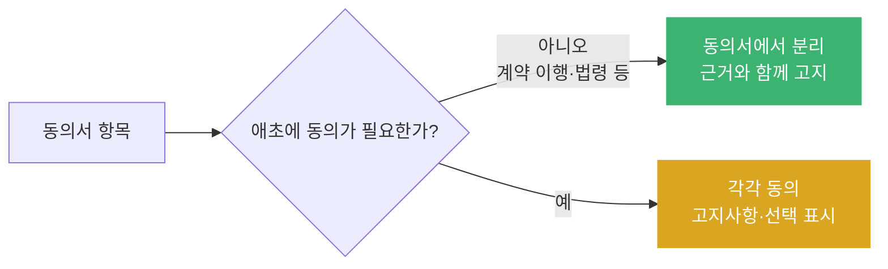
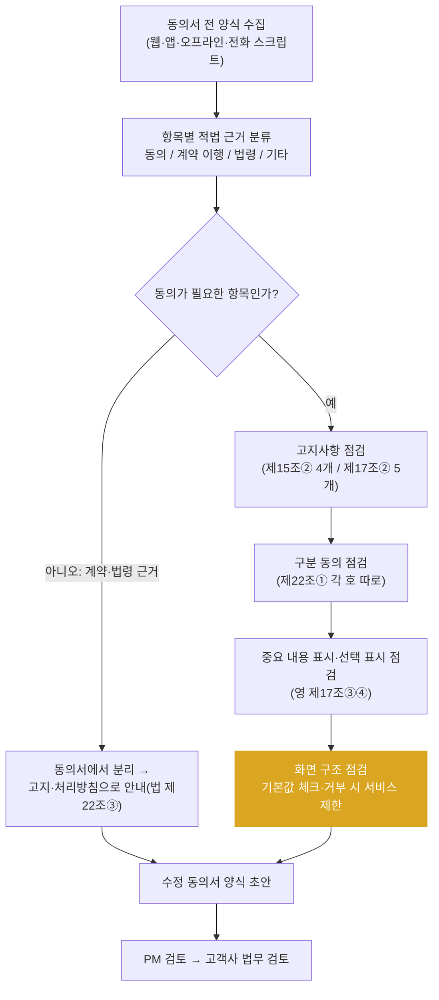
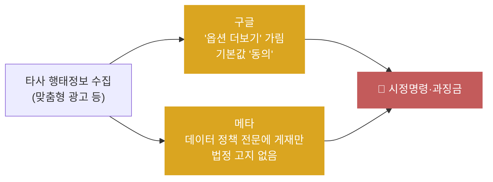

# 1주차-04. 동의서 양식 진단

| 구분 | 내용 |
|---|---|
| 고객사 | A사(민간) |
| 관련 산출물 | `./2_산출물_양식/02_처리방침_진단표.md` (B7·C표와 연계), 동의서 진단 결과표(이 챕터 9절 체크리스트) |
| 선행 챕터 | 1주차-03. 개인정보처리방침 진단 |
| 예상 학습 시간 | 3.5시간 (읽기 1.5시간 + 실습 2시간) |

> [!IMPORTANT]
> **🎯 이 챕터 핵심 3줄**
> 1. 동의서 진단의 첫 질문은 "필수/선택이 나뉘어 있나?"가 아니라 "이 항목은 애초에 동의가 필요한가?"다(2023년 법 개정).
> 2. 동의가 필요한 항목은 고지사항(제15조② 4개 / 제17조② 5개), 각각 동의, 중요 내용 표시, 선택 표시를 점검한다.
> 3. 동의 화면은 문서가 아니라 실제 화면으로 점검한다. 기본값 체크와 미동의 시 서비스 거부를 직접 테스트한다(구글·메타 사례).

---

## 1. 학습 목표

1. 동의서의 각 처리 항목을 적법 근거(동의 / 계약 이행 / 법령 등)별로 분류할 수 있다.
2. 동의서의 법정 고지사항, 구분 동의, 중요 내용 표시, 거부 시 불이익 고지를 점검할 수 있다.
3. 진단 결과를 반영한 수정 동의서 양식(초안)을 작성할 수 있다.

---

## 2. 현장 비유와 기초 개념

> [!TIP]
> 🏗️ 💡 현장 비유: 동의서 진단은 **계약서의 "동의함" 칸이 정말 필요한 칸인지 하나씩 지워 보는 일**이다. 동의가 필요 없는 것까지 동의받으면 정보주체를 헷갈리게 하고, 동의가 꼭 필요한 것을 다른 것과 뭉쳐 받으면 그 동의는 흠이 생긴다.

> [!NOTE]
> 📌 **기초 개념 짚기**
>
> 개인정보는 동의 외에도 법률 규정, 공공기관 소관 업무, 계약 이행, 급박한 이익, 정당한 이익 등 근거로 수집·이용할 수 있다. 동의를 받을 때는 목적·항목·보유기간·거부권과 불이익을 알리고, 동의 사항을 구분해 받아야 하며, 수집·이용·제3자 제공·민감정보·고유식별정보·홍보 등은 **각각 따로** 동의받아야 한다.
> - 근거: 「개인정보 보호법」 제15조제1항·제2항, 제22조제1항[^law15] [^law22]

> [!IMPORTANT]
> 🕒 CPPG 공부 때 "필수 동의 / 선택 동의"로 외운 구조는 **2023년 법 개정 이후 그대로 쓰면 틀릴 수 있습니다.** 2023년 개정으로 온라인 서비스의 필수 동의 특례(구 제39조의3)가 삭제되고, 계약 이행에 필요한 경우 '불가피하게'라는 요건 없이 수집·이용할 수 있게 되었습니다.[^integ114] 그래서 지금 동의서 진단의 첫 질문은 "필수/선택이 나뉘어 있나?"가 아니라 "이 항목은 애초에 동의가 필요한가?"입니다.



> ✅ **2절 한 줄 정리**: 동의는 여러 수집 근거 중 하나일 뿐이므로, 항목마다 동의가 필요한지부터 묻고, 필요한 동의는 구분해 각각 받는다.

---

## 3. 근거 법령·기준

| 근거 | 키워드 | 출처 |
|---|---|---|
| ① 법 제15조제1항 | 수집·이용 근거 7가지 | [^law15] |
| ② 법 제15조제2항 | 동의 시 고지 4개 | [^law15] |
| ③ 법 제17조제2항 | 제3자 제공 동의 시 고지 5개 | [^law17] |
| ④ 법 제22조제1항 | 구분·각각 동의 | [^law22] |
| ⑤ 법 제22조제2항 · 영 제17조제3항 | 중요한 내용 표시 | [^law22] [^dec17] |
| ⑥ 법 제22조제3항 | 동의 없이 처리 항목 구분 공개 | [^law22] |
| ⑦ 법 제22조제5항 | 미동의 이유 서비스 거부 금지 | [^law22] |
| ⑧ 영 제17조제1항 | 동의 요건 4가지 | [^dec17] |
| ⑨ 영 제17조제4항 | 선택 가능 사실 표시 | [^dec17] |
| ⑩ 「개인정보 처리 방법에 관한 고시」 제4조 | 중요한 내용 명확히 표시 | [^integ116] |
| ⑪ 통합 안내서 Ⅳ-3 | 기본값 체크 금지 | [^integ120] |
| ⑫ 통합 안내서 Ⅳ-3 | 필요한 정보는 다른 근거로 | [^integ119] |
| ⑬ 법 제75조 | 과태료 | [^law75] |

**🔎 번호별 보충 설명** (요지 / 쉬운 풀이: 현장에서 확인할 것)

- ① 요지: 수집·이용 근거 7가지 (동의, 법률·법령상 의무, 공공기관 소관 업무, 계약 체결·이행, 급박한 이익, 정당한 이익, 공중위생 등 긴급)
  - 풀이: 동의서의 항목마다 **어느 호에 해당하는지** 분류한다
- ② 요지: 동의 시 고지 4개: ① 목적 ② 항목 ③ 보유·이용 기간 ④ 거부권과 거부 시 불이익
  - 풀이: 4개 중 하나라도 빠지면 미흡
- ③ 요지: 제3자 제공 동의 시 고지 5개: ① 제공받는 자 ② 제공받는 자의 이용 목적 ③ 항목 ④ 제공받는 자의 보유·이용 기간 ⑤ 거부권과 불이익
  - 풀이: "제휴사 등"처럼 제공받는 자를 흐리면 미흡
- ④ 요지: 동의 사항을 구분해 명확히 알리고, 제15조①1·제17조①1·제18조②1·제19조1·제23조①1·제24조①1·홍보·판매 권유 동의는 **각각** 받음
  - 풀이: 마케팅 동의를 회원가입 동의에 섞으면 미흡
- ⑤ 요지: 서면(전자문서 포함) 동의 시 **중요한 내용**(홍보 연락 사실, 민감정보·여권번호 등, 보유기간, 제공받는 자와 그 목적)을 명확히 표시
  - 풀이: 글씨 크기·색·굵기·밑줄 등으로 눈에 띄게 했는지
- ⑥ 요지: 동의 없이 처리하는 항목·법적 근거를 동의받는 항목과 **구분하여** 공개하거나 알림. 입증책임은 처리자
  - 풀이: 계약 이행 근거로 처리하는 항목은 동의서가 아니라 고지로 안내
- ⑦ 요지: 선택 동의를 하지 않거나, 목적 외 이용·제공 동의, 홍보·판매 권유 동의를 하지 않는다는 이유로 재화·서비스 제공을 거부할 수 없음
  - 풀이: 선택 항목 미동의 시 가입 버튼이 비활성화되면 미흡
- ⑧ 요지: 동의 요건 4가지: ① 자유로운 의사 ② 구체적·명확한 내용 ③ 쉽게 읽고 이해할 수 있는 문구 ④ 동의 여부를 명확히 표시할 수 있는 방법 제공
  - 풀이: 문구 난이도, 동의 버튼 구조까지 본다
- ⑨ 요지: 각각 동의를 받을 때 정보주체가 **동의 여부를 선택할 수 있다는 사실**을 명확히 표시
  - 풀이: "선택" 표시가 있는지
- ⑩ 요지: 중요한 내용은 글씨 크기·색깔·굵기·밑줄 등으로 명확히 표시하고, 동의 사항이 많으면 별도로 구분해 표시
  - 풀이: 통합 안내서에 인용된 고시 내용
- ⑪ 요지: "동의함" 체크박스를 **기본값으로 설정하지 않아야** 함. 전화 통화에 응했다는 사실만으로 동의로 간주하면 안 됨
  - 풀이: 웹 화면을 직접 열어 기본값을 확인한다
- ⑫ 요지: 서비스 제공에 **필요한** 개인정보는 동의가 아닌 제15조①4 등 다른 근거로 처리하고 고지하는 것이 바람직. 필요하지 않은 처리의 동의를 서비스 조건으로 삼으면 자유로운 의사 원칙에 반할 수 있음
  - 풀이: "필수 동의"로 묶인 항목을 다시 분류
- ⑬ 요지: 제22조제1항~제3항 위반 동의: 1천만 원 이하 과태료(④3). 제22조제5항 위반 서비스 거부: 3천만 원 이하 과태료(②1)
  - 풀이: 처분 가능성은 고객사에 단정하지 않는다

> [!WARNING]
> 주민등록번호는 정보주체의 **동의로 처리할 수 없습니다.** 법률·대통령령 등에서 구체적으로 요구·허용하는 경우 등 법이 정한 경우에만 처리할 수 있으므로, 동의서에 주민등록번호 수집 동의가 있으면 그 자체가 진단 대상입니다.[^ppg25]

> ✅ **3절 한 줄 정리**: 제15조·제17조는 근거와 고지사항을, 제22조와 영 제17조는 구분·표시·선택권을, 통합 안내서는 기본값 금지와 다른 근거 활용을 정한다.

---

## 4. 컨설팅 수행 절차



### 단계별 설명

| 단계 | 결과물 | 소요 (예시) |
|---|---|---|
| 1. 수집 | 동의서 목록 | 0.5일 |
| 2. 근거 분류 | 근거 분류표 | 0.5일 |
| 3. 고지·구분 점검 | 동의서 진단 결과표 | 0.5일 |
| 4. 화면 점검 | 화면 캡처 증적 | 2시간 |
| 5. 수정안 | 수정 양식 초안 | 1일 |

**🔎 번호별 보충 설명** (하는 일 / 입력 자료)

- 1. 수집
  - 하는 일: 채널별 동의서 전부 확보 (웹·앱 화면 캡처, 종이 서식, 콜센터 스크립트)
  - 입력 자료: 자료 요청 목록 CNS 항목
- 2. 근거 분류
  - 하는 일: 항목별로 동의 / 제15조①4 / 법령 / 기타로 분류
  - 입력 자료: 동의서, 서비스 기능 설명
- 3. 고지·구분 점검
  - 하는 일: 4개·5개 고지사항, 각각 동의, 중요 내용 표시
  - 입력 자료: 근거 분류표
- 4. 화면 점검
  - 하는 일: 기본값 체크, 미동의 시 진행 가능 여부를 직접 테스트
  - 입력 자료: 테스트 계정
- 5. 수정안
  - 하는 일: 수정 동의서·고지 문구 초안
  - 입력 자료: 진단 결과

### 항목별 적법 근거 분류 예시 (A사 쇼핑몰)

| 항목·처리 | 기존 동의서 | 다시 본 적법 근거 |
|---|---|---|
| ① 회원 식별·로그인용 ID, 비밀번호 | 필수 동의 | 🟢 법 제15조①4 검토 |
| ② 배송지 이름·주소·연락처 | 필수 동의 | 🟢 법 제15조①4 검토 |
| ③ 생일 쿠폰용 생년월일 | 필수 동의 | 🟡 동의(선택) |
| ④ 마케팅 문자 수신 | 필수 동의에 포함 | 🟡 각각 동의(법 제22조①7) |
| ⑤ 제휴 카드사 제공 | "제휴사 등"에 제공 동의 | 🟡 각각 동의(법 제22조①2) |

**🔎 번호별 보충 설명** (다시 본 적법 근거 / 처리 방향)

- ① 근거: 서비스 이용 계약 이행에 필요 → 법 제15조①4 검토
  - 처리 방향: 동의서에서 빼고 고지·처리방침에 근거와 함께 안내
- ② 근거: 주문 계약 이행에 필요 → 법 제15조①4 검토
  - 처리 방향: 위와 같음
- ③ 근거: 서비스 제공에 필요하지 않은 부가 혜택 → **동의**(선택)
  - 처리 방향: 선택 동의로 분리, 미동의해도 가입 가능
- ④ 근거: 홍보·판매 권유 → **각각 동의**(법 제22조①7)
  - 처리 방향: 별도 선택 동의로 분리
- ⑤ 근거: 제3자 제공 → **각각 동의**(법 제22조①2), 제공받는 자 특정
  - 처리 방향: 제공받는 자·목적·항목·기간 명시한 별도 동의

> [!TIP]
> "계약 이행에 필요한지"의 최종 판단은 서비스 구조에 따라 달라집니다. 신입은 분류 **초안**과 판단 근거를 쓰고, 판단은 PM이 확정합니다.

### Windows 11 실무 도구 팁

<details>
<summary>🛠️ Windows 11 실무 도구 팁 4가지 펼치기</summary>

| 작업 | 도구 |
|---|---|
| ① 동의 화면 전체를 한 장으로 캡처 | Microsoft Edge |
| ② 화면 순서를 기록 | 캡처 도구 |
| ③ 테스트 과정 녹화 | 캡처 도구 |
| ④ 동의 문구 글자 크기 비교 | 브라우저 개발자 도구 |

**🔎 번호별 보충 설명** (도구·경로 / 방법)

- ① 경로: Microsoft Edge → `Ctrl + Shift + S` (웹 캡처) → 전체 페이지 캡처
  - 방법: 스크롤이 긴 동의 화면도 한 장으로 남긴다
- ② 경로: `Win + Shift + S` (캡처 도구) → 지연 캡처
  - 방법: 체크 해제 → 다음 버튼 클릭 결과까지 순서대로 캡처
- ③ 경로: 캡처 도구 → 녹화(비디오 아이콘)
  - 방법: "선택 동의 해제 시 가입 불가" 같은 동작을 영상 증적으로
- ④ 경로: 브라우저 `F12` 개발자 도구 → 요소 선택 → Computed `font-size`
  - 방법: 중요 내용이 실제로 더 크거나 굵게 표시되는지 수치로 확인

</details>

> ✅ **4절 한 줄 정리**: 채널별 동의서를 모아 항목별 근거를 분류하고, 동의가 필요한 항목만 고지·구분·표시·화면 구조를 점검해 수정 양식을 만든다.

---

## 5. 업무 분담표

| 단계 | 🙋 신입 담당 | 🧑‍💼 PM·선임 담당 |
|---|---|---|
| 수집 | 동의서 요청·캡처, 목록 작성 | 진단 대상 채널 확정 |
| 근거 분류 | 분류 초안과 판단 근거 | 적법 근거 판단 확정 |
| 고지·화면 점검 | 체크리스트 점검, 화면 테스트 | 판정 확정 |
| 수정안 | 수정 동의서·고지 문구 초안 | 문구 확정 |

**🔎 번호별 보충 설명** (단계별 전체 업무와 🏢 고객사 담당)

- 수집
  - 🙋 신입: 채널별 동의서 요청·캡처, 동의서 목록 작성
  - 🧑‍💼 PM·선임: 진단 대상 채널 확정
  - 🏢 고객사: 양식·스크립트 제공, 테스트 계정 발급
- 근거 분류
  - 🙋 신입: 항목별 분류 초안과 판단 근거
  - 🧑‍💼 PM·선임: **적법 근거 판단 확정**
  - 🏢 고객사: 서비스 기능·업무 설명
- 고지·화면 점검
  - 🙋 신입: 체크리스트 점검, 화면 테스트·캡처
  - 🧑‍💼 PM·선임: 판정 확정
  - 🏢 고객사: —
- 수정안
  - 🙋 신입: 수정 동의서·고지 문구 초안
  - 🧑‍💼 PM·선임: 문구 확정
  - 🏢 고객사: 법무 검토, 화면 개발·반영

> [!WARNING]
> 🚫 **신입이 혼자 결정하지 않는 것**:
> - "이 항목은 동의 없이 처리해도 됩니다" 같은 적법 근거 판단
> - 정당한 이익(제15조①6) 적용 여부
> - 고객사에 처분 가능성 언급

> ✅ **5절 한 줄 정리**: 신입은 수집·분류 초안·화면 테스트·문구 초안을 맡고, 적법 근거와 판정·문구 확정은 PM·선임이 맡는다.

---

## 6. 고객 커뮤니케이션 예시

### 6-1. 담당자 인터뷰 질문 리스트 (서비스 기획·마케팅 담당)

| No | 확인 주제 | 답변 후 요청할 증적 |
|---|---|---|
| 1 | 서비스 제공에 꼭 필요한 항목 | 서비스 기능 정의서 |
| 2 | 생년월일·성별 사용처 | 사용 화면, 쿼리·배치 설명 |
| 3 | 마케팅 미동의 회원 발송 차단 | 발송 대상 추출 조건 |
| 4 | 제휴사 제공 항목 | 제휴 계약서, 제공 대장 |
| 5 | 콜센터 전화 동의 | 상담 스크립트, 녹취 보관 정책 |

**🔎 번호별 보충 설명** (질문 / 질문 의도)

- 1
  - 질문: 가입 때 받는 항목 중, 없으면 서비스 자체를 제공할 수 없는 항목은 어떤 것인가요?
  - 의도: 계약 이행 필요 항목과 부가 항목 구분
- 2
  - 질문: 생년월일·성별은 어디에 쓰이나요?
  - 의도: 실제 이용 목적 확인 (동의서 목적과 비교)
- 3
  - 질문: 마케팅 수신 동의를 안 한 회원에게 문자가 나가지 않게 하는 장치가 있나요?
  - 의도: 동의 여부가 실제 처리에 반영되는지
- 4
  - 질문: 제휴사로 넘어가는 정보는 어느 회사에, 어떤 항목인가요?
  - 의도: 제공받는 자 특정
- 5
  - 질문: 콜센터에서 전화로 동의를 받는 경우가 있나요? 어떻게 기록하나요?
  - 의도: 영 제17조②2·3 방법과 기록

### 6-2. 결과 설명 멘트 (PM 확정 후, 실무 담당자 대상)

> "가입 동의서에 '필수 동의'로 묶인 항목이 9개인데, 그중 ID·비밀번호·배송지처럼 서비스 이용 계약을 이행하는 데 필요한 항목은 2023년 법 개정 이후 동의가 아니라 계약 이행 근거로 처리하고 안내하는 방식을 검토하실 수 있습니다.
>
> 반대로 마케팅 문자 수신은 법에서 다른 동의와 **따로** 받도록 정하고 있어서, 지금처럼 필수 동의 안에 들어 있으면 분리가 필요합니다.
>
> 또 '동의함'이 처음부터 체크되어 있는 부분은 통합 안내서가 기본값으로 두지 말라고 안내하는 부분이라 함께 수정안을 드리겠습니다."

> ✅ **6절 한 줄 정리**: 인터뷰로 항목별 실제 용도와 동의 반영 장치를 확인하고, 결과는 "다른 근거 검토 / 분리 / 기본값 수정"으로 나눠 설명한다.

---

## 7. 처분 사례: 구글·메타, 동의 없는 타사 행태정보 수집 (2022.9. 의결)

| 구분 | 내용 |
|---|---|
| 사건 | 타사 행태정보 수집, 명확한 고지·사전 동의 없음 |
| 위반 내용 | 개인정보 수집·이용 동의 위반 (보도자료 기준) |
| 처분 | 시정명령, 과징금 구글 692억 원·메타 308억 원 |
| 출처 | 2022.9.14. 보도자료, 2022.9.14. 제15회 전체회의 의결[^gm] |



<details>
<summary>📄 사건 상세 (사건 개요·위반 내용·처분·출처 원문 펼치기)</summary>

- 사건 개요: 구글과 메타가 이용자의 **타사 행태정보**(다른 웹사이트·앱 방문·사용 이력)를 수집해 맞춤형 광고 등에 쓰면서, 그 사실을 명확히 알리지 않고 사전 동의도 받지 않음. 구글은 가입 시 설정 화면('옵션 더보기')을 가려 두고 기본값을 '동의'로 설정했고, 메타는 동의받을 내용을 알아보기 어려운 형태로 데이터 정책 전문에 게재만 하고 법정 고지사항을 구체적으로 알려 동의받지 않음.
- 위반 내용: 개인정보 수집·이용 동의 위반 (보도자료 기준)
- 처분·결과: 시정명령, 과징금 구글 692억 원·메타 308억 원
- 출처: 2022.9.14. 보도자료 「개인정보위, 구글과 메타의 개인정보 불법 수집 제재」, 2022.9.14. 제15회 전체회의 의결[^gm]

</details>

> [!NOTE]
> 함께 볼 사례: 메타는 프로필로 국내 이용자 약 98만 명의 종교관·정치관 등 **민감정보**를 수집해 광고에 쓰면서, 데이터 정책에 불분명하게 적기만 하고 별도 동의를 받지 않아 법 제23조제1항 위반 등으로 과징금 216억 1,300만 원을 부과받았습니다(2024.11.4. 의결).[^meta]

### 컨설팅 시사점

🔴 **숨겨진 설정 화면, '동의' 기본값, 정책 문서 게재만으로는 동의가 성립하지 않는다.**

- [ ] **① 실제 화면 점검**: 동의 화면은 문서가 아니라 실제 화면으로 점검합니다. 설정 화면이 숨겨져 있거나 기본값이 '동의'인지는 직접 가입해 봐야 보입니다.
- [ ] **② 공개와 동의 구분**: "처리방침(데이터 정책)에 써 두었다"는 동의를 대신하지 못합니다. 처리방침은 공개이고, 동의는 법정 고지 + 정보주체의 명확한 의사 표시입니다.
- [ ] **③ 현행 조문으로 인용**: 위 구글·메타 처분은 2023년 법 개정 **이전** 사건입니다. 현행 법령 조문은 개정된 제15조·제22조로 다시 확인해 인용합니다.

> ✅ **7절 한 줄 정리**: 구글은 기본값 '동의', 메타는 정책 게재만으로 처리해 제재받았으니, 실제 화면으로 점검하고 공개와 동의를 구분한다.

---

## 8. 오답노트

| No | 상황 | ✅ 핵심 |
|---|---|---|
| ① | 필수/선택 구분만 확인 | 동의가 맞는 근거인지 분류 |
| ② | 마케팅 동의 섞임 | 각각 따로 분리 |
| ③ | "제휴사 등" | 제공받는 자 불특정 = 미흡 |
| ④ | PDF만 확인 | 테스트 계정으로 화면 확인 |
| ⑤ | 거부권 고지 누락 | 고지사항 하나씩 대조 |
| ⑥ | 주민등록번호 "동의" | 처리 근거 법령 확인, PM 보고 |

**🔎 번호별 보충 설명** (❌ 신입의 실수 / ✅ 올바른 수행 / 근거)

- ①
  - ❌ "필수/선택이 나뉘어 있으니 양호"로 판정
  - ✅ 필수로 묶인 항목마다 **동의가 맞는 근거인지**부터 분류하고, 계약 이행에 필요한 항목은 동의 대신 근거 고지로 안내하는 방안을 PM과 검토
  - 근거: 통합 안내서 Ⅳ-3[^integ119], 법 제22조제3항
- ②
  - ❌ 마케팅 수신 동의가 "서비스 이용 동의"에 포함된 것을 놓침
  - ✅ 홍보·판매 권유 동의는 **각각 따로** 받아야 하므로 분리
  - 근거: 법 제22조제1항제7호[^law22]
- ③
  - ❌ 제3자 제공 동의에 "제휴사 등"으로 적힌 것을 '부분 이행'으로 가볍게 판정
  - ✅ 제공받는 자는 법정 고지사항이므로 특정되지 않으면 미흡으로 초안 판정
  - 근거: 법 제17조제2항제1호[^law17]
- ④
  - ❌ 동의서 문서(PDF)만 보고 화면 기본값을 확인하지 않음
  - ✅ 테스트 계정으로 직접 가입하며 체크박스 기본값, 미동의 시 진행 가능 여부를 캡처
  - 근거: 통합 안내서 Ⅳ-3 (기본값 금지)[^integ120]
- ⑤
  - ❌ 거부권 고지 문구가 없는데 놓침
  - ✅ 제15조② 4개, 제17조② 5개 고지사항을 체크리스트로 하나씩 대조
  - 근거: 법 제15조제2항제4호, 제17조제2항제5호
- ⑥
  - ❌ 주민등록번호 수집 "동의" 항목을 고지사항만 보고 판정
  - ✅ 주민등록번호는 동의로 처리할 수 없으므로 처리 근거 법령 자체를 확인하도록 PM에 보고
  - 근거: 법 제24조의2[^ppg25]

> ✅ **8절 한 줄 정리**: 근거 분류부터 하고, 각각 동의·제공받는 자 특정·고지사항을 하나씩 대조하며, 화면은 직접 테스트하고, 주민등록번호는 동의로 처리할 수 없다.

---

## 9. 고객사 점검용 체크리스트: 동의서 진단 결과표

각 항목: **점검 항목** → 확인 방법 / 요청 증적 → 판정 기준

### ① 근거 분류·고지사항 (No 1~3)

- [ ] **No 1. 적법 근거 분류**: 동의서의 각 항목이 적법 근거별로 분류되어, 동의가 필요하지 않은 항목은 동의서와 구분해 안내된다
  - 확인 방법: 문서 / 요청 증적: 동의서, 처리방침
  - 판정 기준: 🟢 구분 · 🟡 일부 혼재 · 🔴 모두 동의로 묶음
- [ ] **No 2. 수집·이용 고지 4개**: 수집·이용 동의에 목적·항목·보유기간·거부권과 불이익이 모두 있다
  - 확인 방법: 문서 / 요청 증적: 동의서
  - 판정 기준: 🟢 4개 모두 · 🟡 1개 누락 · 🔴 2개 이상 누락
- [ ] **No 3. 제3자 제공 고지 5개**: 제3자 제공 동의에 제공받는 자·목적·항목·보유기간·거부권과 불이익이 모두 있다
  - 확인 방법: 문서 / 요청 증적: 제공 동의서
  - 판정 기준: 🟢 5개 모두 · 🔴 누락 또는 제공받는 자 불특정 · ⚪ 제공 없음

### ② 구분·표시 (No 4~6)

- [ ] **No 4. 각각 동의**: 제22조제1항 각 호의 동의(제공, 민감정보, 고유식별정보, 홍보 등)를 각각 따로 받는다
  - 확인 방법: 문서·시스템 / 요청 증적: 동의 화면 캡처
  - 판정 기준: 🟢 각각 · 🔴 묶음
- [ ] **No 5. 중요 내용 표시**: 중요한 내용(홍보 연락, 민감정보·여권번호 등, 보유기간, 제공받는 자와 목적)이 눈에 띄게 표시된다
  - 확인 방법: 시스템 / 요청 증적: 화면 캡처, 글자 크기 확인
  - 판정 기준: 🟢 구분 표시 · 🟡 일부만 · 🔴 구분 없음
- [ ] **No 6. 선택 표시**: 선택 동의에 "선택"임이 명확히 표시된다
  - 확인 방법: 시스템 / 요청 증적: 화면 캡처
  - 판정 기준: 🟢 표시 · 🔴 없음

### ③ 화면 동작·채널·일치 (No 7~10)

- [ ] **No 7. 기본값**: "동의함" 체크박스가 기본값으로 체크되어 있지 않다
  - 확인 방법: 시스템 / 요청 증적: 화면 캡처·녹화
  - 판정 기준: 🟢 미체크 기본값 · 🔴 기본 체크
- [ ] **No 8. 미동의 시 진행**: 선택 동의·홍보 동의를 하지 않아도 가입·구매가 가능하다
  - 확인 방법: 시스템 / 요청 증적: 테스트 녹화
  - 판정 기준: 🟢 가능 · 🔴 진행 불가
- [ ] **No 9. 전화 동의**: 전화로 동의받는 경우 영 제17조제2항의 방법과 기록이 있다
  - 확인 방법: 문서·인터뷰 / 요청 증적: 스크립트, 녹취 보관 기준
  - 판정 기준: 🟢 있음 · 🔴 없음 · ⚪ 전화 동의 없음
- [ ] **No 10. 처리방침 일치**: 동의서의 목적·보유기간이 처리방침과 일치한다
  - 확인 방법: 문서 / 요청 증적: 동의서, 처리방침
  - 판정 기준: 🟢 일치 · 🟡 일부 불일치 · 🔴 다수 불일치

> ✅ **9절 한 줄 정리**: 근거 분류·고지사항 → 구분·표시 → 화면 동작·채널·일치 순서로 10개 항목을 점검한다.

---

## 10. 실무 산출물 연계 팁

| 이 챕터의 결과 | 들어가는 산출물 | 위치 |
|---|---|---|
| 항목별 적법 근거 분류표 | 진단 보고서 | 3장 '동의서 진단 결과' + 1주차-03 처리방침 C표 '처리 항목' 행과 교차 확인 |
| 동의서 진단 결과표 (9절) | 진단 보고서 | 3장 요약표 |
| 화면 테스트 캡처·녹화 | `./2_산출물_양식/05_증적_매핑표.md` | `CNS_` 영역코드로 등록 |
| 수정 동의서 양식 | 개선 권고서 | 부록 '동의서 개정안 (신구 대비)' |
| 동의 없이 처리하는 항목·근거 | 처리방침 개정안 | 3번 '처리하는 개인정보의 항목' (동의 / 동의 없이 구분) |

> [!TIP]
> 💡 동의서와 처리방침은 **한 세트**로 고칩니다. 동의서에서 빠진 항목이 처리방침의 "동의 없이 처리하는 개인정보"로 옮겨 가야 하므로, 두 개선안을 같은 날 PM에게 넘깁니다.

---

## 11. 실습 과제 / 퀴즈

> [!NOTE]
> 정답과 해설은 [정답과_해설.md](../../정답과_해설.md)의 **「1주차-04. 동의서 양식 진단」** 절에 있습니다.

### 객관식

**Q1.** 다음 중 「개인정보 보호법」 제22조제1항에 따라 다른 동의와 **구분하여 각각** 동의를 받아야 하는 경우가 아닌 것은?

① 개인정보를 제3자에게 제공하기 위해 동의를 받는 경우
② 재화나 서비스를 홍보하거나 판매를 권유하기 위해 동의를 받는 경우
③ 민감정보 처리에 대해 동의를 받는 경우
④ 정보주체와 체결한 계약을 이행하기 위해 필요한 개인정보를 처리하는 경우

**Q2.** A사 회원가입 화면에서 "[선택] 이벤트·혜택 문자 수신 동의"를 체크하지 않으면 '가입하기' 버튼이 눌리지 않는다. 이에 대한 진단으로 가장 적절한 것은?

① 선택 동의라고 표시했으므로 문제없다.
② 홍보·판매 권유 동의를 하지 않는다는 이유로 서비스 제공을 거부하는 것으로, 법 제22조제5항 위반 소지가 있다.
③ 마케팅 동의는 처리방침에만 적으면 된다.
④ 체크박스를 기본값으로 체크해 두면 해결된다.

**Q3.** 개인정보 수집·이용 동의를 받을 때 정보주체에게 알려야 하는 사항(법 제15조제2항)이 **아닌** 것은?

① 개인정보의 수집·이용 목적
② 개인정보를 처리하는 시스템의 이름
③ 개인정보의 보유 및 이용 기간
④ 동의를 거부할 권리가 있다는 사실 및 동의 거부에 따른 불이익이 있는 경우 그 불이익의 내용

### 실습

**상황**: A사 회원가입 동의서 원문이다. 진단 결과표(9절)를 작성하고 수정 양식을 만들어라.

**제공 자료**

```text
[A사 회원가입 약관 동의 화면 (웹)]
☑ 전체 동의
  ☑ [필수] 이용약관 동의
  ☑ [필수] 개인정보 수집·이용 동의
      - 수집 항목: 아이디, 비밀번호, 이름, 휴대전화번호, 이메일, 생년월일, 성별 등
      - 목적: 회원 관리, 서비스 제공, 마케팅 및 광고 활용
      - 보유 기간: 회원 탈퇴 시까지
  ☑ [필수] 개인정보 제3자 제공 동의
      - 제공받는 자: 제휴사 등
      - 제공 목적: 제휴 서비스 제공
      - 제공 항목: 이름, 휴대전화번호
  □ [선택] 이벤트·혜택 문자 수신 동의
  ※ 필수 항목에 동의하지 않으면 가입할 수 없습니다.

[참고: A사 담당자 인터뷰]
- 생년월일·성별은 생일 쿠폰과 상품 추천에만 씀
- 제휴사는 현재 □□카드 1곳 (제휴 할인 카드 발급 안내용)
- 화면 처음 열 때 위 체크 상태 그대로 보임 (선택 항목만 미체크)
```

**과제**

1. 9절 체크리스트 1~8번을 이 화면에 적용해 판정과 근거를 쓰시오.
2. 각 수집 항목을 "동의 / 계약 이행 등 다른 근거 검토 / 수집 재검토"로 분류한 근거 분류표 초안을 쓰시오.
3. 수정 동의서 양식을 쓰시오. (동의 없이 처리하는 항목의 안내 문구 포함)

**작성 양식**: 9절 체크리스트 표, 4절 '항목별 적법 근거 분류 예시' 표 형식

---

## 12. 더 읽을거리

| 자료 | 읽을 부분 |
|---|---|
| 개인정보 처리 통합 안내서 | p.19~ 'Ⅱ. 개인정보의 수집･이용과 제공'(제15조는 p.22~), p.113~ 'Ⅳ. 동의를 받는 방법' |
| 개인정보 처리방침 작성지침 | p.24~25 (동의 / 동의 없이 처리하는 항목 구분) |
| 구글·메타 처분 보도자료 | 전문, 참고 1~4 |
| 메타 민감정보 처분 보도자료 | 전문 |
| 개인정보 질의응답 모음집 | 수집·이용과 동의 관련 질의 |

<details>
<summary>📂 참고자료 파일명·링크 펼치기 (5개)</summary>

- 개인정보 처리 통합 안내서: [`★개인정보 처리 통합 안내서(2025.7.).pdf`](<../../3_참고자료/★개인정보 처리 통합 안내서(2025.7.).pdf>)
- 개인정보 처리방침 작성지침: [`2026 개인정보 처리방침 작성지침.pdf`](<../../3_참고자료/2026 개인정보 처리방침 작성지침.pdf>)
- 구글·메타 처분 보도자료: [`220915 (조간) 개인정보위, 구글과 메타의 개인정보 불법 수집 제재(조사1과).pdf`](<../../3_참고자료/220915 (조간) 개인정보위, 구글과 메타의 개인정보 불법 수집 제재(조사1과).pdf>)
- 메타 민감정보 처분 보도자료: [`241105 (석간) 개인정보위  합법 처리근거 없이 민감정보를 수집·활용한 메타 제재(조사1과).pdf`](<../../3_참고자료/241105 (석간) 개인정보위  합법 처리근거 없이 민감정보를 수집·활용한 메타 제재(조사1과).pdf>)
- 개인정보 질의응답 모음집: [`1. 개인정보 질의응답 모음집(2025.12.).pdf`](<../../3_참고자료/1. 개인정보 질의응답 모음집(2025.12.).pdf>)

</details>

---

## 각주

[^law15]: [출처: [개인정보 보호법(법률)(제21445호)(20260911).pdf](<../../3_참고자료/개인정보 보호법(법률)(제21445호)(20260911).pdf>), 제15조제1항·제2항]
[^law17]: [출처: [개인정보 보호법(법률)(제21445호)(20260911).pdf](<../../3_참고자료/개인정보 보호법(법률)(제21445호)(20260911).pdf>), 제17조제2항]
[^law22]: [출처: [개인정보 보호법(법률)(제21445호)(20260911).pdf](<../../3_참고자료/개인정보 보호법(법률)(제21445호)(20260911).pdf>), 제22조제1항~제3항·제5항]
[^dec17]: [출처: [개인정보 보호법 시행령(대통령령)(제36804호)(20261110).pdf](<../../3_참고자료/개인정보 보호법 시행령(대통령령)(제36804호)(20261110).pdf>), 제17조제1항·제3항·제4항]
[^law75]: [출처: [개인정보 보호법(법률)(제21445호)(20260911).pdf](<../../3_참고자료/개인정보 보호법(법률)(제21445호)(20260911).pdf>), 제75조제2항제1호, 제75조제4항제3호]
[^integ114]: [출처: [★개인정보 처리 통합 안내서(2025.7.).pdf](<../../3_참고자료/★개인정보 처리 통합 안내서(2025.7.).pdf>), p.114 'Ⅳ-1. 개요' 및 '2023년 개인정보보호법 개정 전후 비교']
[^integ116]: [출처: [★개인정보 처리 통합 안내서(2025.7.).pdf](<../../3_참고자료/★개인정보 처리 통합 안내서(2025.7.).pdf>), p.116 (개인정보 처리 방법에 관한 고시 제4조 인용)]
[^integ119]: [출처: [★개인정보 처리 통합 안내서(2025.7.).pdf](<../../3_참고자료/★개인정보 처리 통합 안내서(2025.7.).pdf>), p.118~119 '자유로운 의사에 따른 동의'·'조건부 제공']
[^integ120]: [출처: [★개인정보 처리 통합 안내서(2025.7.).pdf](<../../3_참고자료/★개인정보 처리 통합 안내서(2025.7.).pdf>), p.120 '명시적인 동의: 포괄 동의의 금지']
[^ppg25]: [출처: [2026 개인정보 처리방침 작성지침.pdf](<../../3_참고자료/2026 개인정보 처리방침 작성지침.pdf>), p.25 (주민등록번호 처리 요건 안내) · [개인정보 보호법(법률)(제21445호)(20260911).pdf](<../../3_참고자료/개인정보 보호법(법률)(제21445호)(20260911).pdf>), 제24조의2]
[^gm]: [출처: [220915 (조간) 개인정보위, 구글과 메타의 개인정보 불법 수집 제재(조사1과).pdf](<../../3_참고자료/220915 (조간) 개인정보위, 구글과 메타의 개인정보 불법 수집 제재(조사1과).pdf>), p.1~2, 2022.9.14. 의결]
[^meta]: [출처: [241105 (석간) 개인정보위  합법 처리근거 없이 민감정보를 수집·활용한 메타 제재(조사1과).pdf](<../../3_참고자료/241105 (석간) 개인정보위  합법 처리근거 없이 민감정보를 수집·활용한 메타 제재(조사1과).pdf>), p.1~2, 2024.11.4. 의결]
