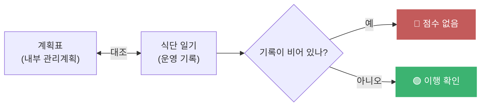
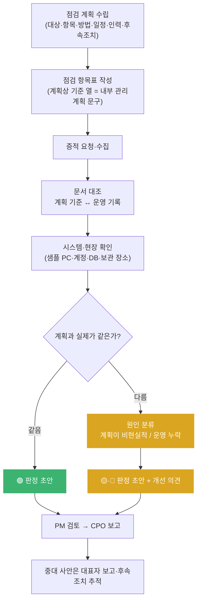
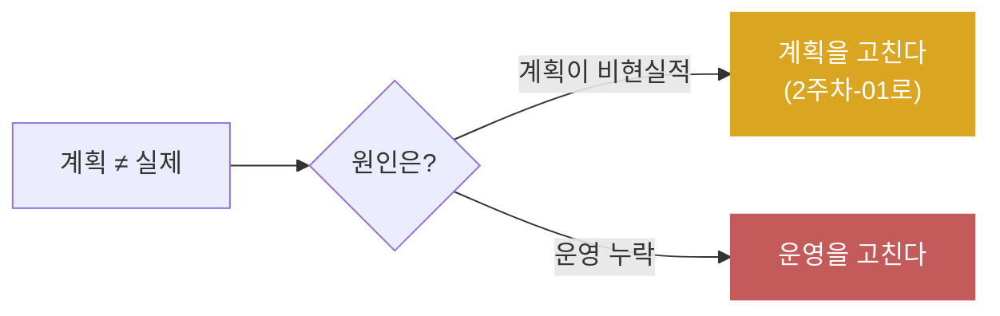
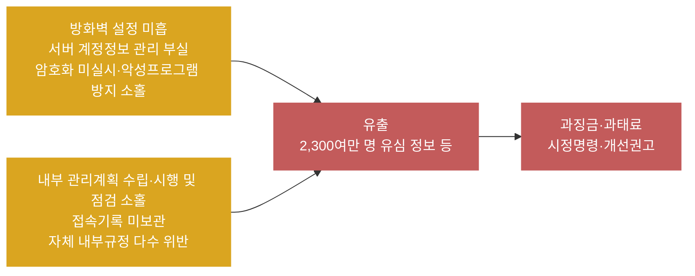

# 2주차-02. 내부 관리계획 이행 점검

| 구분 | 내용 |
|---|---|
| 고객사 | A사(민간) · B기관 연간 정기 점검에도 같은 방법 적용 |
| 관련 산출물 | 이행 점검표(이 챕터 9절), `./2_산출물_양식/05_증적_매핑표.md` |
| 선행 챕터 | 2주차-01. 내부 관리계획 수립과 개정 |
| 예상 학습 시간 | 3.5시간 (읽기 1.5시간 + 실습 2시간) |

> [!IMPORTANT]
> **🎯 이 챕터 핵심 3줄**
> 1. 이행 점검은 고객사 자신의 내부 관리계획 문구("계획상 기준")와 실제 운영 기록을 대조하는 일이다.
> 2. "기록이 있다"가 아니라 계획상 주기 대비 실시 횟수, 인사 명단 대비 계정 상태처럼 세어서 판정하고, 차이는 "계획 비현실 / 운영 누락"으로 원인을 나눈다.
> 3. 점검 결과서는 CPO 이름으로 나가므로 근거·증적을 빈틈없이 남기고, 고객사 PC는 승인받아 담당자가 실행하게 한다(SKT "자체 내부규정 다수 위반").

---

## 1. 학습 목표

1. 내부 관리계획 이행 실태 점검 계획(대상·항목·방법·결과 처리)을 세울 수 있다.
2. 계획에 적힌 기준과 실제 운영 기록을 대조해 차이를 찾고 판정 초안을 쓸 수 있다.
3. Windows 11 도구로 업무용 PC·계정 설정 일부를 직접 확인하고 증적으로 남길 수 있다.

---

## 2. 현장 비유와 기초 개념

> [!TIP]
> 🏗️ 💡 현장 비유: 이행 점검은 **다이어트 계획표와 실제 식단 일기를 나란히 놓고 보는 일**이다. 계획표가 훌륭해도 일기가 비어 있으면 점수는 없다.

> [!NOTE]
> 📌 **기초 개념 짚기**
>
> 개인정보 보호책임자는 접근 권한 관리, 접속기록 보관 및 점검, 암호화 조치 등 내부 관리계획의 이행 실태를 연 1회 이상 점검·관리해야 한다. 점검은 감사팀·보호팀·전문업체 등이 수행할 수 있지만 CPO 책임하에 수행해야 한다.
> - 근거: 안전성 기준 제4조제4항[^safe4], 안내서 p.58[^g58]



시험 지식은 "연 1회 이상 점검"이라는 문장입니다. 현장에서 컨설턴트가 그 점검을 대신 수행하는 경우가 많고, 이때 점검 결과서는 **고객사 CPO의 이름으로** 나갑니다. 컨설턴트는 근거와 증적을 빈틈없이 남겨야 합니다.

> ✅ **2절 한 줄 정리**: CPO는 연 1회 이상 이행 실태를 점검해야 하고, 컨설턴트가 대신 수행해도 결과서는 CPO 이름으로 나가므로 증적을 빈틈없이 남긴다.

---

## 3. 근거 법령·기준

| 근거 | 키워드 | 출처 |
|---|---|---|
| ① 안전성 기준 제4조제4항 | 연 1회 이상 점검·관리 | [^safe4] |
| ② 안내서 p.58 | 점검 계획 6요소 | [^g58] |
| ③ 안전성 기준 제5조 | 접근 권한 | [^safe] |
| ④ 안전성 기준 제6조 | 접근통제 | [^safe] |
| ⑤ 안전성 기준 제7조 | 암호화 | [^safe] |
| ⑥ 안전성 기준 제8조 | 접속기록 보관·점검 | [^safe] |
| ⑦ 안전성 기준 제9조 | 보안 프로그램 업데이트 | [^safe] |
| ⑧ 안전성 기준 제10조·제12조·제13조 | 물리적 보관, 출력·복사, 파기 | [^safe] |
| ⑨ 안내서 p.55 | 차등 교육 연 1회 이상 | [^g55] |

**🔎 번호별 보충 설명** (요지 / 쉬운 풀이: 현장에서 확인할 것)

- ① 요지: CPO는 내부 관리계획 이행 실태를 연 1회 이상 점검·관리
  - 풀이: 점검 계획서와 결과서 2개가 모두 있어야 함
- ② 요지: 점검 계획에 **대상·시기, 조직·인력, 항목·내용, 방법·절차, 결과 기록·보관, 후속조치(개선·보고)**를 포함. 중대한 사안은 대표자에게 보고하고 의사결정 절차를 거쳐 대책 마련
  - 풀이: 컨설팅 착수 시 이 6요소를 점검 계획서 목차로 쓴다
- ③ 요지: 최소 권한, 인사이동 시 지체 없이 변경·말소, 내역 3년 보관, 계정 공유 금지, 인증 실패 시 접근 제한
  - 풀이: 인사 자료와 계정 목록 대조
- ④ 요지: IP 등으로 접속 제한, 유출 시도 탐지, 외부 접속 시 안전한 인증수단, 일정 시간 미사용 시 자동 차단, 업무용 모바일 기기 보호조치
  - 풀이: 설정 화면으로 확인
- ⑤ 요지: 인증정보·고유식별정보 등 암호화, 취급자 PC·보조저장매체 저장 시 암호화
  - 풀이: DB 화면, PC 파일 확인
- ⑥ 요지: 접속기록 보관(1년/2년), 다운로드 확인 포함 점검 주기·방법·사후조치를 내부 관리계획에 정하고 이행
  - 풀이: 계획상 주기 ↔ 실제 점검 기록 횟수 대조
- ⑦ 요지: 보안 프로그램 자동 업데이트 또는 일 1회 이상 업데이트, 보안 업데이트 공지 시 즉시 업데이트
  - 풀이: PC에서 직접 확인 가능
- ⑧ 요지: 물리적 보관, 출력·복사, 파기
  - 풀이: 현장 확인과 기록 확인
- ⑨ 요지: CPO·취급자 대상 차등 교육을 **연 1회 이상** 정기 실시
  - 풀이: 이수율·미이수자 조치 확인

> ✅ **3절 한 줄 정리**: 점검 계획은 안내서 6요소로 세우고, 제5조~제13조의 각 조치가 계획대로 운영되는지 문서·설정·현장으로 확인한다.

---

## 4. 컨설팅 수행 절차



> [!TIP]
> 원인 분류가 중요합니다. **계획이 비현실적**이면 계획을 고치고(2주차-01로 돌아감), 운영이 누락됐으면 운영을 고칩니다. 둘을 섞으면 개선 권고가 엉뚱해집니다.



### 단계별 설명

| 단계 | 결과물 | 소요 (예시) |
|---|---|---|
| 1. 계획 | 점검 계획서 | 0.5일 |
| 2. 항목표 | 이행 점검표 (9절) | 0.5일 |
| 3. 문서 대조 | 대조 결과 | 1~2일 |
| 4. 시스템·현장 | 화면 캡처·사진 | 1일 |
| 5. 판정·보고 | 점검 결과서 초안 | 1일 |

**🔎 번호별 보충 설명** (하는 일 / 입력 자료)

- 1. 계획
  - 하는 일: 안내서 6요소로 점검 계획서 작성
  - 입력 자료: 내부 관리계획 현행본
- 2. 항목표
  - 하는 일: 계획 조항마다 "계획상 기준"을 그대로 옮김
  - 입력 자료: 내부 관리계획
- 3. 문서 대조
  - 하는 일: 기록 횟수·기간·승인 확인
  - 입력 자료: 증적
- 4. 시스템·현장
  - 하는 일: 샘플 확인, 캡처
  - 입력 자료: 테스트 계정, 현장 출입
- 5. 판정·보고
  - 하는 일: 판정 초안, 개선 의견, 보고서
  - 입력 자료: 위 결과

### 샘플링 원칙 (예시)

| 대상 | 예시 샘플 크기 | 메모 |
|---|---|---|
| 퇴직·전보자 계정 | 최근 6개월 퇴직·전보자 전원 또는 10명 | 인사 명단과 시스템 계정 대조 |
| 접속기록 점검 결과 | 최근 1년 전 회차 | 계획상 주기 대비 실시 횟수 |
| 업무용 PC | 개인정보 다운로드 권한자 중 3~5대 | 백신·암호화·화면보호기 확인 |

> [!WARNING]
> 샘플 크기는 회사·PM 기준에 따라 다릅니다. [출처: 일반 지식, 원문 확인 권장]

### Windows 11 실무 도구 팁 (샘플 PC 확인, 고객사 담당자 입회하에)

<details>
<summary>🛠️ Windows 11 실무 도구 팁 7가지 펼치기</summary>

| 작업 | 도구 |
|---|---|
| ① 백신 엔진·정의 업데이트 상태 (제9조) | PowerShell |
| ② Windows 보안 업데이트 적용 이력 (제9조제2항) | PowerShell |
| ③ 로컬 계정 잠금 정책 (제5조제6항 관련) | `secpol.msc` / `net accounts` |
| ④ 로그온 실패 기록 | 이벤트 뷰어 |
| ⑤ 화면보호기·잠금 (업무 PC 관리) | 설정 |
| ⑥ 파일 공유 설정 (제6조제3항) | PowerShell |
| ⑦ BitLocker 등 저장장치 암호화 (제7조제5항 관련) | PowerShell |

**🔎 번호별 보충 설명** (도구·경로 / 방법)

- ① 방법: `Get-MpComputerStatus | Select-Object AntivirusEnabled, AntivirusSignatureLastUpdated, RealTimeProtectionEnabled` → 정의 업데이트 일시가 하루 이내인지 확인 (Microsoft Defender를 쓰는 경우)
- ② 방법: `Get-HotFix | Sort-Object InstalledOn -Descending | Select-Object -First 5`
- ③ 경로: `secpol.msc` → 계정 정책 → 계정 잠금 정책, 또는 명령 프롬프트 `net accounts`
  - 방법: 잠금 임계값 설정 확인 (도메인 PC는 그룹 정책 결과 `gpresult /r` 참고)
- ④ 경로: 이벤트 뷰어(`eventvwr.msc`) → Windows 로그 → 보안 → 이벤트 ID 4625 필터
  - 방법: PowerShell: `Get-WinEvent -FilterHashtable @{LogName='Security'; Id=4625} -MaxEvents 10` (관리자 권한 필요)
- ⑤ 경로: 설정 → 개인 설정 → 잠금 화면 → 화면 보호기, 또는 그룹 정책 결과
  - 방법: 개인정보처리시스템 세션 자동 차단(제6조제4항)은 **시스템 설정**에서 따로 확인
- ⑥ 경로: PowerShell `Get-SmbShare`
  - 방법: 불필요한 공유 폴더(Everyone 권한 등) 확인
- ⑦ 경로: PowerShell `manage-bde -status C:` (관리자)
  - 방법: 취급자 PC 저장 개인정보 보호 수단 확인

</details>

> [!WARNING]
> ⚠️ 고객사 PC에서 명령을 실행할 때는 **사전에 고객사 승인**을 받고, 담당자가 직접 실행하게 한 뒤 화면을 캡처합니다. 컨설턴트가 설정을 바꾸지 않습니다.

> ✅ **4절 한 줄 정리**: 계획 → 항목표 → 문서 대조 → 샘플 시스템·현장 확인 → 판정·보고 순서로 진행하고, PC 확인은 승인받아 담당자가 실행한다.

---

## 5. 업무 분담표

| 단계 | 🙋 신입 담당 | 🧑‍💼 PM·선임 담당 |
|---|---|---|
| 계획 | 점검 계획서 초안 (6요소) | 범위·샘플 기준 확정 |
| 항목표·대조 | 계획상 기준 옮기기, 횟수 집계 | 해석이 갈리는 항목 판단 |
| 시스템·현장 | 확인 요청 목록, 캡처·사진 | 현장 확인 주도 |
| 판정·보고 | 판정·개선 의견 초안 | 판정 확정, CPO 보고 |

**🔎 번호별 보충 설명** (단계별 전체 업무와 🏢 고객사 담당)

- 계획
  - 🙋 신입: 점검 계획서 초안 (6요소)
  - 🧑‍💼 PM·선임: 범위·샘플 기준 확정
  - 🏢 고객사: CPO 승인
- 항목표·대조
  - 🙋 신입: 계획상 기준 옮기기, 기록 대조, 횟수 집계
  - 🧑‍💼 PM·선임: 해석이 갈리는 항목 판단
  - 🏢 고객사: 기록 제공
- 시스템·현장
  - 🙋 신입: 확인 요청 목록, 캡처·사진, 확인 일시 기록
  - 🧑‍💼 PM·선임: 현장 확인 주도
  - 🏢 고객사: 명령 실행·화면 시연
- 판정·보고
  - 🙋 신입: 판정 초안, 개선 의견 초안
  - 🧑‍💼 PM·선임: 판정 확정, CPO 보고
  - 🏢 고객사: CPO 검토, 중대 사안 대표자 보고

> [!WARNING]
> 🚫 **신입이 혼자 결정하지 않는 것**:
> - 판정 확정
> - "중대 사안" 여부 판단
> - 고객사 PC 설정 변경

> ✅ **5절 한 줄 정리**: 신입은 계획서·항목표·집계·캡처·초안을 맡고, 판정 확정과 중대 사안 판단은 PM·선임과 CPO가 한다.

---

## 6. 고객 커뮤니케이션 예시

### 6-1. 현장 확인 협조 요청 메일

```text
제목: [A사 내부 관리계획 이행 점검] 3/24(화) 현장 확인 협조 요청

김○○ 과장님, 안녕하세요. ○○컨설팅 홍길동입니다.

이행 점검 계획서(CPO 승인본)에 따라 3월 24일(화) 10:00~16:00에 현장 확인을 진행하고자 합니다.

■ 확인 대상 (샘플)
 - 개인정보 다운로드 권한자 PC 4대 (마케팅팀 2, 고객지원팀 2)
 - 회원관리시스템 관리자 화면 (계정·권한, 세션 타임아웃 설정)
 - 문서 보관 캐비닛 (고객지원팀)

■ 확인 방법
 - PC 확인은 사용자 본인이 화면을 띄우고, 저희는 화면 캡처만 합니다.
 - 설정 변경, 파일 복사는 하지 않습니다.

■ 준비 요청
 - 각 PC 사용자 입회, 관리자 계정 보유자 1명 동석
```

### 6-2. 점검 결과 설명 멘트 (PM 확정 후, CPO 대상)

> "내부 관리계획 23개 조항 중 17개는 계획대로 운영되고 있었습니다. 차이가 있는 6개 중 4개는 운영 누락이고 2개는 계획 자체가 현실과 맞지 않았습니다.
>
> 예를 들어 접속기록 점검은 계획에 '월 1회'로 되어 있지만 실제로는 분기 1회였습니다.
>
> 여기서 선택지가 두 가지입니다. 점검 체계를 보강해 월 1회를 지키시거나, 처리 규모와 위험을 검토해 실제로 지킬 수 있는 주기로 계획을 고치시는 것입니다.
>
> 어느 쪽이든 정한 주기대로 기록이 남는 것이 핵심입니다."

> ✅ **6절 한 줄 정리**: 현장 확인은 대상·방법·준비를 미리 알리고 "캡처만" 약속하며, 결과는 이행 수·차이 수·원인별로 나눠 선택지와 함께 설명한다.

---

## 7. 처분 사례: SK텔레콤 개인정보 유출사고 (2025.8. 의결)

| 구분 | 내용 |
|---|---|
| 사건 | 안전조치 소홀로 2,300여만 명 유심 정보 등 유출 |
| 위반 내용 | 안전조치의무 위반, 유출 통지 위반 (보도자료 기준) |
| 처분 | 과징금 1,347억 9,100만 원, 과태료 960만 원, 시정명령, 개선권고 |
| 출처 | 2025.8.28. 보도자료, 2025.8.27. 의결[^skt] |



<details>
<summary>📄 사건 상세 (사건 개요·위반 내용·처분·출처 원문 펼치기)</summary>

- 사건 개요: 방화벽 설정 미흡, 서버 계정정보(ID/PW) 관리 부실, 암호화 미실시, 악성프로그램 방지 소홀 등으로 2,300여만 명의 유심 정보 등이 유출됨. 보도자료는 이 외에도 **내부 관리계획 수립·시행 및 점검 소홀, 접속기록 미보관** 등 안전조치의무를 지키지 않았고, **SKT가 자체 마련한 내부규정도 다수 위반**한 것으로 확인되었다고 밝힘.
- 위반 내용: 안전조치의무 위반, 유출 통지 위반 (보도자료 기준)
- 처분·결과: 과징금 1,347억 9,100만 원, 과태료 960만 원, 시정명령(안전조치 강화, 거버넌스 정비 등), 개선권고
- 출처: 2025.8.28. 보도자료 「개인정보위, 'SK텔레콤 개인정보 유출사고' 제재처분 의결」, 2025.8.27. 의결[^skt]

</details>

### 컨설팅 시사점

🔴 **자체 내부규정을 지키지 않은 것과 내부 관리계획 점검 소홀 자체가 위반 사항으로 언급되었다.**

- [ ] **① 고객사 문구 그대로 옮기기**: "자체 마련한 내부규정 다수 위반"은 이행 점검이 바로 잡아내야 하는 유형입니다. 점검표의 "계획상 기준" 열은 고객사 자신의 문구를 그대로 옮겨야 차이가 드러납니다.
- [ ] **② 결과서·후속조치까지 기록**: 내부 관리계획 **점검 소홀** 자체가 위반 사항으로 언급되었습니다. 점검 결과서와 후속조치 기록을 남기는 것까지가 점검입니다.

> ✅ **7절 한 줄 정리**: SKT는 자체 규정 위반과 점검 소홀까지 지적받았으니, 고객사 문구 기준으로 대조하고 결과서·후속조치 기록까지 남긴다.

---

## 8. 오답노트

| No | 상황 | ✅ 핵심 |
|---|---|---|
| ① | 기준 열에 고시 조문 | 고객사 계획 문구를 기준 열에 |
| ② | 결과서 "있음"만 확인 | 계획상 주기 대비 실시 횟수 |
| ③ | 계정 목록만 확인 | 인사 명단·말소일 대조 |
| ④ | 고객사 PC 직접 조작 | 담당자 실행, 캡처만 |
| ⑤ | 교육 "실시"만 확인 | 이수율·차등·후속조치 |
| ⑥ | 실무 담당자에게만 공유 | CPO·대표자 보고, 후속조치 추적 |

**🔎 번호별 보충 설명** (❌ 신입의 실수 / ✅ 올바른 수행 / 근거)

- ①
  - ❌ 점검표의 기준 열에 고시 조문을 적고 고객사 계획 문구는 옮기지 않음
  - ✅ 기준 열에는 **고객사 내부 관리계획 문구**(주기·방법·담당)를 그대로 쓰고, 고시 조문은 근거 열에 씀
  - 근거: 이행 점검은 "계획대로 하고 있는가"를 본다
- ②
  - ❌ 접속기록 점검 결과서가 "있다"는 것만 보고 양호 판정
  - ✅ 계획상 주기(예: 월 1회) 대비 **실시 횟수**(예: 12회 중 4회)를 세어 판정
  - 근거: 안전성 기준 제8조제2항[^safe]
- ③
  - ❌ 퇴직자 명단 없이 시스템 계정 목록만 보고 "활성 계정 이상 없음" 판정
  - ✅ 인사 퇴직·전보 명단과 계정 목록, 권한 말소일을 대조
  - 근거: 안전성 기준 제5조제2항[^safe]
- ④
  - ❌ 고객사 PC에서 직접 설정을 바꾸거나 파일을 복사함
  - ✅ 담당자가 실행하고 컨설턴트는 캡처만. 사전 승인 필수
  - 근거: 고객 시스템 변경은 컨설턴트 권한 밖
- ⑤
  - ❌ 교육 결과서의 "실시"만 보고 양호 판정
  - ✅ 대상자 대비 이수율, 차등 교육 여부, 미이수자 후속조치 확인
  - 근거: 안전성 기준 제4조제2항, 안내서 p.55[^g55]
- ⑥
  - ❌ 점검 결과를 실무 담당자에게만 공유하고 끝냄
  - ✅ CPO 보고, 중대 사안은 대표자 보고와 후속조치 추적까지
  - 근거: 안내서 p.58[^g58]

> ✅ **8절 한 줄 정리**: 고객사 문구를 기준으로 세어서 판정하고, 인사 명단과 대조하며, PC는 손대지 않고, 보고와 후속조치까지 마친다.

---

## 9. 고객사 점검용 체크리스트: 이행 점검표 (예시 항목)

> [!NOTE]
> "계획상 기준" 열은 고객사 내부 관리계획 문구로 바꿔 씁니다. 아래는 A사 개정안 기준 예시입니다.

각 항목: **점검 항목** → 계획상 기준 (예) → 확인 방법 / 요청 증적 → 판정 기준

### ① 점검·권한·인증 (No 1~5)

- [ ] **No 1. 이행 실태 점검 계획·결과**
  - 계획상 기준 (예): 연 1회, CPO 책임
  - 확인 방법: 문서 / 요청 증적: 점검 계획서·결과서, CPO 결재
  - 판정 기준: 🟢 계획·결과·결재 · 🟡 결과만 · 🔴 없음
- [ ] **No 2. 권한 변경·말소**
  - 계획상 기준 (예): 인사 발령 후 지체 없이
  - 확인 방법: 문서·시스템 / 요청 증적: 인사 명단, 계정 목록, 말소 이력
  - 판정 기준: 🟢 불일치 0건 · 🟡 지연 처리 · 🔴 퇴직자 활성 계정
- [ ] **No 3. 권한 내역 보관**
  - 계획상 기준 (예): 3년
  - 확인 방법: 문서 / 요청 증적: 권한 변경 이력
  - 판정 기준: 🟢 3년분 · 🔴 부족
- [ ] **No 4. 외부 접속 인증**
  - 계획상 기준 (예): OTP 적용
  - 확인 방법: 시스템 / 요청 증적: VPN·관리자 접속 설정 화면
  - 판정 기준: 🟢 적용 · 🔴 ID/PW만
- [ ] **No 5. 세션 자동 차단**
  - 계획상 기준 (예): 30분 미사용 시
  - 확인 방법: 시스템 / 요청 증적: 시스템 설정 화면
  - 판정 기준: 🟢 설정 · 🔴 미설정

### ② 암호화·기록·PC (No 6~8)

- [ ] **No 6. 저장 암호화**
  - 계획상 기준 (예): 계좌번호·비밀번호
  - 확인 방법: 시스템 / 요청 증적: DB 컬럼 화면(마스킹)
  - 판정 기준: 🟢 대상 전부 · 🔴 평문
- [ ] **No 7. 접속기록 점검**
  - 계획상 기준 (예): 월 1회, 다운로드 포함
  - 확인 방법: 문서 / 요청 증적: 점검 결과서 12회분, 소명 기록
  - 판정 기준: 🟢 12/12 · 🟡 일부 누락 · 🔴 기록 없음
- [ ] **No 8. 백신 업데이트**
  - 계획상 기준 (예): 자동 업데이트
  - 확인 방법: 시스템 / 요청 증적: `Get-MpComputerStatus` 캡처
  - 판정 기준: 🟢 1일 이내 · 🔴 미갱신

### ③ 교육·수탁자·출력·파기 (No 9~12)

- [ ] **No 9. 교육**
  - 계획상 기준 (예): 연 1회, 대상별 차등
  - 확인 방법: 문서 / 요청 증적: 교육 계획·결과, 이수 명단
  - 판정 기준: 🟢 이수 완료·차등 · 🟡 미이수자 있음 · 🔴 미실시
- [ ] **No 10. 수탁자 관리·감독**
  - 계획상 기준 (예): 반기 1회 점검
  - 확인 방법: 문서 / 요청 증적: 수탁사 점검 결과서
  - 판정 기준: 🟢 계획대로 · 🟡 일부 수탁사 누락 · 🔴 미실시
- [ ] **No 11. 출력물 관리**
  - 계획상 기준 (예): 출력 항목 최소화, 용도 특정
  - 확인 방법: 시스템·현장 / 요청 증적: 출력 화면, 파쇄 기록
  - 판정 기준: 🟢 적용 · 🔴 미적용
- [ ] **No 12. 파기**
  - 계획상 기준 (예): 파기 대장 작성
  - 확인 방법: 문서 / 요청 증적: 파기 대장
  - 판정 기준: 🟢 작성 · 🔴 없음

> ✅ **9절 한 줄 정리**: 점검·권한·인증 → 암호화·기록·PC → 교육·수탁자·출력·파기 순서로 12개 항목을 계획상 기준과 대조한다.

---

## 10. 실무 산출물 연계 팁

| 이 챕터의 결과 | 들어가는 산출물 | 위치 |
|---|---|---|
| 점검 계획서 | 고객사 "○○년 개인정보 보호조치 이행 점검 계획" | 고객사 문서 (CPO 승인) |
| 이행 점검표·판정 | 고객사 "○○년 개인정보 안전조치 이행 실태 점검 결과" | 본문 표 |
| 화면 캡처·사진 | `./2_산출물_양식/05_증적_매핑표.md` | `IMP_` 영역코드 |
| "계획이 비현실적" 항목 | 2주차-01 내부 관리계획 개정안 | 신구 대비표 |
| B기관에서 수행한 경우 | 보호수준 평가 증빙 (4주차-03) | 안전조치 관련 지표 증빙 |

> [!TIP]
> 💡 안내서가 예시로 든 문서명("○○년 개인정보 보호조치 이행 점검 계획(안)", "○○년 개인정보 안전조치 이행 실태 점검 결과")을 그대로 쓰면 고객사 담당자가 증적을 찾기 쉽습니다.[^g58]

---

## 11. 실습 과제 / 퀴즈

> [!NOTE]
> 정답과 해설은 [정답과_해설.md](../../정답과_해설.md)의 **「2주차-02. 내부 관리계획 이행 점검」** 절에 있습니다.

### 객관식

**Q1.** 「개인정보의 안전성 확보조치 기준 안내서」가 제시한 이행 실태 점검·관리 계획(예시)의 구성 요소가 **아닌** 것은?

① 점검 대상 및 시기
② 점검 항목 및 내용
③ 점검 결과 후속조치(개선, 보고)
④ 점검 결과에 따른 과태료 산정

**Q2.** A사 내부 관리계획에 "접속기록은 월 1회 점검한다"고 되어 있다. 최근 1년간 점검 결과서는 4회분(분기별)이다. 신입의 판정 초안으로 가장 적절한 것은?

① 고시에 주기가 정해져 있지 않으므로 🟢 양호
② 계획상 기준(월 1회) 대비 이행 4/12회로 🟡 부분 이행 또는 🔴 미흡 초안을 쓰고, 원인(계획 비현실 / 운영 누락)을 메모해 PM에게 넘긴다.
③ 분기 1회도 충분하므로 계획을 분기로 고쳐 주고 🟢 양호
④ 점검 결과서가 있으므로 판정 대상이 아니다.

**Q3.** 샘플 PC에서 백신 정의 업데이트 상태를 확인하려 한다. Windows 11에서 Microsoft Defender를 쓰는 경우 적절한 방법은?

① `Get-MpComputerStatus` 결과의 `AntivirusSignatureLastUpdated` 확인
② `ipconfig /all` 결과 확인
③ `Get-HotFix`로 백신 정의 날짜 확인
④ 작업 관리자의 CPU 사용률 확인

### 실습

**상황**: A사 이행 점검 자료가 모였다. 9절 이행 점검표를 작성하라.

**제공 자료**

```text
[A사 내부 관리계획(2026-02 개정본) 중 일부]
- 권한: 인사 발령 후 3영업일 내 변경·말소, 내역 3년 보관
- 접속기록: 월 1회 점검(다운로드 1,000건 이상 시 사유 소명)
- 교육: 연 1회, 취급자·개발자·수탁자 대상별 차등
- 수탁자: 반기 1회 서면 점검, 연 1회 고위험 수탁사 현장 점검

[수집된 사실]
- 2025.9~2026.2 퇴직자 8명 중 2명 계정이 2026-03 현재 활성 상태
- 권한 변경 이력: 2024-01부터 보관
- 접속기록 점검 결과서: 2025-03 ~ 2026-02 중 9회분, 다운로드 소명 기록 3건
- 교육: 2025-11 전 직원 동일 온라인 교육 1회, 이수율 92%
- 수탁자 점검: 2025 상반기 서면 점검 7곳, 하반기 없음, 현장 점검 없음
- 샘플 PC 4대 중 1대 백신 정의 업데이트 일시 2026-02-10 (점검일 2026-03-24)
```

**과제**

1. 9절 형식으로 항목별 판정 초안과 판정 근거를 쓰시오.
2. 각 미흡·부분 이행 항목의 원인을 "계획 비현실 / 운영 누락" 중 하나로 분류하고 이유를 쓰시오.
3. CPO 보고용 요약(5줄 이내)을 쓰시오.

**작성 양식**: 9절 이행 점검표

---

## 12. 더 읽을거리

| 자료 | 읽을 부분 |
|---|---|
| 개인정보의 안전성 확보조치 기준 안내서 | p.58 (이행 실태 점검), p.59~ 제5조 이후 각 조 해설 |
| SKT 처분 보도자료 | 3. 주요 위반 사항 |
| ISMS-P 인증기준 안내서 | 1.4.2 관리체계 점검 (3주차 예습) |

<details>
<summary>📂 참고자료 파일명·링크 펼치기 (3개)</summary>

- 개인정보의 안전성 확보조치 기준 안내서: [`개인정보의 안전성 확보조치 기준 안내서(2026.11).pdf`](<../../3_참고자료/개인정보의 안전성 확보조치 기준 안내서(2026.11).pdf>)
- SKT 처분 보도자료: [`250828 (석간) 개인정보위  ‘SK텔레콤 개인정보 유출사고’ 제재처분 의결(조사2과)_최종(붙임 포함).pdf`](<../../3_참고자료/250828 (석간) 개인정보위  ‘SK텔레콤 개인정보 유출사고’ 제재처분 의결(조사2과)_최종(붙임 포함).pdf>)
- ISMS-P 인증기준 안내서: [`ISMS-P 인증기준 안내서(2023.11.23).pdf`](<../../3_참고자료/ISMS-P 인증기준 안내서(2023.11.23).pdf>)

</details>

---

## 각주

[^safe4]: [출처: [개인정보의 안전성 확보조치 기준(개인정보보호위원회고시)(제2026-9호)(20260701).pdf](<../../3_참고자료/개인정보의 안전성 확보조치 기준(개인정보보호위원회고시)(제2026-9호)(20260701).pdf>), 제4조제4항]
[^safe]: [출처: [개인정보의 안전성 확보조치 기준(개인정보보호위원회고시)(제2026-9호)(20260701).pdf](<../../3_참고자료/개인정보의 안전성 확보조치 기준(개인정보보호위원회고시)(제2026-9호)(20260701).pdf>), 제5조~제13조]
[^g55]: [출처: [개인정보의 안전성 확보조치 기준 안내서(2026.11).pdf](<../../3_참고자료/개인정보의 안전성 확보조치 기준 안내서(2026.11).pdf>), p.55]
[^g58]: [출처: [개인정보의 안전성 확보조치 기준 안내서(2026.11).pdf](<../../3_참고자료/개인정보의 안전성 확보조치 기준 안내서(2026.11).pdf>), p.58 '이행 실태 점검·관리 계획(예시)']
[^skt]: [출처: [250828 (석간) 개인정보위  ‘SK텔레콤 개인정보 유출사고’ 제재처분 의결(조사2과)_최종(붙임 포함).pdf](<../../3_참고자료/250828 (석간) 개인정보위  ‘SK텔레콤 개인정보 유출사고’ 제재처분 의결(조사2과)_최종(붙임 포함).pdf>), p.1·5·6, 2025.8.27. 의결]
