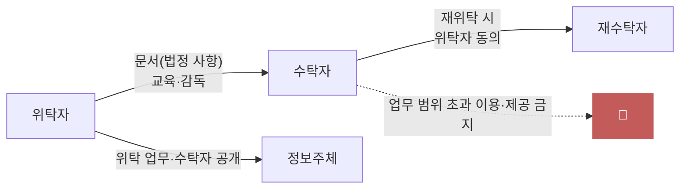
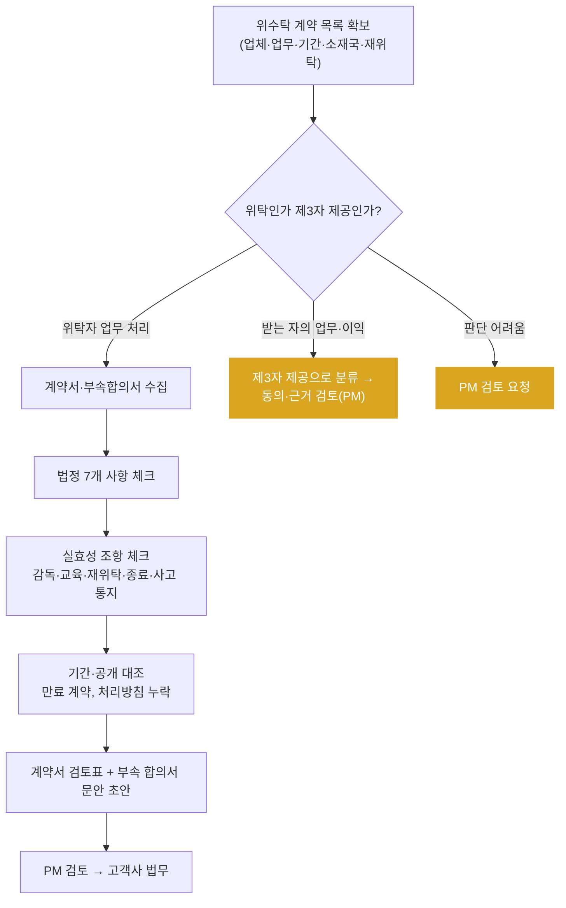
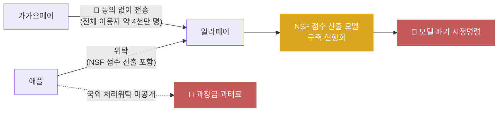

# 2주차-03. 위수탁 계약서 검토

| 구분 | 내용 |
|---|---|
| 고객사 | A사(민간) · B기관도 같은 기준 (공개 방법에 관보 포함) |
| 관련 산출물 | 계약서 검토표(이 챕터 9절), `./2_산출물_양식/03_수탁사_점검_체크리스트.md` A영역 |
| 선행 챕터 | 1주차-03. 개인정보처리방침 진단 (수탁사 목록 대조) |
| 예상 학습 시간 | 3시간 (읽기 1시간 + 실습 2시간) |

> [!IMPORTANT]
> **🎯 이 챕터 핵심 3줄**
> 1. 위탁 문서에는 법 제26조제1항 2개 + 영 제28조제1항 5개 = 7개 법정 사항이 있어야 한다. 본계약뿐 아니라 부속 합의서·별첨까지 확인한다.
> 2. 감독 협조·교육·재위탁 동의·종료 시 반환·파기 통보·계약 기간처럼 조항이 실제로 작동하는지까지 본다.
> 3. 계약서 검토의 첫 단계는 "누구의 업무를 위해 넘기는가"로 위탁과 제3자 제공을 구분하는 것이다(카카오페이·애플·알리페이 사례).

---

## 1. 학습 목표

1. 위탁 문서에 들어가야 하는 법정 사항 7개를 근거 조문과 함께 확인할 수 있다.
2. 재위탁, 관리·감독, 교육, 종료 시 반환·파기, 손해배상 조항이 실제로 작동하는 수준인지 검토할 수 있다.
3. 위탁인지 제3자 제공인지 헷갈리는 계약을 구분해 PM에게 검토 의견을 올릴 수 있다.

---

## 2. 현장 비유와 기초 개념

> [!TIP]
> 🏗️ 💡 현장 비유: 위수탁 계약서는 **집 열쇠를 맡기면서 쓰는 각서**다. "어느 방까지 들어가도 되는지, 다른 사람에게 열쇠를 넘겨도 되는지, 일 끝나면 열쇠를 어떻게 돌려받는지"가 적혀 있지 않으면 열쇠를 맡긴 사람이 책임진다.

> [!NOTE]
> 📌 **기초 개념 짚기**
>
> 개인정보 처리 업무를 위탁할 때는 법정 사항이 들어간 문서로 해야 하고, 위탁 업무와 수탁자를 공개하고, 수탁자를 교육·감독해야 한다. 수탁자는 업무 범위를 넘어 이용·제공할 수 없고, 재위탁하려면 위탁자의 동의를 받아야 한다.
> - 근거: 「개인정보 보호법」 제26조, 시행령 제28조[^law26] [^dec28]



CPPG 시험에서는 "위탁 = 위탁자 업무, 제공 = 받는 자 업무"를 구분하면 됐습니다. 현장에서는 계약서 30건을 받아 **조항이 빠진 계약을 찾고, 빠진 조항을 넣는 부속 합의서 문안**까지 써야 합니다.

> ✅ **2절 한 줄 정리**: 위탁은 법정 사항을 담은 문서로 하고 공개·교육·감독해야 하며, 신입은 빠진 조항을 찾아 부속 합의서 문안까지 쓴다.

---

## 3. 근거 법령·기준

| 근거 | 키워드 | 출처 |
|---|---|---|
| ① 법 제26조제1항 | 문서로 위탁 | [^law26] |
| ② 영 제28조제1항 | 대통령령 사항 5개 | [^dec28] |
| ③ 법 제26조제2항 · 영 제28조제2항·제3항 | 위탁 업무·수탁자 공개 | [^law26] [^dec28] |
| ④ 법 제26조제3항 | 홍보·판매 권유 위탁 통지 | [^law26] |
| ⑤ 법 제26조제4항 · 영 제28조제6항 | 교육·감독 | [^law26] [^dec28] |
| ⑥ 법 제26조제5항·제6항 | 범위 초과 금지, 재위탁 동의 | [^law26] |
| ⑦ 법 제26조제7항·제8항 | 손해배상책임, 준용 | [^law26] |
| ⑧ 통합 안내서 「표준 개인정보 처리 위탁 계약서(예시)」 | 12개 조 | [^integ184] |
| ⑨ 질의응답 Q87 | 재위탁 동의 형식 | [^qa87] |
| ⑩ 질의응답 Q88 | 단기 1회성 위탁 교육 | [^qa88] |
| ⑪ 질의응답 Q92 | 자동갱신 없는 계약 종료 | [^qa92] |
| ⑫ 통합 안내서 (클라우드) | 클라우드 사업자 수탁자 여부 | [^integ180] |

**🔎 번호별 보충 설명** (요지 / 쉬운 풀이: 현장에서 확인할 것)

- ① 요지: 위탁은 ① 목적 외 처리 금지 ② 기술적·관리적 보호조치 ③ 대통령령 사항이 포함된 **문서**로
  - 풀이: 계약서 본문 또는 부속 합의서에 있어야 함
- ② 요지: 대통령령 사항: ① 위탁업무의 목적·범위 ② 재위탁 제한 ③ 접근 제한 등 안전성 확보조치 ④ 관리 현황 점검 등 감독 ⑤ 수탁자 의무 위반 시 손해배상 등 책임
  - 풀이: 법 2개 + 영 5개 = **7개** 체크
- ③ 요지: 위탁 업무와 수탁자(재수탁자 포함)를 홈페이지에 지속 게재(불가 시 사업장 게시, 관보(공공기관), 신문, 간행물, 계약서 등)
  - 풀이: 1주차-03 처리방침 위탁 항목과 대조
- ④ 요지: 홍보·판매 권유 업무 위탁은 서면등으로 정보주체에게 알림
  - 풀이: 문자 발송 대행 등 마케팅 위탁 여부 확인
- ⑤ 요지: 위탁자는 수탁자를 **교육**하고, 처리 현황 점검 등으로 **감독**
  - 풀이: 계약서에 교육·점검 협조 의무가 있는지
- ⑥ 요지: 수탁자는 업무 범위 초과 이용·제공 금지, **재위탁 시 위탁자 동의**
  - 풀이: 재위탁 동의 절차가 계약에 있는지
- ⑦ 요지: 손해배상책임에 대해 수탁자를 처리자의 소속 직원으로 봄. 수탁자에게 안전조치 등 다수 조문 준용
  - 풀이: 수탁자도 안전조치·처리방침 의무가 있음
- ⑧ 요지: 목적·범위, 기간, 재위탁 제한, 안전성 확보조치, 처리 제한, 관리·감독(관리 요구 6개 항목·점검·시정 요구), 교육, 정보주체 권리보장, 파기·반환 및 결과 통보, 손해배상 등 12개 조
  - 풀이: 검토 기준표로 쓰기 좋다. 다만 **최소한의 사항 예시**임
- ⑨ 요지: 재위탁 동의 형식은 제한 없음. 변경이 잦으면 계약에 동의 절차·방법(사후 승인, 주기적 통지 등)을 약정 가능
  - 풀이: "사전 서면 동의만 가능"으로 단정하지 않는다
- ⑩ 요지: 단기 1회성 위탁은 계약 서류에 교육 사항을 명시하는 등의 방법 활용
  - 풀이: 단기 계약도 교육 조항을 비우지 않는다
- ⑪ 요지: 자동갱신 조항이 없으면 처리 기간 종료 시 반환·파기해야 하고, 계속 위탁하려면 다시 계약
  - 풀이: 계약 기간 만료 후 계속 처리 중인 수탁사 찾기
- ⑫ 요지: 클라우드 사업자가 처리 업무를 위탁받거나 실질적 접근권한이 있으면 수탁자에 해당. 단순 물리적 장소만 제공하고 접근권한·관여가 없으면 위·수탁 관계가 아님
  - 풀이: 클라우드 계약을 위탁 목록에서 뺄지 판단할 때

> [!WARNING]
> ⚠️ **확인 필요**: 통합 안내서(2025.7.)의 표준 계약서 예시 제8조제3항은 "개인정보 보호법 제31조 제7항의 개인정보 보호책임자 협의회"를 인용합니다.[^integ184] 2026.3.10. 법 개정으로 현행 법에서는 협의회가 제31조제8항에 있습니다.[^law31] 예시 문안을 고객사 계약서에 옮길 때는 인용 조문을 현행 법률로 다시 확인하세요.

> ✅ **3절 한 줄 정리**: 법 제26조와 영 제28조가 문서·공개·교육·감독·재위탁을 정하고, 통합 안내서 예시 계약서와 질의응답이 실무 해석을 보완한다.

---

## 4. 컨설팅 수행 절차



### 단계별 설명

| 단계 | 결과물 | 소요 (예시) |
|---|---|---|
| 1. 목록 | 분류표 | 0.5일 |
| 2. 법정 사항 | 검토표 A열~G열 | 계약당 20분 |
| 3. 실효성 | 검토표 H열 이후 | 계약당 15분 |
| 4. 대조 | 대조 결과 | 0.5일 |
| 5. 문안 | 부속 합의서 초안 | 1일 |

**🔎 번호별 보충 설명** (하는 일 / 입력 자료)

- 1. 목록
  - 하는 일: 계약 목록 확보, 위탁/제공 1차 분류
  - 입력 자료: 계약 목록, 처리방침
- 2. 법정 사항
  - 하는 일: 7개 사항 존재 여부
  - 입력 자료: 계약서 원문
- 3. 실효성
  - 하는 일: 감독 협조, 교육, 재위탁 동의, 종료 시 반환·파기 통보, 사고 통지
  - 입력 자료: 계약서
- 4. 대조
  - 하는 일: 계약 기간 만료 여부, 처리방침 공개 여부
  - 입력 자료: 처리방침, 계약 기간
- 5. 문안
  - 하는 일: 누락 조항 보완용 부속 합의서 초안
  - 입력 자료: 통합 안내서 예시

### Windows 11 실무 도구 팁

<details>
<summary>🛠️ Windows 11 실무 도구 팁 4가지 펼치기</summary>

| 작업 | 도구 |
|---|---|
| ① 계약서 PDF에서 핵심 단어 찾기 | Microsoft Edge |
| ② 여러 계약서 일괄 검색 | PowerShell |
| ③ 만료 계약 찾기 | Excel |
| ④ 검토표 판정 색 | Excel |

**🔎 번호별 보충 설명** (도구·경로 / 방법)

- ① 경로: Microsoft Edge로 PDF 열기 → `Ctrl + F` → "재위탁", "파기", "손해배상", "점검"
  - 방법: 조항 유무 1차 확인 (스캔 PDF는 검색이 안 되므로 원문 확인)
- ② 경로: PowerShell: `Select-String -Path "D:\계약서\*.txt" -Pattern "재위탁" -List`
  - 방법: 텍스트로 변환된 계약서만 가능. 결과 없는 파일 = 조항 누락 후보
- ③ 경로: Excel → `=IF(계약종료일<TODAY(),"만료","")`
  - 방법: 만료 후 처리 계속 여부 확인 대상
- ④ 경로: Excel 조건부 서식 → 텍스트 포함 "미흡" → 배경 `#c35b5b`
  - 방법: 수탁사별 누락 패턴을 한눈에

</details>

> ✅ **4절 한 줄 정리**: 계약 목록으로 위탁/제공을 먼저 가르고, 법정 7개 → 실효성 → 기간·공개 순서로 확인해 검토표와 부속 합의서 초안을 만든다.

---

## 5. 업무 분담표

| 단계 | 🙋 신입 담당 | 🧑‍💼 PM·선임 담당 |
|---|---|---|
| 목록·분류 | 계약 목록, 1차 분류 초안 | 위탁·제공 구분 확정 |
| 법정·실효성 체크 | 검토표, 조항 위치 기록 | 해석이 필요한 조항 판단 |
| 대조 | 만료·공개 누락 표시 | 우선순위 판단 |
| 문안 | 부속 합의서 초안 | 문안 확정 |

**🔎 번호별 보충 설명** (단계별 전체 업무와 🏢 고객사 담당)

- 목록·분류
  - 🙋 신입: 계약 목록 정리, 위탁/제공 1차 분류 초안
  - 🧑‍💼 PM·선임: **위탁·제공 구분 확정**
  - 🏢 고객사: 계약 목록·원문 제공
- 법정·실효성 체크
  - 🙋 신입: 검토표 작성, 조항 위치(조·항) 기록
  - 🧑‍💼 PM·선임: 해석이 필요한 조항 판단
  - 🏢 고객사: 부속 합의서 존재 여부 확인
- 대조
  - 🙋 신입: 만료·공개 누락 계약 표시
  - 🧑‍💼 PM·선임: 우선순위 판단
  - 🏢 고객사: 계약 갱신 현황 설명
- 문안
  - 🙋 신입: 부속 합의서 초안
  - 🧑‍💼 PM·선임: 문안 확정
  - 🏢 고객사: 법무 검토, 수탁사와 체결

> [!WARNING]
> 🚫 **신입이 혼자 결정하지 않는 것**:
> - 위탁/제3자 제공 최종 구분
> - 클라우드 사업자의 수탁자 해당 여부
> - 손해배상 조항의 법적 적정성

> ✅ **5절 한 줄 정리**: 신입은 목록·검토표·조항 위치·문안 초안을 맡고, 위탁/제공 구분과 법적 해석은 PM·선임이 확정한다.

---

## 6. 고객 커뮤니케이션 예시

### 6-1. 계약서 요청 메일

```text
제목: [A사 개인정보보호 컨설팅] 위수탁 계약서 원문 요청 (7개사, 2026-04-03까지)

김○○ 과장님, 안녕하세요. ○○컨설팅 홍길동입니다.

수탁사 목록 잘 받았습니다. 계약서 검토를 위해 아래 자료를 요청드립니다.

 1. 7개 수탁사별 현행 위탁 계약서 원문 (본계약 + 개인정보 처리 위탁 부속 합의서·별첨 전부)
 2. 재위탁이 있는 경우 A사가 동의한 문서 (메일·공문·시스템 승인 기록 모두 가능)
 3. 2025년 이후 계약이 종료된 수탁사가 있다면 개인정보 반환·파기 확인 자료

※ 본계약에 개인정보 조항이 없고 별도 합의서에 있는 경우가 많아, 첨부 문서까지 함께 부탁드립니다.
```

### 6-2. 결과 설명 멘트 (PM 확정 후)

> "7개 계약 중 4개는 법에서 정한 7개 사항이 모두 들어 있었습니다.
>
> 나머지 3개 중 2개는 '재위탁 제한'과 '관리 현황 점검 등 감독' 조항이 없었고, 1개는 계약 기간이 지난해 12월로 끝났는데 자동갱신 조항 없이 지금도 처리가 계속되고 있었습니다.
>
> 감독 조항이 없으면 A사가 점검을 요청해도 수탁사가 응할 계약상 의무가 없어서, 다음 달 수탁사 점검 전에 부속 합의서로 보완하시는 것을 권해 드립니다. 문안 초안은 첨부했습니다."

> ✅ **6절 한 줄 정리**: 계약서는 부속 합의서·재위탁 동의·종료 파기 자료까지 함께 요청하고, 결과는 충족 수·누락 조항·만료 계약과 보완 방법으로 설명한다.

---

## 7. 처분 사례: 카카오페이·애플·알리페이 (2025.1. 의결)

| 구분 | 내용 |
|---|---|
| 사건 | 제3자 제공(카카오페이→알리페이)과 위탁(애플→알리페이)이 얽힌 국외 이전 |
| 위반 내용 | 카카오페이: 적법 처리 근거 없는 국외이전 / 애플: 국외 처리위탁·수탁자 미공개 (보도자료 기준) |
| 처분 | 카카오페이·애플 과징금 등, 알리페이 NSF 모델 파기 시정명령 |
| 출처 | 2025.1.23. 보도자료, 2025.1.22. 의결[^kp] |



<details>
<summary>📄 사건 상세 (사건 개요·위반 내용·처분·출처 원문 펼치기)</summary>

- 사건 개요: 애플은 결제 처리에 수반된 개인정보 처리 업무(NSF 점수 산출 포함)를 알리페이에 **위탁**하고 있었음. 카카오페이는 애플의 수탁사인 알리페이가 NSF 점수 산출 모델을 구축할 수 있도록 애플 미이용자를 포함한 전체 이용자(약 4천만 명)의 개인정보를 동의 없이 알리페이에 전송했고, 알리페이는 이 정보로 모델을 구축·현행화함. 애플은 국외 처리위탁 사실을 처리방침 등으로 공개하지 않음.
- 위반 내용: 카카오페이: 적법 처리 근거 없는 국외이전 / 애플: 국외 처리위탁·수탁자 미공개 (보도자료 기준)
- 처분·결과: 카카오페이 과징금 59억 6,800만 원·시정명령·공표명령, 애플 과징금 24억 500만 원·과태료 220만 원·시정명령·공표명령, **알리페이: 위법하게 제공·이전된 개인정보로 구축한 NSF 점수 산출 모델 파기 시정명령**
- 출처: 2025.1.23. 보도자료 「개인정보위, 개인정보 무단 국외 이전한 카카오페이·애플에 총 83억 7,520만 원 과징금·과태료 부과」, 2025.1.22. 의결[^kp]

</details>

### 컨설팅 시사점

🔴 **제공과 위탁이 섞인 관계를 구분하지 못하고 목적·범위가 불분명하면, 수탁자의 범위 밖 이용을 막을 수 없다.**

- [ ] **① 관계 구분**: 같은 사건 안에 **제3자 제공 관계(카카오페이→애플)**와 위·수탁 관계(애플→알리페이)가 함께 있습니다. 계약서 검토 첫 단계에서 "누구의 업무를 위해 넘기는가"로 관계를 구분하는 이유입니다.
- [ ] **② 목적·범위 구체화**: 위탁 계약서의 "위탁업무의 목적 및 범위"가 구체적이어야, 수탁자가 그 범위를 넘어 모델을 만들거나 다른 목적에 쓰는 것을 계약 위반으로 다룰 수 있습니다.
- [ ] **③ 파기·통보 조항 확인**: 위탁 종료·위반 시 파기와 그 결과 통보 조항이 있는지 확인합니다.

> ✅ **7절 한 줄 정리**: 제공과 위탁이 얽힌 사건에서 위법 구축 모델 파기까지 명령되었으니, 관계 구분·목적 범위·파기 통보 조항을 계약서에서 확인한다.

---

## 8. 오답노트

| No | 상황 | ✅ 핵심 |
|---|---|---|
| ① | 본계약서만 확인 | 부속 합의서·별첨·서약서까지 |
| ② | 법 3개 호만 확인 | 법 2개 + 영 5개 = 7개 |
| ③ | "사전 서면 동의만" 의견 | 동의 형식 제한 없음 |
| ④ | 계약 만료 미확인 | 자동갱신·만료일 확인 |
| ⑤ | 예시 문안 그대로 | 구체화, 현행 조문 확인 |
| ⑥ | 클라우드 무조건 제외 | 접근권한·관여로 판단 |

**🔎 번호별 보충 설명** (❌ 신입의 실수 / ✅ 올바른 수행 / 근거)

- ①
  - ❌ 본계약서만 보고 "개인정보 조항 없음 → 미흡"으로 판정
  - ✅ 부속 합의서·별첨·보안 서약서까지 받아 함께 확인
  - 근거: 법 제26조제1항은 "문서"를 요구할 뿐 형식을 정하지 않음
- ②
  - ❌ 법 제26조제1항 3개 호만 확인하고 영 제28조제1항 5개를 확인하지 않음
  - ✅ 법 2개 + 영 5개 = 7개를 각각 조·항 위치와 함께 기록
  - 근거: 법 제26조제1항제3호 → 영 제28조제1항[^dec28]
- ③
  - ❌ "재위탁은 반드시 사전 서면 동의만 가능"이라고 개선 의견을 씀
  - ✅ 동의 형식은 제한이 없고, 계약에 동의 절차(사후 승인, 주기적 통지 등)를 약정할 수 있음을 반영
  - 근거: 질의응답 Q87[^qa87]
- ④
  - ❌ 매년 같은 업체라 계약 만료를 확인하지 않음
  - ✅ 자동갱신 조항 유무와 만료일 확인. 만료 후 계속 처리는 재계약 필요
  - 근거: 질의응답 Q92[^qa92]
- ⑤
  - ❌ 통합 안내서 예시 계약서 문안을 그대로 옮김
  - ✅ 고객사 업무에 맞게 목적·범위를 구체화하고, 인용 조문을 현행 법률로 확인 (예: 협의회 조항 번호 변경)
  - 근거: 3절 ⚠️ 확인 필요
- ⑥
  - ❌ 클라우드 계약을 무조건 위탁 목록에서 뺌
  - ✅ 처리 업무 위탁 여부·실질적 접근권한·처리 관여 여부로 판단해 PM에게 올림
  - 근거: 통합 안내서 (클라우드)[^integ180]

> ✅ **8절 한 줄 정리**: 모든 첨부 문서에서 7개 사항을 찾고, 재위탁 동의 형식을 단정하지 않으며, 만료·현행 조문·클라우드 관여 여부를 확인한다.

---

## 9. 고객사 점검용 체크리스트: 위수탁 계약서 검토표

각 항목: **점검 항목** → 확인 방법 / 요청 증적 → 판정 기준

### ① 법 제26조제1항 (No 1~2)

- [ ] **No 1. 목적 외 처리 금지**: 위탁업무 수행 목적 외 개인정보 처리 금지
  - 확인 방법: 문서 / 요청 증적: 계약서
  - 판정 기준: 🟢 명시 · 🔴 없음
- [ ] **No 2. 보호조치**: 개인정보의 기술적·관리적 보호조치
  - 확인 방법: 문서 / 요청 증적: 계약서
  - 판정 기준: 🟢 명시 · 🔴 없음

### ② 영 제28조제1항 (No 3~7)

- [ ] **No 3. 목적·범위**: 위탁업무의 목적 및 범위 (구체적)
  - 확인 방법: 문서 / 요청 증적: 계약서
  - 판정 기준: 🟢 업무·항목 구체적 · 🟡 포괄적("업무 일체") · 🔴 없음
- [ ] **No 4. 재위탁 제한**: 재위탁 제한 (동의 절차 포함)
  - 확인 방법: 문서 / 요청 증적: 계약서
  - 판정 기준: 🟢 제한·동의 절차 · 🟡 제한만 · 🔴 없음
- [ ] **No 5. 안전성 확보조치**: 접근 제한 등 안전성 확보조치
  - 확인 방법: 문서 / 요청 증적: 계약서
  - 판정 기준: 🟢 명시 · 🔴 없음
- [ ] **No 6. 감독**: 관리 현황 점검 등 감독 (점검 요구·시정 요구·협조 의무)
  - 확인 방법: 문서 / 요청 증적: 계약서
  - 판정 기준: 🟢 명시·협조 의무 · 🟡 선언적 문구만 · 🔴 없음
- [ ] **No 7. 손해배상**: 수탁자 의무 위반 시 손해배상 등 책임
  - 확인 방법: 문서 / 요청 증적: 계약서
  - 판정 기준: 🟢 명시 · 🔴 없음

### ③ 실효성 (No 8~10)

- [ ] **No 8. 교육**: 수탁자 교육 (방법·증빙 보고)
  - 확인 방법: 문서 / 요청 증적: 계약서
  - 판정 기준: 🟢 명시 · 🟡 일부 · 🔴 없음
- [ ] **No 9. 반환·파기**: 계약 종료 시 반환·파기와 결과 통보
  - 확인 방법: 문서 / 요청 증적: 계약서
  - 판정 기준: 🟢 반환·파기·통보 · 🟡 파기만 · 🔴 없음
- [ ] **No 10. 기간·갱신**: 위탁 기간과 갱신 (현재 유효)
  - 확인 방법: 문서 / 요청 증적: 계약서, 갱신 기록
  - 판정 기준: 🟢 유효 · 🔴 만료 후 처리 계속

### ④ 공개·통지 (No 11~12)

- [ ] **No 11. 공개**: 위탁 업무·수탁자(재수탁자 포함)가 공개되어 있음
  - 확인 방법: 문서·시스템 / 요청 증적: 처리방침
  - 판정 기준: 🟢 공개 · 🔴 누락
- [ ] **No 12. 홍보 위탁 통지**: 홍보·판매 권유 업무 위탁 시 정보주체 통지
  - 확인 방법: 문서 / 요청 증적: 통지 기록
  - 판정 기준: 🟢 통지 · 🔴 미통지 · ⚪ 해당 위탁 없음

> [!NOTE]
> 1·2번은 법 제26조제1항제1호·제2호, 3~7번은 영 제28조제1항제1호~제5호, 8~10번은 실효성 확인 항목(통합 안내서 예시 계약서 제4·9·11조), 11~12번은 법 제26조제2항·제3항입니다.

> ✅ **9절 한 줄 정리**: 법정 7개(No 1~7) → 실효성 3개(No 8~10) → 공개·통지 2개(No 11~12) 순서로 12개 항목을 수탁사별로 확인한다.

---

## 10. 실무 산출물 연계 팁

| 이 챕터의 결과 | 들어가는 산출물 | 위치 |
|---|---|---|
| 계약서 검토표 (수탁사 × 12항목) | 진단 보고서 | 5장 '위탁 관리 진단' |
| 위탁/제공 분류표 | 처리방침 개정안 (1주차-03) | 위탁 항목·제3자 제공 항목 |
| 부속 합의서 초안 | 개선 권고서 | 부록 '개인정보 처리 위탁 부속 합의서(안)' |
| 감독 조항 누락 수탁사 | 2주차-04 점검 대상 선정 | 0단계 등급화의 "계약 리스크" 요소 |

> [!TIP]
> 💡 계약서 검토 결과는 수탁사 점검표(`./2_산출물_양식/03_수탁사_점검_체크리스트.md`)의 A1~A3에 그대로 옮깁니다. 같은 확인을 두 번 하지 않도록 증적 파일명을 공유합니다.

---

## 11. 실습 과제 / 퀴즈

> [!NOTE]
> 정답과 해설은 [정답과_해설.md](../../정답과_해설.md)의 **「2주차-03. 위수탁 계약서 검토」** 절에 있습니다.

### 객관식

**Q1.** 다음 중 시행령 제28조제1항이 위탁 문서에 포함하도록 정한 사항이 **아닌** 것은?

① 위탁업무의 목적 및 범위
② 재위탁 제한에 관한 사항
③ 수탁자의 연간 매출액
④ 수탁자가 준수해야 할 의무를 위반한 경우의 손해배상 등 책임에 관한 사항

**Q2.** 콜센터 수탁사 B사가 야간 상담 업무를 C사에 맡기려 한다. 「개인정보 보호법」상 맞는 설명은?

① 수탁자의 내부 결정이므로 위탁자에게 알릴 필요가 없다.
② B사는 위탁자(A사)의 동의를 받아야 하며, 동의 형식은 법에서 제한하지 않는다.
③ 정보주체 전원의 동의를 받아야 한다.
④ 재위탁은 어떤 경우에도 금지된다.

**Q3.** A사와 문자 발송 업체 E사의 위탁 계약 기간이 2025.12.31.에 끝났다. 자동갱신 조항은 없고, E사는 2026년에도 같은 업무를 하고 있다. 가장 적절한 검토 의견은?

① 같은 업체와 매년 반복하는 사업이므로 문제없다.
② 계약 기간이 끝났으므로 계속 위탁하려면 위·수탁 계약을 다시 체결하는 등의 조치가 필요하다.
③ 처리방침에만 E사를 적으면 된다.
④ E사가 ISMS-P 인증을 받았다면 계약이 없어도 된다.

### 실습

**상황**: A사와 배송업체 F사의 계약서 중 개인정보 관련 조항이다. 9절 검토표를 작성하고 부속 합의서 문안을 쓰라.

**제공 자료**

```text
[A사-F사 물류 대행 계약서 (2025-01-01 ~ 2026-12-31)]
제7조(비밀유지) F사는 업무상 알게 된 A사의 영업비밀 및 고객정보를 외부에 누설하지 않는다.
제8조(개인정보) F사는 A사가 제공하는 고객의 이름, 주소, 연락처를 배송 업무 등에 사용하며,
          관련 법령을 준수한다.
제9조(하도급) F사는 업무의 원활한 수행을 위해 지역 배송업체에 업무 일부를 하도급할 수 있다.
제12조(손해배상) 일방이 본 계약을 위반하여 상대방에게 손해를 입힌 경우 이를 배상한다.
(그 외 개인정보 관련 조항 없음)

[참고]
- F사는 제주 지역 배송을 G사에 하도급 중 (A사 동의 문서 없음)
- A사 처리방침 위탁 항목: "F사(배송)"만 기재
```

**과제**

1. 9절 검토표 12개 항목의 판정과 근거(조항 위치)를 쓰시오.
2. 이 계약에서 가장 위험도가 높은 문제 2개를 고르고 이유를 쓰시오.
3. 누락 조항을 보완하는 「개인정보 처리 위탁 부속 합의서」 초안을 6개 조 이상 쓰시오. (통합 안내서 예시 참고, 인용 조문은 현행 법률 기준)

**작성 양식**: 9절 검토표, 부속 합의서 초안

---

## 12. 더 읽을거리

| 자료 | 읽을 부분 |
|---|---|
| 개인정보 처리 통합 안내서 | p.161~186 'Ⅵ. 업무위탁에 따른 개인정보의 처리 제한' (표준 계약서 예시 p.184~186) |
| 개인정보 질의응답 모음집 | Ⅶ. 위·수탁 (Q79~Q92) |
| 카카오페이·애플 처분 보도자료 | 사건 개념도, 제재 처분 |
| ISMS-P 인증기준 안내서 | 2.3.2 외부자 계약 시 보안, 3.3.2 개인정보 처리 업무 위탁 |

<details>
<summary>📂 참고자료 파일명·링크 펼치기 (4개)</summary>

- 개인정보 처리 통합 안내서: [`★개인정보 처리 통합 안내서(2025.7.).pdf`](<../../3_참고자료/★개인정보 처리 통합 안내서(2025.7.).pdf>)
- 개인정보 질의응답 모음집: [`1. 개인정보 질의응답 모음집(2025.12.).pdf`](<../../3_참고자료/1. 개인정보 질의응답 모음집(2025.12.).pdf>)
- 카카오페이·애플 처분 보도자료: [`250123 (석간) 개인정보위, 개인정보 무단 국외 이전한 카카오페이·애플에 총 83억 7,520만 원 과징금·과태료 부과(조사3팀).pdf`](<../../3_참고자료/250123 (석간) 개인정보위, 개인정보 무단 국외 이전한 카카오페이·애플에 총 83억 7,520만 원 과징금·과태료 부과(조사3팀).pdf>)
- ISMS-P 인증기준 안내서: [`ISMS-P 인증기준 안내서(2023.11.23).pdf`](<../../3_참고자료/ISMS-P 인증기준 안내서(2023.11.23).pdf>)

</details>

---

## 각주

[^law26]: [출처: [개인정보 보호법(법률)(제21445호)(20260911).pdf](<../../3_참고자료/개인정보 보호법(법률)(제21445호)(20260911).pdf>), 제26조]
[^law31]: [출처: [개인정보 보호법(법률)(제21445호)(20260911).pdf](<../../3_참고자료/개인정보 보호법(법률)(제21445호)(20260911).pdf>), 제31조제8항]
[^dec28]: [출처: [개인정보 보호법 시행령(대통령령)(제36804호)(20261110).pdf](<../../3_참고자료/개인정보 보호법 시행령(대통령령)(제36804호)(20261110).pdf>), 제28조]
[^integ180]: [출처: [★개인정보 처리 통합 안내서(2025.7.).pdf](<../../3_참고자료/★개인정보 처리 통합 안내서(2025.7.).pdf>), p.180 '클라우드(B2B) 사업자가 클라우드 이용사업자의 수탁자에 해당하는지 여부']
[^integ184]: [출처: [★개인정보 처리 통합 안내서(2025.7.).pdf](<../../3_참고자료/★개인정보 처리 통합 안내서(2025.7.).pdf>), p.184~186 '표준 개인정보 처리 위탁 계약서(예시)']
[^qa87]: [출처: [1. 개인정보 질의응답 모음집(2025.12.).pdf](<../../3_참고자료/1. 개인정보 질의응답 모음집(2025.12.).pdf>), Q87, p.102~103]
[^qa88]: [출처: [1. 개인정보 질의응답 모음집(2025.12.).pdf](<../../3_참고자료/1. 개인정보 질의응답 모음집(2025.12.).pdf>), Q88, p.103~104]
[^qa92]: [출처: [1. 개인정보 질의응답 모음집(2025.12.).pdf](<../../3_참고자료/1. 개인정보 질의응답 모음집(2025.12.).pdf>), Q92, p.107]
[^kp]: [출처: [250123 (석간) 개인정보위, 개인정보 무단 국외 이전한 카카오페이·애플에 총 83억 7,520만 원 과징금·과태료 부과(조사3팀).pdf](<../../3_참고자료/250123 (석간) 개인정보위, 개인정보 무단 국외 이전한 카카오페이·애플에 총 83억 7,520만 원 과징금·과태료 부과(조사3팀).pdf>), p.1~4, 2025.1.22. 의결]
