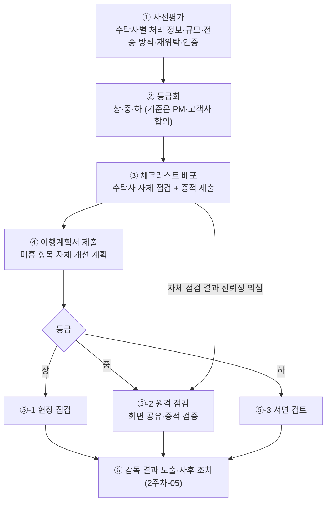

# 2주차-04. 수탁사 점검 실무

| 구분 | 내용 |
|---|---|
| 고객사 | A사(민간) · B기관 수탁사 점검에도 같은 방법 적용 |
| 관련 산출물 | `./2_산출물_양식/03_수탁사_점검_체크리스트.md` (0단계·1단계) |
| 선행 챕터 | 2주차-03. 위수탁 계약서 검토 |
| 예상 학습 시간 | 4시간 (읽기 1.5시간 + 실습 2.5시간) |

---

## 1. 학습 목표

1. 수탁사를 위험도로 등급화해 점검 대상과 점검 방식(서면·원격·현장)을 제안할 수 있다.
2. 수탁사 점검 체크리스트로 서면 점검과 현장 점검을 수행하고, 확인 내용을 증적과 함께 기록할 수 있다.
3. 수탁사의 자체 점검 결과를 그대로 믿지 않고 신뢰성을 검증하는 방법을 적용할 수 있다.

---

## 2. 현장 비유와 기초 개념

> 🏗️ **현장 비유**: 수탁사 점검은 **협력업체 위생 점검**이다. 모든 업체를 매번 방문할 수는 없으니 위험한 곳부터 직접 가고, 나머지는 서류와 사진으로 보되, 서류만 보고 "깨끗하다"고 하지는 않는다.

> 📌 **기초 개념 짚기**
> 위탁자는 업무 위탁으로 개인정보가 유출등이 되지 않도록 수탁자를 교육하고, 처리 현황 점검 등으로 수탁자가 개인정보를 안전하게 처리하는지 감독해야 한다. 감독 대상에는 법령상 처리자의 준수사항과 위탁 문서의 내용을 지키는지가 포함된다.
> - 근거: 「개인정보 보호법」 제26조제4항, 시행령 제28조제6항[^law26] [^dec28]

CPPG에서는 "위탁자는 수탁자를 감독해야 한다"까지 배웁니다. 현장에서는 **"수탁사 30곳을 1년에 어떻게, 어느 깊이로 감독할 것인가"**를 설계하고 실제로 돌려야 합니다.

---

## 3. 근거 법령·기준

| 근거 | 요지 | 쉬운 풀이 (현장에서 확인할 것) | 출처 |
|---|---|---|---|
| 법 제26조제4항 · 영 제28조제6항 | 교육 + 처리 현황 점검 등 감독. 법령상 준수사항과 위탁 문서 내용 준수 여부를 감독 | 점검 항목 = 법령(안전조치 등) + 계약서 조항 | [^law26] [^dec28] |
| 질의응답 Q91 / 통합 안내서 | 감독이 반드시 **직접 방문**일 필요는 없음. 위험도로 등급화한 뒤 현장·원격 점검 등 합리적 수단 선택. 예시 절차: 사전평가 → 등급화 → 체크리스트 자체 점검 → 이행계획서 제출 → 현장·원격 점검 → 결과 도출·사후 조치 | 이 6단계를 그대로 점검 계획 뼈대로 쓴다 | [^qa91] [^integ174] |
| 통합 안내서 | 업무 위탁 유형·성격, 보유량, 업무 역량 등을 고려한 점검 지표로 **정기적** 실태 점검. 자료제출 요구, 현장 방문, 점검 도구 배포, 원격 점검, 정기 보고, 전문기관 점검 대행 등 다양한 수단 활용 | 수단 선택지를 고객사에 제시할 때의 근거 | [^integ174] |
| 통합 안내서 (전문 수탁자) | 전문 수탁자가 ISMS-P 등 주기적 점검을 받거나, 사전 협의된 자체 점검을 하고, **계약 문서에 약정한 방식**으로 결과를 다수 위탁자에게 알리면 감독 의무를 이행할 수 있음 | 대형 PG사·클라우드 등은 인증서와 점검 결과 통지로 갈음 가능. 단, **계약에 약정**되어 있어야 함 | [^integ175] |
| 안전성 기준 안내서 | 내부 관리계획에 수탁자 교육·감독의 시기·방법·절차·점검 항목을 정하고, 기록과 개선조치를 남김. 계약서 등에 안전조치를 명시하고 **분기별 또는 반기별** 주기적 관리·감독 예시 | 점검 주기는 고객사 내부 관리계획에서 정한 대로 | [^g53] |
| 안전성 기준 제4조제1항제16호 | 내부 관리계획 포함 사항: 수탁자 관리·감독 | 2주차-01과 연결 | [^safe] |
| ISMS-P 인증기준 2.3.3 | 외부자 보호대책 이행 여부를 주기적 점검·감사로 관리·감독, 발견 문제 개선계획 수립·이행, 재위탁 시 위탁자 동의. 점검은 업무 시작 전·진행 중·종료 시점, 수탁자 역량·자체 시스템 보유·정보 수량과 민감도를 고려해 주기·방법 결정 | 3주차 인증 컨설팅에서도 같은 항목을 본다 | [^ismsg233] |

---

## 4. 컨설팅 수행 절차



### 점검 방식 비교

| 구분 | 서면 점검 | 원격 점검 | 현장 점검 |
|---|---|---|---|
| 방법 | 체크리스트 + 증적 파일 검토 | 화상회의 화면 공유로 시스템 설정·로그 확인 | 사업장 방문, 시스템·출입통제·문서 보관 직접 확인 |
| 장점 | 다수 수탁사를 빠르게 | 이동 없이 시스템 실물 확인 | 가장 신뢰도 높음, 물리적 조치 확인 가능 |
| 한계 | 자체 점검 결과를 믿어야 함 | 물리적 조치 확인 어려움 | 비용·시간 큼 |
| 주로 쓰는 대상 | 하 등급 | 중 등급, 서면 결과 검증 | 상 등급, 사고·민원 발생 수탁사 |

### 단계별 설명

| 단계 | 하는 일 | 입력 자료 | 결과물 | 소요 (예시) |
|---|---|---|---|---|
| 사전평가·등급화 | 수탁사별 사실 정보 정리 | 수탁사 목록, 계약서 검토표 | 0단계 표 | 1일 |
| 체크리스트 배포 | 수탁사별 맞춤 체크리스트·안내문 발송 | 체크리스트 양식 | 발송 기록 | 0.5일 |
| 서면 검토 | 응답·증적의 유효성 확인 | 수탁사 응답 | 1단계 판정 초안 | 수탁사당 2시간 |
| 원격·현장 점검 | 시스템·현장 확인, 캡처·사진 | 점검 일정 | 확인 기록 | 수탁사당 0.5~1일 |
| 결과 정리 | 수탁사별 결과 요약, 개선 요구 초안 | 위 결과 | 2단계 요약표 | 1일 |

### 자체 점검 결과 신뢰성 검증 방법

| 신호 | 의심 이유 | 검증 방법 |
|---|---|---|
| 모든 항목이 "양호", 증적 없음 | 응답만 있고 근거가 없음 | 무작위 3개 항목 증적 요청 |
| 증적 날짜가 모두 점검 요청일 이후 | 점검을 위해 급히 만든 문서 | 이전 기간 운영 기록 요청 |
| 캡처 화면에 시스템 시간·URL이 없음 | 다른 환경·과거 화면일 수 있음 | 원격 점검으로 실시간 화면 확인 |
| 재위탁 "없음"인데 업무 규모상 불가능해 보임 | 하도급 누락 가능성 | 업무 흐름 인터뷰, 재수탁사 목록 확인 |

### Windows 11 실무 도구 팁

| 작업 | 도구·경로 | 방법 |
|---|---|---|
| 원격 점검 화면 기록 | 캡처 도구(`Win + Shift + S`) → 녹화, 또는 Teams 회의 녹화 (사전 동의) | 화면 우측 하단 시계가 보이게 캡처해 확인 일시를 남긴다 |
| 체크리스트 일괄 배포용 개별 파일 만들기 | PowerShell: `"B콜센터","C택배","D클라우드" \| ForEach-Object { Copy-Item "D:\양식\체크리스트.xlsx" "D:\배포\체크리스트_$_.xlsx" }` | 수탁사명이 붙은 파일을 한 번에 생성 |
| 수탁사 응답 취합 | Excel → 데이터 → 데이터 가져오기 → 파일에서 → 폴더에서 | 폴더 안 응답 파일을 하나의 표로 합친다 (파워 쿼리) |
| 현장 사진 시간 확인 | 사진 우클릭 → 속성 → 자세히 → 찍은 날짜 | 사진 파일명에 `TRS_수탁사명_항목_YYYYMMDD` 규칙 적용 |

---

## 5. 업무 분담표

| 단계 | 🙋 신입 담당 | 🧑‍💼 PM·선임 담당 | 🏢 고객사 담당 | 🏭 수탁사 담당 |
|---|---|---|---|---|
| 사전평가·등급화 | 0단계 표 사실 정보 작성 | 등급 기준 제안·확정 | 등급 기준 합의, 수탁사 정보 제공 | — |
| 배포 | 안내문·체크리스트 발송, 회신 추적 | 안내문 검토 | 수탁사에 협조 공문 | 자체 점검·증적 제출 |
| 서면 검토 | 증적 유효성 확인, 판정 초안 | 판정 확정 | — | 보완 자료 제출 |
| 원격·현장 | 확인 요청 목록, 캡처·사진·확인 일시 기록 | 점검 진행 | 필요 시 동행 | 시스템 시연, 현장 안내 |
| 결과 정리 | 수탁사별 요약, 개선 요구 초안 | 개선 요구 확정 | 수탁사에 공식 통보 | — |

> 🚫 **신입이 혼자 결정하지 않는 것**: 수탁사 등급 기준, 현장 점검 대상 선정, 수탁사에 직접 개선 "명령", 위탁 계약 해지 같은 조치 언급
> ⚠️ 수탁사에 대한 공식 요구는 **위탁자(고객사)의 이름**으로 나갑니다. 컨설턴트는 위탁자를 대신해 점검을 수행할 뿐입니다.

---

## 6. 고객 커뮤니케이션 예시

### 6-1. 수탁사 점검 안내 메일 (고객사 명의 발송용 초안)

```text
제목: [A사] 2026년 상반기 개인정보 처리 위탁업무 점검 안내 (자체 점검표 회신: 5/15까지)

B콜센터 개인정보 보호 담당자님께,

A사는 「개인정보 보호법」 제26조제4항 및 위탁 계약서 제○조(관리·감독)에 따라
위탁한 개인정보 처리업무에 대한 정기 점검을 실시합니다.
이번 점검은 A사가 위임한 ○○컨설팅이 함께 수행합니다.

■ 일정
 1. 자체 점검표 및 증적 회신: 2026-05-15(금)
 2. 원격 점검(화면 공유, 1시간): 2026-05-22(금) 중 협의
 3. 현장 점검: 해당 없음 (귀사는 이번 반기 원격 점검 대상)

■ 제출 방법: 첨부 점검표 작성 + 항목별 증적 파일 (A사 지정 보안 공유 폴더)
  ※ 고객 개인정보가 담긴 원본 파일은 제출하지 마시고, 마스킹 화면으로 제출해 주십시오.

문의: A사 정보보호팀 김○○ 과장 / ○○컨설팅 홍길동
```

### 6-2. 원격 점검 질문 리스트 (콜센터 수탁사)

| No | 질문 | 질문 의도 | 화면으로 확인할 것 |
|---|---|---|---|
| 1 | 상담원 계정은 몇 개이고, 퇴사자 계정은 언제 지우나요? | 계정·권한 관리 (E2·E4) | 상담 시스템 사용자 목록, 최근 퇴사자 계정 상태 |
| 2 | 상담원 PC에서 고객 정보를 엑셀로 내려받을 수 있나요? | 다운로드·출력 통제 (E11) | 다운로드 메뉴 권한 설정 |
| 3 | 야간·주말 상담을 다른 업체에 맡기나요? | 재위탁 (C1) | 재위탁 계약·A사 동의 문서 |
| 4 | 상담 녹취는 어디에, 얼마 동안 보관하나요? | 보관·파기 (E12) | 녹취 서버 보관 설정 |
| 5 | A사 교육 자료는 상담원에게 어떻게 전달되었나요? | 교육 (D1) | 교육 이수 명단 |

---

## 7. 처분 사례와 인증 결함 사례

### 처분 사례: 테무 (2025.5. 의결)

| 구분 | 내용 |
|---|---|
| 사건 개요 | 해외직구 서비스 테무는 상품 배송을 위해 한국·중국·싱가포르·일본 등의 다수 사업자에게 개인정보 처리를 위탁하거나 보관하고 있었음에도, 국외 사업자 위탁 사실을 처리방침에 공개하거나 이용자에게 알리지 않았고, **수탁사에 대해 개인정보 안전관리 방안 교육, 개인정보 처리현황 점검 등의 관리·감독을 실시하지 않았음**. 국내대리인도 지정하지 않음. |
| 위반 조항 | 국외이전 위반(§28의8①), 국내대리인 지정의무 위반(§31의2①), 개인정보 처리 업무 위탁 공개 위반·**수탁자 교육·관리감독 의무 위반(§26)** (보도자료 붙임 기준) |
| 처분·결과 | 과징금 13억 6,900만 원, 과태료 1,760만 원, 시정명령·개선권고(위탁 현황과 처리 흐름 투명 공개, **수탁자에 대한 관리·감독 실시**, 정보주체 권리 보장 등) |
| 출처 | 2025.5.15. 보도자료 「국외이전 규정 등 개인정보 보호법 위반한 테무에 13억 6,900만 원 과징금 부과」, 2025.5.14. 의결[^temu] |

### 인증 결함 사례: ISMS-P 2.3.3 외부자 보안 이행 관리

인증기준 안내서가 제시한 결함사례 중 수탁사 점검과 직접 관련된 것입니다.[^ismsg233]

| 결함사례 (안내서 요약) | 이 챕터에서 막는 방법 |
|---|---|
| 회사에 상주하는 IT 개발·운영 외주업체를 정기적으로 보안점검하지 않음 | 0단계 사전평가에 **상주 외주 인력**도 포함 |
| 수탁자에게 보안교육 실시 공문만 보내고 실제 교육 수행 여부를 확인하지 않음 | 체크리스트 D1에서 **이수 명단 증적** 요구 |
| 수탁자 자체 보안점검 결과만 통지받고, 점검이 충실했는지 확인하는 절차가 없음 | 4절 "자체 점검 결과 신뢰성 검증 방법" 적용 |
| 수탁자 일부가 위탁자 동의 없이 재위탁 | 체크리스트 C1 + 원격 점검 질문 3번 |

**컨설팅 시사점**

- 테무 사례는 "감독을 **안 했다**"가 위반 사유입니다. 점검 계획을 세웠는지가 아니라 **실제로 교육·점검을 했고 기록이 남아 있는지**를 고객사에 확인시킵니다.
- 국외 수탁사는 현장 점검이 어렵습니다. 원격 점검, 인증서·점검 결과 통지 등 대체 수단을 **계약서에 약정**해 두도록 2주차-03 계약 보완과 연결합니다.

---

## 8. 오답노트

| ❌ 신입의 실수 | ✅ 올바른 수행 | 근거 |
|---|---|---|
| 모든 수탁사를 똑같은 체크리스트로 서면 점검만 함 | 위험도로 등급화해 현장·원격·서면을 나누고, 업무에 맞게 항목을 조정 | 질의응답 Q91, 통합 안내서[^qa91] [^integ174] |
| 수탁사가 보낸 자체 점검표가 전부 "예"라서 양호 판정 | 무작위 항목 증적 요청, 원격 확인으로 신뢰성 검증 | ISMS-P 2.3.3 결함사례 3[^ismsg233] |
| 교육 공문 발송 기록만으로 D1(교육) 양호 판정 | 수탁사 취급자 이수 명단·교육 자료까지 확인 | ISMS-P 2.3.3 결함사례 2, 통합 안내서 p.174 |
| ISMS-P 인증서를 받은 수탁사는 점검 대상에서 아예 제외 | 계약에 약정된 결과 통지 방식이 있는지 확인하고, 인증 범위에 위탁 업무가 포함되는지 확인 | 통합 안내서 (전문 수탁자)[^integ175] |
| 컨설턴트 이름으로 수탁사에 "개선하라"는 메일을 보냄 | 개선 요구는 위탁자(고객사) 명의 공식 통보로 진행 | 감독 의무 주체는 위탁자(법 제26조제4항) |
| 현장 사진을 날짜·장소 기록 없이 저장 | 파일명 규칙과 촬영 일시, 촬영 허가 사실을 기록 | 1주차-02 증적 관리 |

---

## 9. 고객사 점검용 체크리스트

이 챕터의 체크리스트는 `./2_산출물_양식/03_수탁사_점검_체크리스트.md` **1단계 점검 항목(A1~G1, 20개)**을 그대로 씁니다. 아래는 **위탁자(고객사)의 감독 체계**를 점검하는 항목입니다.

| No | 점검 항목 | 확인 방법 | 요청 증적 | 판정 기준 |
|---|---|---|---|---|
| 1 | 수탁자 교육·감독의 시기·방법·절차·점검 항목이 내부 관리계획에 정해져 있다 | 문서 | 내부 관리계획 | 🟢 4요소 · 🟡 일부 · 🔴 없음 |
| 2 | 수탁사 전체 목록과 위험도 등급(또는 점검 우선순위)이 있다 | 문서 | 수탁사 목록, 등급표 | 🟢 목록·등급 · 🟡 목록만 · 🔴 없음 |
| 3 | 계획한 주기대로 점검했고 결과가 기록되어 있다 | 문서 | 점검 결과서 | 🟢 계획대로 · 🟡 일부 수탁사 누락 · 🔴 미실시 |
| 4 | 수탁사 교육을 실시했거나 교육 증빙을 받았다 | 문서 | 교육 자료, 이수 명단 | 🟢 증빙 있음 · 🟡 공문만 · 🔴 없음 |
| 5 | 자체 점검 결과의 신뢰성을 검증하는 절차가 있다 | 문서·인터뷰 | 검증 기록 | 🟢 있음 · 🔴 없음 · ⚪ 자체 점검 방식 미사용 |
| 6 | 전문 수탁자의 인증·점검 결과 통지가 계약에 약정되어 있고 실제로 받고 있다 | 문서 | 계약 조항, 통지 문서 | 🟢 약정·수령 · 🟡 수령만 · ⚪ 해당 없음 |

---

## 10. 실무 산출물 연계 팁

| 이 챕터의 결과 | 들어가는 산출물 | 위치 |
|---|---|---|
| 0단계 등급표 | 수탁사 관리 계획 (고객사 문서) | "○○년 수탁자 관리·감독 계획" |
| 1단계 점검 결과 | `./2_산출물_양식/03_수탁사_점검_체크리스트.md` | 수탁사별 1부 |
| 원격·현장 캡처·사진 | `./2_산출물_양식/05_증적_매핑표.md` | `TRS_` 영역코드 |
| 위탁자 감독 체계 점검 결과 (9절) | 진단 보고서 | 5장 '위탁 관리 진단' |
| ISMS-P 준비 고객사 | 갭 분석표 2.3.3 | 3주차-03 |

> 💡 수탁사별 점검 결과는 **다음 반기 점검의 출발점**입니다. 같은 파일에 반기별 열을 추가하는 방식으로 이력을 쌓으면 2주차-05 이행 확인이 쉬워집니다.

---

## 11. 실습 과제 / 퀴즈

> 정답과 해설은 [정답과_해설.md](../../정답과_해설.md)의 **「2주차-04. 수탁사 점검 실무」** 절에 있습니다.

### 객관식

**Q1.** 다수의 수탁자를 감독하는 방법에 대한 보호위원회 질의응답의 설명으로 옳은 것은?

① 모든 수탁자의 처리 현장을 매년 직접 방문해야 한다.
② 감독의 방법과 범위가 법의 취지에 부합하면 현장 점검을 비롯해 비대면 점검 등을 선택할 수 있다.
③ 수탁자가 서약서를 내면 감독 의무가 면제된다.
④ 감독은 수탁자가 스스로 하는 것이므로 위탁자는 결과를 받을 필요가 없다.

**Q2.** 다음 중 ISMS-P 인증기준 안내서 2.3.3의 **결함사례**에 해당하는 것은?

① 수탁자 자체 보안점검 결과를 통지받으면서 그 점검이 충실했는지 확인하는 절차가 없음
② 수탁자 목록을 처리방침에 공개함
③ 위탁 계약서에 재위탁 제한 조항을 둠
④ 수탁자에게 교육 자료를 주고 이수 명단을 받음

**Q3.** 다음 중 원격 점검보다 **현장 점검**이 꼭 필요한 항목은?

① 상담 시스템 사용자 목록의 퇴사자 계정 상태
② 개인정보가 포함된 서류의 잠금장치 보관 상태
③ 백신 정의 업데이트 일시
④ 다운로드 메뉴 권한 설정

### 실습

**상황**: A사 수탁사 7곳의 정보다. 점검 계획을 세우고, B콜센터 서면 점검 결과를 판정하라.

**제공 자료**

[A사 수탁사 현황]

| 수탁사 | 업무 | 처리 정보 | 규모 | 전송 | 재위탁 | 인증 |
|---|---|---|---|---|---|---|
| B콜센터 | 고객 상담 | 이름, 연락처, 주문내역, 상담녹취 | 80만 명 | 상담 시스템 접속 | 야간 C사 | 없음 |
| D클라우드 | 서버 인프라 | 전체 회원 DB(암호화) | 80만 명 | - | 없음 | ISMS-P |
| E문자 | 마케팅 문자 발송 | 이름, 휴대전화 | 30만 명 | 월 1회 파일 전송 | 없음 | 없음 |
| F택배 | 배송 | 이름, 주소, 연락처 | 80만 명 | API | 제주 G사 | 없음 |
| H설문 | 만족도 조사 | 이메일 | 연 1회 5천 명 | 1회 파일 | 없음 | 없음 |
| I결제 | 결제 대행 | 결제 정보 | 80만 명 | API | 없음 | ISMS-P |
| J개발 | 상주 유지보수 | 운영 DB 접근 | 80만 명 | 내부망 | 없음 | 없음 |

```text
[B콜센터 자체 점검표 회신 요약]
- 20개 항목 전부 "예(양호)" 표시
- 첨부 증적: 내부 관리계획(2026-05-10 작성, 결재란 공란), 교육 사진 1장
- 재위탁 항목: "해당 없음"
```

**과제**

1. 7개 수탁사의 0단계 표를 완성하고, 등급(상/중/하)과 점검 방식을 제안하시오. (등급 기준을 스스로 정하고 1줄로 밝힐 것)
2. B콜센터 자체 점검표 회신에서 신뢰성이 의심되는 신호 3개를 찾고, 각각의 검증 방법을 쓰시오.
3. B콜센터 원격 점검 질문 5개를 6-2 형식으로 쓰시오.

**작성 양식**: `./2_산출물_양식/03_수탁사_점검_체크리스트.md` 0단계 표, 6-2 질문 표

---

## 12. 더 읽을거리

| 자료 | 참고자료 파일명 | 읽을 부분 |
|---|---|---|
| 개인정보 처리 통합 안내서 | [`★개인정보 처리 통합 안내서(2025.7.).pdf`](<../../3_참고자료/★개인정보 처리 통합 안내서(2025.7.).pdf>) | p.174~176 '교육·관리·감독 의무', p.180 클라우드 |
| 개인정보 질의응답 모음집 | [`1. 개인정보 질의응답 모음집(2025.12.).pdf`](<../../3_참고자료/1. 개인정보 질의응답 모음집(2025.12.).pdf>) | Q88, Q91 |
| 개인정보의 안전성 확보조치 기준 안내서 | [`개인정보의 안전성 확보조치 기준 안내서(2026.11).pdf`](<../../3_참고자료/개인정보의 안전성 확보조치 기준 안내서(2026.11).pdf>) | p.53 '수탁자 관리 및 감독(예시)' |
| ISMS-P 인증기준 안내서 | [`ISMS-P 인증기준 안내서(2023.11.23).pdf`](<../../3_참고자료/ISMS-P 인증기준 안내서(2023.11.23).pdf>) | 2.3.1~2.3.4 외부자 보안 (결함사례 포함) |
| 테무 처분 보도자료 | [`250515 (석간) 국외이전 규정 등 개인정보 보호법 위반한 테무에 13억 6,900만 원 과징금 부과(조사1과).pdf`](<../../3_참고자료/250515 (석간) 국외이전 규정 등 개인정보 보호법 위반한 테무에 13억 6,900만 원 과징금 부과(조사1과).pdf>) | 조사 결과 ①, 붙임 |

---

## 각주

[^law26]: [출처: [개인정보 보호법(법률)(제21445호)(20260911).pdf](<../../3_참고자료/개인정보 보호법(법률)(제21445호)(20260911).pdf>), 제26조제4항]
[^dec28]: [출처: [개인정보 보호법 시행령(대통령령)(제36804호)(20261110).pdf](<../../3_참고자료/개인정보 보호법 시행령(대통령령)(제36804호)(20261110).pdf>), 제28조제6항]
[^safe]: [출처: [개인정보의 안전성 확보조치 기준(개인정보보호위원회고시)(제2026-9호)(20260701).pdf](<../../3_참고자료/개인정보의 안전성 확보조치 기준(개인정보보호위원회고시)(제2026-9호)(20260701).pdf>), 제4조제1항제16호]
[^g53]: [출처: [개인정보의 안전성 확보조치 기준 안내서(2026.11).pdf](<../../3_참고자료/개인정보의 안전성 확보조치 기준 안내서(2026.11).pdf>), p.53]
[^qa91]: [출처: [1. 개인정보 질의응답 모음집(2025.12.).pdf](<../../3_참고자료/1. 개인정보 질의응답 모음집(2025.12.).pdf>), Q91, p.106]
[^integ174]: [출처: [★개인정보 처리 통합 안내서(2025.7.).pdf](<../../3_참고자료/★개인정보 처리 통합 안내서(2025.7.).pdf>), p.174~175 '2) 관리･감독 의무']
[^integ175]: [출처: [★개인정보 처리 통합 안내서(2025.7.).pdf](<../../3_참고자료/★개인정보 처리 통합 안내서(2025.7.).pdf>), p.175~176 (전문 수탁자 예시 ②)]
[^ismsg233]: [출처: [ISMS-P 인증기준 안내서(2023.11.23).pdf](<../../3_참고자료/ISMS-P 인증기준 안내서(2023.11.23).pdf>), p.71~72, 2.3.3 외부자 보안 이행 관리 (주요 확인사항·결함사례)]
[^temu]: [출처: [250515 (석간) 국외이전 규정 등 개인정보 보호법 위반한 테무에 13억 6,900만 원 과징금 부과(조사1과).pdf](<../../3_참고자료/250515 (석간) 국외이전 규정 등 개인정보 보호법 위반한 테무에 13억 6,900만 원 과징금 부과(조사1과).pdf>), p.1~4, 2025.5.14. 의결]
