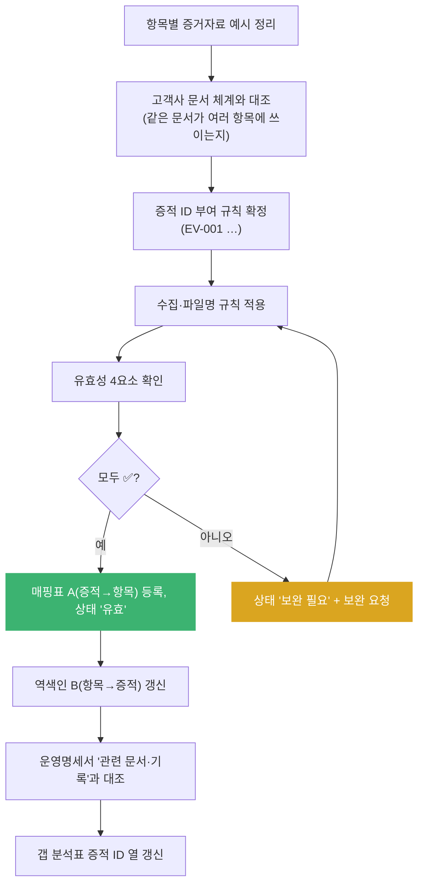
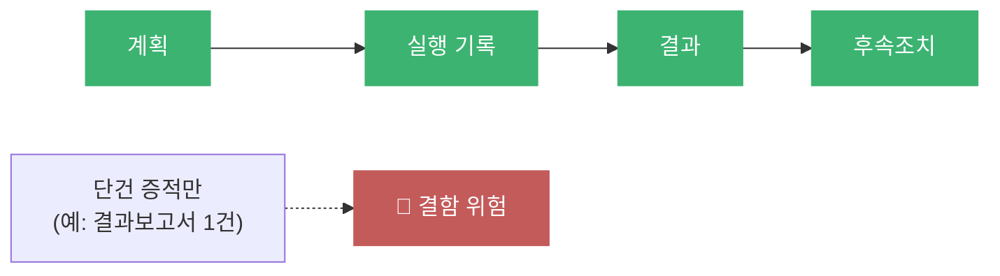

# 3주차-04. 증적 수집과 매핑

| 구분 | 내용 |
|---|---|
| 고객사 | A사(민간, ISMS-P 인증 준비) |
| 관련 산출물 | `./2_산출물_양식/05_증적_매핑표.md`, `./2_산출물_양식/04_ISMS-P_갭분석표.md` (증적 ID 열) |
| 선행 챕터 | 1주차-02. 자료 요청과 인터뷰, 증적 관리 · 3주차-03. 현황 분석과 갭 분석 |
| 예상 학습 시간 | 3시간 (읽기 1시간 + 실습 2시간) |

> [!IMPORTANT]
> **🎯 이 챕터 핵심 3줄**
> 1. 증적 매핑표는 증적 수백 개를 101개 항목과 1:N으로 연결하는 색인이고, 공통 문서는 한 곳에 두고 여러 항목에 연결한다.
> 2. 증적은 "있다/없다"가 아니라 계획 → 실행 기록 → 결과 → 후속조치 세트로 관리하고, 운영명세서의 "관련 문서·기록"과 같게 맞춘다.
> 3. 증적은 실제 운영 과정에서 생긴 기록이어야 한다. 빠진 기록을 소급 작성하도록 돕지 않는다.

---

## 1. 학습 목표

1. 인증기준 안내서의 증거자료 예시를 바탕으로 항목별 필요 증적 목록을 만들 수 있다.
2. 증적을 항목과 1:N으로 매핑하고, 유효성 4요소(기간·승인·범위·연결성)를 확인할 수 있다.
3. 운영명세서의 "관련 문서·기록"과 실제 증적이 일치하도록 관리할 수 있다.

---

## 2. 현장 비유와 기초 개념

> [!TIP]
> 🏗️ 💡 현장 비유: 증적 매핑표는 **도서관 색인 카드**다. 책(증적)이 아무리 많아도 색인이 없으면 심사원이 "2.5.6 보여 주세요"라고 할 때 30분 동안 서고를 뒤져야 한다.

> [!NOTE]
> 📌 **기초 개념 짚기**
>
> 인증 신청인은 심사 전에 문서와 증거자료를 준비해야 하고, 서면심사는 정책·지침·절차와 **이행의 증거자료**를 검토한다. 인증기준 안내서는 항목마다 증거자료 예시를 제시하고, 운영명세서에는 항목별 관련 문서와 기록(증거자료)을 적도록 한다.
> - 근거: ISMS-P 고시 제17조제2항제1호, 제25조제2항[^isms], 인증기준 안내서 1.3.1[^ig131]


1주차-02에서 증적의 유효성을 배웠다면, 이 챕터는 그 증적 수백 개를 **101개 항목과 연결하는 체계**를 만드는 일입니다.

> ✅ **2절 한 줄 정리**: 서면심사는 이행의 증거자료를 보므로, 증적을 101개 항목에 연결하는 색인 체계를 미리 만든다.

---

## 3. 근거 법령·기준

| 근거 | 키워드 | 출처 |
|---|---|---|
| ① 고시 제17조제2항 | 문서·증거자료 준비 | [^isms] |
| ② 고시 제25조제2항·제3항 | 서면심사·현장심사 | [^isms] |
| ③ 인증기준 안내서 1.3.1 | 세부 문서번호·기록 제시 | [^ig131] |
| ④ 인증기준 안내서 (항목별 증거자료 예시) | 자료 요청의 출발점 | [^ig123] [^ig256] [^ig295] |
| ⑤ 안전성 기준 제5조제3항, 제8조 | 권한 내역 3년, 접속기록 1년/2년 | [^safe] |

**🔎 번호별 보충 설명** (요지 / 쉬운 풀이: 현장에서 확인할 것)

- ① 요지: 인증심사를 위한 문서·증거자료, 장소·시설·장비 준비
  - 풀이: 심사 전에 증적이 "찾을 수 있는 상태"여야 함
- ② 요지: 서면심사는 문서·증거자료, 현장심사는 면담·시스템 확인
  - 풀이: 문서 증적 + 시스템 시연 증적 두 종류를 준비
- ③ 요지: 운영명세서에 관련 문서명과 **세부 문서번호**, 실제 운영 과정에서 생성되는 **문서·결재·회의록 등 기록** 제시
  - 풀이: 매핑표의 "관련 문서·기록"이 운영명세서와 같아야 함
- ④ 요지: 예: 1.2.3 위험관리 지침·계획서·결과보고서·위원회 회의록·자산 목록·흐름표/도, 2.5.6 검토 기준·이력·결과보고서와 후속조치, 2.9.5 로그 검토 절차·결과·접속기록 점검 내역·다운로드 사유 확인 결과·이상징후 대응 자료
  - 풀이: 자료 요청 목록의 출발점
- ⑤ 요지: 권한 내역 3년, 접속기록 1년/2년
  - 풀이: 법정 보관 기간이 있는 증적은 기간을 별도 확인

### 증적의 종류

| 종류 | 확인할 유효성 요소 |
|---|---|
| ① 정책·지침 | 승인, 최신성(개정 이력) |
| ② 계획 | 기간(올해 것), 승인 |
| ③ 기록·결과 | 기간, 승인, 범위, 연결성(계획과 일치) |
| ④ 시스템 화면·설정 | 확인 일시, 범위(대상 시스템 전체) |
| ⑤ 대장·목록 | 최신성, 범위 |

**🔎 번호별 보충 설명** (예)

- ① 정보보호 정책, 내부 관리계획, 위험관리 지침
- ② 위험관리계획서, 교육 계획, 내부점검 계획
- ③ 위험평가 결과, 교육 결과·출석부, 점검 결과, 회의록
- ④ 계정 목록, 권한 설정, 암호화 설정, 로그
- ⑤ 정보자산 목록, 수탁사 목록, 파기 대장

> ✅ **3절 한 줄 정리**: 고시는 증거자료 준비와 서면·현장 확인을, 안내서는 운영명세서의 문서번호·기록과 항목별 증거자료 예시를 요구하고, 증적 종류마다 확인할 유효성 요소가 다르다.

---

## 4. 컨설팅 수행 절차



### 폴더 구조 예시

```text
D:\A사_ISMS-P_증적\
├── 1_관리체계\
│   ├── 1.1\  1.2\  1.3\  1.4\
├── 2_보호대책\
│   ├── 2.1\ … 2.12\
├── 3_처리단계\
│   ├── 3.1\ … 3.5\
└── 00_공통문서\   ← 여러 항목에 쓰이는 정책·지침 (중복 저장하지 않음)
```

> [!TIP]
> 같은 문서를 여러 폴더에 복사하면 개정 시 일부만 바뀌는 사고가 납니다. 공통 문서는 한 곳에 두고 매핑표에서 여러 항목에 연결합니다.

### 단계별 설명

| 단계 | 결과물 | 소요 (예시) |
|---|---|---|
| 1. 필요 증적 목록 | 필요 증적 목록 | 2일 |
| 2. 수집·등록 | 매핑표 A | 상시 |
| 3. 역색인 | 매핑표 B | 상시 |
| 4. 운영명세서 대조 | 불일치 목록 | 1~2일 |
| 5. 심사 전 점검 | 심사 준비 완료 표시 | 1일 |

**🔎 번호별 보충 설명** (하는 일 / 입력 자료)

- 1. 필요 증적 목록
  - 하는 일: 항목별 증거자료 예시 → 고객사 문서명으로 변환
  - 입력 자료: 안내서, 고객사 문서 목록
- 2. 수집·등록
  - 하는 일: ID 부여, 파일명 규칙, 유효성 확인
  - 입력 자료: 제출 자료
- 3. 역색인
  - 하는 일: 항목→증적 목록, 부족 증적 표시
  - 입력 자료: 매핑표 A
- 4. 운영명세서 대조
  - 하는 일: 문서명·문서번호·기록 일치 확인
  - 입력 자료: 운영명세서 초안
- 5. 심사 전 점검
  - 하는 일: 링크·파일 열림·최신본 여부 확인
  - 입력 자료: 매핑표

### Windows 11 실무 도구 팁

<details>
<summary>🛠️ Windows 11 실무 도구 팁 5가지 펼치기</summary>

| 작업 | 도구 |
|---|---|
| ① 항목 폴더 일괄 생성 | PowerShell |
| ② 매핑표에서 파일 바로 열기 | Excel `HYPERLINK` |
| ③ 증적 변경 여부 확인 | PowerShell `Get-FileHash` |
| ④ 파일 열림 일괄 확인 | PowerShell |
| ⑤ 오래된 증적 찾기 | PowerShell |

**🔎 번호별 보충 설명** (도구·경로 / 방법)

- ① 방법:

  ```powershell
  "1.1","1.2","1.3","1.4" | ForEach-Object { New-Item -ItemType Directory -Force "D:\A사_ISMS-P_증적\1_관리체계\$_" }
  ```

- ② 경로: Excel `=HYPERLINK("D:\A사_ISMS-P_증적\2_보호대책\2.5\"&C2, C2)`
  - 방법: 심사 중 클릭 한 번으로 열기 (경로는 고객사 공유 위치 기준)
- ③ 경로: PowerShell `Get-FileHash` (SHA256) 를 등록 시점에 기록
  - 방법: 심사 직전 다시 계산해 바뀐 파일 확인
- ④ 경로: PowerShell `Get-ChildItem -Recurse -File | Where-Object Length -eq 0`
  - 방법: 0바이트(깨진) 파일 찾기
- ⑤ 경로: PowerShell `Get-ChildItem -Recurse -File | Where-Object LastWriteTime -lt (Get-Date).AddYears(-1)`
  - 방법: 1년 넘은 파일 후보 (본문 날짜로 최종 확인)

</details>

> ✅ **4절 한 줄 정리**: 증거자료 예시 → 문서 체계 대조 → ID·파일명 → 유효성 확인 → 매핑표 A·B → 운영명세서 대조 → 갭 분석표 갱신 순서로 관리하고, 공통 문서는 한 곳에 둔다.

---

## 5. 업무 분담표

| 단계 | 🙋 신입 담당 | 🧑‍💼 PM·선임 담당 |
|---|---|---|
| 필요 증적 목록 | 예시 → 고객사 문서명 변환 | 문서 체계에 맞게 조정 |
| 수집·등록 | ID·파일명·유효성, 매핑표 관리 | 대체 증적 인정 판단 |
| 운영명세서 대조 | 불일치 목록 작성 | 운영명세서 검토 |
| 심사 준비 | 링크·파일 점검, 담당자 표 | 심사 대응 리허설 |

**🔎 번호별 보충 설명** (단계별 전체 업무와 🏢 고객사 담당)

- 필요 증적 목록
  - 🙋 신입: 안내서 증거자료 예시 → 고객사 문서명 변환
  - 🧑‍💼 PM·선임: 고객사 문서 체계에 맞게 조정
  - 🏢 고객사: 문서 목록 제공
- 수집·등록
  - 🙋 신입: ID·파일명·유효성 확인, 매핑표 관리
  - 🧑‍💼 PM·선임: 대체 증적 인정 판단
  - 🏢 고객사: 증적 작성·제출
- 운영명세서 대조
  - 🙋 신입: 불일치 목록 작성
  - 🧑‍💼 PM·선임: 운영명세서 검토
  - 🏢 고객사: **운영명세서 작성·확정**
- 심사 준비
  - 🙋 신입: 링크·파일 점검, 항목별 담당자 표
  - 🧑‍💼 PM·선임: 심사 대응 리허설
  - 🏢 고객사: 증적 원본 보관

> [!WARNING]
> 🚫 **신입이 혼자 결정하지 않는 것**:
> - 대체 증적 인정
> - 증적 내용 수정 요청(고객사 문서를 컨설턴트가 고쳐 쓰는 것은 금지)
> - 운영명세서 확정

> [!WARNING]
> ⚠️ 증적은 **실제 운영 과정에서 생긴 기록**이어야 합니다. 심사를 위해 날짜를 소급해 문서를 만들도록 돕는 일은 절대 하지 않습니다.

> ✅ **5절 한 줄 정리**: 신입은 목록 변환·등록·대조·파일 점검을 맡고, 대체 증적과 운영명세서는 PM과 고객사가 정하며, 증적 소급 작성은 절대 돕지 않는다.

---

## 6. 고객 커뮤니케이션 예시

### 6-1. 항목별 증적 요청 메일 (2.9.5 예)

```text
제목: [A사 ISMS-P] 2.9.5 로그 및 접속기록 점검 증적 요청 (5/20까지)

김○○ 과장님, 안녕하세요. ○○컨설팅 홍길동입니다.

2.9.5 항목 확인을 위해 아래 증적을 요청드립니다. (인증기준 안내서 증거자료 예시 기준)

 1. 로그 검토 및 모니터링 절차서 (현행본, 승인 이력 포함)
 2. 최근 12개월 접속기록 점검 결과서 (회원관리·주문관리·콜센터 시스템 각각)
 3. 개인정보 다운로드 사유 확인 기준과 확인 결과 (최근 12개월)
 4. 이상징후 발견 시 대응 기록 (있는 경우)

※ 2번은 내부 관리계획에 정한 주기(월 1회)와 횟수가 맞는지 확인하려는 것입니다.
   빠진 달이 있으면 사유를 함께 알려 주시면 됩니다. 사후에 새로 작성하실 필요는 없습니다.
```

### 6-2. 결과 설명 멘트 (실무 담당자 대상)

> "증적 312건을 101개 항목에 연결했고, 유효한 증적이 1건 이상 있는 항목은 84개입니다. 나머지 17개 항목은 증적이 없거나 보완이 필요합니다.
>
> 특히 운영명세서에 '정보보호 위원회 회의록(분기)'이라고 적혀 있는데 실제 회의록은 2건뿐이어서, 명세서를 실제 운영에 맞게 고치시거나 앞으로 기록이 쌓이도록 일정을 잡으셔야 합니다.
>
> 명세서와 실제가 다르면 그 자체가 결함 사례에 해당합니다."

> ✅ **6절 한 줄 정리**: 증적 요청은 안내서 증거자료 예시 기준으로 기간·시스템을 특정하되 소급 작성은 요구하지 않고, 결과는 연결 현황과 명세서·실제 불일치를 설명한다.

---

## 7. 인증 결함 사례: 증적과 기록 관련

| 항목 | 증적 관리에서 막는 방법 |
|---|---|
| ① 1.3.1 보호대책 구현 | 매핑표 B(항목→증적)와 운영명세서 "관련 문서·기록"을 한 줄씩 대조 |
| ② 1.3.1 보호대책 구현 | 완료 보고서와 함께 **조치 후 화면·설정** 증적을 매핑 |
| ③ 2.2.4 인식제고 및 교육훈련 | 교육 1회당 자료·출석부·결과보고서·미이수자 조치를 한 세트로 매핑 |
| ④ 2.5.6 접근권한 검토 | 검토 결과보고서 + 후속조치 기록을 같은 증적 세트로 |

**🔎 번호별 보충 설명** (결함사례: 안내서 요약)

- ① **운영명세서에 작성된 운영 현황이 실제와 일치하지 않고**, 운영명세서에 기록된 관련 문서·결재 내용·회의록 등이 **존재하지 않는** 경우[^ig131]
- ② 위험조치 이행결과보고서는 '조치 완료'로 되어 있으나 위험이 여전히 존재하거나 이행결과의 정확성·효과성이 확인되지 않는 경우[^ig131]
- ③ 교육을 실시했으나 **교육시행·평가 기록(교육 자료, 출석부, 평가 설문지, 결과보고서 등) 일부를 남기지 않은** 경우 / 미이수자를 파악하지 않거나 추가교육을 하지 않은 경우[^ig224]
- ④ 과다 부여·오남용 의심 사례가 발견되었으나 상세조사·내부보고 등 **후속조치가 수행되지 않은** 경우[^ig256]



### 컨설팅 시사점

🔴 **증적을 "있다/없다"로만 보면 명세서 불일치·효과 미확인·기록 누락·후속조치 누락 결함을 놓친다.**

- [ ] **① 세트로 관리**: 증적은 "있다/없다"가 아니라 **세트(계획 → 실행 기록 → 결과 → 후속조치)**로 관리해야 결함을 막을 수 있습니다.

> ✅ **7절 한 줄 정리**: 1.3.1·2.2.4·2.5.6 결함은 모두 증적이 세트로 갖춰지지 않아 생기니, 계획 → 기록 → 결과 → 후속조치를 한 묶음으로 매핑한다.

---

## 8. 오답노트

| No | 상황 | ✅ 핵심 |
|---|---|---|
| ① | 같은 문서를 폴더마다 복사 | 한 곳에 두고 여러 항목 연결 |
| ② | 결과보고서만 등록 | 계획·자료·출석부·결과·조치 세트 |
| ③ | "조치 완료" 보고서만 | 조치 후 효과 확인 증적 추가 |
| ④ | 빠진 달 결과서 작성 요청 | 사실·사유 기록, 소급 작성 금지 |
| ⑤ | 명세서·매핑표 따로 관리 | 같은 기준으로 맞춤 |
| ⑥ | 날짜 없는 캡처 | 시계·URL·시스템명 보이게 |

**🔎 번호별 보충 설명** (❌ 신입의 실수 / ✅ 올바른 수행 / 근거)

- ①
  - ❌ 같은 정책 문서를 항목마다 폴더에 복사
  - ✅ 공통 문서는 한 곳에 두고 매핑표에서 여러 항목에 연결
  - 근거: 개정 시 불일치 방지
- ②
  - ❌ 교육 결과보고서만 등록하고 출석부·자료는 받지 않음
  - ✅ 계획·자료·출석부·결과·미이수자 조치를 세트로 매핑
  - 근거: 안내서 2.2.4 결함사례[^ig224]
- ③
  - ❌ "조치 완료" 보고서만으로 해당 항목 증적 완료 처리
  - ✅ 조치 후 시스템 화면 등 효과 확인 증적 추가
  - 근거: 안내서 1.3.1 결함사례[^ig131]
- ④
  - ❌ 빠진 달의 점검 결과서를 지금 작성해 달라고 고객사에 요청
  - ✅ 빠진 사실과 사유를 그대로 기록하고 앞으로의 운영을 개선. 소급 작성은 하지 않음
  - 근거: 증적 = 실제 운영 기록
- ⑤
  - ❌ 운영명세서와 매핑표를 따로 관리
  - ✅ 운영명세서 "관련 문서·기록"과 매핑표 B를 같은 기준(문서명·문서번호)으로 맞춤
  - 근거: 안내서 1.3.1[^ig131]
- ⑥
  - ❌ 시스템 화면 캡처에 날짜·시스템명이 없음
  - ✅ 시스템 시계·URL·시스템명이 보이게 캡처하고 확인 일시 기록
  - 근거: 유효성 '기간·범위'

> ✅ **8절 한 줄 정리**: 공통 문서는 한 곳에, 증적은 세트로, 완료는 효과로, 빠진 기록은 사실대로, 명세서와 매핑표는 같은 기준으로, 캡처는 일시와 함께 남긴다.

---

## 9. 고객사 점검용 체크리스트: 증적 관리 체계

각 항목: **점검 항목** → 확인 방법 / 요청 증적 → 판정 기준

### ① 목록·일치 (No 1~2)

- [ ] **No 1. 항목별 증적 목록**: 항목별 증적 목록(매핑표 또는 운영명세서)이 있다
  - 확인 방법: 문서 / 요청 증적: 매핑표, 운영명세서
  - 판정 기준: 🟢 전 항목 · 🟡 일부 · 🔴 없음
- [ ] **No 2. 명세서 실재**: 운영명세서의 관련 문서·기록이 실제로 존재한다
  - 확인 방법: 문서 / 요청 증적: 운영명세서, 증적 원본
  - 판정 기준: 🟢 전부 존재 · 🟡 일부 없음 · 🔴 다수 없음

### ② 세트·보관 (No 3~4)

- [ ] **No 3. 세트 관리**: 증적이 계획→기록→결과→후속조치 세트로 관리된다
  - 확인 방법: 문서 / 요청 증적: 항목별 증적 세트
  - 판정 기준: 🟢 세트 · 🟡 일부 · 🔴 단건
- [ ] **No 4. 보관 위치·담당자**: 증적 원본의 보관 위치와 담당자가 정해져 있다
  - 확인 방법: 인터뷰·문서 / 요청 증적: 보관 기준
  - 판정 기준: 🟢 있음 · 🔴 없음

### ③ 법정 보관 기간 (No 5)

- [ ] **No 5. 법정 보관**: 법정 보관 기간이 있는 기록(권한 내역 3년, 접속기록 1·2년)이 보관되어 있다
  - 확인 방법: 시스템 / 요청 증적: 보관 설정, 이력
  - 판정 기준: 🟢 충족 · 🔴 부족

> ✅ **9절 한 줄 정리**: 목록·명세서 실재 → 세트·보관 체계 → 법정 보관 기간 순서로 5개 항목을 확인한다.

---

## 10. 실무 산출물 연계 팁

| 이 챕터의 결과 | 들어가는 산출물 | 위치 |
|---|---|---|
| 증적 목록 | `./2_산출물_양식/05_증적_매핑표.md` | A표 |
| 항목별 역색인 | `./2_산출물_양식/05_증적_매핑표.md` | B표 |
| 증적 ID | `./2_산출물_양식/04_ISMS-P_갭분석표.md` | 증적 ID 열 |
| 운영명세서 불일치 목록 | 고객사 운영명세서 수정 요청 | 관련 문서·기록 열 |
| 심사 대응 색인 | 3주차-06 심사 대응 | 심사원 요청 대응표 |

---

## 11. 실습 과제 / 퀴즈

> [!NOTE]
> 정답과 해설은 [정답과_해설.md](../../정답과_해설.md)의 **「3주차-04. 증적 수집과 매핑」** 절에 있습니다.

### 객관식

**Q1.** 인증기준 안내서 1.3.1이 운영명세서에 적도록 한 내용이 **아닌** 것은?

① 인증기준 선정 여부
② 관련 문서명과 세부 문서번호
③ 실제 운영 과정에서 생성되는 기록(증거자료)
④ 심사원 배정 일정

**Q2.** 2.2.4 교육 항목 증적으로 "2026년 교육 결과보고서" 1건만 받았다. 결함을 막기 위해 함께 받아야 할 것으로 가장 거리가 **먼** 것은?

① 교육 자료
② 출석부(참석자 목록)
③ 미이수자 추가교육 기록
④ 교육 강사의 학위 증명서

**Q3.** 내부 관리계획상 월 1회인 접속기록 점검 결과서 중 3개월분이 없다. 신입의 대응으로 옳은 것은?

① 고객사에 빠진 3개월분 결과서를 지금 작성해 달라고 요청한다.
② 빠진 사실과 사유를 기록하고, 판정 초안과 개선 과제(향후 운영)를 쓴다.
③ 매핑표에서 해당 항목을 삭제한다.
④ 9개월분이 있으므로 🟢로 등록한다.

### 실습

**상황**: A사가 2.5.6, 2.9.5, 2.2.4, 1.2.3 항목 증적을 보냈다. 매핑표를 작성하라.

**제공 자료**

```text
[제출 증적]
a. 정보보호지침_v3.2.pdf (2025-12-01 CISO 승인) - 2.5.6 '분기별 접근권한 검토', 2.9.5 '월 1회 접속기록 점검' 규정 포함
b. 접근권한검토_2026Q1.xlsx (2026-04-10, 결재 없음, 회원관리시스템만)
c. 접속기록점검_2025-06~2026-05.zip (월별 파일 10개, 각 파일에 팀장 결재)
d. 교육결과_2026.pdf (2026-02-14, 정보보호팀장 결재, 380명 중 350명 이수)
e. 교육자료_2026.pptx
f. 취약점진단보고서_2025-11.pdf (외부업체)
g. 위험관리지침_v1.0.pdf (2024-01 승인)
[운영명세서 기재]
- 2.5.6: "분기별 접근권한 검토 결과보고서(전 시스템)"
- 1.2.3: "2026년 위험관리계획서, 위험평가 결과보고서"
```

**과제**

1. `./2_산출물_양식/05_증적_매핑표.md` A표 형식으로 a~g를 등록하시오. (연결 항목, 유효성 4요소, 상태, 비고)
2. B표 형식으로 2.5.6, 2.9.5, 2.2.4, 1.2.3의 역색인을 쓰고 "부족한 증적"을 채우시오.
3. 운영명세서 기재 내용과 실제 증적의 불일치 2건을 찾고 고객사에 보낼 요청 문장을 쓰시오.

**작성 양식**: `./2_산출물_양식/05_증적_매핑표.md`

---

## 12. 더 읽을거리

| 자료 | 읽을 부분 |
|---|---|
| ISMS-P 인증기준 안내서 | 1.3.1(p.37~38), 2.2.4, 2.5.6, 2.9.5 증거자료 예시·결함사례 |
| ISMS-P 고시 | 제17조, 제25조 |
| 개인정보의 안전성 확보조치 기준 | 제5조, 제8조 (보관 기간) |

<details>
<summary>📂 참고자료 파일명·링크 펼치기 (3개)</summary>

- ISMS-P 인증기준 안내서: [`ISMS-P 인증기준 안내서(2023.11.23).pdf`](<../../3_참고자료/ISMS-P 인증기준 안내서(2023.11.23).pdf>)
- ISMS-P 고시: [`정보보호 및 개인정보보호 관리체계 인증 등에 관한 고시(개인정보보호위원회고시)(제2024-8호)(20240724).pdf`](<../../3_참고자료/정보보호 및 개인정보보호 관리체계 인증 등에 관한 고시(개인정보보호위원회고시)(제2024-8호)(20240724).pdf>)
- 개인정보의 안전성 확보조치 기준: [`개인정보의 안전성 확보조치 기준(개인정보보호위원회고시)(제2026-9호)(20260701).pdf`](<../../3_참고자료/개인정보의 안전성 확보조치 기준(개인정보보호위원회고시)(제2026-9호)(20260701).pdf>)

</details>

---

## 각주

[^isms]: [출처: [정보보호 및 개인정보보호 관리체계 인증 등에 관한 고시(개인정보보호위원회고시)(제2024-8호)(20240724).pdf](<../../3_참고자료/정보보호 및 개인정보보호 관리체계 인증 등에 관한 고시(개인정보보호위원회고시)(제2024-8호)(20240724).pdf>), 제17조제2항, 제25조제2항·제3항]
[^safe]: [출처: [개인정보의 안전성 확보조치 기준(개인정보보호위원회고시)(제2026-9호)(20260701).pdf](<../../3_참고자료/개인정보의 안전성 확보조치 기준(개인정보보호위원회고시)(제2026-9호)(20260701).pdf>), 제5조제3항, 제8조]
[^ig123]: [출처: [ISMS-P 인증기준 안내서(2023.11.23).pdf](<../../3_참고자료/ISMS-P 인증기준 안내서(2023.11.23).pdf>), p.33~34, 1.2.3 증거자료 예시]
[^ig131]: [출처: [ISMS-P 인증기준 안내서(2023.11.23).pdf](<../../3_참고자료/ISMS-P 인증기준 안내서(2023.11.23).pdf>), p.37~38, 1.3.1 보호대책 구현 (운영명세서·결함사례)]
[^ig224]: [출처: [ISMS-P 인증기준 안내서(2023.11.23).pdf](<../../3_참고자료/ISMS-P 인증기준 안내서(2023.11.23).pdf>), p.63, 2.2.4 인식제고 및 교육훈련 결함사례]
[^ig256]: [출처: [ISMS-P 인증기준 안내서(2023.11.23).pdf](<../../3_참고자료/ISMS-P 인증기준 안내서(2023.11.23).pdf>), p.98~99, 2.5.6 접근권한 검토 (증거자료 예시·결함사례)]
[^ig295]: [출처: [ISMS-P 인증기준 안내서(2023.11.23).pdf](<../../3_참고자료/ISMS-P 인증기준 안내서(2023.11.23).pdf>), p.143~144, 2.9.5 로그 및 접속기록 점검 증거자료 예시]
