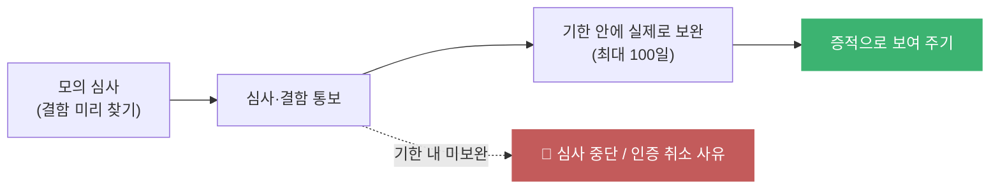
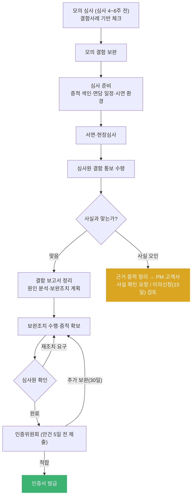
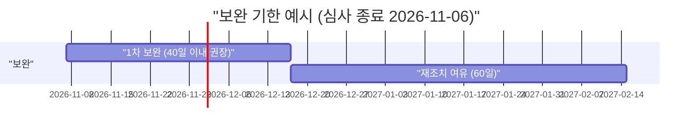
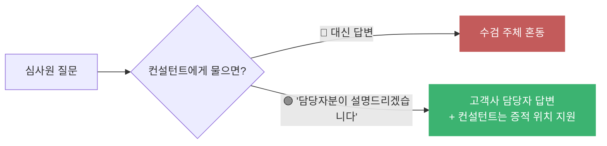

# 3주차-06. 결함 유형과 심사 대응

| 구분 | 내용 |
|---|---|
| 고객사 | A사(민간, ISMS-P 인증 심사) |
| 관련 산출물 | 결함 보고서·보완조치 계획(이 챕터 4절 양식), `./2_산출물_양식/05_증적_매핑표.md` (심사 대응 색인) |
| 선행 챕터 | 3주차-03·04·05 |
| 예상 학습 시간 | 3.5시간 (읽기 1.5시간 + 실습 2시간) |

> [!IMPORTANT]
> **🎯 이 챕터 핵심 3줄**
> 1. 결함은 모의 심사로 미리 찾고, 통보된 결함은 심사종료 다음 날부터 최대 100일(재조치 60일 포함) 안에 "실제로" 고쳐 증적으로 보여 준다. 1차 보완은 앞당긴다.
> 2. 결함 보고서는 항목 + 사실 + 근거 + 증적 구조로, 평가어 없이 쓴다. 사실과 다른 결함은 근거를 모아 15일 이내 이의신청을 검토한다.
> 3. 수검 주체는 고객사다. 컨설턴트는 대신 답하지 않고, 결함사례가 현행 법령과 다른지 한 번 더 확인한다(2.9.5 사례 3).

---

## 1. 학습 목표

1. 인증기준 안내서 결함사례를 바탕으로 자주 나오는 결함 유형을 분류하고, 모의 심사에서 미리 찾을 수 있다.
2. 결함 보고서를 "항목 + 사실 + 근거 + 증적" 구조로 쓰고, 보완조치 계획을 기한 안에 짤 수 있다.
3. 심사 기간 중 증적 제시·현장 시연·사실 확인 요청에서 신입이 할 일과 하지 말아야 할 일을 구분할 수 있다.

---

## 2. 현장 비유와 기초 개념

> [!TIP]
> 🏗️ 💡 현장 비유: 심사 대응은 **세무조사 대응**과 비슷하다. 묻는 것에 정확한 장부(증적)를 빨리 보여 주되, 묻지 않은 것을 추측으로 말하지 않고, 틀린 지적은 근거로 바로잡는다.

> [!NOTE]
> 📌 **기초 개념 짚기**
>
> 인증심사는 서면심사와 현장심사를 병행하고, 발견된 결함은 심사종료 다음 날부터 최대 100일(재조치 요구 60일 포함) 안에 보완해야 한다. 기한 안에 보완하지 않으면 심사가 중단될 수 있고, 인증 취득 후 보완조치를 하지 않으면 인증 취소 사유가 된다.
> - 근거: ISMS-P 고시 제25조제1항·제4항, 제26조제1항제3호, 제35조제1항제3호[^isms]



시험에서는 "결함 → 보완조치"까지 배웠다면, 현장에서는 **결함이 나오기 전에 찾고(모의 심사), 나온 결함은 기한 안에 "실제로" 고치고, 그 사실을 증적으로 보여 주는 것**까지 해야 합니다.

> ✅ **2절 한 줄 정리**: 결함은 미리 찾고, 기한 안에 실제로 고치고, 증적으로 보여 줘야 하며, 기한을 넘기면 심사 중단·인증 취소 사유가 된다.

---

## 3. 근거 법령·기준

| 근거 | 키워드 | 출처 |
|---|---|---|
| ① 고시 제25조제1항~제3항 | 서면심사 + 현장심사 | [^isms] |
| ② 고시 제25조제4항 | 보완조치 최대 100일 | [^isms] |
| ③ 고시 제25조제5항 | 위원회 후 30일 이내 추가 보완 | [^isms] |
| ④ 고시 제26조제1항 | 심사 중단 사유 | [^isms] |
| ⑤ 고시 제30조 | 안건 5일 전 제출 | [^isms] |
| ⑥ 고시 제35조·제36조 | 인증 취소, 15일 이내 이의신청 | [^isms] |
| ⑦ 인증기준 안내서 (항목별 결함사례) | 모의 심사 체크리스트 | [^ig] |

**🔎 번호별 보충 설명** (요지 / 쉬운 풀이: 현장에서 확인할 것)

- ① 요지: 신청인 방문, 서면심사 + 현장심사 (면담·시스템 확인·취약점 점검)
  - 풀이: 심사 기간 중 담당자 면담·시연 일정표 준비
- ② 요지: 결함 보완조치: 심사종료 다음 날부터 **최대 100일 (재조치 요구 60일 포함)**
  - 풀이: 첫 보완을 늦게 내면 재조치 기간이 줄어든다
- ③ 요지: 인증위원회 심의 결과에 따라 위원회 종료 다음 날부터 **30일 이내** 추가 보완 요구 가능
  - 풀이: 위원회 후에도 대응 인력 유지
- ④ 요지: 심사 지연·방해, 준비 미흡, **100일 내 보완조치 미완료** 등은 심사 중단 사유
  - 풀이: 보완 기한 관리가 핵심
- ⑤ 요지: 심의안건은 위원회 개최 5일 전까지 제출, 위원회는 필요 시 심사원·전문가 의견 청취
  - 풀이: 보완조치 결과는 위원회 안건 마감 전에 확정
- ⑥ 요지: 보완조치 미이행 등은 인증 취소 사유. 심사 결과·취소에 이의가 있으면 통보일부터 **15일 이내** 이의신청
  - 풀이: 사실과 다른 결함은 근거를 모아 기한 내 이의신청 검토
- ⑦ 요지: 항목마다 실제 결함 판단 예시
  - 풀이: 모의 심사 체크리스트

> ✅ **3절 한 줄 정리**: 고시는 보완 100일(재조치 60일)·추가 보완 30일·안건 5일 전·이의신청 15일 기한과 중단·취소 사유를 정하고, 안내서 결함사례는 모의 심사 체크리스트가 된다.

---

## 4. 컨설팅 수행 절차



### 보완 기한 계산 (예시)

| 이벤트 | 예시 날짜 |
|---|---|
| ① 심사 종료 | 2026-11-06(금) |
| ② 보완조치 기한 (최대) | 2027-02-14 |
| ③ 1차 보완 제출 권장 | 2026-12-16 전후 |
| ④ 인증위원회 안건 제출 | 위원회 일정 확인 |

**🔎 번호별 보충 설명** (기준)

- ① —
- ② 심사종료 다음 날부터 최대 100일 (재조치 60일 포함) / 예시 날짜는 11/7을 1일째로 셀 때. 산입 방식은 심사수행기관 안내 확인
- ③ 재조치 60일을 남기도록 **40일 이내**
- ④ 위원회 개최 5일 전까지 (심사수행기관)



> [!WARNING]
> 1차 보완 제출 시점(40일)은 "재조치 요구 60일 포함"이라는 고시 문언에서 역산한 **실무 권장값**입니다. [출처: 일반 지식, 원문 확인 권장]

### 자주 나오는 결함 유형 (인증기준 안내서 결함사례 기반)

| 유형 | 대표 항목 |
|---|---|
| ① 계획은 있고 실행 기록이 없음 | 1.2.3, 2.5.6, 2.9.5 |
| ② 실행했으나 후속조치 없음 | 2.5.6, 1.3.1 |
| ③ 범위·대상 누락 | 1.1.4, 1.2.1, 2.2.4 |
| ④ 문서와 실제가 다름 | 1.2.2, 1.3.1, 3.5.1 |
| ⑤ 법정 고지·절차 누락 | 3.1.1 |
| ⑥ 독립성·승인 문제 | 1.4.2, 1.2.3 |

**🔎 번호별 보충 설명** (결함사례 요지: 안내서)

- ① 검토·점검 기준은 있으나 실제 검토 내역이 확인되지 않음[^ig256] [^ig295]
- ② 과다 권한·오남용 의심 발견 후 상세조사·보고 없음 / 미이행 사유 보고·후속조치 없음[^ig256] [^ig131]
- ③ 개발·시험 시스템, 클라우드 자산, 외주 인력이 범위·목록·교육 대상에서 빠짐[^ig114] [^ig121] [^ig224]
- ④ 흐름도·운영명세서·처리방침이 실제와 다름[^ig122] [^ig131] [^ig351]
- ⑤ 동의 시 거부권·불이익 고지 누락, 항목 "~등" 포괄 안내, 회원가입 때 결제·배송 정보를 미리 필수 수집[^ig311]
- ⑥ 점검팀이 구축 참여자로만 구성 / 위험평가 결과 경영진 미승인[^ig142] [^ig123]

### 결함 보고서 양식 (예시)

| 결함 No | 인증기준 항목 | 기한 |
|---|---|---|
| D-01 | 2.5.6 접근권한 검토 | 2026-12-11 |

**🔎 보충 설명** (D-01 나머지 열)

- 결함 내용 (사실): 지침상 분기별 검토이나 최근 1년 검토 이력 1회(회원관리시스템만)
- 관련 근거: 인증기준 2.5.6, 정보보호지침 제○조
- 확인 증적: EV-045
- 원인 분석: 검토 담당 미지정
- 보완조치 계획: 검토 담당 지정, 전 시스템 검토 실시, 결과 보고
- 담당: 인프라팀장
- 보완 증적: 검토 결과보고서, 후속조치 내역

<details>
<summary>📋 결함 보고서 양식 전체 열(10개) 보기</summary>

| 결함 No | 인증기준 항목 | 결함 내용 (사실) | 관련 근거 | 확인 증적 | 원인 분석 | 보완조치 계획 | 담당 | 기한 | 보완 증적 |
|---|---|---|---|---|---|---|---|---|---|
| D-01 | 2.5.6 접근권한 검토 | 지침상 분기별 검토이나 최근 1년 검토 이력 1회(회원관리시스템만) | 인증기준 2.5.6, 정보보호지침 제○조 | EV-045 | 검토 담당 미지정 | 검토 담당 지정, 전 시스템 검토 실시, 결과 보고 | 인프라팀장 | 2026-12-11 | 검토 결과보고서, 후속조치 내역 |

</details>

> [!TIP]
> 결함 문구는 **사실(무엇이, 어디서, 얼마나)**만 쓰고 평가어("심각한", "부실한")는 쓰지 않습니다.

### 단계별 설명

| 단계 | 결과물 | 소요 (예시) |
|---|---|---|
| 1. 모의 심사 | 모의 결함 목록 | 1주 |
| 2. 심사 준비 | 심사 대응표 | 2~3일 |
| 3. 심사 대응 | 요청·제시 로그 | 심사 기간 |
| 4. 결함 정리 | 결함 보고서 | 2~3일 |
| 5. 보완 지원 | 보완조치 결과 | 최대 100일 |

**🔎 번호별 보충 설명** (하는 일 / 입력 자료)

- 1. 모의 심사
  - 하는 일: 결함사례 기반 체크, 증적 시연 리허설
  - 입력 자료: 갭 분석표, 매핑표
- 2. 심사 준비
  - 하는 일: 증적 색인, 면담·시연 일정, 대기 인력
  - 입력 자료: 매핑표 B
- 3. 심사 대응
  - 하는 일: 증적 요청 접수·제시 기록
  - 입력 자료: 심사원 요청
- 4. 결함 정리
  - 하는 일: 결함 보고서, 원인 분석, 보완 계획
  - 입력 자료: 결함 통보
- 5. 보완 지원
  - 하는 일: 보완 증적 검토·제출
  - 입력 자료: 고객사 조치

### Windows 11 실무 도구 팁

<details>
<summary>🛠️ Windows 11 실무 도구 팁 4가지 펼치기</summary>

| 작업 | 도구 |
|---|---|
| ① 심사 중 증적 요청 로그 | Excel |
| ② 보완 기한 자동 표시 | Excel |
| ③ 보완 전후 비교 증적 | 캡처 도구 |
| ④ 시연 환경 점검 | 관리자 콘솔·VPN·OTP |

**🔎 번호별 보충 설명** (도구·경로 / 방법)

- ① 경로: Excel 표: 요청 시각 / 심사원 / 항목 / 요청 내용 / 제시 증적 ID / 제시 시각
  - 방법: 같은 요청 중복 대응 방지, 결함 통보 시 근거
- ② 경로: Excel `=심사종료일+100` 및 `=TODAY()-심사종료일` 경과일
  - 방법: 남은 일수 경고
- ③ 경로: 캡처 도구로 같은 화면 전·후 캡처 (시계 포함)
  - 방법: 보완 증적 신뢰성
- ④ 경로: 심사 전날 관리자 콘솔 로그인·VPN·OTP 동작 확인
  - 방법: 시연 실패로 인한 오해 방지

</details>

> ✅ **4절 한 줄 정리**: 모의 심사 → 준비 → 심사 대응 → 결함 정리(사실 확인) → 보완·재조치 → 인증위원회 순서로 진행하고, 1차 보완은 40일 이내로 당기며, 결함 문구는 사실만 쓴다.

---

## 5. 업무 분담표

| 단계 | 🙋 신입 담당 | 🧑‍💼 PM·선임 담당 |
|---|---|---|
| 모의 심사 | 결함사례 체크리스트, 리허설 보조 | 모의 심사원 역할, 결함 판단 |
| 심사 대응 | 요청 로그, 증적 찾기·전달 | 질의 해석, 고객사 코칭 |
| 결함 정리 | 결함 보고서·원인 분석 초안 | 사실 오인 판단, 보완 전략 |
| 보완 지원 | 보완 증적 검토, 기한 관리 | 보완 적정성 판단 |

**🔎 번호별 보충 설명** (단계별 전체 업무와 🏢 고객사 담당)

- 모의 심사
  - 🙋 신입: 결함사례 체크리스트, 증적 시연 리허설 진행 보조
  - 🧑‍💼 PM·선임: 모의 심사원 역할, 결함 판단
  - 🏢 고객사: 수검 리허설 참여
- 심사 대응
  - 🙋 신입: 요청 로그, 증적 찾기·전달 (고객사 통해)
  - 🧑‍💼 PM·선임: 심사원 질의 해석, 고객사 코칭
  - 🏢 고객사: **수검 주체** (답변·시연)
- 결함 정리
  - 🙋 신입: 결함 보고서·원인 분석 초안
  - 🧑‍💼 PM·선임: 사실 오인 여부 판단, 보완 전략
  - 🏢 고객사: 보완 계획 승인
- 보완 지원
  - 🙋 신입: 보완 증적 검토, 기한 관리
  - 🧑‍💼 PM·선임: 보완 적정성 판단
  - 🏢 고객사: 보완조치 수행·제출

> [!WARNING]
> 🚫 **신입이 혼자 하지 않는 것**:
> - 심사원에게 직접 답변·반박 (수검 주체는 고객사)
> - 결함 인정·불인정 판단
> - 심사원에게 결함 "협상"

> [!WARNING]
> ⚠️ 컨설턴트는 심사 기간 중 **고객사를 대신해 답변하지 않습니다.** 심사원이 컨설턴트에게 묻더라도 "담당자분이 설명드리겠습니다"로 돌립니다. [출처: 일반 지식, 원문 확인 권장]



> ✅ **5절 한 줄 정리**: 신입은 체크리스트·로그·증적 찾기·초안·기한 관리를 맡고, 심사원 응대와 결함 인정 여부는 고객사와 PM 몫이다.

---

## 6. 고객 커뮤니케이션 예시

### 6-1. 결함 보고 후 고객사 실무자 대상 설명 멘트

> "심사 결과 결함 9건이 통보되었습니다. 6건은 모의 심사 때 이미 보완 중이던 것이고, 3건은 새로 나온 것입니다.
>
> 보완 기한은 심사종료 다음 날부터 최대 100일인데, 이 안에 심사원이 재조치를 요구하는 60일이 포함되어 있어서 첫 보완은 12월 중순까지 제출하시는 게 안전합니다.
>
> 9건 모두 담당자·기한·제출 증적을 표로 정리했으니, 담당자분들께 오늘 안에 공유해 주세요."

### 6-2. 사실 확인 요청 근거 정리 메모 (고객사 내부용, PM 검토 후)

```text
[결함 D-07 사실 확인 요청 검토 메모]
- 통보 내용: 2.2.4 "외주 개발자가 교육 대상에서 누락"
- 우리가 확인한 사실: 외주 개발자 12명은 2026-03-15 별도 교육 이수 (EV-118 출석부, EV-119 교육 자료)
- 심사 시 미제시 사유: 외주 교육 자료가 협력사관리 폴더에 별도 보관되어 제시 누락
- 제안: 심사수행기관에 해당 증적을 제출해 사실 확인 요청 (PM 판단 필요)
  ※ 결과 통보 후 이의가 있으면 통보일부터 15일 이내 이의신청 가능 (고시 제36조)
```

> ✅ **6절 한 줄 정리**: 결함 통보 후에는 건수·기존/신규·1차 보완 시점을 바로 공유하고, 사실과 다른 결함은 증적 ID와 미제시 사유를 담은 메모로 PM 판단을 받는다.

---

## 7. 인증 결함 사례: 2.9.5 로그 및 접속기록 점검 — 안내서와 현행 고시의 차이

인증기준 안내서(2023.11.)는 2.9.5 결함사례로 다음을 듭니다.[^ig295]

| 결함사례 | 현행 기준으로 볼 때 |
|---|---|
| ① 사례 1 | 🟢 그대로 유효 |
| ② 사례 2 | 🟢 그대로 유효 |
| ③ 사례 3 | 🟡 ⚠️ 아래 참고 |
| ④ 사례 4 | 🟢 그대로 유효 (내부 기준 미이행) |

**🔎 번호별 보충 설명** (결함사례: 안내서 요약)

- ① 사례 1: 이상접속·이상행위에 대한 모니터링 및 경고·알림 정책(기준)이 수립되어 있지 않음
- ② 사례 2: 점검·모니터링 기준은 있으나 실제 이상접속·이상행위 검토 내역이 확인되지 않음
- ③ 사례 3: 개인정보처리자가 개인정보처리시스템의 접속기록 점검 주기를 **분기 1회로 정하고 있는** 경우
- ④ 사례 4: 내부 관리계획에 1,000명 이상 다운로드 시 사유 확인 기준이 있는데, 다운로드가 발생했으나 사유를 확인하지 않음

> [!WARNING]
> ⚠️ **확인 필요**: 현행 「개인정보의 안전성 확보조치 기준」(제2026-9호) 제8조제2항은 접속기록 점검의 **주기·방법·사후조치절차를 내부 관리계획으로 정하고 이행**하도록 하며, 안내서(2026.11.)는 점검 주기를 처리하는 개인정보의 규모·성격 등을 고려해 합리적으로 정하되 과도하게 길게 두지 않도록 주의하라고 설명합니다.[^safe8] [^g154] 인증기준 안내서 사례 3은 2023년 발간 당시 기준을 반영한 것으로 보이므로, 분기 1회 주기를 결함으로 볼지는 최신 인증기준 안내서·심사수행기관 확인이 필요합니다. PM에게 보고하고, 고객사에는 "주기를 정한 근거(위험 분석 결과)를 문서로 남기는 것"을 함께 권고합니다.

### 컨설팅 시사점

🟡 **결함사례는 강력한 판정 기준이지만, 발간 시점 이후 바뀐 법령과 충돌할 수 있다.**

- [ ] **① 관련 법규 현행 여부 확인**: 결함사례는 강력한 판정 기준이지만, 발간 시점 이후 바뀐 법령과 충돌할 수 있습니다. 결함사례를 인용할 때는 관련 법규가 현행과 같은지 한 번 더 확인합니다.

> ✅ **7절 한 줄 정리**: 2.9.5 사례 1·2·4는 그대로 유효하지만 사례 3(분기 1회 주기)은 현행 안전성 기준과 다를 수 있으니, 결함사례 인용 전 현행 법령을 확인한다.

---

## 8. 오답노트

| No | 상황 | ✅ 핵심 |
|---|---|---|
| ① | 컨설턴트가 대신 답변 | 고객사 담당자 연결 |
| ② | 결함 문구에 평가어 | 사실만 |
| ③ | 100일 다 써서 1차 보완 | 1차 보완 앞당김 |
| ④ | "지침 개정"만 제출 | 개정 + 실제 운영 증적 |
| ⑤ | 사실과 다른 결함 그냥 보완 | PM 판단, 15일 내 이의신청 검토 |
| ⑥ | 결함사례 그대로 인용 | 현행 법령 확인 |

**🔎 번호별 보충 설명** (❌ 신입의 실수 / ✅ 올바른 수행 / 근거)

- ①
  - ❌ 심사원 질문에 컨설턴트가 대신 답함
  - ✅ 수검 주체인 고객사 담당자가 답하도록 연결하고, 컨설턴트는 증적 찾기 지원
  - 근거: 수검 주체는 신청인
- ②
  - ❌ 결함 문구에 "관리 부실", "심각한 미흡" 같은 평가어를 씀
  - ✅ 사실(대상·기간·수치)만 씀
  - 근거: 결함 보고서 작성 원칙
- ③
  - ❌ 100일을 다 써서 1차 보완을 제출
  - ✅ 재조치 60일을 고려해 1차 보완을 앞당김
  - 근거: 고시 제25조제4항[^isms]
- ④
  - ❌ 보완조치로 "지침 개정"만 제출
  - ✅ 개정 지침 + 실제 운영 증적(최소 1회 실행 기록)을 함께 제출
  - 근거: 1.3.1 결함사례 2 (조치 완료 표기만, 효과 미확인)[^ig131]
- ⑤
  - ❌ 사실과 다른 결함에 대해 아무 대응 없이 보완
  - ✅ 근거 증적을 정리해 PM 판단을 받고, 필요하면 기한(15일) 내 이의신청 검토
  - 근거: 고시 제36조[^isms]
- ⑥
  - ❌ 안내서 결함사례를 현행 법령 확인 없이 그대로 인용
  - ✅ 관련 법규가 개정되었는지 확인 (예: 2.9.5 사례 3)
  - 근거: 7절 ⚠️

> ✅ **8절 한 줄 정리**: 답은 고객사가, 문구는 사실로, 보완은 일찍·실제 운영 증적과 함께, 사실 오인은 근거로, 결함사례는 현행 법령과 대조해 쓴다.

---

## 9. 고객사 점검용 체크리스트: 심사 준비도

각 항목: **점검 항목** → 확인 방법 / 요청 증적 → 판정 기준

### ① 심사 전 준비 (No 1~3)

- [ ] **No 1. 모의 심사**: 모의 심사를 수행하고 모의 결함을 보완했다
  - 확인 방법: 문서 / 요청 증적: 모의 심사 결과, 보완 기록
  - 판정 기준: 🟢 완료 · 🟡 보완 중 · 🔴 미수행
- [ ] **No 2. 증적 색인·담당자**: 항목별 증적 색인(매핑표 B)과 담당자가 정해져 있다
  - 확인 방법: 문서 / 요청 증적: 심사 대응표
  - 판정 기준: 🟢 전 항목 · 🟡 일부 · 🔴 없음
- [ ] **No 3. 면담·시연 환경**: 면담 대상자·시연 환경(관리자 콘솔, VPN, OTP)이 준비되었다
  - 확인 방법: 인터뷰·시스템 / 요청 증적: 일정표, 리허설 기록
  - 판정 기준: 🟢 준비 · 🔴 미준비

### ② 심사 중·후 관리 (No 4~5)

- [ ] **No 4. 요청 로그**: 심사 중 증적 요청 로그를 기록할 체계가 있다
  - 확인 방법: 문서 / 요청 증적: 요청 로그 양식
  - 판정 기준: 🟢 있음 · 🔴 없음
- [ ] **No 5. 보완 관리표**: 결함 보완 기한·담당·제출 증적이 표로 관리된다
  - 확인 방법: 문서 / 요청 증적: 결함 보고서·보완 계획
  - 판정 기준: 🟢 있음 · 🔴 없음 · ⚪ 심사 전

### ③ 기준 차이 (No 6)

- [ ] **No 6. 결함사례·법령 차이**: 결함사례와 현행 법령이 다른 항목을 식별해 두었다
  - 확인 방법: 문서 / 요청 증적: 차이 메모
  - 판정 기준: 🟢 식별 · 🔴 미식별

> ✅ **9절 한 줄 정리**: 심사 전 준비(모의 심사·색인·시연) → 심사 중·후 관리(로그·보완표) → 기준 차이 식별 순서로 6개 항목을 확인한다.

---

## 10. 실무 산출물 연계 팁

| 이 챕터의 결과 | 들어가는 산출물 | 위치 |
|---|---|---|
| 모의 결함 목록 | 갭 분석표 판정 갱신 | `./2_산출물_양식/04_ISMS-P_갭분석표.md` |
| 심사 대응표 | 증적 매핑표 B | `./2_산출물_양식/05_증적_매핑표.md` |
| 결함 보고서·보완 계획 | 보완조치 결과 제출 자료 | 심사수행기관 제출용 |
| 보완 증적 | 증적 매핑표 A (새 ID) | 보완 증적은 기존과 구분해 등록 |
| 사후심사 대비 | 다음 해 연간 일정 | 고시 제27조 (연 1회 이상) |

---

## 11. 실습 과제 / 퀴즈

> [!NOTE]
> 정답과 해설은 [정답과_해설.md](../../정답과_해설.md)의 **「3주차-06. 결함 유형과 심사 대응」** 절에 있습니다.

### 객관식

**Q1.** 인증심사 결함 보완조치에 대한 설명으로 옳은 것은?

① 보완조치 기간은 심사종료 다음 날부터 최대 100일이며, 재조치 요구 60일이 포함된다.
② 보완조치 기간은 인증위원회 종료 후 100일이다.
③ 보완조치를 기한 내에 못 해도 심사는 계속된다.
④ 보완조치는 지침 개정 문서만 제출하면 된다.

**Q2.** 심사 중 심사원이 신입 컨설턴트에게 "이 시스템 접근권한 검토는 언제 하셨죠?"라고 물었다. 가장 적절한 대응은?

① 기억나는 대로 날짜를 답한다.
② "담당자분이 설명드리겠습니다"라고 하고, 담당자가 답하도록 연결하며 관련 증적 위치를 담당자에게 알려 준다.
③ 매핑표를 심사원에게 직접 보내 준다.
④ 아직 검토하지 않았다고 말한다.

**Q3.** 다음 결함 문구 중 가장 적절한 것은?

① "접근권한 관리가 매우 부실함"
② "지침상 분기별 접근권한 검토를 하도록 되어 있으나, 2025.11.~2026.10. 검토 이력은 2026.4. 1회(회원관리시스템)뿐임"
③ "보안 의식이 낮음"
④ "전반적으로 개선 필요"

### 실습

**상황**: A사 인증심사가 2026-11-06에 끝났고 결함 4건이 통보되었다. 결함 보고서와 보완 일정표를 작성하라.

**제공 자료**

```text
[통보된 결함 (요약)]
1. 2.5.6: 접근권한 검토 이력이 지침상 주기(분기)에 미달하고, 콜센터 시스템은 검토 대상에서 누락
2. 2.9.5: 개인정보 다운로드 1,000건 이상 3건에 대해 사유 확인 기록 없음 (내부 관리계획 기준 있음)
3. 2.2.4: 외주 개발자 교육 누락
4. 1.2.2: 개인정보 흐름도에 신규 앱 결제 흐름(PG 연계) 누락

[고객사 내부 확인 결과]
- 3번: 외주 개발자 12명은 2026-03-15 별도 교육 이수 (출석부·교육자료 있음, 협력사관리 폴더에 있어 심사 때 제시 못 함)
- 나머지는 사실과 같음
```

**과제**

1. 4절 결함 보고서 양식으로 4건을 작성하시오. (원인 분석·보완조치 계획·보완 증적 포함)
2. 3번 결함에 대해 PM에게 올릴 사실 확인 요청 검토 메모를 6-2 형식으로 쓰시오.
3. 심사 종료일 기준 보완 일정표(1차 보완 제출, 재조치 여유, 최대 기한)를 쓰시오.

**작성 양식**: 4절 결함 보고서·보완 기한 표, 6-2 메모

---

## 12. 더 읽을거리

| 자료 | 읽을 부분 |
|---|---|
| ISMS-P 고시 | 제25조, 제26조, 제30조, 제35조, 제36조 |
| ISMS-P 인증기준 안내서 | 2.5.6, 2.9.5, 3.1.1, 2.2.4 결함사례 |
| 개인정보의 안전성 확보조치 기준 안내서 | p.154 접속기록 점검 주기 FAQ |

<details>
<summary>📂 참고자료 파일명·링크 펼치기 (3개)</summary>

- ISMS-P 고시: [`정보보호 및 개인정보보호 관리체계 인증 등에 관한 고시(개인정보보호위원회고시)(제2024-8호)(20240724).pdf`](<../../3_참고자료/정보보호 및 개인정보보호 관리체계 인증 등에 관한 고시(개인정보보호위원회고시)(제2024-8호)(20240724).pdf>)
- ISMS-P 인증기준 안내서: [`ISMS-P 인증기준 안내서(2023.11.23).pdf`](<../../3_참고자료/ISMS-P 인증기준 안내서(2023.11.23).pdf>)
- 개인정보의 안전성 확보조치 기준 안내서: [`개인정보의 안전성 확보조치 기준 안내서(2026.11).pdf`](<../../3_참고자료/개인정보의 안전성 확보조치 기준 안내서(2026.11).pdf>)

</details>

---

## 각주

[^isms]: [출처: [정보보호 및 개인정보보호 관리체계 인증 등에 관한 고시(개인정보보호위원회고시)(제2024-8호)(20240724).pdf](<../../3_참고자료/정보보호 및 개인정보보호 관리체계 인증 등에 관한 고시(개인정보보호위원회고시)(제2024-8호)(20240724).pdf>), 제25조, 제26조, 제30조, 제35조, 제36조]
[^ig]: [출처: [ISMS-P 인증기준 안내서(2023.11.23).pdf](<../../3_참고자료/ISMS-P 인증기준 안내서(2023.11.23).pdf>), 제2장 항목별 결함사례]
[^ig114]: [출처: [ISMS-P 인증기준 안내서(2023.11.23).pdf](<../../3_참고자료/ISMS-P 인증기준 안내서(2023.11.23).pdf>), p.18, 1.1.4 결함사례]
[^ig121]: [출처: [ISMS-P 인증기준 안내서(2023.11.23).pdf](<../../3_참고자료/ISMS-P 인증기준 안내서(2023.11.23).pdf>), p.25, 1.2.1 결함사례]
[^ig122]: [출처: [ISMS-P 인증기준 안내서(2023.11.23).pdf](<../../3_참고자료/ISMS-P 인증기준 안내서(2023.11.23).pdf>), p.31, 1.2.2 결함사례]
[^ig123]: [출처: [ISMS-P 인증기준 안내서(2023.11.23).pdf](<../../3_참고자료/ISMS-P 인증기준 안내서(2023.11.23).pdf>), p.34, 1.2.3 결함사례]
[^ig131]: [출처: [ISMS-P 인증기준 안내서(2023.11.23).pdf](<../../3_참고자료/ISMS-P 인증기준 안내서(2023.11.23).pdf>), p.38, 1.3.1 결함사례]
[^ig142]: [출처: [ISMS-P 인증기준 안내서(2023.11.23).pdf](<../../3_참고자료/ISMS-P 인증기준 안내서(2023.11.23).pdf>), p.46, 1.4.2 결함사례]
[^ig224]: [출처: [ISMS-P 인증기준 안내서(2023.11.23).pdf](<../../3_참고자료/ISMS-P 인증기준 안내서(2023.11.23).pdf>), p.63, 2.2.4 결함사례]
[^ig256]: [출처: [ISMS-P 인증기준 안내서(2023.11.23).pdf](<../../3_참고자료/ISMS-P 인증기준 안내서(2023.11.23).pdf>), p.98~99, 2.5.6 접근권한 검토 결함사례]
[^ig295]: [출처: [ISMS-P 인증기준 안내서(2023.11.23).pdf](<../../3_참고자료/ISMS-P 인증기준 안내서(2023.11.23).pdf>), p.143~144, 2.9.5 로그 및 접속기록 점검 결함사례]
[^ig311]: [출처: [ISMS-P 인증기준 안내서(2023.11.23).pdf](<../../3_참고자료/ISMS-P 인증기준 안내서(2023.11.23).pdf>), p.191, 3.1.1 개인정보 수집·이용 결함사례]
[^ig351]: [출처: [ISMS-P 인증기준 안내서(2023.11.23).pdf](<../../3_참고자료/ISMS-P 인증기준 안내서(2023.11.23).pdf>), p.247, 3.5.1 결함사례]
[^safe8]: [출처: [개인정보의 안전성 확보조치 기준(개인정보보호위원회고시)(제2026-9호)(20260701).pdf](<../../3_참고자료/개인정보의 안전성 확보조치 기준(개인정보보호위원회고시)(제2026-9호)(20260701).pdf>), 제8조제2항]
[^g154]: [출처: [개인정보의 안전성 확보조치 기준 안내서(2026.11).pdf](<../../3_참고자료/개인정보의 안전성 확보조치 기준 안내서(2026.11).pdf>), p.154 FAQ 6 '접속기록 점검 주기']
