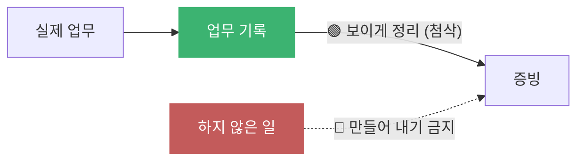
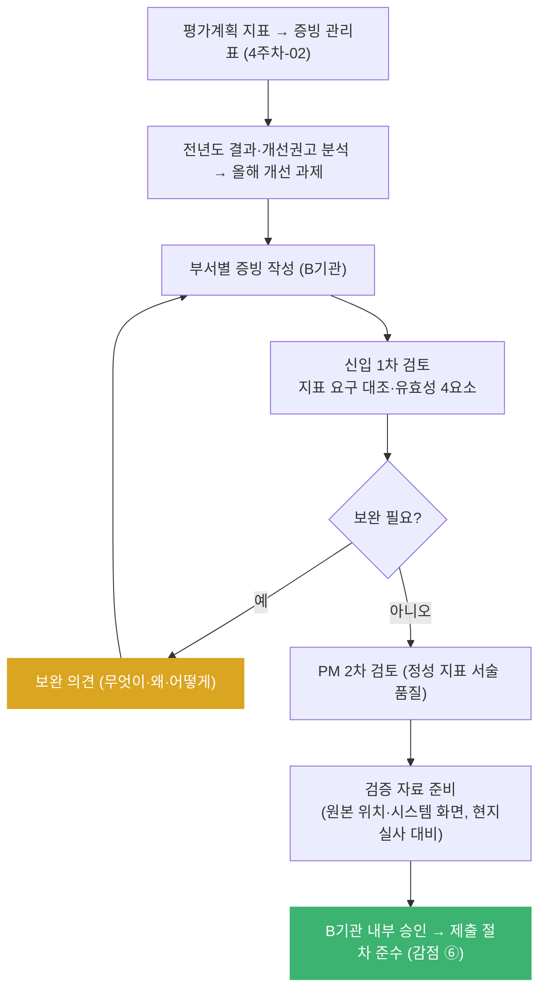
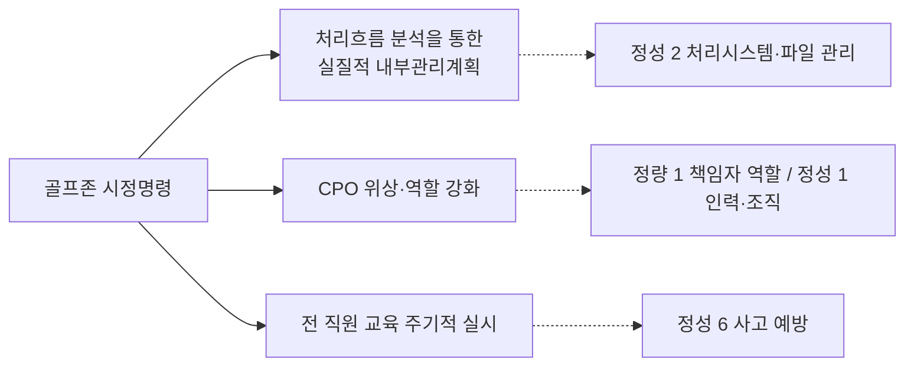

# 4주차-03. 보호수준 평가 증빙 작성 지원

| 구분 | 내용 |
|---|---|
| 고객사 | B기관(공공) |
| 관련 산출물 | `./2_산출물_양식/06_보호수준평가_증빙_관리표.md`, `./2_산출물_양식/05_증적_매핑표.md` |
| 선행 챕터 | 4주차-02. 보호수준 평가 제도와 지표 |
| 예상 학습 시간 | 3.5시간 (읽기 1.5시간 + 실습 2시간) |

> [!IMPORTANT]
> **🎯 이 챕터 핵심 3줄**
> 1. 증빙은 실제 업무의 기록이어야 한다. 컨설턴트는 "보이게" 정리하도록 돕되 만들어 내지 않는다.
> 2. 증빙은 지표 대응·기간·승인·범위·연결성·사실성 6개 관점으로 1차 검토하고, 정성 지표 서술은 형용사가 아니라 수치·일자·결과로 보완한다.
> 3. 현지실사에 대비해 원본 위치·시연 화면 목록을 준비하고, 증빙 간 수치를 교차 확인한다. 보호위원회는 "실질적" 이행을 요구한다(골프존 시정명령).

---

## 1. 학습 목표

1. B기관 부서가 작성한 증빙을 지표 요구·유효성 기준으로 검토하고 보완 의견을 쓸 수 있다.
2. 1~3주차 산출물 중 보호수준 평가 증빙 후보가 되는 것을 찾아 재사용 계획을 세울 수 있다.
3. 전년도 평가 결과와 개선권고에서 올해 개선 과제를 도출할 수 있다.

---

## 2. 현장 비유와 기초 개념

> [!TIP]
> 🏗️ 💡 현장 비유: 증빙 작성 지원은 **자기소개서 첨삭**이다. 경험(실제 업무)을 대신 만들어 줄 수는 없지만, 이미 한 일을 평가자가 알아볼 수 있게 근거와 결과 중심으로 정리하도록 돕는다.

> [!NOTE]
> 📌 **기초 개념 짚기**
>
> 보호위원회는 평가대상기관에 ① 자체 점검 결과와 증명자료 ② 증명자료 검증에 필요한 자료 ③ 그 밖에 필요한 자료의 제출을 요구할 수 있고, 제출 자료를 기준으로 평가하거나 방문해 평가할 수 있다. 평가 결과 개선을 권고받은 기관은 조치 결과를 알려야 한다.
> - 근거: 시행령 제13조의2제5항·제6항[^dec], 「개인정보 보호법」 제11조의2제4항[^law]



이 챕터의 원칙은 하나입니다. **증빙은 실제 업무의 기록이어야 하고, 컨설턴트는 그것을 "보이게" 정리하도록 돕되 만들어 내지 않는다.**

> ✅ **2절 한 줄 정리**: 보호위원회는 증명자료와 검증 자료를 요구하고 방문 평가도 하므로, 증빙은 실제 기록이어야 하고 컨설턴트는 정리만 돕는다.

---

## 3. 근거 법령·기준

| 근거 | 키워드 | 출처 |
|---|---|---|
| ① 영 제13조의2제5항 | 증명자료, 검증 자료 | [^dec] |
| ② 영 제13조의2제6항 | 방문 평가 | [^dec] |
| ③ 영 제13조의2제3항 | 평가지표 포함 | [^dec] |
| ④ 2026 평가 개요 | 자체평가 + 심층평가, 감점 ⑤·⑥ | [^lvl] |
| ⑤ 법 제11조의2제4항 | 개선권고 조치 결과 통보 | [^law] |

**🔎 번호별 보충 설명** (요지 / 쉬운 풀이: 현장에서 확인할 것)

- ① 요지: 자체 점검 결과 + **증명자료**, 증명자료 **검증에 필요한 자료**
  - 풀이: 증빙만이 아니라 "검증 자료"(원본 위치, 시스템 화면)를 요구받을 수 있음
- ② 요지: 제출 자료 기준 평가 또는 방문 평가
  - 풀이: 현지실사에서 증빙과 실제가 다르면 문제
- ③ 요지: 평가계획에 평가지표 포함
  - 풀이: 지표별 요구 사항은 평가계획 원문 기준
- ④ 요지: 자체평가(법령상 의무사항 이행 여부) + 심층평가(업무수행의 적절성·충실성). 감점 ⑤ 공정한 평가 방해, ⑥ 자체평가 결과보고서 제출 절차 미준수
  - 풀이: 정량 = "했는가", 정성 = "제대로 했는가". 허위·과장 증빙은 공정성 문제
- ⑤ 요지: 개선권고 → 이행 노력·조치 결과 통보
  - 풀이: 올해 개선 과제 1순위

### 평가 항목 ↔ 관련 법령 의무 ↔ 이 레포 산출물 (연결 후보)

> [!WARNING]
> 아래는 **평가 항목 이름**을 기준으로 관련 법령 의무와 1~3주차 산출물을 연결한 학습용 표입니다. 실제 지표가 무엇을 요구하는지는 B기관이 받은 평가계획으로 확정합니다.

| 평가 항목 (2026) | 관련 법령 의무 (예) | 증빙 후보가 될 수 있는 산출물 |
|---|---|---|
| 정량 1. 개인정보 책임자의 역할 수행 | 법 제31조 (CPO 지정·업무) | CPO 지정 문서, 내부 관리계획 CPO 조항 (2주차-01), 이행 점검 결과 CPO 보고 (2주차-02) |
| 정량 2. 개인정보 영향평가 수행 등 | 법 제33조, 영향평가 고시 제12조 | 영향평가서 제출·이행확인서 (4주차-04) |
| 정량 4. 처리방침 및 열람·정정·삭제·처리정지 등 | 법 제30조, 제35조~제37조 | 처리방침 진단표 (1주차-03), 권리 행사 처리 대장 |
| 정량 5. 수집·이용과 제공 | 법 제15조, 제17조, 제18조, 제22조 | 동의서·고지 진단 (1주차-04), 제공 대장 |
| 정량 6. 접근권한 관리 및 접속기록 점검 | 안전성 기준 제5조, 제8조 | 이행 점검표 2·3·7번 (2주차-02) |
| 정량 7. 침해사고 방지조치 및 대응 절차 | 안전성 기준 제4조제1항제14호, 제6조, 제9조, 법 제34조 | 유출사고 대응 계획, 이행 점검 결과 |
| 정량 8. 암호화 조치 | 안전성 기준 제7조, 법 제24조의2 | 암호화 적용 현황 (2주차-02) |
| 정량 9. 영상정보처리기기 운영 | 법 제25조·제25조의2, 표준지침 제35조~ | CCTV 운영·관리 방침, 관리대장 |
| 정성 1. 인력·조직 및 예산 | 법 제31조 | 조직도, 예산 자료, CPO 보고 체계 |
| 정성 2. 처리시스템 및 파일 관리의 적절성 | 법 제32조, 영 제34조 | 개인정보파일 등록 현황, 흐름표 (4주차-05) |
| 정성 3. 기관장 노력 | — | 기관장 보고·결재, 회의록 |
| 정성 4. 처리 및 권리 보장의 적절성 | 법 제35조~제38조 | 권리 행사 처리 대장, 거절 사유 검토 |
| 정성 5. 위·수탁의 적절성 및 사후관리 | 법 제26조 | 계약서 검토표, 수탁사 점검·이행 확인 (2주차-03~05) |
| 정성 6. 유출 등 사고 예방과 대응 노력 | 법 제34조, 안전성 기준 | 유출 대응 훈련, 접속기록 점검 사후조치 |

> ✅ **3절 한 줄 정리**: 영 제13조의2는 증명·검증 자료와 방문 평가를, 평가 개요는 정량(했는가)·정성(제대로 했는가)을 정하며, 1~3주차 산출물은 평가 항목별 증빙 후보가 된다.

---

## 4. 컨설팅 수행 절차



### 증빙 1차 검토 기준

| 구분 | 확인 질문 | 흔한 문제 |
|---|---|---|
| 지표 대응 | 평가계획 지표가 요구하는 내용에 정확히 답하는가? | 지표와 관계없는 자료를 많이 붙임 |
| 기간 | 평가 대상 기간 안의 기록인가? | 전년도 자료 재사용 |
| 승인 | 기관 내부 결재·보고가 있는가? | 초안·결재 공란 |
| 범위 | 기관 전체(모든 처리시스템·부서)를 포괄하는가? | 일부 부서 자료만 |
| 연결성 | 계획 → 실행 → 결과 → 후속조치가 이어지는가? | 계획서만, 결과 없음 |
| 사실성 | 실제 업무 기록인가? 현지실사 때 원본을 보여 줄 수 있는가? | 평가용으로 새로 만든 문서 |

### 정성 지표 서술 보완 요령 (예)

| 🔴 약한 서술 | 🟢 보완 방향 |
|---|---|
| "수탁사 관리를 철저히 하였음" | 점검 대상 수·방식·발견 건수·개선 요구·이행 확인 결과를 수치로 |
| "기관장이 개인정보 보호에 관심이 많음" | 기관장 보고 일자·안건·지시 사항·후속 조치 기록 |
| "교육을 실시함" | 대상별 차등 교육 내용, 이수율, 미이수자 조치 |

> [!WARNING]
> 서술 보완은 **있는 사실을 구체화**하는 것입니다. 하지 않은 일을 쓰도록 권하지 않습니다.

### 단계별 설명

| 단계 | 결과물 | 소요 (예시) |
|---|---|---|
| 1. 개선 과제 도출 | 개선 과제 목록 | 1일 |
| 2. 증빙 작성 안내 | 안내문 | 1일 |
| 3. 1차 검토 | 검토 의견 | 지표당 30분 |
| 4. 검증 자료 준비 | 검증 자료 목록 | 1~2일 |
| 5. 제출 지원 | 제출 체크리스트 | 0.5일 |

**🔎 번호별 보충 설명** (하는 일 / 입력 자료)

- 1. 개선 과제 도출
  - 하는 일: 전년도 결과·개선권고 → 올해 과제
  - 입력 자료: 결과 공문
- 2. 증빙 작성 안내
  - 하는 일: 부서별 작성 안내문, 재사용 가능 산출물 안내
  - 입력 자료: 증빙 관리표
- 3. 1차 검토
  - 하는 일: 지표 대응·유효성 검토, 보완 의견
  - 입력 자료: 부서 증빙
- 4. 검증 자료 준비
  - 하는 일: 원본 위치·시연 화면 목록
  - 입력 자료: 증빙
- 5. 제출 지원
  - 하는 일: 제출 절차·기한 확인
  - 입력 자료: 평가계획

### Windows 11 실무 도구 팁

<details>
<summary>🛠️ Windows 11 실무 도구 팁 4가지 펼치기</summary>

| 작업 | 도구 |
|---|---|
| ① 부서별 증빙 진행률 | Excel 피벗 테이블 |
| ② 증빙 PDF 묶기 | Word → Edge |
| ③ 검토 의견 기록 | Word 메모 |
| ④ 원본 위치 목록 | PowerShell |

**🔎 번호별 보충 설명** (도구·경로 / 방법)

- ① 경로: Excel 피벗 테이블 (행: 부서, 열: 작성 상태)
  - 방법: 주간 회의 자료
- ② 경로: Word에서 각 문서를 PDF로 저장 → Edge에서 확인
  - 방법: 묶음 전 페이지 순서·누락 확인 (PDF 병합 도구는 기관 승인 SW 사용)
- ③ 경로: Word → 검토 → 새 메모
  - 방법: 원본을 직접 고치지 않고 메모로 의견
- ④ 경로: PowerShell `Get-ChildItem -Recurse -File | Select FullName, LastWriteTime | Export-Csv`
  - 방법: 현지실사 때 원본을 바로 찾기 위한 목록

</details>

> ✅ **4절 한 줄 정리**: 개선 과제 도출 → 작성 안내 → 6개 관점 1차 검토·보완 → PM 2차 검토 → 검증 자료 준비 → 내부 승인·제출 순서로 지원하고, 서술은 사실을 구체화한다.

---

## 5. 업무 분담표

| 단계 | 🙋 신입 담당 | 🧑‍💼 PM·선임 담당 |
|---|---|---|
| 개선 과제 | 전년도 결과·개선권고 정리 | 과제 우선순위 |
| 증빙 작성 | 작성 안내문, 재사용 산출물 연결 | 지표 해석 |
| 1차 검토 | 지표 대응·유효성 검토, 보완 의견 | — |
| 2차 검토 | — | 정성 서술 품질 검토 |
| 제출 | 제출 체크리스트 | 최종 확인 |

**🔎 번호별 보충 설명** (단계별 🏢 B기관 담당)

- 개선 과제: 과제 승인, 담당 지정
- 증빙 작성: **증빙 작성 (부서)**
- 1차 검토: 보완
- 2차 검토: —
- 제출: **내부 승인·제출**

> [!WARNING]
> 🚫 **신입이 하지 않는 것**:
> - B기관 증빙을 대신 작성
> - 실행하지 않은 활동을 서술하도록 권유
> - 결재 없는 문서를 "곧 결재된다"며 증빙으로 처리
> - 자체평가 점수 산정

> ✅ **5절 한 줄 정리**: 신입은 개선 과제 정리·안내·1차 검토·체크리스트를 맡고, 증빙 작성과 제출은 B기관이, 서술 품질과 최종 확인은 PM이 한다.

---

## 6. 고객 커뮤니케이션 예시

### 6-1. 증빙 보완 의견 (부서 담당자 대상)

```text
[정성 5. 개인정보 처리업무 위·수탁의 적절성 및 사후관리 — 1차 검토 의견]

■ 제출 증빙: 「2027년 수탁사 관리 계획」(결재 완료), 「수탁사 현황표」
■ 의견
 1. 계획서만 있고 실행 결과가 없습니다. 상반기 수탁사 점검 결과보고서(5월 결재본)와
    개선 요구·이행 확인표를 함께 제출해 주시면 '계획 → 실행 → 결과 → 후속조치'가 이어집니다.
 2. 수탁사 현황표의 수탁사 수(12곳)와 처리방침에 공개된 수탁사 수(10곳)가 다릅니다.
    어느 쪽이 맞는지 확인 부탁드립니다. (현지실사 때 대조될 수 있습니다)
 3. 서술에 '철저히 관리'라는 표현 대신, 점검 대상 수, 발견 건수, 이행 완료 건수를 적어 주세요.
```

### 6-2. 결과 설명 멘트 (PM 확정 후, CPO 대상)

> "부서별 증빙 46건 중 29건은 바로 제출 가능하고, 17건은 보완이 필요합니다.
>
> 보완 사유는 대부분 '계획서만 있고 실행 결과가 없다'와 '수치가 다른 문서와 맞지 않는다' 두 가지입니다.
>
> 특히 작년 개선권고였던 수탁사 관리·감독은 올해 점검 결과와 이행 확인까지 증빙에 꼭 들어가야 합니다.
>
> 현지실사에서 원본을 바로 보여 드릴 수 있도록 원본 위치 목록도 함께 정리해 두었습니다."

> ✅ **6절 한 줄 정리**: 보완 의견은 연결성·수치 일치·서술 구체화 관점으로 쓰고, CPO에게는 제출 가능/보완 건수와 주된 보완 사유·개선권고 이행을 설명한다.

---

## 7. 처분 사례: ㈜골프존 시정명령 내용과 정성 지표 (2024.5. 의결)

| 구분 | 내용 |
|---|---|
| 사건 | 파일서버 개인정보 랜섬웨어 유출 (약 221만 명 이상) |
| 처분 | 과징금 75억 4백만 원, 과태료 540만 원, 시정명령, 공표명령 |
| 출처 | 2024.5.9. 보도자료, 2024.5.8. 의결[^golf] |



<details>
<summary>📄 사건 상세 (사건 개요·처분·출처 원문 펼치기)</summary>

- 사건 개요: 업무망 파일서버에 저장된 주민등록번호 등 개인정보가 랜섬웨어 공격으로 유출됨 (약 221만 명 이상)
- 처분·결과: 과징금 75억 4백만 원, 과태료 540만 원. 시정명령: **회사 내 개인정보 처리흐름에 대한 면밀한 분석을 통한 실질적인 내부관리계획 수립·시행**, 공유설정 등 안전조치, **개인정보보호책임자의 위상과 역할 강화**, **전 직원 대상 개인정보 보호 교육 주기적 실시**, 공표명령
- 출처: 2024.5.9. 보도자료 「개인정보위, ㈜골프존 개인정보 유출사고에 대해 과징금 75억 원, 과태료 540만 원 및 시정명령 부과」, 2024.5.8. 의결[^golf]

</details>

### 컨설팅 시사점

🟡 **보호위원회는 형식적 계획서가 아니라 "실질적" 이행을 요구한다.**

- [ ] **① 실질적 이행을 서술 원칙으로**: 시정명령 항목(처리흐름 분석, 실질적 내부 관리계획, CPO 위상, 교육)은 보호수준 평가 항목 이름(정량 1 책임자 역할, 정성 1 인력·조직, 정성 2 처리시스템·파일 관리, 정성 6 사고 예방)과 많이 겹칩니다. 보호위원회가 **"실질적"** 이행을 요구한다는 점을 증빙 서술 원칙으로 삼습니다.
- [ ] **② 형식과 실질 구분**: 민간 처분 사례지만, 공공기관 증빙 검토 때도 "형식적 계획서"와 "실질적 이행 기록"을 구분하는 기준으로 쓸 수 있습니다.

> ✅ **7절 한 줄 정리**: 골프존 시정명령 항목은 평가 지표와 많이 겹치고 "실질적" 이행을 요구하니, 증빙은 형식적 계획서가 아니라 실행 기록으로 채운다.

---

## 8. 오답노트

| No | 상황 | ✅ 핵심 |
|---|---|---|
| ① | 부족한 증빙을 새로 만들어 줌 | 실제 기록 안내, 없으면 개선 과제 |
| ② | 결재 공란 "곧 결재" 통과 | 결재 완료 후 제출 |
| ③ | 전년도 증빙 날짜만 변경 | 올해 기간 기록으로 교체 |
| ④ | 서술을 형용사로 채움 | 수치·일자·결과 |
| ⑤ | 증빙 간 수치 불일치 놓침 | 숫자 교차 확인 |
| ⑥ | 제출을 담당자에게만 맡김 | 제출 체크리스트로 함께 확인 |

**🔎 번호별 보충 설명** (❌ 신입의 실수 / ✅ 올바른 수행 / 근거)

- ①
  - ❌ 증빙이 부족한 지표에 컨설턴트가 문서를 새로 만들어 줌
  - ✅ 실제 업무 기록을 찾도록 안내하고, 없으면 "없음"과 개선 과제로 정리
  - 근거: 영 제13조의2제5항(증명자료·검증 자료)[^dec], 감점 ⑤ 공정성[^lvl]
- ②
  - ❌ 결재 공란 문서를 "곧 결재 예정"이라며 통과
  - ✅ 결재 완료 후 제출. 일정이 안 되면 PM에 보고
  - 근거: 유효성 '승인'
- ③
  - ❌ 전년도 증빙을 날짜만 바꿔 재사용
  - ✅ 올해 평가 대상 기간의 기록으로 교체
  - 근거: 유효성 '기간'
- ④
  - ❌ 정성 지표 서술을 형용사로 채움
  - ✅ 수치·일자·결과 중심으로 보완 의견
  - 근거: 심층평가 = 적절성·충실성[^lvl]
- ⑤
  - ❌ 증빙 간 수치 불일치(수탁사 수 등)를 놓침
  - ✅ 처리방침·현황표·점검 결과의 숫자를 교차 확인
  - 근거: 현지실사 대비 (영 제13조의2제6항)
- ⑥
  - ❌ 제출 기한·절차를 B기관 담당자에게만 맡김
  - ✅ 평가계획의 제출 절차를 체크리스트로 만들어 함께 확인
  - 근거: 감점 ⑥[^lvl]

> ✅ **8절 한 줄 정리**: 증빙은 만들지 않고 찾으며, 결재·기간을 지키고, 서술은 수치로, 숫자는 교차 확인하고, 제출 절차는 함께 챙긴다.

---

## 9. 고객사 점검용 체크리스트: 증빙 품질

각 항목: **점검 항목** → 확인 방법 / 요청 증적 → 판정 기준

### ① 지정·유효성 (No 1~2)

- [ ] **No 1. 담당·증빙 지정**: 모든 지표에 담당 부서와 증빙이 지정되어 있다
  - 확인 방법: 문서 / 요청 증적: 증빙 관리표
  - 판정 기준: 🟢 전부 · 🟡 일부 · 🔴 다수 미지정
- [ ] **No 2. 기간·결재**: 증빙이 평가 대상 기간의 결재 완료 문서다
  - 확인 방법: 문서 / 요청 증적: 증빙 원본
  - 판정 기준: 🟢 전부 · 🟡 일부 · 🔴 다수 미충족

### ② 연결성·일치 (No 3~4)

- [ ] **No 3. 정성 증빙 연결성**: 정성 지표 증빙이 계획→실행→결과→후속조치로 이어진다
  - 확인 방법: 문서 / 요청 증적: 정성 증빙 세트
  - 판정 기준: 🟢 이어짐 · 🟡 일부 · 🔴 계획서만
- [ ] **No 4. 수치 일치**: 증빙 간 수치(수탁사 수, 시스템 수, 교육 인원 등)가 일치한다
  - 확인 방법: 문서 / 요청 증적: 관련 증빙
  - 판정 기준: 🟢 일치 · 🔴 불일치

### ③ 실사·제출 준비 (No 5~7)

- [ ] **No 5. 검증 자료 목록**: 증빙 원본 위치와 시연 가능한 시스템 화면 목록이 있다
  - 확인 방법: 문서 / 요청 증적: 검증 자료 목록
  - 판정 기준: 🟢 있음 · 🔴 없음
- [ ] **No 6. 개선권고 이행 증빙**: 전년도 개선권고 이행 증빙이 준비되었다
  - 확인 방법: 문서 / 요청 증적: 조치 결과, 통보 공문
  - 판정 기준: 🟢 있음 · 🔴 없음 · ⚪ 개선권고 없음
- [ ] **No 7. 제출 체크리스트**: 제출 절차·기한이 체크리스트로 관리된다
  - 확인 방법: 문서 / 요청 증적: 제출 체크리스트
  - 판정 기준: 🟢 있음 · 🔴 없음

> ✅ **9절 한 줄 정리**: 지정·유효성 → 연결성·수치 일치 → 실사·제출 준비 순서로 7개 항목을 확인한다.

---

## 10. 실무 산출물 연계 팁

| 이 챕터의 결과 | 들어가는 산출물 | 위치 |
|---|---|---|
| 증빙 작성 상태·검토 의견 | `./2_산출물_양식/06_보호수준평가_증빙_관리표.md` | A·B·C표 |
| 원본 위치·검증 자료 | `./2_산출물_양식/05_증적_매핑표.md` | `LVL_` 영역코드 |
| 올해 개선 과제 | 연간 컨설팅 결과 보고서 | '차년도 개선 과제' |
| 전년도 개선권고 이행 | 증빙 관리표 E표 | 조치 증빙 |

> [!TIP]
> 💡 B기관 연간 컨설팅에서 만든 2주차 산출물(이행 점검, 수탁사 점검)은 **처음부터 증빙으로 쓸 수 있게** 결재·날짜·수치를 갖춰 두면, 평가 시즌에 다시 만들 일이 없습니다.

---

## 11. 실습 과제 / 퀴즈

> [!NOTE]
> 정답과 해설은 [정답과_해설.md](../../정답과_해설.md)의 **「4주차-03. 보호수준 평가 증빙 작성 지원」** 절에 있습니다.

### 객관식

**Q1.** 시행령 제13조의2제5항에 따라 보호위원회가 제출을 요구할 수 있는 자료가 **아닌** 것은?

① 평가대상기관이 자체 점검한 결과와 증명자료
② 증명자료의 검증에 필요한 자료
③ 그 밖에 개인정보 보호수준을 평가하기 위해 필요한 자료
④ 평가대상기관 직원의 개인 신용정보

**Q2.** 부서 담당자가 "수탁사 점검을 안 했는데, 점검 결과보고서 양식만 만들어서 내면 안 될까요?"라고 물었다. 신입의 대응으로 가장 적절한 것은?

① 양식을 채워 제출하도록 돕는다.
② 실제 점검하지 않은 내용을 증빙으로 만들 수 없음을 설명하고, 사실대로 정리한 뒤 개선 과제로 넣는 방안을 PM에게 보고한다.
③ 작년 결과보고서 날짜를 바꿔 제출하도록 한다.
④ 해당 지표는 증빙 없이 비워 둔다고만 답한다.

**Q3.** 정성 지표 증빙의 서술 보완으로 가장 적절한 것은?

① "개인정보 보호를 철저히 함"
② "기관장이 개인정보 보호에 큰 관심을 가짐"
③ "2027.5. 수탁사 12곳 점검(현장 3·서면 9), 미흡 7건 개선 요구, 6.30. 기준 6건 이행 확인"
④ "모든 부서가 최선을 다함"

### 실습

**상황**: B기관 부서들이 보낸 증빙 초안이다. 1차 검토 의견을 작성하라.

**제공 자료**

```text
[정량 6. 접근권한 관리 및 접속기록 점검 — 정보화팀 제출]
- 「접근권한 관리 지침」(2024-03 결재)
- 「2026년 접속기록 점검 결과」: 3월·6월·9월분 (결재 있음), 내부 관리계획상 월 1회
- 권한 말소 현황: 퇴직자 15명 중 13명 말소 기록, 2명 기록 없음

[정성 1. 개인정보보호 인력·조직 및 예산 — 기획팀 제출]
- 서술: "개인정보보호 전담 인력을 충분히 확보하고 예산을 안정적으로 편성하였음"
- 첨부: 조직도(2025-01 기준)

[정성 6. 개인정보 유출 등 사고 예방과 대응 노력 — 감사팀 제출]
- 「개인정보 유출 대응 매뉴얼」(2022-07 결재, 이후 개정 없음)
- 2026년 3월 오발송 사고: 신고·통지 완료 공문 첨부
```

**과제**

1. 세 지표 각각에 대해 4절 "증빙 1차 검토 기준" 6개 관점으로 문제를 찾으시오.
2. 6-1 형식으로 부서별 보완 의견을 쓰시오.
3. 정성 1 서술을 보완할 때 부서에 요청할 사실 자료 4개를 쓰시오.

**작성 양식**: 6-1 보완 의견, `./2_산출물_양식/06_보호수준평가_증빙_관리표.md` 검토 의견 열

---

## 12. 더 읽을거리

| 자료 | 읽을 부분 |
|---|---|
| 개인정보 보호법 시행령 | 제13조의2 |
| 2026 보호수준 평가단 위촉 보도자료 | 붙임1 |
| 골프존 처분 보도자료 | 시정명령 내용 |
| 개인정보 유출등 대응 안내서 | 유출 대응 계획·매뉴얼 (정성 6 관련) |

<details>
<summary>📂 참고자료 파일명·링크 펼치기 (4개)</summary>

- 개인정보 보호법 시행령: [`개인정보 보호법 시행령(대통령령)(제36804호)(20261110).pdf`](<../../3_참고자료/개인정보 보호법 시행령(대통령령)(제36804호)(20261110).pdf>)
- 2026 보호수준 평가단 위촉 보도자료: [`[260824 15시보도] 2026년 공공기관 개인정보 보호수준 평가단 위촉(자율보호정책과)_최종.pdf`](<../../3_참고자료/[260824 15시보도] 2026년 공공기관 개인정보 보호수준 평가단 위촉(자율보호정책과)_최종.pdf>)
- 골프존 처분 보도자료: [`240509 (석간) 개인정보위, ㈜골프존 개인정보 유출사고에 대해 과징금 75억 원, 과태료 540만 원 및 시정명령 부과(조사1과).pdf`](<../../3_참고자료/240509 (석간) 개인정보위, ㈜골프존 개인정보 유출사고에 대해 과징금 75억 원, 과태료 540만 원 및 시정명령 부과(조사1과).pdf>)
- 개인정보 유출등 대응 안내서: [`개인정보 유출등 대응 안내서(2026.9.).pdf`](<../../3_참고자료/개인정보 유출등 대응 안내서(2026.9.).pdf>)

</details>

---

## 각주

[^law]: [출처: [개인정보 보호법(법률)(제21445호)(20260911).pdf](<../../3_참고자료/개인정보 보호법(법률)(제21445호)(20260911).pdf>), 제11조의2제4항]
[^dec]: [출처: [개인정보 보호법 시행령(대통령령)(제36804호)(20261110).pdf](<../../3_참고자료/개인정보 보호법 시행령(대통령령)(제36804호)(20261110).pdf>), 제13조의2제3항·제5항·제6항]
[^lvl]: [출처: [\[260824 15시보도\] 2026년 공공기관 개인정보 보호수준 평가단 위촉(자율보호정책과)_최종.pdf](<../../3_참고자료/[260824 15시보도] 2026년 공공기관 개인정보 보호수준 평가단 위촉(자율보호정책과)_최종.pdf>), p.1~3, 붙임1]
[^golf]: [출처: [240509 (석간) 개인정보위, ㈜골프존 개인정보 유출사고에 대해 과징금 75억 원, 과태료 540만 원 및 시정명령 부과(조사1과).pdf](<../../3_참고자료/240509 (석간) 개인정보위, ㈜골프존 개인정보 유출사고에 대해 과징금 75억 원, 과태료 540만 원 및 시정명령 부과(조사1과).pdf>), p.1~2, 2024.5.8. 의결]
