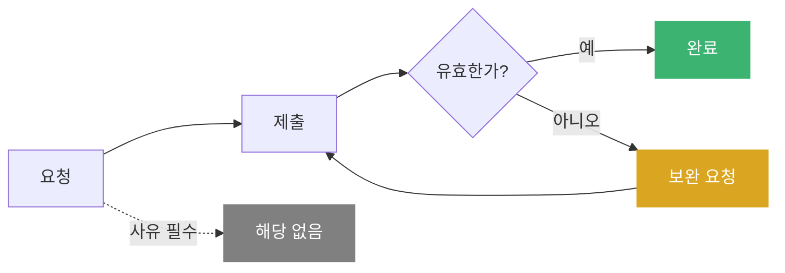
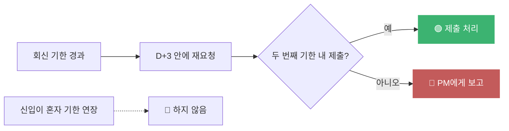

# 01. 자료 요청 목록 (RFI)

> [!NOTE]
> 사용 챕터: 1주차-02 자료 요청과 인터뷰, 증적 관리 · 이후 모든 챕터에서 재사용
>
> 작성 주체: 신입 초안 → PM 검토·확정 → 고객사 발송

> [!IMPORTANT]
> **🎯 이 양식 핵심 3줄**
> 1. 진단 범위에 해당하는 행만 남기고, 자료명은 문서명·기준 시점·형식까지 특정한다.
> 2. 개인정보가 든 원본은 받지 않고 마스킹본·화면 캡처로 요청하며, 제출 자료는 증적 파일명 규칙으로 보관한다.
> 3. 상태는 요청 → 제출 → 보완 요청 → 완료(또는 해당 없음)로 관리하고, 기한을 넘기면 D+3 재요청 후 PM에게 보고한다.

## 문서 정보

| 항목 | 내용 |
|---|---|
| 프로젝트명 | {예: A사 2026 개인정보보호 컨설팅} |
| 고객사 | {A사 / B기관} |
| 진단 범위 | {예: 처리방침·동의서 진단, 내부 관리계획, 수탁사 점검} |
| 작성자 / 검토자 | {신입 이름} / {PM 이름} |
| 버전 / 작성일 | v{0.1} / {YYYY-MM-DD} |
| 1차 회신 기한 | {YYYY-MM-DD} |

## 작성 방법

- [ ] **① 범위에 맞추기**: 아래 영역별 기본 목록에서 이번 진단 범위에 해당하는 행만 남기고, 고객사 상황에 맞게 자료명을 구체화합니다.
- [ ] **② 특정하기**: "보안 정책 일체"처럼 뭉뚱그리지 말고 문서명·기준 시점·형식을 특정합니다.
- [ ] **③ 원본 받지 않기**: 개인정보가 들어 있는 원본(회원 DB 추출본, 신청서 원본 등)은 받지 않습니다. 마스킹본 또는 화면 캡처로 요청합니다.
- [ ] **④ 파일명 규칙**: 제출된 자료는 아래 증적 파일명 규칙으로 이름을 바꿔 보관하고, `증적 파일명` 열에 적습니다.
- [ ] **⑤ 상태 관리**: 상태는 `요청` → `제출` → `보완 요청` → `완료` 또는 `해당 없음`(사유 필수)으로 관리합니다.



### 증적 파일명 규칙 (이 레포의 실습 규칙)

```text
{영역코드}_{자료명}_{기준일 YYYYMMDD}_v{버전}.{확장자}
예) PRV_처리방침_현행본_20261101_v01.pdf
    TRS_위수탁계약서_콜센터B사_20260301_v01.pdf
```

| 영역코드 | 영역 | 영역코드 | 영역 |
|---|---|---|---|
| GEN | 공통 | TRS | 위탁·수탁사 |
| PRV | 처리방침 | ISM | ISMS-P |
| CNS | 동의서 | LVL | 보호수준 평가 |
| IMP | 내부 관리계획·안전조치 | PIA | 영향평가 |

> ✅ **작성 방법 한 줄 정리**: 범위에 맞춰 자료를 특정해 요청하고, 원본 대신 마스킹본을 받고, 파일명 규칙과 5단계 상태로 관리한다.

---

## 영역별 기본 목록

아래는 영역별로 나눠 읽기 쉽게 줄인 표입니다. 상세(범위·기준 시점)·형식·담당·일자·상태 열은 바로 아래 **작성용 전체 양식**에 있습니다.

#### GEN · 공통

| No | 자료명 | 요청 근거 |
|---|---|---|
| 1 | 조직도 및 업무분장표 | 안전성 기준 제4조제1항제1호·제3호[^safe] |
| 2 | 개인정보 보호 관련 규정·지침 목록 | 진단 범위 확정용 |
| 3 | 개인정보처리시스템 목록 | 안전성 기준 제2조제1호[^safe] |
| 4 | 개인정보파일 목록 (공공: 개인정보파일 등록 현황) | 법 제32조[^law] (공공기관) |

#### PRV · 처리방침

| No | 자료명 | 요청 근거 |
|---|---|---|
| 5 | 개인정보 처리방침 현행본과 변경 이력 | 법 제30조[^law] · 작성지침 '처리방침의 변경'[^ppg] |
| 6 | 수집 항목 대조 자료 | 처리방침-실제 처리 현황 대조 |
| 7 | 수탁사·제3자 제공처 목록 | 법 제26조제2항, 제30조제1항제3호·제4호[^law] |

#### CNS · 동의서

| No | 자료명 | 요청 근거 |
|---|---|---|
| 8 | 개인정보 수집 동의서 양식 전체 | 법 제22조[^law] |

#### IMP · 내부 관리계획·안전조치

| No | 자료명 | 요청 근거 |
|---|---|---|
| 9 | 내부 관리계획 현행본과 승인 문서 | 안전성 기준 제4조제1항[^safe] |
| 10 | 내부 관리계획 수정 이력 | 안전성 기준 제4조제3항[^safe] |
| 11 | 내부 관리계획 이행 실태 점검 결과 | 안전성 기준 제4조제4항[^safe] |
| 12 | 개인정보 보호 교육 계획과 결과 | 안전성 기준 제4조제2항[^safe] |
| 13 | 접근 권한 부여·변경·말소 내역 | 안전성 기준 제5조제3항[^safe] |
| 14 | 접속기록 샘플과 점검 결과 | 안전성 기준 제8조[^safe] |
| 15 | 암호화 적용 현황 | 안전성 기준 제7조[^safe] |

#### TRS · 위탁·수탁사

| No | 자료명 | 요청 근거 |
|---|---|---|
| 16 | 위수탁 계약서 전체 | 법 제26조제1항[^law] · 영 제28조제1항[^dec] |
| 17 | 수탁사 교육·관리감독 결과 | 법 제26조제4항[^law] · 통합 안내서 p.174~176[^integ] |
| 18 | 재위탁 동의 문서 | 법 제26조제6항[^law] |
| 19 | 위탁 종료 수탁사의 반환·파기 확인 증빙 | 통합 안내서 p.178[^integ] |

#### ISM · ISMS-P

| No | 자료명 | 요청 근거 |
|---|---|---|
| 20 | 인증범위 정의서 | 인증기준 1.1.4[^isms7] |
| 21 | 정보자산 목록 | 인증기준 1.2.1[^isms7] |
| 22 | 위험평가 결과서와 보호대책 이행계획 | 인증기준 1.2.3·1.2.4[^isms7] |
| 23 | 관리체계 내부점검 결과 | 인증기준 1.4.2[^isms7] |

#### LVL · 보호수준 평가 (B기관만)

| No | 자료명 | 요청 근거 |
|---|---|---|
| 24 | 전년도 보호수준 평가 결과와 개선권고 조치 결과 | 법 제11조의2제4항[^law] · 2026 지표 감점 ⑧[^lvl] |
| 25 | 보호위원회가 통보한 올해 평가계획 | 영 제13조의2제3항[^dec] |

#### PIA · 영향평가 (B기관만)

| No | 자료명 | 요청 근거 |
|---|---|---|
| 26 | 사업 설명자료 | 수행안내서 p.34[^piag] |
| 27 | 개발 산출물 | 수행안내서 p.34[^piag] |
| 28 | 외부 연계 자료 | 수행안내서 p.34[^piag] |

<details>
<summary>📋 작성용 전체 양식 (13열, 28행) 펼치기</summary>

| No | 영역 | 자료명 | 상세 (범위·기준 시점) | 형식 | 요청 근거 | 고객사 담당 | 요청일 | 회신 기한 | 제출일 | 상태 | 증적 파일명 | 비고 |
|---|---|---|---|---|---|---|---|---|---|---|---|---|
| 1 | GEN | 조직도 및 업무분장표 | 개인정보 보호 조직 포함, 최신본 | PDF | 안전성 기준 제4조제1항제1호·제3호[^safe] | | | | | | | |
| 2 | GEN | 개인정보 보호 관련 규정·지침 목록 | 문서명, 개정일, 승인권자 | Excel | 진단 범위 확정용 | | | | | | | |
| 3 | GEN | 개인정보처리시스템 목록 | 시스템명, 처리 개인정보, 정보주체 수, 운영 부서 | Excel | 안전성 기준 제2조제1호[^safe] | | | | | | | |
| 4 | GEN | 개인정보파일 목록 (공공: 개인정보파일 등록 현황) | 파일명, 항목, 보유기간 | Excel | 법 제32조[^law] (공공기관) | | | | | | | B기관만 |
| 5 | PRV | 개인정보 처리방침 현행본과 변경 이력 | 현행본 + 직전 버전, 변경일 | PDF·URL | 법 제30조[^law] · 작성지침 '처리방침의 변경'[^ppg] | | | | | | | |
| 6 | PRV | 수집 항목 대조 자료 | 회원 DB 테이블 정의서(컬럼명·설명), 개인정보 미포함 | Excel | 처리방침-실제 처리 현황 대조 | | | | | | | 원본 데이터 금지 |
| 7 | PRV | 수탁사·제3자 제공처 목록 | 업체명, 위탁 업무/제공 목적, 계약 기간 | Excel | 법 제26조제2항, 제30조제1항제3호·제4호[^law] | | | | | | | |
| 8 | CNS | 개인정보 수집 동의서 양식 전체 | 온라인(화면 캡처)·오프라인(서식), 채널별 | PDF·PNG | 법 제22조[^law] | | | | | | | |
| 9 | IMP | 내부 관리계획 현행본과 승인 문서 | 내부 의사결정(결재) 증빙 포함 | PDF | 안전성 기준 제4조제1항[^safe] | | | | | | | |
| 10 | IMP | 내부 관리계획 수정 이력 | 개정일, 개정 사유, 개정 내용 | 문서 내 이력표 | 안전성 기준 제4조제3항[^safe] | | | | | | | |
| 11 | IMP | 내부 관리계획 이행 실태 점검 결과 | 최근 1년, CPO 점검·관리 결과 | PDF | 안전성 기준 제4조제4항[^safe] | | | | | | | |
| 12 | IMP | 개인정보 보호 교육 계획과 결과 | 대상·내용·일정·방법, 이수 현황 | PDF·Excel | 안전성 기준 제4조제2항[^safe] | | | | | | | |
| 13 | IMP | 접근 권한 부여·변경·말소 내역 | 최근 3년, 시스템별 | Excel | 안전성 기준 제5조제3항[^safe] | | | | | | | |
| 14 | IMP | 접속기록 샘플과 점검 결과 | 점검 주기 1회분 이상, 점검 결과·사후조치 기록 | Excel·PDF | 안전성 기준 제8조[^safe] | | | | | | | 샘플은 마스킹 |
| 15 | IMP | 암호화 적용 현황 | 대상 항목, 저장·전송 구간, 알고리즘 | Excel | 안전성 기준 제7조[^safe] | | | | | | | |
| 16 | TRS | 위수탁 계약서 전체 | 수탁사별 현행 계약서(부속 합의서 포함) | PDF | 법 제26조제1항[^law] · 영 제28조제1항[^dec] | | | | | | | |
| 17 | TRS | 수탁사 교육·관리감독 결과 | 최근 1년, 점검 결과·교육 증빙 | PDF | 법 제26조제4항[^law] · 통합 안내서 p.174~176[^integ] | | | | | | | |
| 18 | TRS | 재위탁 동의 문서 | 재위탁이 있는 수탁사만 | PDF | 법 제26조제6항[^law] | | | | | | | |
| 19 | TRS | 위탁 종료 수탁사의 반환·파기 확인 증빙 | 최근 1년 내 종료 계약 | PDF | 통합 안내서 p.178[^integ] | | | | | | | |
| 20 | ISM | 인증범위 정의서 | 서비스·시스템·조직·장소 | PDF | 인증기준 1.1.4[^isms7] | | | | | | | |
| 21 | ISM | 정보자산 목록 | 분류기준·중요도 포함, 최종 검토일 | Excel | 인증기준 1.2.1[^isms7] | | | | | | | |
| 22 | ISM | 위험평가 결과서와 보호대책 이행계획 | 최근 1년, 경영진 승인 증빙 | PDF | 인증기준 1.2.3·1.2.4[^isms7] | | | | | | | |
| 23 | ISM | 관리체계 내부점검 결과 | 최근 1년, 경영진 보고 증빙 | PDF | 인증기준 1.4.2[^isms7] | | | | | | | |
| 24 | LVL | 전년도 보호수준 평가 결과와 개선권고 조치 결과 | 결과 통보 공문, 조치 결과 회신 | PDF | 법 제11조의2제4항[^law] · 2026 지표 감점 ⑧[^lvl] | | | | | | | B기관만 |
| 25 | LVL | 보호위원회가 통보한 올해 평가계획 | 평가대상·기준·방법·지표 | PDF | 영 제13조의2제3항[^dec] | | | | | | | B기관만 |
| 26 | PIA | 사업 설명자료 | 사업추진계획서, 제안요청서(RFP), 요구사항 정의서 | PDF | 수행안내서 p.34[^piag] | | | | | | | B기관만 |
| 27 | PIA | 개발 산출물 | 업무 흐름도, ERD, 테이블 정의서, 화면 설계서, 시스템 구조도 | PDF·Excel | 수행안내서 p.34[^piag] | | | | | | | B기관만 |
| 28 | PIA | 외부 연계 자료 | 위탁계획서, 연계계획서, 인터페이스 정의서 | PDF | 수행안내서 p.34[^piag] | | | | | | | B기관만 |

</details>

> ✅ **기본 목록 한 줄 정리**: 8개 영역 28개 자료 중 진단 범위에 맞는 행만 골라, 상세·형식·근거를 채워 요청한다. LVL·PIA와 개인정보파일 목록은 B기관만 해당한다.

---

## 미제출 자료 추적

| No | 자료명 | 1차 요청일 | 재요청일 | 미제출 사유 (고객사 답변) | 대체 증적 | PM 보고 여부 |
|---|---|---|---|---|---|---|
| | | | | | | ☐ |

> [!TIP]
> 💡 회신 기한이 지나면 D+3 안에 재요청하고, 두 번째 기한도 지나면 PM에게 보고합니다. 신입이 혼자 기한을 연장해 주지 않습니다.




---

## 각주

[^law]: [출처: [개인정보 보호법(법률)(제21445호)(20260911).pdf](<../3_참고자료/개인정보 보호법(법률)(제21445호)(20260911).pdf>)]
[^dec]: [출처: [개인정보 보호법 시행령(대통령령)(제36804호)(20261110).pdf](<../3_참고자료/개인정보 보호법 시행령(대통령령)(제36804호)(20261110).pdf>)]
[^safe]: [출처: [개인정보의 안전성 확보조치 기준(개인정보보호위원회고시)(제2026-9호)(20260701).pdf](<../3_참고자료/개인정보의 안전성 확보조치 기준(개인정보보호위원회고시)(제2026-9호)(20260701).pdf>)]
[^ppg]: [출처: [2026 개인정보 처리방침 작성지침.pdf](<../3_참고자료/2026 개인정보 처리방침 작성지침.pdf>), p.83 '24. 개인정보 처리방침의 변경에 관한 사항']
[^integ]: [출처: [★개인정보 처리 통합 안내서(2025.7.).pdf](<../3_참고자료/★개인정보 처리 통합 안내서(2025.7.).pdf>), Ⅵ. 업무위탁에 따른 개인정보의 처리 제한]
[^isms7]: [출처: [\[별표 7\] 인증기준(제23조 관련)(정보보호 및 개인정보보호 관리체계 인증 등에 관한 고시).pdf](<../3_참고자료/[별표 7] 인증기준(제23조 관련)(정보보호 및 개인정보보호 관리체계 인증 등에 관한 고시).pdf>)]
[^lvl]: [출처: [\[260824 15시보도\] 2026년 공공기관 개인정보 보호수준 평가단 위촉(자율보호정책과)_최종.pdf](<../3_참고자료/[260824 15시보도] 2026년 공공기관 개인정보 보호수준 평가단 위촉(자율보호정책과)_최종.pdf>), p.3 붙임1]
[^piag]: [출처: [개인정보 영향평가 수행안내서(25.10.).pdf](<../3_참고자료/개인정보 영향평가 수행안내서(25.10.).pdf>), p.34 '2.3 대상시스템 관련 자료 분석']
