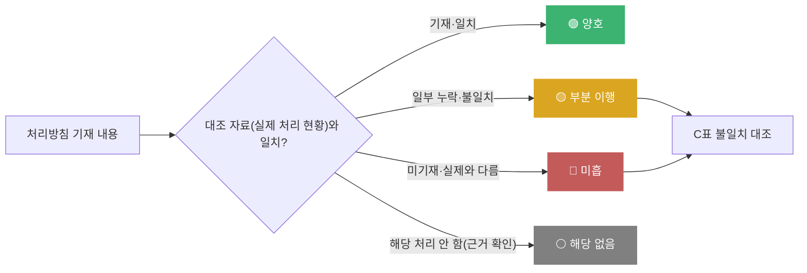

# 02. 개인정보 처리방침 진단표

> [!NOTE]
> 사용 챕터: 1주차-03 개인정보처리방침 진단 · 4주차(B기관 처리방침) 재사용
>
> 작성 주체: 신입 초안(판정 초안 + 근거) → PM 판정 확정

> [!IMPORTANT]
> **🎯 이 양식 핵심 3줄**
> 1. A표(24개 기재 항목)는 기재 여부가 아니라 대조 자료의 실제 처리 현황과 맞는지로 판정한다.
> 2. ⚪ 해당 없음은 해당 처리를 하지 않는다는 근거와 함께 적고, 법령 근거가 있는 항목은 법령 근거 열을 우선한다.
> 3. 🟡·🔴 항목은 C표(불일치 대조표)에 구체적인 차이와 개선안 문구를 적는다. C표가 이 진단의 핵심 산출물이다.

## 문서 정보

| 항목 | 내용 |
|---|---|
| 고객사 / 진단 대상 | {A사} / {처리방침 버전·시행일, URL} |
| 대조 자료 | {예: 회원 DB 테이블 정의서 v3, 수탁사 목록(2026.10.), 동의서 양식 5종} |
| 작성자 / 검토자 / 작성일 | {신입} / {PM} / {YYYY-MM-DD} |

## 판정 범례

| 표기 | 의미 | 배경색 (Excel) |
|---|---|---|
| 🟢 양호 | 기재했고, 실제 처리 현황과 일치함 | `#3cb371` |
| 🟡 부분 이행 | 기재했으나 일부 누락·불일치·불명확 | `#daa520` |
| 🔴 미흡 | 기재하지 않았거나 실제와 다름 | `#c35b5b` |
| ⚪ 해당 없음 | 해당 처리를 하지 않음 (근거 자료로 확인) | `#808080` |

## 작성 방법

- [ ] **① 대조 후 판정**: 기재 여부만 보고 끝내지 말고, `대조 자료` 열의 실제 처리 현황과 맞는지 확인한 뒤 판정합니다.
- [ ] **② 해당 없음 근거**: "해당시" 항목을 ⚪ 해당 없음으로 판정할 때는 해당 처리를 하지 않는다는 근거(수탁사 목록, 국외 이전 여부 확인 등)를 함께 적습니다.
- [ ] **③ 표기 우선순위**: `작성지침 표기` 열은 작성지침의 기재 사항 표에서 텍스트로 확인되는 표기(해당시·권장)만 옮겼습니다. 법령 근거가 있는 항목은 `법령 근거` 열을 우선합니다.

> ✅ **작성 방법 한 줄 정리**: 대조 자료와 맞춰 보고 판정하고, 해당 없음은 근거와 함께, 법령 근거를 작성지침 표기보다 우선한다.

---

## A. 기재 사항 진단 (작성지침 24개 항목)[^ppg15]

읽기용 요약입니다. 작성지침 표기·기재 내용·대조 자료·판정 열은 아래 **작성용 전체 양식**에 있습니다.

| No | 기재 항목 | 법령 근거 |
|---|---|---|
| 1 | 제목 및 서문 | 작성지침 |
| 2 | 개인정보의 처리 목적 | 법 제30조제1항제1호 |
| 3 | 처리하는 개인정보의 항목 | 영 제31조제1항제1호 |
| 4 | 14세 미만 아동의 개인정보 처리에 관한 사항 | 작성지침 (법 제22조의2 관련) |
| 5 | 개인정보의 처리 및 보유 기간 | 법 제30조제1항제2호 |
| 6 | 개인정보의 파기 절차 및 방법 (법령상 보존 시 보존 근거·항목 포함) | 법 제30조제1항제3호의2 |
| 7 | 개인정보의 제3자 제공에 관한 사항 | 법 제30조제1항제3호 |
| 8 | 추가적인 이용·제공이 지속적으로 발생 시 판단 기준 | 작성지침 (법 제15조제3항, 제17조제4항 관련) |
| 9 | 개인정보 처리업무의 위탁에 관한 사항 | 법 제30조제1항제4호 · 제26조제2항 |
| 10 | 개인정보의 국외 수집 및 이전에 관한 사항 | 영 제31조제1항제2호·제4호 · 법 제28조의8 |
| 11 | 개인정보의 안전성 확보조치에 관한 사항 | 영 제31조제1항제3호 |
| 12 | 민감정보의 공개 가능성 및 비공개를 선택하는 방법 | 법 제30조제1항제3호의3 |
| 13 | 가명정보 처리에 관한 사항 | 법 제30조제1항제4호의2 |
| 14 | 개인정보 자동 수집 장치의 설치·운영 및 그 거부 | 법 제30조제1항제7호 |
| 15 | 자동 수집 장치를 통해 제3자가 행태정보를 수집하도록 허용하는 경우 | 작성지침 |
| 16 | 정보주체와 법정대리인의 권리·의무 및 행사방법 | 법 제30조제1항제5호 |
| 17 | 자동화된 결정에 관한 사항 | 작성지침 (법 제37조의2 관련) |
| 18 | 개인정보 보호책임자 또는 담당부서·고충처리 부서 | 법 제30조제1항제6호 |
| 19 | 국내대리인 지정에 관한 사항 | 법 제31조의2 |
| 20 | 정보주체의 권익침해에 대한 구제방법 | 작성지침 |
| 21 | 고정형 영상정보처리기기 운영·관리에 관한 사항 | 작성지침 (법 제25조 관련) |
| 22 | 이동형 영상정보처리기기 운영·관리에 관한 사항 | 작성지침 (법 제25조의2 관련) |
| 23 | 자율적으로 처리방침에 포함하여 정한 사항 | 작성지침 |
| 24 | 개인정보 처리방침의 변경에 관한 사항 | 작성지침 |

📋 작성용 전체 양식 (A표 9열, 24행) 펼치기

| No | 기재 항목 | 법령 근거 | 작성지침 표기 | 처리방침 기재 내용 (요약) | 대조 자료 (실제 처리 현황) | 판정 | 판정 근거 | 개선 의견 |
|---|---|---|---|---|---|---|---|---|
| 1 | 제목 및 서문 | 작성지침 | | | | | | |
| 2 | 개인정보의 처리 목적 | 법 제30조제1항제1호 | | | 동의서 목적, 서비스 기능 목록 | | | |
| 3 | 처리하는 개인정보의 항목 | 영 제31조제1항제1호 | | | DB 테이블 정의서, 가입 화면 | | | |
| 4 | 14세 미만 아동의 개인정보 처리에 관한 사항 | 작성지침 (법 제22조의2 관련) | 해당시 | | 가입 연령 제한 정책 | | | |
| 5 | 개인정보의 처리 및 보유 기간 | 법 제30조제1항제2호 | | | 파기 배치 설정, 내부 보존기간표 | | | |
| 6 | 개인정보의 파기 절차 및 방법 (법령상 보존 시 보존 근거·항목 포함) | 법 제30조제1항제3호의2 | | | 파기 절차서, 분리보관 DB 현황 | | | |
| 7 | 개인정보의 제3자 제공에 관한 사항 | 법 제30조제1항제3호 | 해당시 | | 제공 대장, 제공 동의서 | | | |
| 8 | 추가적인 이용·제공이 지속적으로 발생 시 판단 기준 | 작성지침 (법 제15조제3항, 제17조제4항 관련) | 해당시 | | | | | |
| 9 | 개인정보 처리업무의 위탁에 관한 사항 | 법 제30조제1항제4호 · 제26조제2항 | 해당시 | | 위수탁 계약서 목록 (재위탁 포함) | | | |
| 10 | 개인정보의 국외 수집 및 이전에 관한 사항 | 영 제31조제1항제2호·제4호 · 법 제28조의8 | 해당시 | | 클라우드·해외 수탁사 소재지 | | | |
| 11 | 개인정보의 안전성 확보조치에 관한 사항 | 영 제31조제1항제3호 | | | 내부 관리계획 | | | |
| 12 | 민감정보의 공개 가능성 및 비공개를 선택하는 방법 | 법 제30조제1항제3호의3 | 해당시 | | | | | |
| 13 | 가명정보 처리에 관한 사항 | 법 제30조제1항제4호의2 | 해당시 | | 가명처리 대장 | | | |
| 14 | 개인정보 자동 수집 장치의 설치·운영 및 그 거부 | 법 제30조제1항제7호 | 해당시 | | 쿠키·SDK 목록 | | | |
| 15 | 자동 수집 장치를 통해 제3자가 행태정보를 수집하도록 허용하는 경우 | 작성지침 | 권장 · 해당시 | | 광고 SDK·태그 목록 | | | |
| 16 | 정보주체와 법정대리인의 권리·의무 및 행사방법 | 법 제30조제1항제5호 | | | 권리 행사 접수 화면·절차서 | | | |
| 17 | 자동화된 결정에 관한 사항 | 작성지침 (법 제37조의2 관련) | 해당시 | | | | | |
| 18 | 개인정보 보호책임자 또는 담당부서·고충처리 부서 | 법 제30조제1항제6호 | | | CPO 지정 문서, 대표번호 실제 연결 확인 | | | |
| 19 | 국내대리인 지정에 관한 사항 | 법 제31조의2 | 해당시 | | | | | |
| 20 | 정보주체의 권익침해에 대한 구제방법 | 작성지침 | 권장 | | | | | |
| 21 | 고정형 영상정보처리기기 운영·관리에 관한 사항 | 작성지침 (법 제25조 관련) | 해당시 | | CCTV 설치 현황 | | | |
| 22 | 이동형 영상정보처리기기 운영·관리에 관한 사항 | 작성지침 (법 제25조의2 관련) | 해당시 | | | | | |
| 23 | 자율적으로 처리방침에 포함하여 정한 사항 | 작성지침 | 권장 | | | | | |
| 24 | 개인정보 처리방침의 변경에 관한 사항 | 작성지침 | | | 이전 버전 보관·공개 여부 | | | |

> ✅ **A표 한 줄 정리**: 24개 기재 항목마다 법령 근거와 대조 자료를 놓고 실제와 일치하는지 판정한다.

---

## B. 작성 원칙·공개 방법 진단

읽기용 요약입니다. 확인 방법·판정 열은 아래 **작성용 전체 양식**에 있습니다.

| No | 점검 항목 | 근거 |
|---|---|---|
| B1 | 법 제30조제1항 각 호와 영 제31조제1항 각 호의 사항을 **명시적으로 구분**했는가 | 표준지침 제18조제1항[^std] |
| B2 | 알기 쉬운 용어로 구체적·명확하게 썼는가 ("등", "기타" 남용 여부) | 표준지침 제18조제1항[^std] |
| B3 | 처리하는 개인정보가 목적에 필요한 **최소한**이라는 점을 밝혔는가 | 표준지침 제18조제2항[^std] |
| B4 | 명칭을 "개인정보 처리방침"으로 표준화해 썼는가 | 작성지침 '제목 및 서문'[^ppg20] |
| B5 | 인터넷 홈페이지에 **지속적으로 게재**하고 있는가 (홈페이지가 없으면 영 제31조제3항의 방법) | 영 제31조제2항·제3항[^dec] |
| B6 | 모바일 앱에서도 쉽게 찾을 수 있는가 | 작성지침 Ⅳ-1[^ppg] |
| B7 | 동의 없이 처리하는 개인정보의 항목·법적 근거를 동의받는 개인정보와 **구분하여** 공개했는가 | 법 제22조제3항[^law] |

📋 작성용 전체 양식 (B표 6열, 7행) 펼치기

| No | 점검 항목 | 근거 | 확인 방법 | 판정 | 판정 근거 |
|---|---|---|---|---|---|
| B1 | 법 제30조제1항 각 호와 영 제31조제1항 각 호의 사항을 **명시적으로 구분**했는가 | 표준지침 제18조제1항[^std] | 문서 | | |
| B2 | 알기 쉬운 용어로 구체적·명확하게 썼는가 ("등", "기타" 남용 여부) | 표준지침 제18조제1항[^std] | 문서 | | |
| B3 | 처리하는 개인정보가 목적에 필요한 **최소한**이라는 점을 밝혔는가 | 표준지침 제18조제2항[^std] | 문서 | | |
| B4 | 명칭을 "개인정보 처리방침"으로 표준화해 썼는가 | 작성지침 '제목 및 서문'[^ppg20] | 문서 | | |
| B5 | 인터넷 홈페이지에 **지속적으로 게재**하고 있는가 (홈페이지가 없으면 영 제31조제3항의 방법) | 영 제31조제2항·제3항[^dec] | 시스템 (홈페이지 하단 링크) | | |
| B6 | 모바일 앱에서도 쉽게 찾을 수 있는가 | 작성지침 Ⅳ-1[^ppg] | 시스템 (앱 화면) | | |
| B7 | 동의 없이 처리하는 개인정보의 항목·법적 근거를 동의받는 개인정보와 **구분하여** 공개했는가 | 법 제22조제3항[^law] | 문서 | | |

> ✅ **B표 한 줄 정리**: 명시적 구분·알기 쉬운 용어·최소한 명시·명칭·지속 게재·앱 접근성·동의 없이 처리 항목 구분 공개 7가지를 본다.

---

## C. 불일치 대조표 (기재 내용 ↔ 실제 처리 현황)

> [!NOTE]
> 처리방침 진단의 핵심 산출물입니다. A표에서 🟡·🔴로 판정한 항목은 여기에 구체적인 차이를 적습니다.

읽기용 요약입니다. 기재 내용·실제 처리 현황·확인 자료 열은 아래 **작성용 전체 양식**에 있습니다.

| 관련 항목 (A표 No) | 차이 유형 | 개선안 문구 (초안) |
|---|---|---|
| 3 | 기재 누락 | "필수: 이름, 휴대전화번호, 이메일, 생년월일" |
| 9 | 수탁사 누락 (재위탁 포함) | 수탁사·재수탁사 전부 열거 |

📋 작성용 전체 양식 (C표 7열, 예시 2행) 펼치기

| No | 관련 항목 (A표 No) | 처리방침 기재 내용 | 실제 처리 현황 | 확인 자료 (증적 파일명) | 차이 유형 | 개선안 문구 (초안) |
|---|---|---|---|---|---|---|
| 예시 | 3 | 수집 항목: 이름, 휴대전화번호, 이메일 | DB에 `birth_date` 컬럼이 있고 가입 화면에서 생년월일을 받음 | PRV_회원DB테이블정의서_20261101_v01.xlsx | 기재 누락 | "필수: 이름, 휴대전화번호, 이메일, 생년월일" |
| 예시 | 9 | 수탁사: 배송 C사 외 2곳 | 계약서 목록상 5곳, 콜센터 재수탁사 1곳 있음 | TRS_위수탁계약목록_20261031_v01.xlsx | 수탁사 누락 (재위탁 포함) | 수탁사·재수탁사 전부 열거 |

> [!WARNING]
> 위 두 행은 이해를 돕기 위한 **가상 예시**입니다. 실제 진단 때는 지웁니다.

> ✅ **C표 한 줄 정리**: A표의 🟡·🔴 항목마다 기재 내용과 실제 현황, 확인 증적, 차이 유형, 개선안 문구를 한 줄로 적는다.

---

## 각주

[^law]: [출처: [개인정보 보호법(법률)(제21445호)(20260911).pdf](<../3_참고자료/개인정보 보호법(법률)(제21445호)(20260911).pdf>), 제22조제3항, 제30조]
[^dec]: [출처: [개인정보 보호법 시행령(대통령령)(제36804호)(20261110).pdf](<../3_참고자료/개인정보 보호법 시행령(대통령령)(제36804호)(20261110).pdf>), 제31조]
[^std]: [출처: [표준 개인정보 보호지침(개인정보보호위원회고시)(제2025-4호)(20250411).pdf](<../3_참고자료/표준 개인정보 보호지침(개인정보보호위원회고시)(제2025-4호)(20250411).pdf>), 제18조]
[^ppg15]: [출처: [2026 개인정보 처리방침 작성지침.pdf](<../3_참고자료/2026 개인정보 처리방침 작성지침.pdf>), p.15 '개인정보 처리방침 기재 사항' 표]
[^ppg20]: [출처: [2026 개인정보 처리방침 작성지침.pdf](<../3_참고자료/2026 개인정보 처리방침 작성지침.pdf>), p.20 '1. 제목 및 서문']
[^ppg]: [출처: [2026 개인정보 처리방침 작성지침.pdf](<../3_참고자료/2026 개인정보 처리방침 작성지침.pdf>), p.88 'Ⅳ-1. 누리집(인터넷 홈페이지) 및 모바일 앱에 게재하는 경우']
