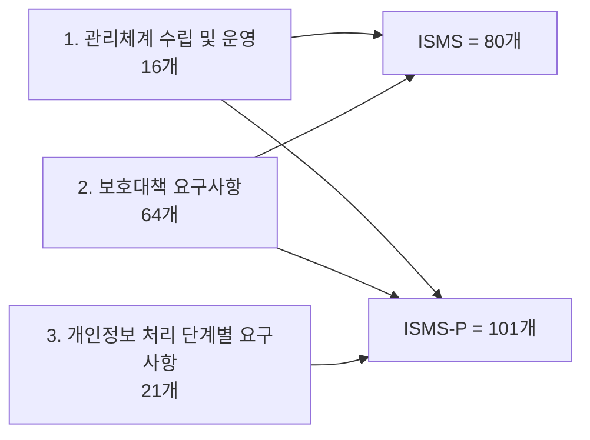

# 04. ISMS-P 갭 분석표

> [!NOTE]
> 사용 챕터: 3주차-03 현황 분석과 갭 분석 · 3주차-04(증적 매핑), 3주차-06(결함·보완조치)과 연결
>
> 작성 주체: 신입(현황·증적·판정 초안) → PM·선임(판정 확정, 개선 과제 우선순위)

> [!IMPORTANT]
> **🎯 이 양식 핵심 3줄**
> 1. ISMS-P는 101개(1·2·3영역), ISMS는 80개(1·2영역) 항목을 B표에서 하나씩 판정하고, A표로 영역별 집계를 낸다.
> 2. 현황 요약은 인터뷰 답변이 아니라 확인한 사실로 쓰고, 증적 ID가 없으면 🟢로 판정하지 않으며, ⚪는 사유를 쓴다.
> 3. 우선순위와 개선 과제 확정은 PM·선임이 하고, 신입은 초안을 쓴다.

## 문서 정보

| 항목 | 내용 |
|---|---|
| 고객사 / 인증 구분 | {A사} / {ISMS-P 또는 ISMS} |
| 인증범위 | {서비스·시스템·조직·장소, 인증범위 정의서 파일명} |
| 분석 기준일 | {YYYY-MM-DD} |
| 작성자 / 검토자 | {신입} / {PM} |

## 적용 기준

- 인증기준은 고시 별표 7의 **101개 항목**입니다. 관리체계 수립 및 운영 16개 / 보호대책 요구사항 64개 / 개인정보 처리 단계별 요구사항 21개입니다.[^isms7]
- ISMS-P 인증은 1·2·3 영역 전부(101개), ISMS 인증은 1·2 영역(80개)을 적용합니다.[^isms23]

> [!WARNING]
> 항목별 "주요 확인사항"과 "결함사례"는 인증기준 안내서를 봅니다.[^ismsg] 안내서는 고시 제2023-8호 기준이므로, 심사 절차는 고시(제2024-8호)를 우선합니다.

## 판정 범례

| 표기 | 의미 | 배경색 (Excel) |
|---|---|---|
| 🟢 양호 | 인증기준 충족, 증적으로 확인 | `#3cb371` |
| 🟡 부분 이행 | 정책은 있으나 이행 증적 부족, 또는 일부 범위만 이행 | `#daa520` |
| 🔴 미흡 | 정책·이행 모두 없음, 또는 인증기준과 다르게 운영 | `#c35b5b` |
| ⚪ 해당 없음 | 인증범위에 해당 요소가 없음 (사유 필수) | `#808080` |

## 작성 방법

- [ ] **① 확인한 사실로 쓰기**: `현황 요약`은 인터뷰 답변이 아니라 확인한 사실로 씁니다. 예: "정보자산 목록 있음(2025.12. 작성), 2026년 신규 서버 3대 누락".
- [ ] **② 증적 ID 연결**: `증적 ID`는 `./2_산출물_양식/05_증적_매핑표.md`의 ID를 씁니다. 증적이 없으면 비워 두고 판정을 🟢로 하지 않습니다.
- [ ] **③ 해당 없음 사유**: ⚪ 해당 없음은 `현황 요약`에 사유를 씁니다. 예: "2.10.4 — 인증범위에 전자거래·핀테크 서비스 없음".
- [ ] **④ 확정은 PM·선임**: `우선순위`(상/중/하)와 `개선 과제` 확정은 PM·선임이 합니다. 신입은 초안을 씁니다.

> ✅ **작성 방법 한 줄 정리**: 사실·증적 ID·사유로 판정 초안을 쓰고, 우선순위와 과제 확정은 PM·선임에게 맡긴다.

---

## A. 영역별 요약

| 영역 | 항목 수 | 🟢 | 🟡 | 🔴 | ⚪ |
|---|---|---|---|---|---|
| 1.1 관리체계 기반 마련 | 6 | | | | |
| 1.2 위험 관리 | 4 | | | | |
| 1.3 관리체계 운영 | 3 | | | | |
| 1.4 관리체계 점검 및 개선 | 3 | | | | |
| 2.1 정책, 조직, 자산 관리 | 3 | | | | |
| 2.2 인적 보안 | 6 | | | | |
| 2.3 외부자 보안 | 4 | | | | |
| 2.4 물리 보안 | 7 | | | | |
| 2.5 인증 및 권한관리 | 6 | | | | |
| 2.6 접근통제 | 7 | | | | |
| 2.7 암호화 적용 | 2 | | | | |
| 2.8 정보시스템 도입 및 개발 보안 | 6 | | | | |
| 2.9 시스템 및 서비스 운영관리 | 7 | | | | |
| 2.10 시스템 및 서비스 보안관리 | 9 | | | | |
| 2.11 사고 예방 및 대응 | 5 | | | | |
| 2.12 재해복구 | 2 | | | | |
| 3.1 개인정보 수집 시 보호조치 | 7 | | | | |
| 3.2 개인정보 보유 및 이용 시 보호조치 | 5 | | | | |
| 3.3 개인정보 제공 시 보호조치 | 4 | | | | |
| 3.4 개인정보 파기 시 보호조치 | 2 | | | | |
| 3.5 정보주체 권리보호 | 3 | | | | |
| **합계** | **101** | | | | |

---
## B. 항목별 갭 분석

> [!TIP]
> B표는 101개 행을 채우는 작성용 양식이라 영역별로 접어 두었습니다. 작업할 영역만 펼쳐서 쓰세요. ISMS 인증이면 1·2 영역만 씁니다.

📋 1. 관리체계 수립 및 운영 (16개 항목) 펼치기

| 항목 | 항목명 | 현황 요약 (As-Is) | 확인 방법 | 증적 ID | 판정 | 갭 내용 · 개선 과제 (초안) | 우선순위 |
|---|---|---|---|---|---|---|---|
| **1.1 관리체계 기반 마련** | | | | | | | |
| 1.1.1 | 경영진의 참여 | | | | | | |
| 1.1.2 | 최고책임자의 지정 | | | | | | |
| 1.1.3 | 조직 구성 | | | | | | |
| 1.1.4 | 범위 설정 | | | | | | |
| 1.1.5 | 정책 수립 | | | | | | |
| 1.1.6 | 자원 할당 | | | | | | |
| **1.2 위험 관리** | | | | | | | |
| 1.2.1 | 정보자산 식별 | | | | | | |
| 1.2.2 | 현황 및 흐름분석 | | | | | | |
| 1.2.3 | 위험 평가 | | | | | | |
| 1.2.4 | 보호대책 선정 | | | | | | |
| **1.3 관리체계 운영** | | | | | | | |
| 1.3.1 | 보호대책 구현 | | | | | | |
| 1.3.2 | 보호대책 공유 | | | | | | |
| 1.3.3 | 운영현황 관리 | | | | | | |
| **1.4 관리체계 점검 및 개선** | | | | | | | |
| 1.4.1 | 법적 요구사항 준수 검토 | | | | | | |
| 1.4.2 | 관리체계 점검 | | | | | | |
| 1.4.3 | 관리체계 개선 | | | | | | |

📋 2. 보호대책 요구사항 (64개 항목) 펼치기

| 항목 | 항목명 | 현황 요약 (As-Is) | 확인 방법 | 증적 ID | 판정 | 갭 내용 · 개선 과제 (초안) | 우선순위 |
|---|---|---|---|---|---|---|---|
| **2.1 정책, 조직, 자산 관리** | | | | | | | |
| 2.1.1 | 정책의 유지관리 | | | | | | |
| 2.1.2 | 조직의 유지관리 | | | | | | |
| 2.1.3 | 정보자산 관리 | | | | | | |
| **2.2 인적 보안** | | | | | | | |
| 2.2.1 | 주요 직무자 지정 및 관리 | | | | | | |
| 2.2.2 | 직무 분리 | | | | | | |
| 2.2.3 | 보안 서약 | | | | | | |
| 2.2.4 | 인식제고 및 교육훈련 | | | | | | |
| 2.2.5 | 퇴직 및 직무변경 관리 | | | | | | |
| 2.2.6 | 보안 위반 시 조치 | | | | | | |
| **2.3 외부자 보안** | | | | | | | |
| 2.3.1 | 외부자 현황 관리 | | | | | | |
| 2.3.2 | 외부자 계약 시 보안 | | | | | | |
| 2.3.3 | 외부자 보안 이행 관리 | | | | | | |
| 2.3.4 | 외부자 계약 변경 및 만료 시 보안 | | | | | | |
| **2.4 물리 보안** | | | | | | | |
| 2.4.1 | 보호구역 지정 | | | | | | |
| 2.4.2 | 출입통제 | | | | | | |
| 2.4.3 | 정보시스템 보호 | | | | | | |
| 2.4.4 | 보호설비 운영 | | | | | | |
| 2.4.5 | 보호구역 내 작업 | | | | | | |
| 2.4.6 | 반출입 기기 통제 | | | | | | |
| 2.4.7 | 업무환경 보안 | | | | | | |
| **2.5 인증 및 권한관리** | | | | | | | |
| 2.5.1 | 사용자 계정 관리 | | | | | | |
| 2.5.2 | 사용자 식별 | | | | | | |
| 2.5.3 | 사용자 인증 | | | | | | |
| 2.5.4 | 비밀번호 관리 | | | | | | |
| 2.5.5 | 특수 계정 및 권한 관리 | | | | | | |
| 2.5.6 | 접근권한 검토 | | | | | | |
| **2.6 접근통제** | | | | | | | |
| 2.6.1 | 네트워크 접근 | | | | | | |
| 2.6.2 | 정보시스템 접근 | | | | | | |
| 2.6.3 | 응용프로그램 접근 | | | | | | |
| 2.6.4 | 데이터베이스 접근 | | | | | | |
| 2.6.5 | 무선 네트워크 접근 | | | | | | |
| 2.6.6 | 원격접근 통제 | | | | | | |
| 2.6.7 | 인터넷 접속 통제 | | | | | | |
| **2.7 암호화 적용** | | | | | | | |
| 2.7.1 | 암호정책 적용 | | | | | | |
| 2.7.2 | 암호키 관리 | | | | | | |
| **2.8 정보시스템 도입 및 개발 보안** | | | | | | | |
| 2.8.1 | 보안 요구사항 정의 | | | | | | |
| 2.8.2 | 보안 요구사항 검토 및 시험 | | | | | | |
| 2.8.3 | 시험과 운영 환경 분리 | | | | | | |
| 2.8.4 | 시험 데이터 보안 | | | | | | |
| 2.8.5 | 소스 프로그램 관리 | | | | | | |
| 2.8.6 | 운영환경 이관 | | | | | | |
| **2.9 시스템 및 서비스 운영관리** | | | | | | | |
| 2.9.1 | 변경관리 | | | | | | |
| 2.9.2 | 성능 및 장애관리 | | | | | | |
| 2.9.3 | 백업 및 복구관리 | | | | | | |
| 2.9.4 | 로그 및 접속기록 관리 | | | | | | |
| 2.9.5 | 로그 및 접속기록 점검 | | | | | | |
| 2.9.6 | 시간 동기화 | | | | | | |
| 2.9.7 | 정보자산의 재사용 및 폐기 | | | | | | |
| **2.10 시스템 및 서비스 보안관리** | | | | | | | |
| 2.10.1 | 보안시스템 운영 | | | | | | |
| 2.10.2 | 클라우드 보안 | | | | | | |
| 2.10.3 | 공개서버 보안 | | | | | | |
| 2.10.4 | 전자거래 및 핀테크 보안 | | | | | | |
| 2.10.5 | 정보전송 보안 | | | | | | |
| 2.10.6 | 업무용 단말기기 보안 | | | | | | |
| 2.10.7 | 보조저장매체 관리 | | | | | | |
| 2.10.8 | 패치관리 | | | | | | |
| 2.10.9 | 악성코드 통제 | | | | | | |
| **2.11 사고 예방 및 대응** | | | | | | | |
| 2.11.1 | 사고 예방 및 대응체계 구축 | | | | | | |
| 2.11.2 | 취약점 점검 및 조치 | | | | | | |
| 2.11.3 | 이상행위 분석 및 모니터링 | | | | | | |
| 2.11.4 | 사고 대응 훈련 및 개선 | | | | | | |
| 2.11.5 | 사고 대응 및 복구 | | | | | | |
| **2.12 재해복구** | | | | | | | |
| 2.12.1 | 재해·재난 대비 안전조치 | | | | | | |
| 2.12.2 | 재해 복구 시험 및 개선 | | | | | | |

📋 3. 개인정보 처리 단계별 요구사항 (21개 항목, ISMS-P만) 펼치기

| 항목 | 항목명 | 현황 요약 (As-Is) | 확인 방법 | 증적 ID | 판정 | 갭 내용 · 개선 과제 (초안) | 우선순위 |
|---|---|---|---|---|---|---|---|
| **3.1 개인정보 수집 시 보호조치** | | | | | | | |
| 3.1.1 | 개인정보 수집·이용 | | | | | | |
| 3.1.2 | 개인정보 수집 제한 | | | | | | |
| 3.1.3 | 주민등록번호 처리 제한 | | | | | | |
| 3.1.4 | 민감정보 및 고유식별정보의 처리 제한 | | | | | | |
| 3.1.5 | 개인정보 간접수집 | | | | | | |
| 3.1.6 | 영상정보처리기기 설치·운영 | | | | | | |
| 3.1.7 | 마케팅 목적의 개인정보 수집·이용 | | | | | | |
| **3.2 개인정보 보유 및 이용 시 보호조치** | | | | | | | |
| 3.2.1 | 개인정보 현황관리 | | | | | | |
| 3.2.2 | 개인정보 품질보장 | | | | | | |
| 3.2.3 | 이용자 단말기 접근 보호 | | | | | | |
| 3.2.4 | 개인정보 목적 외 이용 및 제공 | | | | | | |
| 3.2.5 | 가명정보 처리 | | | | | | |
| **3.3 개인정보 제공 시 보호조치** | | | | | | | |
| 3.3.1 | 개인정보 제공 | | | | | | |
| 3.3.2 | 개인정보 처리 업무 위탁 | | | | | | |
| 3.3.3 | 영업의 양도 등에 따른 개인정보 이전 | | | | | | |
| 3.3.4 | 개인정보 국외이전 | | | | | | |
| **3.4 개인정보 파기 시 보호조치** | | | | | | | |
| 3.4.1 | 개인정보 파기 | | | | | | |
| 3.4.2 | 처리목적 달성 후 보유 시 조치 | | | | | | |
| **3.5 정보주체 권리보호** | | | | | | | |
| 3.5.1 | 개인정보 처리방침 공개 | | | | | | |
| 3.5.2 | 정보주체 권리보장 | | | | | | |
| 3.5.3 | 정보주체에 대한 통지 | | | | | | |

> ✅ **A·B표 한 줄 정리**: B표에서 항목별 현황·확인 방법·증적 ID·판정·개선 과제·우선순위를 채우고, A표에 영역별 판정 수를 집계한다.

---

## C. 작성 예시 (가상)

읽기용 요약입니다. 현황 요약·확인 방법·증적 ID·개선 과제·우선순위 열은 아래 **작성용 전체 양식**에 있습니다.

| 항목 | 항목명 | 판정 |
|---|---|---|
| 1.2.1 | 정보자산 식별 | 🟡 부분 이행 |
| 2.10.4 | 전자거래 및 핀테크 보안 | ⚪ 해당 없음 |

📋 작성 예시 전체 (8열) 펼치기

| 항목 | 항목명 | 현황 요약 (As-Is) | 확인 방법 | 증적 ID | 판정 | 갭 내용 · 개선 과제 (초안) | 우선순위 |
|---|---|---|---|---|---|---|---|
| 1.2.1 | 정보자산 식별 | 정보자산 목록 있음(2025.12. 작성). 2026.6. 도입한 신규 WAS 3대가 목록에 없음 | 문서·시스템 | EV-012, EV-013 | 🟡 부분 이행 | 목록을 최신화하고 자산 도입 절차에 목록 갱신 단계를 추가 | 상 |
| 2.10.4 | 전자거래 및 핀테크 보안 | 인증범위에 해당 서비스 없음 (인증범위 정의서 v2) | 문서 | EV-001 | ⚪ 해당 없음 | — | — |

> [!WARNING]
> 위 예시는 이해를 돕기 위한 가상 사례입니다. 실제 작성 때는 지웁니다.

---

## 각주

[^isms7]: [출처: [\[별표 7\] 인증기준(제23조 관련)(정보보호 및 개인정보보호 관리체계 인증 등에 관한 고시).pdf](<../3_참고자료/[별표 7] 인증기준(제23조 관련)(정보보호 및 개인정보보호 관리체계 인증 등에 관한 고시).pdf>)]
[^isms23]: [출처: [정보보호 및 개인정보보호 관리체계 인증 등에 관한 고시(개인정보보호위원회고시)(제2024-8호)(20240724).pdf](<../3_참고자료/정보보호 및 개인정보보호 관리체계 인증 등에 관한 고시(개인정보보호위원회고시)(제2024-8호)(20240724).pdf>), 제23조제1항]
[^ismsg]: [출처: [ISMS-P 인증기준 안내서(2023.11.23).pdf](<../3_참고자료/ISMS-P 인증기준 안내서(2023.11.23).pdf>), 제2장 항목별 '주요 확인사항'·'결함사례']
