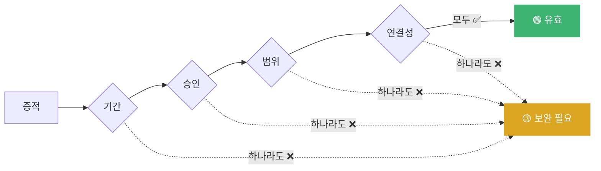
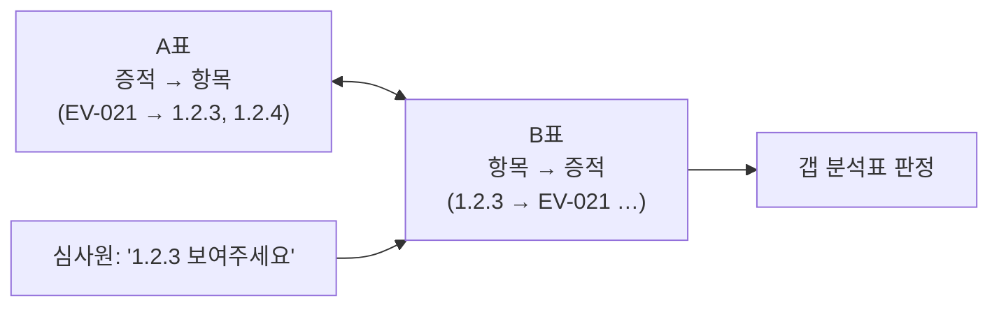

# 05. 증적 매핑표

> [!NOTE]
> 사용 챕터: 3주차-04 증적 수집과 매핑 · 3주차-06 결함 유형과 심사 대응 · 4주차-03(보호수준 평가 증빙)에 응용
>
> 작성 주체: 신입(증적 수집·등록·유효성 1차 확인) → PM(유효성 최종 판단)

> [!IMPORTANT]
> **🎯 이 양식 핵심 3줄**
> 1. 증적 하나에 증적 ID(EV-001~) 하나를 붙이고, 여러 항목을 증명하면 연결 항목에 모두 적는다(1:N).
> 2. 유효성 4요소(기간·승인·범위·연결성) 중 하나라도 ❌이면 상태를 "보완 필요"로 둔다.
> 3. A표(증적 → 항목)와 B표(항목 → 증적) 두 방향으로 관리해 심사원 요청에 바로 답한다.

## 문서 정보

| 항목 | 내용 |
|---|---|
| 고객사 / 대상 | {A사 ISMS-P 인증 준비} |
| 증적 보관 위치 | {예: 고객사 지정 공유 폴더 `\\fileserver\ISMS-P\2026\증적`} |
| 작성자 / 검토자 / 기준일 | {신입} / {PM} / {YYYY-MM-DD} |

## 작성 방법

- [ ] **① 증적 ID 부여**: 증적 하나에 증적 ID(`EV-001`부터)를 하나씩 붙입니다. 같은 증적이 여러 항목을 증명하면 `연결 항목`에 모두 적습니다(1:N).
- [ ] **② 파일명 규칙**: 파일명은 `./2_산출물_양식/01_자료요청_목록.md`의 증적 파일명 규칙을 따릅니다.
- [ ] **③ 유효성 확인**: 유효성 4요소를 확인하고 하나라도 ❌이면 `상태`를 `보완 필요`로 둡니다.

| 유효성 요소 | 확인 내용 |
|---|---|
| 기간 | 점검 대상 기간(예: 최근 1년) 안에 작성·실행된 기록인가 |
| 승인 | 정해진 결재권자의 승인(서명·전자결재 이력)이 있는가 |
| 범위 | 인증범위 전체(모든 대상 시스템·조직)를 포괄하는가 |
| 연결성 | 정책·지침에 정한 내용(주기·방법·책임자)과 실제 기록이 일치하는가 |

> [!NOTE]
> 인증 신청인은 인증심사 전에 문서와 증거자료를 준비해야 하며, 서면심사는 정책·지침·절차와 이행 증거자료를 검토하는 방식으로 진행됩니다.[^isms]

### Windows 11 팁

🛠️ Windows 11 팁 3가지 펼치기

| 작업 | 방법 |
|---|---|
| 증적 폴더의 파일 목록을 한 번에 뽑기 | PowerShell: `Get-ChildItem -Path "D:\증적" -Recurse -File \| Select-Object Name, LastWriteTime, Length \| Export-Csv -Path "D:\증적목록.csv" -Encoding UTF8 -NoTypeInformation` |
| 매핑표에서 항목별 증적 수 세기 | Excel: `=COUNTIF(연결항목열, "*1.2.1*")` |
| 파일 속성의 작성일 확인 | 파일 우클릭 → 속성 → 자세히 (문서 내부 작성일·결재일과 다를 수 있으므로 **문서 본문 날짜를 우선** 확인) |

> ✅ **작성 방법 한 줄 정리**: ID를 붙이고 파일명 규칙을 따르며, 유효성 4요소를 모두 통과한 증적만 "유효"로 둔다.

---

## A. 증적 목록 (증적 → 항목)

읽기용 요약입니다. 증적명·파일명·유형·일자·승인·유효성 4요소·비고 열은 아래 **작성용 전체 양식**에 있습니다.

| 증적 ID | 연결 항목 | 상태 |
|---|---|---|
| EV-001 |  | 유효 / 보완 필요 / 수집 중 |
| EV-002 |  |  |

📋 작성용 전체 양식 (A표 14열) 펼치기

| 증적 ID | 증적명 | 파일명 | 유형 | 연결 항목 | 작성·실행일 | 대상 기간 | 승인자·승인일 | 기간 | 승인 | 범위 | 연결성 | 상태 | 비고 |
|---|---|---|---|---|---|---|---|---|---|---|---|---|---|
| EV-001 | | | 정책 / 계획 / 기록 / 화면 / 로그 | | | | | ✅ / ❌ | ✅ / ❌ | ✅ / ❌ | ✅ / ❌ | 유효 / 보완 필요 / 수집 중 | |
| EV-002 | | | | | | | | | | | | | |

---

## B. 항목별 역색인 (항목 → 증적)

> [!TIP]
> 심사원이 "1.2.3 위험 평가 증적 보여주세요"라고 하면 이 표에서 바로 찾습니다.

| 항목 | 항목명 | 정책·지침 증적 | 이행 증적 | 증적 수 | 부족한 증적 | 갭 분석표 판정 |
|---|---|---|---|---|---|---|
| 1.1.1 | 경영진의 참여 | | | | | |
| … | | | | | | |

> [!NOTE]
> 항목 목록 전체(101개)는 `./2_산출물_양식/04_ISMS-P_갭분석표.md`의 B표에서 복사해 씁니다.

> ✅ **A·B표 한 줄 정리**: A표는 증적마다 연결 항목·유효성·상태를, B표는 항목마다 정책·이행 증적과 부족한 증적을 적어 서로 맞춘다.

---

## C. 작성 예시 (가상)

읽기용 요약입니다. 나머지 열은 아래 **작성 예시 전체**에 있습니다.

| 증적 ID | 증적명 | 상태 |
|---|---|---|
| EV-021 | 2026년 위험평가 결과서 | 보완 필요 |
| EV-022 | 접근권한 검토 결과 (2026 상반기) | 보완 필요 |

📋 작성 예시 전체 (14열) 펼치기

| 증적 ID | 증적명 | 파일명 | 유형 | 연결 항목 | 작성·실행일 | 대상 기간 | 승인자·승인일 | 기간 | 승인 | 범위 | 연결성 | 상태 | 비고 |
|---|---|---|---|---|---|---|---|---|---|---|---|---|---|
| EV-021 | 2026년 위험평가 결과서 | ISM_위험평가결과서_20260630_v02.pdf | 기록 | 1.2.3, 1.2.4 | 2026-06-30 | 2026년 | CISO·CPO 2026-07-03 | ✅ | ✅ | ❌ | ✅ | 보완 필요 | 신규 클라우드 구간이 평가 대상에서 빠짐 |
| EV-022 | 접근권한 검토 결과 (2026 상반기) | ISM_접근권한검토_20260715_v01.xlsx | 기록 | 2.5.6 | 2026-07-15 | 2026.1.~6. | 정보보호팀장 2026-07-16 | ✅ | ✅ | ✅ | ❌ | 보완 필요 | 지침은 분기 검토인데 반기 1회만 실시 |

> [!WARNING]
> 위 예시는 이해를 돕기 위한 가상 사례입니다.

---

## 각주

[^isms]: [출처: [정보보호 및 개인정보보호 관리체계 인증 등에 관한 고시(개인정보보호위원회고시)(제2024-8호)(20240724).pdf](<../3_참고자료/정보보호 및 개인정보보호 관리체계 인증 등에 관한 고시(개인정보보호위원회고시)(제2024-8호)(20240724).pdf>), 제17조제2항제1호, 제25조제2항]
