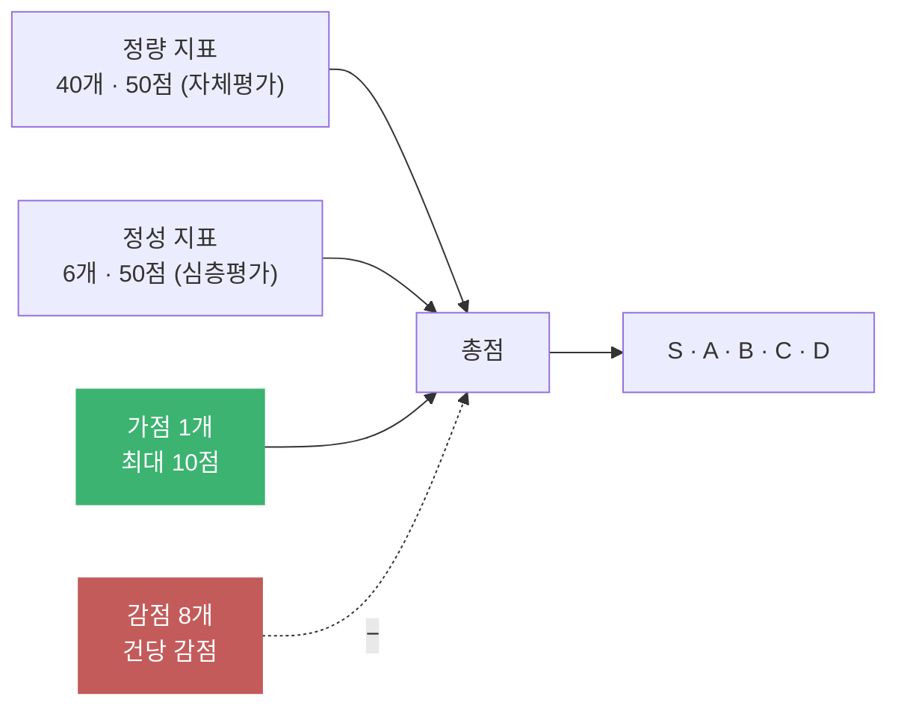
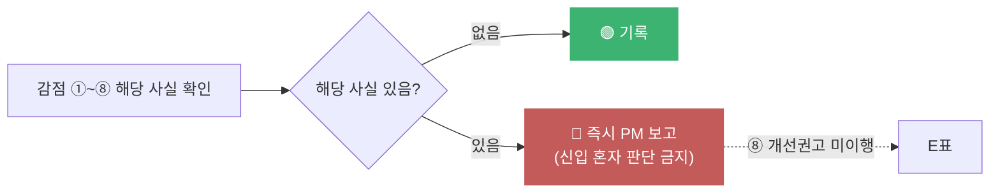

# 06. 개인정보 보호수준 평가 증빙 관리표

> [!NOTE]
> 사용 챕터: 4주차-02 보호수준 평가 제도와 지표 · 4주차-03 보호수준 평가 증빙 작성 지원 · 4주차-06 종합 모의 프로젝트
>
> 작성 주체: B기관 부서별 담당자(증빙 작성) · 신입(취합·1차 검토) · PM(검토 의견 확정)

> [!IMPORTANT]
> **🎯 이 양식 핵심 3줄**
> 1. 지표 구조·배점은 2026년 평가 개요만 옮겼고, 개별 지표명은 B기관이 받은 평가계획에서 그대로 옮겨 적는다.
> 2. A표(정량 40개)·B표(정성 6개)·C표(가점)에 지표별 증빙·담당·상태·검토 의견을 적고, 정성 지표는 결과·후속조치까지 담겼는지 본다.
> 3. D표(감점 ①~⑧)는 해당 사실을 미리 확인해 PM에게 보고하고, E표로 전년도 개선권고 이행을 관리한다. 제출은 B기관이 한다.

## 문서 정보

| 항목 | 내용 |
|---|---|
| 기관 | B기관 |
| 평가 연도 | {2026} |
| 평가계획 수령일 | {YYYY-MM-DD} (보호위원회가 평가대상기관에 통보한 평가계획) |
| 작성자 / 검토자 / 기준일 | {신입} / {PM} / {YYYY-MM-DD} |

## 이 양식의 근거와 범위

- 보호수준 평가는 법 제11조의2와 영 제13조의2에 근거합니다. 보호위원회는 평가 전에 **평가대상·평가기준·방법·평가지표를 포함한 평가계획**을 평가대상기관에 통보합니다.[^dec]
- 아래 지표 구조와 배점은 **2026년 평가 개요**(보도자료 붙임1)에 나온 것만 옮겼습니다.[^lvl] 개별 지표명은 B기관이 받은 평가계획에서 옮겨 적습니다.

> [!WARNING]
> 평가를 받는 주체는 B기관입니다. 컨설턴트는 증빙을 검토하고 보완 의견을 주며, 기관을 대신해 제출하지 않습니다.

### 2026년 평가 구조

| 지표 분류 | 평가 방법 | 지표 수 | 배점 |
|---|---|---|---|
| 정량 지표 | 자체평가 | 40개 | 50점 |
| 정성 지표 | 심층평가 | 6개 | 50점 |
| 기타 지표 | 가점 | 1개 | 최대 10점 |
| 기타 지표 | 감점 | 8개 | 건당 감점 |

평가 결과 등급: S(90점 이상) · A(90~80점) · B(80~70점) · C(70~60점) · D(60점 미만)[^lvl]

## 판정 범례 (컨설턴트 사전 검토용)

🟢 양호 `#3cb371` 증빙이 지표 요구를 충족 · 🟡 부분 이행 `#daa520` 보완 필요 · 🔴 미흡 `#c35b5b` 증빙 없음 또는 요구와 다름 · ⚪ 해당 없음 `#808080` (사유 필수)

> ✅ **근거·구조 한 줄 정리**: 법 제11조의2·영 제13조의2에 따라 통보된 평가계획을 기준으로, 정량 50·정성 50·가점·감점 구조로 증빙을 관리한다.

---

## A. 정량 지표 (자체평가, 40개 · 50점)

> [!NOTE]
> `순번`은 이 표의 관리 번호입니다. `지표명`은 평가계획의 지표명을 그대로 옮깁니다.

읽기용 요약입니다. 지표명·증빙·담당·파일명·상태·판정·검토 의견 열은 아래 **작성용 전체 양식**에 있습니다.

| 분야 | 평가 항목 | 순번 |
|---|---|---|
| 개인정보 관리체계 (5개) | 1. 개인정보 책임자의 역할 수행 (2개) | 1-1 |
|  |  | 1-2 |
|  | 2. 개인정보 영향평가 수행 등 (3개) | 2-1 |
|  |  | 2-2 |
|  |  | 2-3 |
| 정보주체 권리보장 (7개) | 4. 개인정보 처리방침 및 열람·정정·삭제·처리정지 등 (3개) | 4-1 |
|  |  | 4-2 |
|  |  | 4-3 |
|  | 5. 수집·이용과 제공 (4개) | 5-1 |
|  |  | 5-2 |
|  |  | 5-3 |
|  |  | 5-4 |
| 개인정보 안전조치 (28개) | 6. 접근권한 관리 및 접속기록 점검 (8개) | 6-1 ~ 6-8 |
|  | 7. 개인정보 침해사고 방지조치 및 대응 절차 (11개) | 7-1 ~ 7-11 |
|  | 8. 암호화 조치 (5개) | 8-1 ~ 8-5 |
|  | 9. 영상정보처리기기 운영 (4개) | 9-1 ~ 9-4 |

📋 작성용 전체 양식 (A표 10열) 펼치기

| 분야 | 평가 항목 | 순번 | 지표명 (평가계획에서 옮김) | 증빙자료명 | 작성 부서·담당 | 증빙 파일명 | 작성 상태 | 사전 검토 판정 | 검토 의견 |
|---|---|---|---|---|---|---|---|---|---|
| 개인정보 관리체계 (5개) | 1. 개인정보 책임자의 역할 수행 (2개) | 1-1 | | | | | 미착수 / 작성 중 / 완료 | | |
| | | 1-2 | | | | | | | |
| | 2. 개인정보 영향평가 수행 등 (3개) | 2-1 | | | | | | | |
| | | 2-2 | | | | | | | |
| | | 2-3 | | | | | | | |
| 정보주체 권리보장 (7개) | 4. 개인정보 처리방침 및 열람·정정·삭제·처리정지 등 (3개) | 4-1 | | | | | | | |
| | | 4-2 | | | | | | | |
| | | 4-3 | | | | | | | |
| | 5. 수집·이용과 제공 (4개) | 5-1 | | | | | | | |
| | | 5-2 | | | | | | | |
| | | 5-3 | | | | | | | |
| | | 5-4 | | | | | | | |
| 개인정보 안전조치 (28개) | 6. 접근권한 관리 및 접속기록 점검 (8개) | 6-1 ~ 6-8 | | | | | | | |
| | 7. 개인정보 침해사고 방지조치 및 대응 절차 (11개) | 7-1 ~ 7-11 | | | | | | | |
| | 8. 암호화 조치 (5개) | 8-1 ~ 8-5 | | | | | | | |
| | 9. 영상정보처리기기 운영 (4개) | 9-1 ~ 9-4 | | | | | | | |

> [!WARNING]
> 평가 항목 번호는 보도자료 원문대로 1·2·4·5…로 적었습니다(원문에 3번 항목 없음). 6~9번은 지면상 범위로 묶었으니 실제 작성 때는 지표마다 한 행씩 펼칩니다.

---

## B. 정성 지표 (심층평가, 6개 · 50점)

읽기용 요약입니다. 증빙·담당·파일명·상태·판정·검토 의견 열은 아래 **작성용 전체 양식**에 있습니다.

| 순번 | 평가 항목 | 배점 |
|---|---|---|
| Q1 | 개인정보보호 인력·조직 및 예산 | 10점 |
| Q2 | 개인정보처리시스템 및 파일 관리의 적절성 | 10점 |
| Q3 | 개인정보 보호 활동 확대를 위한 기관장 노력 | 10점 |
| Q4 | 개인정보 처리 및 정보주체 권리 보장의 적절성 | 5점 |
| Q5 | 개인정보 처리업무 위·수탁의 적절성 및 사후관리 | 5점 |
| Q6 | 개인정보 유출 등 사고 예방과 대응 노력 | 10점 |

📋 작성용 전체 양식 (B표 9열) 펼치기

| 순번 | 평가 항목 | 배점 | 증빙자료명 | 작성 부서·담당 | 증빙 파일명 | 작성 상태 | 사전 검토 판정 | 검토 의견 (결과·후속조치까지 담겼는가) |
|---|---|---|---|---|---|---|---|---|
| Q1 | 개인정보보호 인력·조직 및 예산 | 10점 | | | | | | |
| Q2 | 개인정보처리시스템 및 파일 관리의 적절성 | 10점 | | | | | | |
| Q3 | 개인정보 보호 활동 확대를 위한 기관장 노력 | 10점 | | | | | | |
| Q4 | 개인정보 처리 및 정보주체 권리 보장의 적절성 | 5점 | | | | | | |
| Q5 | 개인정보 처리업무 위·수탁의 적절성 및 사후관리 | 5점 | | | | | | |
| Q6 | 개인정보 유출 등 사고 예방과 대응 노력 | 10점 | | | | | | |

> ✅ **A·B표 한 줄 정리**: 정량 40개는 "했는가"를 증빙하고, 정성 6개는 결과·후속조치까지 담겼는지 검토 의견으로 확인한다.

---

## C. 가점 지표

| 항목 | 배점 | 해당 활동 | 증빙자료명 | 증빙 파일명 | 검토 의견 |
|---|---|---|---|---|---|
| AI 등 신기술 환경에서 개인정보의 안전한 활용 및 리스크 관리 | 최대 10점 | | | | |

---

## D. 감점 사전 점검

> [!WARNING]
> 감점 항목은 "해당 사실이 있는지"를 미리 확인해 PM에게 보고하는 용도입니다. 해당 사실이 있으면 신입이 혼자 판단하지 말고 즉시 PM에게 알립니다.

읽기용 요약입니다. 해당 사실 유무·확인 자료·비고 열은 아래 **작성용 전체 양식**에 있습니다.

| No | 감점 항목 | 최대 감점 |
|---|---|---|
| ① | 개인정보 유출 등 사고 발생 | 건당 최대 -20점 |
| ② | 유출등사고가 아닌 기타 개인정보 관련 사건·사고 발생 | 건당 최대 -10점 |
| ③ | 유출등사고 대응조치 미흡 | 건당 최대 -5점 |
| ④ | 과징금·과태료·시정명령·시정권고·공표(명령)·개선권고 등 | 건당 최대 -5점 |
| ⑤ | 공정한 평가를 방해하는 행위 (유출신고 고의 누락, 현지실사 방해 등) | 최대 -20점 |
| ⑥ | 자체평가 결과보고서 제출 절차 미준수 | 최대 -5점 |
| ⑦ | 개인정보처리시스템 선정 기준 미준수 | 최대 -5점 |
| ⑧ | 전년도 보호수준 평가 결과 개선권고 미이행 | 최대 -20점 |

📋 작성용 전체 양식 (D표 6열) 펼치기

| No | 감점 항목 | 최대 감점 | 해당 사실 유무 | 확인 자료 | 비고 |
|---|---|---|---|---|---|
| ① | 개인정보 유출 등 사고 발생 | 건당 최대 -20점 | 있음 / 없음 | | |
| ② | 유출등사고가 아닌 기타 개인정보 관련 사건·사고 발생 | 건당 최대 -10점 | | | |
| ③ | 유출등사고 대응조치 미흡 | 건당 최대 -5점 | | | |
| ④ | 과징금·과태료·시정명령·시정권고·공표(명령)·개선권고 등 | 건당 최대 -5점 | | | |
| ⑤ | 공정한 평가를 방해하는 행위 (유출신고 고의 누락, 현지실사 방해 등) | 최대 -20점 | | | |
| ⑥ | 자체평가 결과보고서 제출 절차 미준수 | 최대 -5점 | | | |
| ⑦ | 개인정보처리시스템 선정 기준 미준수 | 최대 -5점 | | | |
| ⑧ | 전년도 보호수준 평가 결과 개선권고 미이행 | 최대 -20점 | | | → E표 |

---

## E. 전년도 개선권고 이행 관리

> [!IMPORTANT]
> 개선권고를 받은 공공기관의 장은 이행을 위해 성실히 노력하고 조치 결과를 보호위원회에 알려야 합니다.[^law] 미이행은 위 D표 ⑧ 감점 대상입니다.

| No | 전년도 개선권고 내용 | 담당 부서 | 조치 계획 | 조치 완료일 | 조치 증빙 파일명 | 보호위원회 결과 통보일 | 이행 판정 |
|---|---|---|---|---|---|---|---|
| | | | | | | | 🟢 / 🟡 / 🔴 |

> ✅ **D·E표 한 줄 정리**: 감점 사실은 미리 찾아 PM에게 올리고, 전년도 개선권고는 조치·증빙·통보일까지 관리해 감점 ⑧을 막는다.

---

## 각주

[^law]: [출처: [개인정보 보호법(법률)(제21445호)(20260911).pdf](<../3_참고자료/개인정보 보호법(법률)(제21445호)(20260911).pdf>), 제11조의2제4항]
[^dec]: [출처: [개인정보 보호법 시행령(대통령령)(제36804호)(20261110).pdf](<../3_참고자료/개인정보 보호법 시행령(대통령령)(제36804호)(20261110).pdf>), 제13조의2제3항]
[^lvl]: [출처: [\[260824 15시보도\] 2026년 공공기관 개인정보 보호수준 평가단 위촉(자율보호정책과)_최종.pdf](<../3_참고자료/[260824 15시보도] 2026년 공공기관 개인정보 보호수준 평가단 위촉(자율보호정책과)_최종.pdf>), p.3 붙임1 '2026년 공공기관 개인정보 보호수준 평가 개요']
