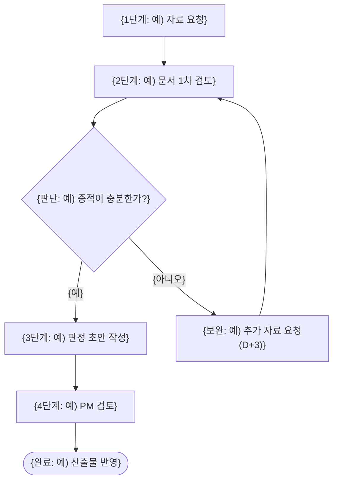

# {N}주차-{NN}. {챕터명}

<!--
작성 가이드
- 이 파일을 복사해 ./1_학습_챕터/{N}주차_{주제}/{NN}_{챕터명}.md 로 저장한다.
- { } 자리표시자를 모두 채우고, 이 주석과 다른 작성 가이드 주석은 지운다.
- 12개 섹션의 순서를 바꾸지 않는다. 내용이 없는 섹션은 지우지 말고 "해당 없음"과 사유를 적는다.
- 설명 순서: 현장 비유 1줄 → 근거 법령·기준 → 컨설팅 수행 절차 → 신입이 맡는 업무 → 오답노트
- 상세 규칙은 ./4_작성_템플릿/README.md 참고
-->

| 구분 | 내용 |
|---|---|
| 고객사 | {A사(민간) / B기관(공공)} |
| 관련 산출물 | {예: `./2_산출물_양식/02_처리방침_진단표.md`} |
| 선행 챕터 | {예: 1주차-02. 자료 요청과 인터뷰, 증적 관리} |
| 예상 학습 시간 | {예: 3시간 (읽기 1.5시간 + 실습 1.5시간)} |

---

## 1. 학습 목표

<!-- 3개 이내. 반드시 "~할 수 있다"로 끝낸다. 동사는 관찰 가능한 행동으로 쓴다(작성한다, 판정한다, 대조한다 등). -->

1. {학습 목표 1}할 수 있다.
2. {학습 목표 2}할 수 있다.
3. {학습 목표 3}할 수 있다.

---

## 2. 현장 비유와 기초 개념

> 🏗️ **현장 비유**: {이 업무를 한 줄로 비유. 예: "처리방침 진단은 식당 메뉴판과 실제 주방 재료를 대조하는 일이다."}

> 📌 **기초 개념 짚기**
> {CPPG 범위 개념을 2~3줄로 요약. 길게 다시 설명하지 않는다.}
> - 근거: {「개인정보 보호법」 제○조, 시행령 제○조 등}[^1]

<!-- 여기에는 CPPG 시험 지식과 현장 실무가 갈리는 지점을 1~2문장으로 덧붙여도 좋다.
     예: "시험에서는 법정 기재사항 목록을 외우면 되지만, 현장에서는 그 목록이 실제 처리 현황과 맞는지 증명해야 한다." -->

---

## 3. 근거 법령·기준

<!-- 조문/인증기준 항목/평가지표 번호, 요지, 쉬운 풀이, 출처 각주를 표로 정리한다.
     원문을 다시 열어 번호·개수·시행일을 확인한 뒤 쓴다. 확인할 수 없으면 ⚠️ 확인 필요 블록을 단다. -->

| 근거 | 요지 | 쉬운 풀이 (현장에서 확인할 것) | 출처 |
|---|---|---|---|
| {「개인정보 보호법」 제○조제○항} | {조문 요지} | {고객사에서 무엇을 확인해야 하는지} | [^2] |
| {시행령 제○조} | {요지} | {풀이} | [^3] |
| {고시 제○조 / 인증기준 ○.○.○ / 평가지표 ○} | {요지} | {풀이} | [^4] |

> ⚠️ **확인 필요**: {참고자료와 일반 지식이 다르거나 확인할 수 없는 내용, 그리고 무엇을 어디서 확인해야 하는지}

---

## 4. 컨설팅 수행 절차

<!-- Mermaid 다이어그램 1개 이상(flowchart 또는 gantt). 모든 노드 텍스트·엣지 라벨·작업명·메시지를 쌍따옴표로 감싼다.
     노드 ID는 영문·숫자만 쓴다. -->



### 단계별 설명

| 단계 | 하는 일 | 입력 자료 | 결과물 | 소요 (예시) |
|---|---|---|---|---|
| 1. {단계명} | {설명} | {예: 처리방침 현행본} | {예: 자료 요청 목록} | {예: 0.5일} |
| 2. {단계명} | {설명} | {입력} | {결과물} | {소요} |
| 3. {단계명} | {설명} | {입력} | {결과물} | {소요} |
| 4. {단계명} | {설명} | {입력} | {결과물} | {소요} |

### Windows 11 실무 도구 팁

<!-- 해당 챕터에서 쓰는 도구·경로·명령어를 Windows 11 기준으로 안내한다. 해당 없으면 "해당 없음". -->

| 작업 | 도구·경로 | 방법 |
|---|---|---|
| {예: 두 버전 문서 비교} | {예: Word → 검토 → 비교} | {설명} |
| {예: 계정 잠금 정책 확인} | {예: `secpol.msc` → 계정 정책 → 계정 잠금 정책} | {설명} |
| {예: 로그온 이벤트 확인} | {예: PowerShell} | `Get-WinEvent -FilterHashtable @{LogName='Security'; Id=4625} -MaxEvents 20` |

---

## 5. 업무 분담표

<!-- 신입 / PM·선임 / 고객사 3열. 신입이 "혼자 하는 일"과 "PM 확인을 받는 일"을 구분해서 쓴다.
     영향평가 챕터는 신입의 보조 업무만 쓴다. -->

| 단계 | 🙋 신입 담당 | 🧑‍💼 PM·선임 담당 | 🏢 고객사 담당 |
|---|---|---|---|
| {단계 1} | {예: 자료 요청 목록 초안 작성, 요청 메일 발송} | {예: 요청 범위 확정, 목록 검토} | {예: 자료 취합·제출} |
| {단계 2} | {업무} | {업무} | {업무} |
| {단계 3} | {업무} | {업무} | {업무} |
| {단계 4} | {업무} | {예: 최종 판정 확정, 고객 보고} | {예: 결과 확인, 개선 계획 수립} |

> 🚫 **신입이 혼자 결정하지 않는 것**: {예: 최종 판정 확정, 위험 수용 여부, 고객사 경영진 대상 결과 설명}

---

## 6. 고객 커뮤니케이션 예시

<!-- 자료 요청 메일 / 인터뷰 질문 리스트 / 결과 설명 멘트 중 1개 이상. 실제로 복사해 쓸 수 있는 수준으로 구체적으로 쓴다. -->

### 6-1. {자료 요청 메일}

```text
제목: [{프로젝트명}] {요청 내용} 자료 요청드립니다 (회신 요청일: {YYYY-MM-DD})

{고객사 담당자명} 님, 안녕하세요.
{컨설팅사명} {이름}입니다.

{요청 배경 1~2문장}

■ 요청 자료
 1. {자료명} - {형식, 기준 시점}
 2. {자료명} - {형식, 기준 시점}

■ 회신 요청일: {YYYY-MM-DD}
■ 제출 방법: {예: 지정된 공유 폴더 / 암호화 압축 후 메일}
  ※ 개인정보가 포함된 원본은 보내지 마시고, {마스킹본/화면 캡처}로 보내 주시기 바랍니다.

문의 사항은 {연락처}로 연락 주시기 바랍니다.
감사합니다.
```

### 6-2. {인터뷰 질문 리스트}

| No | 질문 | 질문 의도 | 답변 후 요청할 증적 |
|---|---|---|---|
| 1 | {질문} | {확인하려는 것} | {증적} |
| 2 | {질문} | {의도} | {증적} |
| 3 | {질문} | {의도} | {증적} |

### 6-3. {결과 설명 멘트}

> "{고객사 담당자에게 결과를 설명하는 말. 판정 + 근거 + 개선 방향 순서로, 비난하지 않는 어조로 쓴다.}"

---

## 7. 처분 사례 또는 인증 결함 사례

<!-- 개인정보보호위원회 실제 처분 사례 또는 ISMS-P 인증 결함 사례.
     사건 개요 → 위반 조항/결함 항목 → 처분·결과 → 컨설팅 시사점 순서.
     출처(의결 연월, 보도자료 제목 또는 참고자료 파일명)를 밝힌다. 확인되지 않으면 ⚠️ 확인 필요. -->

### 사례: {사례명}

| 구분 | 내용 |
|---|---|
| 사건 개요 | {무슨 일이 있었는지} |
| 위반 조항 / 결함 항목 | {「개인정보 보호법」 제○조 / 인증기준 ○.○.○} |
| 처분·결과 | {과징금·과태료·시정명령 등 / 결함 판정 결과} |
| 출처 | {의결 연월, 보도자료 제목, 참고자료 파일명}[^5] |

**컨설팅 시사점**

- {이 사례에서 고객사 점검 시 반드시 확인해야 할 것 1}
- {확인해야 할 것 2}

---

## 8. 오답노트

<!-- 신입 컨설턴트가 자주 하는 실수 3개 이상. ❌ / ✅ / 근거 3열 표. -->

| ❌ 신입의 실수 | ✅ 올바른 수행 | 근거 |
|---|---|---|
| {예: 고객사 담당자의 구두 답변만 듣고 '양호'로 판정함} | {예: 답변을 증적 요청으로 바꿔 시스템 화면·로그로 확인한 뒤 판정함} | {조문·항목 또는 실무 원칙} |
| {예: 증적의 작성일·승인일을 확인하지 않음} | {예: 점검 대상 기간 안에 작성·승인된 문서인지 확인함} | {근거} |
| {실수 3} | {올바른 수행} | {근거} |

---

## 9. 고객사 점검용 체크리스트

<!-- 점검 항목 / 확인 방법(인터뷰·문서·시스템) / 요청 증적 / 판정 기준 4열.
     판정 기준은 🟢 양호 / 🟡 부분 이행 / 🔴 미흡 / ⚪ 해당 없음 중 어떤 경우인지 구분해 쓴다. -->

| No | 점검 항목 | 확인 방법 | 요청 증적 | 판정 기준 |
|---|---|---|---|---|
| 1 | {점검 항목} | {인터뷰 / 문서 / 시스템} | {증적} | 🟢 {조건} · 🟡 {조건} · 🔴 {조건} |
| 2 | {점검 항목} | {확인 방법} | {증적} | 🟢 {조건} · 🟡 {조건} · 🔴 {조건} |
| 3 | {점검 항목} | {확인 방법} | {증적} | 🟢 {조건} · 🔴 {조건} · ⚪ {해당 없음 조건} |

---

## 10. 실무 산출물 연계 팁

<!-- 이 챕터 결과가 어떤 산출물의 어느 부분으로 들어가는지 쓴다. -->

| 이 챕터의 결과 | 들어가는 산출물 | 위치 (장·절·시트) |
|---|---|---|
| {예: 기재사항 누락 목록} | {예: 개인정보 처리 현황 진단 보고서} | {예: 3장 2절 '처리방침 진단 결과'} |
| {결과} | {산출물, 예: `./2_산출물_양식/0N_양식명.md`} | {위치} |

> 💡 {PM에게 넘기기 전에 신입이 꼭 해 둘 정리 작업 1~2줄}

---

## 11. 실습 과제 / 퀴즈

> 정답과 해설은 [정답과_해설.md](../../정답과_해설.md)의 **「{N}주차-{NN}. {챕터명}」** 절에 있습니다. 먼저 스스로 풀어 보세요.

### 객관식

**Q1.** {문제}

① {선택지}
② {선택지}
③ {선택지}
④ {선택지}

**Q2.** {문제}

① {선택지}
② {선택지}
③ {선택지}
④ {선택지}

**Q3.** {문제}

① {선택지}
② {선택지}
③ {선택지}
④ {선택지}

### 실습

**상황**: {가상 고객사(A사 또는 B기관)와 진단 대상 자료를 구체적으로 제시}

**제공 자료**

```text
{진단할 가상 자료 원문: 예) 처리방침 일부, 동의서 양식, 계약서 조항, 점검 결과 메모 등}
```

**과제**

1. {과제 1: 예) 법정 기재사항 누락을 찾아 진단표에 판정과 근거를 쓰시오.}
2. {과제 2: 예) 미흡 항목 1개에 대해 개선 문안을 작성하시오.}
3. {과제 3: 예) 고객사 담당자에게 보낼 결과 설명 메일을 5문장 이내로 쓰시오.}

**작성 양식**: {`./2_산출물_양식/0N_양식명.md`}

---

## 12. 더 읽을거리

| 자료 | 참고자료 파일명 | 읽을 부분 |
|---|---|---|
| {안내서·해설서 이름} | `{파일명}` 또는 "참고자료 폴더에 없음" | {예: p.20~35 'Ⅲ. 작성 방법'} |
| {자료} | `{파일명}` | {범위} |

---

## 각주

[^1]: [출처: {파일명}, {조항}]
[^2]: [출처: {파일명}, {p.쪽}, {조항·항목번호}]
[^3]: [출처: {파일명}, {조항}]
[^4]: [출처: {파일명 또는 "일반 지식, 원문 확인 권장"}]
[^5]: [출처: {보도자료 제목 또는 파일명}, {의결 연월}]
