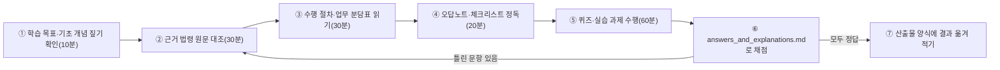

# Advanced_PrivacyStudy: 신입 컨설턴트 실무 가이드

> CPPG를 딴 다음 날, 고객사 회의실에 처음 들어가는 신입 개인정보보호 컨설턴트를 위한 4주 실무 커리큘럼

- **기준일**: 2026-11-18. 이 날짜까지 `./references/` 폴더에 있는 법령·고시·안내서를 1순위 근거로 삼았습니다.
- **대상 독자**: 입사 0~1년 차 개인정보보호 컨설턴트 (기초 개인정보보호 교육 이수, CPPG 취득)
- **작성 관점**: 고객사에 투입된 신입 컨설턴트. PM·선임의 지시를 받아 실무를 수행합니다.

---

## 1. 프로젝트 개요

CPPG 시험은 **"법이 무엇을 요구하는가"** 를 묻습니다. 현장에서는 **"이 고객사가 법 요구를 실제로 지키고 있는가, 그걸 어떤 증적으로 보여줄 수 있는가"** 를 묻습니다. 이 레포는 그 차이를 메우기 위해 만들었습니다.

| 시험 지식 (CPPG) | 현장 실무 (이 레포에서 다루는 것) |
|---|---|
| 처리방침 법정 기재사항을 외운다 | 처리방침을 **실제 DB 컬럼·수탁사 목록·동의서와 대조**해 불일치를 찾는다 |
| 위탁 시 문서에 넣을 사항을 안다 | 고객사 위수탁 계약서 30건을 받아 **조항 누락표**를 만든다 |
| 접속기록 보관 기간을 안다 | 접속기록 **샘플을 받아 날짜·항목·점검 이력**을 확인하고 판정한다 |
| ISMS-P 인증기준이 101개임을 안다 | 항목별로 **증적을 매핑하고 결함 문구**를 초안으로 쓴다 |
| 영향평가 대상 기준을 안다 | 영향평가 산출물용 **흐름표·흐름도**를 직접 그린다 |

레포 전체가 하나의 **가상 연간 프로젝트**처럼 이어집니다. 1~3주차는 민간 고객사(A사)를, 4주차는 공공 고객사(B기관)를 맡아 실습합니다.

---

## 2. 선수 지식과 학습 전 자가 점검

### 2-1. 선수 지식 (CPPG 수준)

이 레포는 아래 내용을 **이미 안다고 보고** 짧게 요약만 합니다. 자신이 없으면 CPPG 교재나 `./glossary.md`를 먼저 보세요.

- 「개인정보 보호법」 체계: 법 → 시행령 → 고시(안전성 확보조치 기준, 표준 개인정보 보호지침 등) → 안내서
- 개인정보·가명정보·민감정보·고유식별정보의 정의, 개인정보처리자·수탁자·개인정보취급자의 구분
- 처리 단계별 의무: 수집·이용(제15조), 제3자 제공(제17조), 목적 외 이용·제공(제18조), 파기(제21조), 위탁(제26조)
- 안전성 확보조치 기준의 기본 조치 항목: 내부 관리계획, 접근권한, 접근통제, 암호화, 접속기록, 악성프로그램 방지, 물리적 조치, 파기
- 정보주체의 권리: 열람, 정정·삭제, 처리정지, 동의 철회, 자동화된 결정에 대한 권리

### 2-2. 학습 전 자가 점검 (5문항)

현행 법령 기준으로 답해 보세요. **CPPG 공부 때 외운 내용과 현행 법령이 달라진 부분**도 일부러 넣었습니다.
정답과 해설은 [`answers_and_explanations.md`](./answers_and_explanations.md)의 **「학습 전 자가 점검」** 절에 있습니다.

1. **(O/X)** 개인정보처리자는 개인정보처리시스템 접속기록을 "월 1회 이상" 점검해야 한다고 「개인정보의 안전성 확보조치 기준」에 명시되어 있다.
2. **(단답)** 개인정보처리시스템 접속기록은 원칙적으로 ( ㉠ ) 이상 보관해야 하고, 5만 명 이상의 정보주체 개인정보를 처리하는 시스템 등 일정한 경우에는 ( ㉡ ) 이상 보관해야 한다.
3. **(단답)** 공공기관이 개인정보 영향평가를 해야 하는 개인정보파일 기준 중 "구축·운용·변경하려는 개인정보파일로서 ( ㉠ )명 이상의 정보주체에 관한 민감정보 또는 고유식별정보를 처리하는 파일"과 "( ㉡ )명 이상의 정보주체에 관한 개인정보파일"의 빈칸은?
4. **(서술)** 개인정보 처리 업무를 위탁할 때 위탁 문서에 넣어야 하는 사항을, 법률 조항과 시행령 조항으로 나누어 쓰시오.
5. **(O/X)** 개인정보 보호책임자는 내부 관리계획의 이행 실태를 연 1회 이상 점검·관리해야 한다.

> 💡 5문항 중 4개 이상 맞히면 바로 1주차로 들어가세요. 3개 이하라면 1주차를 시작하기 전에 `./glossary.md`와 각 챕터의 `📌 기초 개념 짚기` 박스를 먼저 훑어보세요.

---

## 3. 학습 대상과 4주 뒤 목표 역량

### 3-1. 학습 대상

- 개인정보보호 컨설팅 회사에 입사한 지 0~1년 된 컨설턴트
- 기초 개인정보보호 교육을 이수하고 CPPG를 취득했으나, 컨설팅 프로젝트 투입 경험은 없거나 적은 사람

### 3-2. 4주 뒤 목표 역량

4주 뒤에는 **PM의 지시를 받아 아래 업무를 혼자 해낼 수 있어야** 합니다.

| 업무 | 4주 뒤 목표 수준 | 관련 주차 |
|---|---|---|
| 자료 요청 | 진단 범위에 맞춰 자료 요청 목록을 만들고, 요청 메일을 쓰고, 미제출 자료를 추적한다 | 1주차 |
| 인터뷰 보조 | 인터뷰 질문지를 준비하고, 회의록을 쓰고, 구두 답변을 증적 요청으로 바꾼다 | 1주차 |
| 문서 진단 | 처리방침·동의서·내부 관리계획·위수탁 계약서를 법령 기준으로 진단하고 개선안 초안을 쓴다 | 1~2주차 |
| 현장 점검 | 수탁사·고객사 현장에서 체크리스트로 시스템 화면과 증적을 확인하고 판정한다 | 2주차 |
| 인증 준비 보조 | ISMS-P 갭 분석표, 증적 매핑표, 정보자산 목록, 결함 보고서 초안을 쓴다 | 3주차 |
| 공공 컨설팅 보조 | 보호수준 평가 증빙을 검토하고, 영향평가 흐름표·흐름도와 이행 점검표를 정리한다 | 4주차 |
| 산출물 초안 작성 | 위 결과를 진단 보고서·점검표 양식에 맞춰 PM이 검토할 수 있는 수준으로 정리한다 | 전 주차 |

> ⚠️ 판정 확정, 고객사 경영진 보고, 위험 수용 결정, 영향평가 위험도 산정과 같은 **최종 판단은 PM·선임의 몫**입니다. 각 챕터의 **업무 분담표**에서 신입이 맡는 범위를 꼭 확인하세요.

---

## 4. 고객사 가정

모든 챕터의 실습과 예시는 아래 **가상 고객사**를 기준으로 합니다. 실제 기관·기업과는 관계가 없습니다.

### 4-1. 민간 고객사: A사 (1~3주차)

| 항목 | 내용 |
|---|---|
| 업종 | 온라인 쇼핑몰과 멤버십 서비스를 운영하는 중견기업 (가상) |
| 정보주체 | 온라인 회원 약 80만 명, 임직원 약 400명 |
| 수탁사 | 배송, 콜센터(CS), 결제대행, 클라우드 인프라, 마케팅 문자 발송 등 10여 곳 |
| 컨설팅 범위 | 처리방침·동의서 진단, 내부 관리계획 개정과 이행 점검, 위수탁 계약서 검토, 수탁사 점검, ISMS-P 인증 준비 |
| 특이사항 | ISMS 인증 의무대상 해당 여부는 매출액·이용자 수에 따라 판단해야 함 (3주차-01에서 직접 검토) |

### 4-2. 공공 고객사: B기관 (4주차)

| 항목 | 내용 |
|---|---|
| 기관 유형 | 「공공기관의 운영에 관한 법률」에 따른 공공기관 (가상의 준정부기관) |
| 주요 업무 | 대국민 지원금 신청·민원 포털 운영. 법령에 근거해 고유식별정보를 처리함 |
| 정보주체 | 포털 이용자 약 120만 명 |
| 계약 형태 | 우리 회사가 **매년 고정으로 맡는** 연간 정기 컨설팅 |
| 컨설팅 범위 | 개인정보 보호수준 평가 대응, 차세대 시스템 구축에 따른 개인정보 영향평가 보조, 연간 정기 점검 |
| 특이사항 | 보호수준 평가 대상 기관(시행령 제13조의2제1항제1호)이며, 차세대 시스템은 영향평가 대상(시행령 제35조) 여부 검토가 필요함 |

---

## 5. 4주 전체 목차

| 주차 | No | 챕터 | 파일 |
|---|---|---|---|
| **1주차. 컨설팅 기본기와 문서 진단** | 01 | 컨설팅 업무 흐름과 신입의 역할 | [01_컨설팅_업무_흐름과_신입의_역할.md](./chapters/1주차_컨설팅_기본기/01_컨설팅_업무_흐름과_신입의_역할.md) |
| | 02 | 자료 요청과 인터뷰, 증적 관리 | [02_자료요청과_인터뷰_증적관리.md](./chapters/1주차_컨설팅_기본기/02_자료요청과_인터뷰_증적관리.md) |
| | 03 | 개인정보처리방침 진단 | [03_개인정보처리방침_진단.md](./chapters/1주차_컨설팅_기본기/03_개인정보처리방침_진단.md) |
| | 04 | 동의서 양식 진단 | [04_동의서_양식_진단.md](./chapters/1주차_컨설팅_기본기/04_동의서_양식_진단.md) |
| **2주차. 내부 관리계획과 수탁사 점검** | 01 | 내부 관리계획 수립과 개정 | [01_내부관리계획_수립과_개정.md](./chapters/2주차_내부관리계획과_수탁사/01_내부관리계획_수립과_개정.md) |
| | 02 | 내부 관리계획 이행 점검 | [02_내부관리계획_이행점검.md](./chapters/2주차_내부관리계획과_수탁사/02_내부관리계획_이행점검.md) |
| | 03 | 위수탁 계약서 검토 | [03_위수탁_계약서_검토.md](./chapters/2주차_내부관리계획과_수탁사/03_위수탁_계약서_검토.md) |
| | 04 | 수탁사 점검 실무 | [04_수탁사_점검_실무.md](./chapters/2주차_내부관리계획과_수탁사/04_수탁사_점검_실무.md) |
| | 05 | 수탁사 점검 결과보고와 이행 확인 | [05_수탁사_점검_결과보고와_이행확인.md](./chapters/2주차_내부관리계획과_수탁사/05_수탁사_점검_결과보고와_이행확인.md) |
| **3주차. ISMS-P 관리체계 컨설팅** | 01 | ISMS-P 제도와 인증 절차 | [01_ISMS-P_제도와_인증절차.md](./chapters/3주차_ISMS-P/01_ISMS-P_제도와_인증절차.md) |
| | 02 | 인증기준 구조 이해 | [02_인증기준_구조_이해.md](./chapters/3주차_ISMS-P/02_인증기준_구조_이해.md) |
| | 03 | 현황 분석과 갭 분석 | [03_현황분석과_갭분석.md](./chapters/3주차_ISMS-P/03_현황분석과_갭분석.md) |
| | 04 | 증적 수집과 매핑 | [04_증적_수집과_매핑.md](./chapters/3주차_ISMS-P/04_증적_수집과_매핑.md) |
| | 05 | 정보자산, 흐름도, 위험평가 보조 | [05_정보자산_흐름도_위험평가_보조.md](./chapters/3주차_ISMS-P/05_정보자산_흐름도_위험평가_보조.md) |
| | 06 | 결함 유형과 심사 대응 | [06_결함유형과_심사대응.md](./chapters/3주차_ISMS-P/06_결함유형과_심사대응.md) |
| **4주차. 공공 고객사 연간 컨설팅: B기관** | 01 | 공공기관 연간 컨설팅 캘린더 | [01_공공기관_연간_컨설팅_캘린더.md](./chapters/4주차_공공_고객사/01_공공기관_연간_컨설팅_캘린더.md) |
| | 02 | 보호수준 평가 제도와 지표 | [02_보호수준_평가_제도와_지표.md](./chapters/4주차_공공_고객사/02_보호수준_평가_제도와_지표.md) |
| | 03 | 보호수준 평가 증빙 작성 지원 | [03_보호수준_평가_증빙_작성지원.md](./chapters/4주차_공공_고객사/03_보호수준_평가_증빙_작성지원.md) |
| | 04 | 영향평가 개요와 보조 업무 | [04_영향평가_개요와_보조업무.md](./chapters/4주차_공공_고객사/04_영향평가_개요와_보조업무.md) |
| | 05 | 개인정보 흐름표와 흐름도 작성 | [05_개인정보_흐름표_흐름도_작성.md](./chapters/4주차_공공_고객사/05_개인정보_흐름표_흐름도_작성.md) |
| | 06 | 종합 모의 프로젝트 | [06_종합_모의프로젝트.md](./chapters/4주차_공공_고객사/06_종합_모의프로젝트.md) |

### 공통 자료

| 구분 | 파일 | 용도 |
|---|---|---|
| 챕터 템플릿 | [templates/chapter_template.md](./templates/chapter_template.md) | 모든 챕터가 따르는 12개 필수 구성 |
| 템플릿 사용법 | [templates/README.md](./templates/README.md) | 표기 규칙, 각주, Mermaid 작성 규칙 |
| 용어집 | [glossary.md](./glossary.md) | 컨설팅·인증·평가 용어 (가나다순) |
| 정답·해설 | [answers_and_explanations.md](./answers_and_explanations.md) | 챕터별 퀴즈·실습 정답과 해설, 자가 점검 정답 |
| 산출물 양식 | [deliverables/01_자료요청_목록.md](./deliverables/01_자료요청_목록.md) | 1주차-02 |
| | [deliverables/02_처리방침_진단표.md](./deliverables/02_처리방침_진단표.md) | 1주차-03 |
| | [deliverables/03_수탁사_점검_체크리스트.md](./deliverables/03_수탁사_점검_체크리스트.md) | 2주차-04, 05 |
| | [deliverables/04_ISMS-P_갭분석표.md](./deliverables/04_ISMS-P_갭분석표.md) | 3주차-03 |
| | [deliverables/05_증적_매핑표.md](./deliverables/05_증적_매핑표.md) | 3주차-04 |
| | [deliverables/06_보호수준평가_증빙_관리표.md](./deliverables/06_보호수준평가_증빙_관리표.md) | 4주차-03 |
| | [deliverables/07_개인정보_흐름표.md](./deliverables/07_개인정보_흐름표.md) | 4주차-05 |

---

## 6. 학습 방법 가이드

### 6-1. 하루 학습 루틴 (권장)



### 6-2. 학습 원칙

1. **원문을 직접 연다.** 챕터의 각주에 적힌 `references/` 파일과 쪽수를 직접 열어 확인하세요. 실제 업무에서도 PM은 "근거 어디야?"라고 묻습니다.
2. **실습은 산출물 양식에 쓴다.** 실습 결과는 메모장이 아니라 `./deliverables/` 양식에 작성하세요. 4주차-06 종합 모의 프로젝트에서 그대로 다시 씁니다.
3. **판정은 증적으로 한다.** "담당자가 그렇다고 했다"는 판정 근거가 아닙니다. 모든 실습에서 **증적 파일명**까지 적는 습관을 들이세요.
4. **모르면 표시한다.** 확인되지 않은 내용은 단정하지 말고 `> ⚠️ 확인 필요`로 표시한 뒤 PM에게 질문하세요. 이 레포도 같은 규칙으로 작성했습니다.

### 6-3. 표기 규칙

| 표기 | 의미 |
|---|---|
| `📌 기초 개념 짚기` | CPPG 범위 개념을 2~3줄로 요약한 박스 |
| `> ⚠️ 확인 필요` | references에서 확인할 수 없거나, references와 일반 지식이 다른 내용 |
| `[출처: 파일명, p.쪽, 조항]` | references 폴더 파일의 근거 위치 (쪽수는 문서에 인쇄된 쪽 번호 기준) |
| `[출처: 일반 지식, 원문 확인 권장]` | references에 없어 일반 지식으로 보충한 내용 |

**점검 결과 판정 표기**

| 표기 | 판정 | 엑셀·보고서 배경색 (HEX) |
|---|---|---|
| 🟢 양호 | 요구사항을 충족하고 증적으로 확인됨 | `#3cb371` |
| 🟡 부분 이행 | 일부만 충족했거나 증적이 불완전함 | `#daa520` |
| 🔴 미흡 | 요구사항을 충족하지 못했거나 증적이 없음 | `#c35b5b` |
| ⚪ 해당 없음 | 고객사 환경에 해당 요구사항이 적용되지 않음 (사유 기재 필수) | `#808080` |

> GitHub은 마크다운 안의 HTML 배경색(`style` 속성)을 표시하지 않습니다. 그래서 이 레포의 마크다운 안에서는 **이모지와 판정 텍스트**로 표기하고, 같은 표를 Excel이나 보고서로 옮길 때는 위 HEX 코드를 배경색으로 씁니다. 글자색은 따로 지정하지 않습니다(다크·라이트 모드 자동 대응).
> Windows 11 Excel에서는 **홈 → 조건부 서식 → 셀 강조 규칙 → 텍스트 포함**으로 "양호", "부분 이행", "미흡", "해당 없음"에 각 HEX 색을 지정해 두면 편합니다.

---

## 7. 참고자료 목록

아래 파일은 모두 `./references/` 폴더에 있습니다. 챕터에서는 이 파일명을 그대로 각주에 씁니다.

### 7-1. 개인정보 보호 법령·고시

| 문서 | 파일명 | 시행일·버전 |
|---|---|---|
| 개인정보 보호법 (현행) | `개인정보 보호법(법률)(제21445호)(20260911).pdf` | 2026.9.11. 시행 (일부 조문 2027.3.9.·2027.7.1. 시행) |
| 개인정보 보호법 (시행 예정) | `개인정보 보호법(법률)(제21445호)(20270701).pdf` | 2027.7.1. 시행 |
| 개인정보 보호법 시행령 | `개인정보 보호법 시행령(대통령령)(제36804호)(20261110).pdf` | 2026.11.10. 시행 |
| 시행령 별표 1·1의5·2 | `[별표 1] 개인정보 보호책임자의 자격…pdf` 외 2건 | 2026.9.10. 개정 |
| 개인정보의 안전성 확보조치 기준 | `개인정보의 안전성 확보조치 기준(개인정보보호위원회고시)(제2026-9호)(20260701).pdf` | 2026.7.1. 시행 (제15조제5호·제18조는 2027.1.1. 시행) |
| 표준 개인정보 보호지침 | `표준 개인정보 보호지침(개인정보보호위원회고시)(제2025-4호)(20250411).pdf` | 2025.4.11. 시행 |
| 정보보호 및 개인정보보호 관리체계 인증 등에 관한 고시 | `정보보호 및 개인정보보호 관리체계 인증 등에 관한 고시(…)(제2024-8호)(20240724).pdf` | 2024.7.24. 시행 |
| ISMS-P 인증기준 (고시 별표 7) | `[별표 7] 인증기준(제23조 관련)(…).pdf` | 101개 항목 (관리체계 16 / 보호대책 64 / 처리 단계별 21) |
| 개인정보 영향평가에 관한 고시 | `개인정보 영향평가에 관한 고시(개인정보보호위원회고시)(제2025-7호)(20250905).pdf` | 2025.9.5. 시행 |
| 영향평가 고시 별표 5 | `[별표 5] 개인정보 영향평가의 평가영역 및 평가분야 (…).pdf` | 5개 영역 29개 분야 |
| 가명정보의 결합 및 반출 등에 관한 고시 | `가명정보의 결합 및 반출 등에 관한 고시(…)(제2025-8호)(20250909).pdf` | 2025.9.9. 시행 |
| 과징금 부과기준 | `개인정보 보호법 위반에 대한 과징금 부과기준(…)(제2026-12호)(20260911).pdf` | 2026.9.11. 시행 |
| 조사 및 처분에 관한 규정 | `개인정보 보호위원회의 조사 및 처분에 관한 규정(…)(제2026-13호)(20260911).pdf` | 2026.9.11. 시행 |

### 7-2. 개인정보보호위원회 안내서

| 문서 | 파일명 | 발간 |
|---|---|---|
| 개인정보 처리방침 작성지침 | `2026 개인정보 처리방침 작성지침.pdf` | 2026.4. |
| 개인정보의 안전성 확보조치 기준 안내서 | `개인정보의 안전성 확보조치 기준 안내서(2026.11).pdf` | 2026.11. |
| 개인정보 영향평가 수행안내서 | `개인정보 영향평가 수행안내서(25.10.).pdf` | 2025.10. |
| 개인정보 유출등 대응 안내서 | `개인정보 유출등 대응 안내서(2026.9.).pdf` | 2026.9. |
| 개인정보 질의응답 모음집 | `1. 개인정보 질의응답 모음집(2025.12.).pdf` | 2025.12. |
| 알기쉬운 개인정보 처리 동의 안내서 | `★알기쉬운 개인정보 처리 동의 안내서.pdf` | 2022.3. ⚠️ 2023.9. 법 개정 이전 발간 |
| 가명정보 처리 가이드라인 | `가명정보 처리 가이드라인(2026.03.).pdf` | 2026.3. |
| 고정형 영상정보처리기기 설치·운영 안내서 | `★고정형 영상정보처리기기 설치 운영 안내서(2024.12).pdf` | 2024.12. |
| 이동형 영상정보처리기기 개인영상정보 보호·활용 안내서 | `이동형 영상정보처리기기를 위한 개인영상정보 보호·활용 안내서(2024.9.).pdf` | 2024.9. |
| 자동화된 결정에 대한 정보주체의 권리 안내서 | `★자동화된 결정에 대한 정보주체의 권리 안내서(2024.9).pdf` | 2024.9. |
| 생성형 AI 개발·활용을 위한 개인정보 처리 안내서 | `생성형 인공지능(AI) 개발·활용을 위한 개인정보 처리 안내서(2025.8.).pdf` | 2025.8. |

### 7-3. 개인정보보호위원회 보도자료 (처분·점검 사례)

| 보도일 | 내용 | 파일명 앞부분 |
|---|---|---|
| 2022.9.14. | 구글·메타, 동의 없는 타사 행태정보 수집 (과징금 약 1,000억 원) | `220915 (조간) …` |
| 2023.7.12. | ㈜엘지유플러스 유출사고 (과징금 68억 원) | `230713 (조간) …` |
| 2024.3.28. | 주요 AI(LLM) 서비스 사전 실태점검 결과 (개선권고) | `240328 (석간) …` |
| 2024.5.9. | ㈜골프존 유출사고 (과징금 75억 원) | `240509 (석간) …` |
| 2024.5.23. | ㈜카카오 오픈채팅 유출 (과징금 151억 원) | `240523 (석간) …` |
| 2024.6.13. | 에이닷 등 AI 응용서비스 사전 실태점검 결과 | `240613 (석간) …` |
| 2024.11.5. | 메타, 합법 처리근거 없는 민감정보 수집 | `241105 (석간) …` |
| 2025.1.23. | 카카오페이·애플, 개인정보 무단 국외 이전 | `250123 (석간) …` |
| 2025.5.15. | 테무, 국외이전 규정 등 위반 | `250515 (석간) …` |
| 2025.8.28. | SK텔레콤 유출사고 (과징금 1,347억 9,100만 원) | `250828 (석간) …` |
| 2026.8.24. | 2026년 공공기관 개인정보 보호수준 평가단 위촉 (평가 개요·지표 포함) | `[260824 15시보도] …` |

### 7-4. 관련 법령 (보존 기간·처리 근거 확인용)

`정보통신망 이용촉진 및 정보보호 등에 관한 법률`·시행령, `신용정보의 이용 및 보호에 관한 법률`, `위치정보의 보호 및 이용 등에 관한 법률`, `전기통신사업법`, `통신비밀보호법`·시행령, `전자상거래 등에서의 소비자보호에 관한 법률 시행령`, `소득세법`·시행령, `국민건강보험법`·시행령·시행규칙, `고용보험법 시행령`, `여권법`

### 7-5. references에 없는 자료 (원문 확인 필요)

아래 자료는 커리큘럼에 필요하지만 `references/`에 없습니다. 해당 챕터에서는 `[출처: 일반 지식, 원문 확인 권장]` 또는 `⚠️ 확인 필요`로 표시합니다.

- ISMS-P 인증기준 안내서 (항목별 세부 확인사항, 증거자료 예시, 결함 사례)
- 개인정보 보호수준 평가 관련 고시와 평가 편람 (지표별 평가 기준, 증빙자료 목록, 연간 일정)
- 개인정보 처리 위탁 관련 안내서와 표준 위수탁 계약서
- 2023.9. 법 개정 이후 개정된 동의 관련 안내서
- 공공기관 대상 처분 사례와 ISMS-P 인증 결함 사례 자료

---

## 8. 레포 구조

```text
Advanced_PrivacyStudy/
├── README.md
├── glossary.md
├── answers_and_explanations.md
├── templates/
│   ├── README.md
│   └── chapter_template.md
├── deliverables/            # 실습 산출물 양식 (01~07)
├── chapters/
│   ├── 1주차_컨설팅_기본기/
│   ├── 2주차_내부관리계획과_수탁사/
│   ├── 3주차_ISMS-P/
│   └── 4주차_공공_고객사/
└── references/              # 법령·고시·안내서 원문 (1순위 근거)
```

> 이 레포는 학습용 자료입니다. 실제 고객사에 적용할 때는 반드시 국가법령정보센터(www.law.go.kr)와 개인정보보호위원회 누리집(www.pipc.go.kr)에서 최신 원문을 다시 확인하세요.
