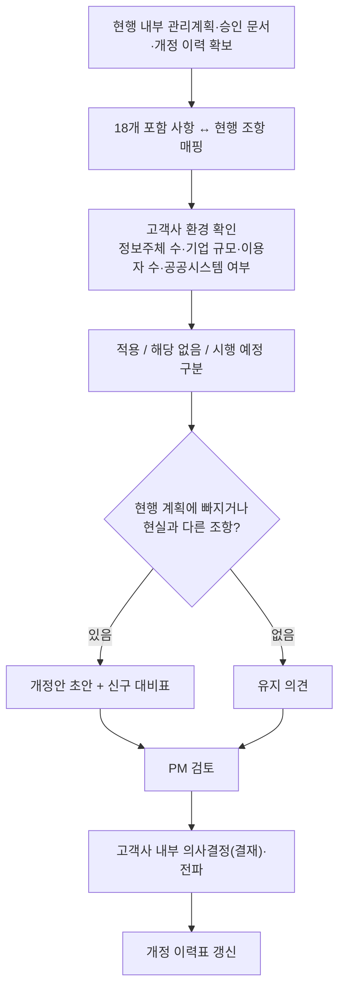

# 2주차-01. 내부 관리계획 수립과 개정

| 구분 | 내용 |
|---|---|
| 고객사 | A사(민간) · B기관(공공시스템 해당 여부 확인 포함) |
| 관련 산출물 | 내부 관리계획 매핑표(이 챕터 4절), `./deliverables/01_자료요청_목록.md` IMP 영역 |
| 선행 챕터 | 1주차-02. 자료 요청과 인터뷰, 증적 관리 |
| 예상 학습 시간 | 3.5시간 (읽기 1.5시간 + 실습 2시간) |

---

## 1. 학습 목표

1. 「개인정보의 안전성 확보조치 기준」 제4조제1항의 18개 포함 사항을 고시의 세부 조문과 1:1로 매핑할 수 있다.
2. 고객사의 규모·처리 환경에 따라 적용·제외되는 조항을 근거와 함께 구분할 수 있다.
3. 고객사 현행 내부 관리계획의 누락·불일치를 찾아 개정안 초안과 신구 대비표를 작성할 수 있다.

---

## 2. 현장 비유와 기초 개념

> 🏗️ **현장 비유**: 내부 관리계획은 **회사의 개인정보 보호 "헌법"**이다. 헌법에 없는 조직은 권한이 없고, 헌법과 다르게 운영하면 그 자체가 위반이 된다. 그래서 남의 헌법을 복사해 오면 안 된다.

> 📌 **기초 개념 짚기**
> 개인정보처리자는 개인정보가 유출등이 되지 않도록 내부 관리계획 수립, 접속기록 보관 등 안전성 확보에 필요한 기술적·관리적·물리적 조치를 해야 한다. 세부 기준은 「개인정보의 안전성 확보조치 기준」(고시)이 정하고, 내부 관리계획은 그 첫 조항(제4조)이다.
> - 근거: 「개인정보 보호법」 제29조, 시행령 제30조제1항제1호·제3항, 안전성 기준 제4조[^law29] [^dec30] [^safe4]

CPPG에서는 "내부 관리계획에 들어갈 사항"을 외웠다면, 현장에서는 **"그 사항이 이 회사 환경에 맞게, 실제로 할 수 있는 수준으로 적혀 있는가"**를 봅니다. 안내서는 법률이나 기준의 내용을 **그대로 옮기는 것이 아니라 스스로의 환경에 맞게** 수립하라고 합니다.[^g54]

---

## 3. 근거 법령·기준

| 근거 | 요지 | 쉬운 풀이 (현장에서 확인할 것) | 출처 |
|---|---|---|---|
| 안전성 기준 제4조제1항 | **내부 의사결정 절차**를 거쳐 18개 사항을 포함한 내부 관리계획을 수립·시행. 1만 명 미만 정보주체를 처리하는 소상공인·개인·단체는 생략 가능 | 결재(승인) 문서가 있어야 "수립"으로 인정. A사·B기관은 생략 대상이 아님 | [^safe4] |
| 안전성 기준 제4조제2항 | 교육 목적·대상, 내용, 일정·방법을 정해 CPO와 취급자에게 **차등화한** 교육을 정기 실시 | 안내서는 **연 1회 이상** 정기 실시로 해설 | [^safe4] [^g55] |
| 안전성 기준 제4조제3항 | 중요한 변경이 있으면 **즉시 반영**하고 **수정 이력** 관리 | 개정할 때도 내부 의사결정 절차(승인)를 다시 거침 | [^safe4] [^g57] |
| 안전성 기준 제4조제4항 | CPO는 이행 실태를 **연 1회 이상** 점검·관리 | 2주차-02의 주제 | [^safe4] |
| 안전성 기준 제5조~제13조 | 접근 권한, 접근통제, 인터넷망 차단, 암호화, 접속기록, 악성프로그램, 물리적 조치, 재해·재난, 출력·복사, 파기의 세부 기준 | 제4조 18개 사항의 **"내용"**은 이 조문들에서 가져온다 | [^safe] |
| 안전성 기준 제15조 | 공공시스템운영기관은 공공시스템별 안전조치 사항 등을 내부 관리계획에 포함 | B기관이 공공시스템운영기관인지 먼저 확인 | [^safe] |
| 안내서 (제4조 해설) | 해당 내용이 없으면 목차에서 제외하거나 "해당 없음"으로 기재할 수 있고, 제외 사유는 "15. 위험 분석 및 관리" 등에 기술. 사업주·대표자의 내부결재 등 **승인**을 받아 모든 임직원과 관련자에게 알림 | 복붙한 조항을 "해당 없음"으로 정리할 때의 근거 | [^g37] |
| 안내서 (제4조 해설) | 수탁자 관리·감독 항목에는 교육·감독의 **시기와 방법, 절차, 점검 항목**을 포함하고 기록을 남김 | 2주차-04 수탁사 점검의 근거가 된다 | [^g53] |

> ⚠️ **확인 필요**: 안전성 기준 부칙에 따라 제15조제5호와 제18조는 **2027.1.1.부터** 시행됩니다.[^safebuchik] 2026년에 B기관 내부 관리계획을 개정할 때는 시행 예정 조항으로 표시해 두고, 2026년 점검에서 미흡으로 판정하지 않습니다.

---

## 4. 컨설팅 수행 절차



### 18개 포함 사항 ↔ 세부 조문 매핑표

| No | 제4조제1항 포함 사항 | 내용을 가져올 세부 근거 | 고객사 환경에 따른 조정 포인트 |
|---|---|---|---|
| 1 | 개인정보 보호 조직의 구성 및 운영 | 영 제30조제1항제1호나목 | 조직도와 실제 담당 부서 일치 여부 |
| 2 | 개인정보 보호책임자의 자격요건 및 지정 | 법 제31조, 영 제32조, 영 별표 1 | 소상공인은 대표자가 CPO가 될 수 있음. 일정 기준 처리자는 지정·변경 시 이사회 의결·신고(법 제31조제3항) |
| 3 | CPO와 개인정보취급자의 역할 및 책임 | 법 제28조, 제31조제4항 | CPO 관할 범위가 조직 전체인지 |
| 4 | 개인정보취급자 관리·감독 및 교육 | 법 제28조, 안전성 기준 제4조제2항 | 교육 대상별 차등(취급자·개발자·수탁자 등) |
| 5 | 접근 권한의 관리 | 안전성 기준 제5조 | 권한 기록 3년, 계정 공유 금지, 인증 실패 시 접근 제한 |
| 6 | 접근통제 | 안전성 기준 제6조, 제6조의2 | 인터넷망 차단은 **전년도 말 기준 직전 3개월 일일평균 이용자 100만 명 이상**인 처리자만 |
| 7 | 개인정보의 암호화 조치 | 안전성 기준 제7조 | 이용자 / 이용자가 아닌 정보주체 구분. 암호키 관리 절차는 **10만 명 이상 대기업·중견기업·공공기관, 100만 명 이상 중소기업·단체** |
| 8 | 접속기록 보관 및 점검 | 안전성 기준 제8조 | 보관 1년 / 2년 판단, 점검 **주기·방법·사후조치**를 이 계획에서 정함 |
| 9 | 악성프로그램 등 방지 | 안전성 기준 제9조 | 자동 업데이트 또는 일 1회 이상 업데이트 |
| 10 | 취약점 점검 | 안전성 기준 제4조제1항제10호 (공공시스템운영기관은 제18조, 2027.1.1. 시행) | 점검 주기·방법을 계획에 정함 |
| 11 | 물리적 안전조치 | 안전성 기준 제10조 (재해·재난은 제11조) | 별도 전산실·자료보관실 유무, 제11조는 10만/100만 명 기준 |
| 12 | 출력·복사 시 안전조치 | 안전성 기준 제12조 | 출력 용도 특정, 항목 최소화 |
| 13 | 개인정보의 파기 | 법 제21조, 영 제16조, 안전성 기준 제13조 | 파기 방법·기록 |
| 14 | 유출사고 대응 계획 수립·시행 | 법 제34조, 영 제39조~제40조, 유출등 대응 안내서 | 2026.3. 개정된 **유출등 가능성 통지**(법 제34조제2항) 반영 여부 |
| 15 | 위험 분석 및 관리 | 안전성 기준 제6조의2제2항, 제7조제3항제2호나목 등 | 인터넷망 차단 예외, 내부망 고유식별정보 암호화 예외 판단 근거가 여기서 나옴 |
| 16 | 수탁자 관리·감독 | 법 제26조제4항, 영 제28조제6항 | 시기·방법·절차·점검 항목·기록[^g53] |
| 17 | 수립·변경·승인 | 안전성 기준 제4조제3항 | 승인권자, 개정 이력 양식 |
| 18 | 그 밖에 필요한 사항 | 안내서 예시: 인증 획득, 컨설팅·실태점검, PbD·영향평가 절차, PET 등[^g54] | 고객사가 자율적으로 추가 |

### 단계별 설명

| 단계 | 하는 일 | 입력 자료 | 결과물 | 소요 (예시) |
|---|---|---|---|---|
| 1. 확보 | 현행 계획, 승인 문서, 개정 이력 수집 | 자료 요청 목록 IMP | 현행본 사본 | 0.5일 |
| 2. 매핑 | 18개 사항 ↔ 현행 조항 대응 | 위 매핑표 | 매핑 결과 (있음/없음/불충분) | 0.5일 |
| 3. 환경 확인 | 정보주체 수, 기업 규모, 이용자 수, 공공시스템 여부 확인 | 인터뷰, 처리시스템 목록 | 적용 조항 판단표 | 0.5일 |
| 4. 개정안 | 누락 조항 추가, 현실과 다른 조항 수정 | 매핑 결과 | 개정안, 신구 대비표 | 1~2일 |
| 5. 승인·전파 지원 | 결재 상신 자료, 전파 공지문 초안 | 개정안 | 결재용 요약, 공지 초안 | 0.5일 |

### Windows 11 실무 도구 팁

| 작업 | 도구·경로 | 방법 |
|---|---|---|
| 신구 대비표 만들기 | Word → 검토 → 비교 → 비교 | 현행본과 개정안을 비교해 변경 표시본을 만들고, 표로 옮긴다 |
| 조항 번호 자동 매기기 | Word → 홈 → 다단계 목록 → "제1조, 제2조…" 사용자 지정 | 조항을 추가해도 번호가 자동으로 바뀌어 인용 오류가 줄어든다 |
| 매핑 누락 찾기 | Excel → 홈 → 조건부 서식 → 셀 강조 규칙 → 같음 → "없음" 을 `#c35b5b` 배경 | 18개 중 빠진 항목이 바로 보인다 |

---

## 5. 업무 분담표

| 단계 | 🙋 신입 담당 | 🧑‍💼 PM·선임 담당 | 🏢 고객사 담당 |
|---|---|---|---|
| 확보·매핑 | 18개 사항 매핑표 작성 | 매핑 결과 검토 | 현행본·승인 문서 제공 |
| 환경 확인 | 정보주체 수·이용자 수·기업 규모 자료 정리 | **적용 / 해당 없음 판단 확정** | 수치 제공 (기준 시점 명시) |
| 개정안 | 조항 문안 초안, 신구 대비표 | 문안 확정, 고객사 현실에 맞는 수준 조정 | 실행 가능성 검토 |
| 승인·전파 | 결재 요약·공지문 초안 | 경영진 보고 | 내부 결재, 전 직원 전파, 이력 관리 |

> 🚫 **신입이 혼자 결정하지 않는 것**: 조항의 "해당 없음" 확정, 인터넷망 차단·암호화 예외 같은 위험 분석 결과 판단, 점검 주기 숫자 결정(고객사가 이행 가능한지 PM과 협의)

---

## 6. 고객 커뮤니케이션 예시

### 6-1. 적용 조항 판단을 위한 인터뷰 질문 리스트

| No | 질문 | 질문 의도 | 답변 후 요청할 증적 |
|---|---|---|---|
| 1 | 전년도 말 기준 직전 3개월간 일일평균 이용자 수는 몇 명인가요? | 인터넷망 차단 대상 여부 (제6조의2) | 이용자 수 산출 자료 (기준 시점 포함) |
| 2 | 처리하는 정보주체 수는 회원·임직원·수탁 처리분 포함 몇 명인가요? 회사 규모 구분(대기업·중견·중소)은요? | 암호키 관리(제7조⑥), 재해·재난(제11조), 접속기록 2년(제8조①) 판단 | 시스템별 정보주체 수, 기업 규모 확인 자료 |
| 3 | 전산실이나 자료보관실을 따로 두고 있나요? | 물리적 조치 적용 범위 (제10조) | 출입통제 절차서, 보관실 사진 |
| 4 | 내부 관리계획은 누가 승인하고, 마지막 개정은 언제였나요? | 내부 의사결정 절차, 이력 관리 | 결재 문서, 개정 이력표 |
| 5 | 최근 1년 사이 시스템·조직·위탁에 큰 변화가 있었나요? | "중요한 변경"의 즉시 반영 여부 (제4조③) | 변경 내역 (신규 시스템, 조직 개편, 신규 수탁사) |

### 6-2. 결과 설명 멘트 (PM 확정 후)

> "현행 내부 관리계획은 2022년 버전 그대로여서 2023년 이후 바뀐 안전성 기준 체계가 반영되지 않았습니다. 18개 포함 사항과 대조해 보니 '유출사고 대응 계획'과 '수탁자 관리·감독' 조항이 없고, 접속기록 점검 주기는 '월 1회'로 적혀 있는데 실제 운영은 분기 1회입니다. 이번 개정안에서는 실제로 지킬 수 있는 주기로 정하고, 정한 대로 기록을 남기시는 방향을 제안드립니다. 개정 후에는 대표이사 결재와 전 직원 공지까지 해 주셔야 '수립·시행'으로 인정됩니다."

---

## 7. 처분 사례: ㈜엘지유플러스 개인정보 유출사고 (2023.7. 의결)

| 구분 | 내용 |
|---|---|
| 사건 개요 | 고객인증시스템(CAS)에서 개인정보 약 29만 7천 건(중복 제거)이 유출됨. 운영 데이터를 개발기·검수기로 옮겨 테스트한 뒤 방치해 1천만 건 이상의 개인정보가 남아 있었고, 접근권한·접속기록을 제대로 관리하지 않아 대규모 추출·전송 기록이 남지 않는 등 관리 통제가 부실했음. 최근 3년 안에 수탁자 관리·감독 소홀 등으로 처분받은 이력도 있었음. |
| 위반 조항 | 법 제21조(파기), 법 제29조(안전조치의무: 권한 내역 보관, 침입차단·탐지, 비밀번호 작성규칙, 접속기록), 유출 통지 위반 (舊 법 조항 기준) |
| 처분·결과 | 과징금 68억 원(68억 45만 2천 원), 과태료 2,700만 원. **CPO의 역할과 위상 강화, 개인정보 보호 조직의 전문성 제고, 개인정보 내부관리계획 재정립**, 전반적인 시스템 점검 및 취약요소 개선 시정명령, 결과 공표 |
| 출처 | 2023.7.12. 보도자료 「개인정보위, ㈜엘지유플러스 개인정보 유출사고에 대해 과징금 68억 원, 과태료 2,700만 원 및 시정명령 부과」[^lgu] |

**컨설팅 시사점**

- 처분 내용에 "내부관리계획 **재정립**"이 들어갔다는 것은, 계획이 있어도 실제 통제(테스트 데이터 관리, 접속기록)를 담지 못했다는 뜻입니다. 매핑할 때 **개발·테스트 환경**의 개인정보 처리도 계획 범위에 들어 있는지 확인합니다.
- 내부 관리계획 개정은 문서 작업으로 끝나지 않습니다. CPO 위상, 조직 전문성과 함께 묶여 시정명령이 나왔다는 점을 개정안 보고 때 설명합니다.

---

## 8. 오답노트

| ❌ 신입의 실수 | ✅ 올바른 수행 | 근거 |
|---|---|---|
| 다른 고객사 내부 관리계획이나 고시 조문을 그대로 복사해 개정안을 만듦 | 고객사 환경(규모·이용자 수·시스템)을 확인해 적용 조항을 고르고, 실행 가능한 수준으로 문안을 씀 | 안내서: 스스로의 환경에 맞게 수립[^g54] |
| 해당 없는 조항(예: 인터넷망 차단)을 근거 없이 삭제 | "해당 없음"으로 남기거나 목차에서 제외하되, 제외 사유를 위험 분석 및 관리 조항 등에 기술 | 안내서[^g37] |
| 개정안을 메일로 받은 담당 팀장 확인만으로 "개정 완료"로 기록 | 내부 의사결정 절차(대표자 등 승인권자 결재)와 전 직원 전파 증적을 확인 | 안전성 기준 제4조제1항·제3항, 안내서[^g37] [^g57] |
| 접속기록 점검 주기를 "월 1회 이상"으로 무조건 적어 넣음 | 고시가 숫자를 정하지 않았으므로 고객사가 실제로 지킬 수 있는 합리적 주기를 PM·고객사와 정함 (과도하게 길지 않게) | 안전성 기준 제8조제2항, 안내서 p.154 |
| 공공시스템 관련 2027.1.1. 시행 조항을 2026년 점검에서 미흡으로 판정 | 시행일을 확인하고 "시행 예정"으로 표시 | 안전성 기준 부칙[^safebuchik] |
| 유출사고 대응 조항을 2023년 문구 그대로 둠 | 2026.3. 개정된 법 제34조(유출등 **가능성** 통지 등) 반영 여부 확인 | 법 제34조제2항[^law34] |

---

## 9. 고객사 점검용 체크리스트

| No | 점검 항목 | 확인 방법 | 요청 증적 | 판정 기준 |
|---|---|---|---|---|
| 1 | 내부 관리계획이 내부 의사결정 절차(승인)를 거쳐 수립되었다 | 문서 | 결재 문서 | 🟢 승인권자 결재 · 🔴 결재 없음 |
| 2 | 제4조제1항 18개 사항이 모두 포함되거나, 제외 사유가 기술되어 있다 | 문서 | 내부 관리계획 | 🟢 전부 · 🟡 1~3개 누락 · 🔴 4개 이상 누락 |
| 3 | 조항 내용이 고객사 환경(규모·이용자 수·시스템)과 맞는다 | 문서·인터뷰 | 처리시스템 목록, 이용자 수 자료 | 🟢 일치 · 🟡 일부 불일치 · 🔴 다른 회사 문서 수준 |
| 4 | 교육 목적·대상·내용·일정·방법이 정해져 있다 | 문서 | 교육 계획 | 🟢 5요소 모두 · 🟡 일부 · 🔴 없음 |
| 5 | 중요한 변경이 즉시 반영되고 수정 이력이 관리된다 | 문서 | 개정 이력표 | 🟢 이력·승인 · 🟡 이력만 · 🔴 없음 |
| 6 | 개정된 계획이 임직원·관련자에게 전파되었다 | 문서 | 공지 메일, 게시 화면, 교육 자료 | 🟢 전파 증적 · 🔴 없음 |
| 7 | 수탁자 관리·감독의 시기·방법·절차·점검 항목이 정해져 있다 | 문서 | 내부 관리계획 해당 조항 | 🟢 4요소 · 🟡 일부 · 🔴 없음 · ⚪ 위탁 없음 |

---

## 10. 실무 산출물 연계 팁

| 이 챕터의 결과 | 들어가는 산출물 | 위치 |
|---|---|---|
| 18개 사항 매핑표 | 진단 보고서 | 4장 '내부 관리계획 진단' |
| 적용 조항 판단표 | 내부 관리계획 개정안 | 부록 '적용 기준 판단 근거' (위험 분석 및 관리 조항과 연결) |
| 신구 대비표 | 개선 권고서 | 부록 '내부 관리계획 개정안' |
| 점검 주기·방법 확정값 | 2주차-02 이행 점검표 | "계획상 기준" 열 |

> 💡 개정안에서 정한 **주기·방법·담당자**는 그대로 2주차-02 이행 점검의 판정 기준이 됩니다. 지키지 못할 숫자를 넣으면 다음 점검에서 고객사가 미흡을 받게 됩니다.

---

## 11. 실습 과제 / 퀴즈

> 정답과 해설은 [answers_and_explanations.md](../../answers_and_explanations.md)의 **「2주차-01. 내부 관리계획 수립과 개정」** 절에 있습니다.

### 객관식

**Q1.** 「개인정보의 안전성 확보조치 기준」 제4조제1항 단서에 따라 내부 관리계획 수립을 **생략할 수 있는** 경우는?

① 1만 명 미만의 정보주체에 관하여 개인정보를 처리하는 소상공인·개인·단체
② 10만 명 미만의 정보주체에 관하여 개인정보를 처리하는 중소기업
③ 개인정보처리시스템을 클라우드로 운영하는 모든 처리자
④ ISMS-P 인증을 받은 처리자

**Q2.** A사(중견기업, 정보주체 80만 명, 전년도 말 기준 직전 3개월 일일평균 이용자 30만 명)의 내부 관리계획을 개정할 때, 다음 중 **적용되지 않는** 조항은?

① 암호화된 개인정보를 안전하게 보관하기 위한 암호 키 관리 절차 (제7조제6항)
② 재해·재난 대비 안전조치 (제11조)
③ 개인정보취급자 컴퓨터 등에 대한 인터넷망 차단 조치 (제6조의2제1항)
④ 접속기록 보관 및 점검 (제8조)

**Q3.** 내부 관리계획 개정 절차에 대한 설명으로 옳지 **않은** 것은?

① 중요한 변경이 있으면 즉시 반영해 수정하고 수정 이력을 관리한다.
② 개정할 때도 내부 의사결정 절차를 거친다.
③ 개정 내용은 개인정보취급자 등에게 전파한다.
④ 컨설턴트가 작성한 개정안은 컨설팅사 PM이 승인하면 시행할 수 있다.

### 실습

**상황**: A사 현행 내부 관리계획 목차와 A사 환경 정보다. 매핑표를 만들고 개정안 초안을 쓰라.

**제공 자료**

```text
[A사 개인정보 내부 관리계획 목차 (2022-04-01 시행, 정보보호팀장 전결)]
제1장 총칙 (목적, 정의, 적용범위)
제2장 개인정보 보호책임자 지정 및 역할
제3장 개인정보취급자 교육 (연 1회 집합교육)
제4장 접근권한 관리 (권한 내역 1년 보관)
제5장 접근통제 (침입차단시스템 운영)
제6장 암호화 (비밀번호 일방향 암호화)
제7장 접속기록 (1년 보관, 월 1회 점검)
제8장 백신 설치
제9장 파기
부칙 (개정 이력 없음)

[A사 환경]
- 중견기업, 회원 80만 명(주민등록번호 미수집, 계좌번호 저장), 임직원 400명
- 전년도 말 기준 직전 3개월 일일평균 이용자 30만 명
- 별도 전산실 없음 (서버는 클라우드 D사), 문서 보관 캐비닛 있음
- 수탁사 7곳 (콜센터·배송·문자 발송 등)
- 실제 접속기록 점검: 분기 1회
```

**과제**

1. 18개 포함 사항 매핑표(4절 형식)를 만들어 각 사항을 "있음 / 없음 / 불충분 / 해당 없음(사유)"으로 판정하시오.
2. 현행 계획 중 **안전성 기준과 맞지 않는 조항**을 2개 이상 찾고 근거를 쓰시오.
3. 신구 대비표(현행 | 개정안 | 근거) 형식으로 개정안 5개 조항 이상을 쓰시오.

**작성 양식**: 4절 매핑표, 신구 대비표

---

## 12. 더 읽을거리

| 자료 | references 파일명 | 읽을 부분 |
|---|---|---|
| 개인정보의 안전성 확보조치 기준 안내서 | [`개인정보의 안전성 확보조치 기준 안내서(2026.11).pdf`](<../../references/개인정보의 안전성 확보조치 기준 안내서(2026.11).pdf>) | p.35~58 '제4조 내부 관리계획의 수립·시행 및 점검' (목차 예시 p.37) |
| 개인정보의 안전성 확보조치 기준 | [`개인정보의 안전성 확보조치 기준(개인정보보호위원회고시)(제2026-9호)(20260701).pdf`](<../../references/개인정보의 안전성 확보조치 기준(개인정보보호위원회고시)(제2026-9호)(20260701).pdf>) | 제4조~제13조, 부칙 |
| 개인정보 유출등 대응 안내서 | [`개인정보 유출등 대응 안내서(2026.9.).pdf`](<../../references/개인정보 유출등 대응 안내서(2026.9.).pdf>) | 유출사고 대응 계획 수립 (18개 사항 중 14번) |
| 엘지유플러스 처분 보도자료 | [`230713 (조간) 개인정보위, ㈜엘지유플러스 개인정보 유출사고에 대해 과징금 68억 원, 과태료 2,700만 원 및 시정명령 부과(조사2과)FN.pdf`](<../../references/230713 (조간) 개인정보위, ㈜엘지유플러스 개인정보 유출사고에 대해 과징금 68억 원, 과태료 2,700만 원 및 시정명령 부과(조사2과)FN.pdf>) | 전문, 참고1 |

---

## 각주

[^law29]: [출처: [개인정보 보호법(법률)(제21445호)(20260911).pdf](<../../references/개인정보 보호법(법률)(제21445호)(20260911).pdf>), 제29조]
[^law34]: [출처: [개인정보 보호법(법률)(제21445호)(20260911).pdf](<../../references/개인정보 보호법(법률)(제21445호)(20260911).pdf>), 제34조제2항]
[^dec30]: [출처: [개인정보 보호법 시행령(대통령령)(제36804호)(20261110).pdf](<../../references/개인정보 보호법 시행령(대통령령)(제36804호)(20261110).pdf>), 제30조제1항제1호·제3항]
[^safe4]: [출처: [개인정보의 안전성 확보조치 기준(개인정보보호위원회고시)(제2026-9호)(20260701).pdf](<../../references/개인정보의 안전성 확보조치 기준(개인정보보호위원회고시)(제2026-9호)(20260701).pdf>), 제4조]
[^safe]: [출처: [개인정보의 안전성 확보조치 기준(개인정보보호위원회고시)(제2026-9호)(20260701).pdf](<../../references/개인정보의 안전성 확보조치 기준(개인정보보호위원회고시)(제2026-9호)(20260701).pdf>), 제5조~제15조]
[^safebuchik]: [출처: [개인정보의 안전성 확보조치 기준(개인정보보호위원회고시)(제2026-9호)(20260701).pdf](<../../references/개인정보의 안전성 확보조치 기준(개인정보보호위원회고시)(제2026-9호)(20260701).pdf>), 부칙]
[^g37]: [출처: [개인정보의 안전성 확보조치 기준 안내서(2026.11).pdf](<../../references/개인정보의 안전성 확보조치 기준 안내서(2026.11).pdf>), p.37]
[^g53]: [출처: [개인정보의 안전성 확보조치 기준 안내서(2026.11).pdf](<../../references/개인정보의 안전성 확보조치 기준 안내서(2026.11).pdf>), p.53 '16. 수탁자에 대한 관리 및 감독']
[^g54]: [출처: [개인정보의 안전성 확보조치 기준 안내서(2026.11).pdf](<../../references/개인정보의 안전성 확보조치 기준 안내서(2026.11).pdf>), p.54~55 '17. 수립, 변경 및 승인', '18. 그 밖에 필요한 사항']
[^g55]: [출처: [개인정보의 안전성 확보조치 기준 안내서(2026.11).pdf](<../../references/개인정보의 안전성 확보조치 기준 안내서(2026.11).pdf>), p.55 (제4조제2항 해설)]
[^g57]: [출처: [개인정보의 안전성 확보조치 기준 안내서(2026.11).pdf](<../../references/개인정보의 안전성 확보조치 기준 안내서(2026.11).pdf>), p.57 (제4조제3항 해설)]
[^lgu]: [출처: [230713 (조간) 개인정보위, ㈜엘지유플러스 개인정보 유출사고에 대해 과징금 68억 원, 과태료 2,700만 원 및 시정명령 부과(조사2과)FN.pdf](<../../references/230713 (조간) 개인정보위, ㈜엘지유플러스 개인정보 유출사고에 대해 과징금 68억 원, 과태료 2,700만 원 및 시정명령 부과(조사2과)FN.pdf>), p.1~3, 2023.7.12. 의결]
