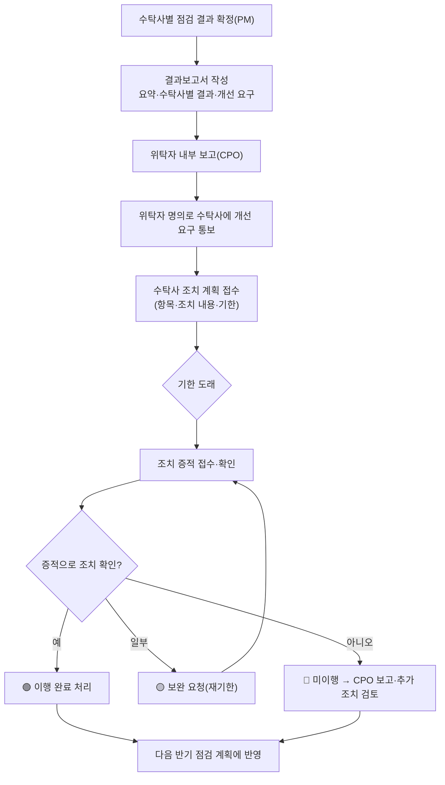

# 2주차-05. 수탁사 점검 결과보고와 이행 확인

| 구분 | 내용 |
|---|---|
| 고객사 | A사(민간) |
| 관련 산출물 | `./deliverables/03_수탁사_점검_체크리스트.md` (2단계 결과 요약·3단계 개선 요구와 이행 확인), 수탁사 점검 결과보고서 |
| 선행 챕터 | 2주차-04. 수탁사 점검 실무 |
| 예상 학습 시간 | 3시간 (읽기 1시간 + 실습 2시간) |

---

## 1. 학습 목표

1. 수탁사 점검 결과를 위탁자 경영진·실무자가 이해할 수 있는 결과보고서 형식으로 정리할 수 있다.
2. 미흡 항목마다 구체적인 개선 요구(무엇을, 언제까지, 어떤 증적으로)를 작성할 수 있다.
3. 수탁사의 조치 결과를 증적으로 확인해 이행 여부를 판정하고 추적할 수 있다.

---

## 2. 현장 비유와 기초 개념

> 🏗️ **현장 비유**: 이행 확인은 **치과 재검진**이다. "충치 치료하세요"라고 말한 것으로 끝나면 의사 일을 다 한 것이 아니다. 다음 진료에서 실제로 치료됐는지 봐야 한다.

> 📌 **기초 개념 짚기**
> 위탁자는 수탁자를 감독해야 하고, 내부 관리계획에는 수탁자 교육·감독의 기록을 남기고 **문제점이 발견되면 그에 따른 개선조치**를 하도록 정해야 한다. 감독은 점검 → 결과 → 개선 요구 → 이행 확인까지가 한 바퀴다.
> - 근거: 「개인정보 보호법」 제26조제4항[^law26], 안전성 기준 안내서 p.53[^g53]

CPPG 지식은 "감독 의무"에서 끝납니다. 현장에서 고객사가 가장 많이 놓치는 것은 **개선 요구를 보낸 뒤 확인하지 않는 것**입니다. 그러면 다음 해 점검에서 같은 미흡이 그대로 나옵니다.

---

## 3. 근거 법령·기준

| 근거 | 요지 | 쉬운 풀이 (현장에서 확인할 것) | 출처 |
|---|---|---|---|
| 법 제26조제4항 · 영 제28조제6항 | 위탁자의 교육·감독 의무 | 결과보고·이행 확인 기록이 곧 "감독했다"는 증적 | [^law26] [^dec28] |
| 안전성 기준 안내서 p.53 | 수탁자 교육·감독 기록을 남기고, 문제점이 발견되면 개선조치. 관리·감독 예시에 **결과 기록·보관**, **결과 후속조치(개선, 보고)** 포함 | 결과보고서와 이행 확인표가 이 두 요소에 해당 | [^g53] |
| 통합 안내서 (감독 절차 예시) | 사전평가 → 등급화 → 체크리스트 자체 점검 → **이행계획서 제출** → 현장·원격 점검 → **감독 결과 도출 및 사후 조치** | 이 챕터는 마지막 단계("결과 도출 및 사후 조치") | [^integ175] |
| 표준 위탁 계약서 예시 제8조제2항 | 위탁자는 점검하거나 점검을 요구할 수 있고, **점검 사항에 대해 시정을 요구**할 수 있으며 수탁자는 특별한 사유가 없으면 이행 | 개선 요구의 계약상 근거. 계약에 이 조항이 없으면 2주차-03으로 돌아가 보완 | [^integ185] |
| ISMS-P 인증기준 2.3.3 | 외부자 점검·감사에서 발견된 문제점에 대해 개선계획을 수립·이행하고, **개선 조치 완료 여부에 대한 이행점검** 수행 | 인증 심사에서도 "개선 요구 후 확인했는가"를 본다 | [^ismsg233] |
| 법 제64조의2제1항제5호 (통합 안내서 제재 규정 표) | 위탁자가 관리·감독 또는 교육을 소홀히 하여 수탁자가 법을 위반한 경우 과징금 대상 | 고객사에 처분 가능성을 단정하지 않고, 감독 기록의 중요성을 설명하는 배경으로만 쓴다 | [^integ181] |

---

## 4. 컨설팅 수행 절차



### 결과보고서 목차 (예시)

| 장 | 내용 | 신입이 맡는 부분 |
|---|---|---|
| 1. 점검 개요 | 근거(법 제26조제4항, 계약 조항), 대상, 기간, 방법(서면·원격·현장), 점검자 | 표 작성 |
| 2. 종합 결과 | 수탁사 × 영역별 🟢🟡🔴⚪ 집계, 주요 발견 3~5개 | 집계표, 그래프 |
| 3. 수탁사별 결과 | 수탁사마다 판정표와 근거 | 판정표·근거 정리 |
| 4. 개선 요구 사항 | 항목·요구 내용·기한·제출 증적 | 초안 작성 |
| 5. 위탁자 조치 사항 | 계약 보완, 내부 관리계획 보완, 다음 점검 계획 | 초안 작성 |
| 부록 | 체크리스트 원본, 증적 목록 | 증적 매핑 |

### 좋은 개선 요구 문장의 4요소

| 요소 | 나쁜 예 | 좋은 예 |
|---|---|---|
| 대상 | "계정 관리 강화" | "상담 시스템 퇴사자 계정 3개(○○, ○○, ○○)" |
| 조치 | "개선 바람" | "즉시 삭제하고, 퇴사 처리 시 계정 삭제 절차를 인사 절차에 추가" |
| 기한 | "조속히" | "2026-06-30까지" |
| 증적 | (없음) | "삭제 후 사용자 목록 화면 캡처, 개정된 퇴사 절차서" |

### 단계별 설명

| 단계 | 하는 일 | 입력 자료 | 결과물 | 소요 (예시) |
|---|---|---|---|---|
| 결과보고서 | 판정 집계, 수탁사별 결과, 개선 요구 | 체크리스트 1·2단계 | 결과보고서 초안 | 2일 |
| 통보 | 위탁자 명의 통보문 초안 | 결과보고서 | 통보문 | 0.5일 |
| 조치 계획 접수 | 수탁사 계획의 구체성 검토 | 수탁사 회신 | 3단계 표 (계획·기한) | 수탁사당 0.5시간 |
| 이행 확인 | 증적 확인, 필요 시 원격 확인 | 조치 증적 | 3단계 표 (확인 결과) | 수탁사당 1시간 |
| 추적 보고 | 미이행·지연 현황 CPO 보고 | 3단계 표 | 월간 추적 보고 | 수시 |

### Windows 11 실무 도구 팁

| 작업 | 도구·경로 | 방법 |
|---|---|---|
| 판정 집계표 | Excel → 삽입 → 피벗 테이블 (행: 수탁사, 열: 판정, 값: 개수) | 결과보고서 2장 집계를 자동으로 |
| 기한 경과 표시 | Excel → `=IF(AND(이행확인일="",TODAY()>조치기한),"기한 경과","")` + 조건부 서식 `#c35b5b` | 미이행 추적 |
| 결과보고서 PDF 배포 | Word → 파일 → 다른 이름으로 저장 → PDF → 옵션 "문서 구조 태그" 체크 | 고객사 배포용 (편집 방지) |
| 이행 증적 비교 | 사진 앱에서 조치 전·후 캡처를 나란히 열기 (`Win + ←/→` 창 분할) | 같은 화면의 전후 비교를 결과에 첨부 |

---

## 5. 업무 분담표

| 단계 | 🙋 신입 담당 | 🧑‍💼 PM·선임 담당 | 🏢 고객사(위탁자) 담당 | 🏭 수탁사 담당 |
|---|---|---|---|---|
| 결과보고서 | 집계·수탁사별 결과·개선 요구 초안 | 보고서 검토·확정, 주요 발견 문장 | CPO 보고·승인 | — |
| 통보 | 통보문 초안 | 검토 | **위탁자 명의로 발송** | 접수 |
| 조치 계획 | 계획의 4요소(대상·조치·기한·증적) 검토 | 기한 협의 | 승인 | 조치 계획 제출 |
| 이행 확인 | 증적 확인, 판정 초안, 추적표 갱신 | 판정 확정 | 미이행 시 추가 조치 결정 | 조치·증적 제출 |

> 🚫 **신입이 혼자 결정하지 않는 것**: 기한 연장 승인, 미이행 수탁사에 대한 조치(계약 관련) 언급, 결과보고서 최종 판정

---

## 6. 고객 커뮤니케이션 예시

### 6-1. 개선 요구 통보문 (위탁자 명의 초안)

```text
제목: [A사] 2026년 상반기 개인정보 처리 위탁업무 점검 결과 및 개선 요청

B콜센터 대표이사님께,

A사는 위탁 계약서 제○조(관리·감독)에 따라 2026-05-22 실시한 점검 결과를 아래와 같이 알리고,
미흡 사항에 대한 개선을 요청드립니다.

■ 점검 결과 요약: 20개 항목 중 양호 14 / 부분 이행 3 / 미흡 2 / 해당 없음 1

■ 개선 요청 사항
```

| No | 항목 | 요청 내용 | 기한 | 제출 증적 |
|---|---|---|---|---|
| 1 | E2 | 퇴사자 상담 계정 3개 삭제, 퇴사 절차에 계정 삭제 단계 추가 | 2026-06-12 | 삭제 후 사용자 목록 캡처, 개정 절차서 |
| 2 | C1 | 야간 상담 재위탁(C사)에 대한 A사 동의 절차 진행 | 2026-06-12 | 재위탁 동의 요청 공문 |
| 3 | D1 | 2026년 상담원 개인정보 보호 교육 실시 및 이수 명단 제출 | 2026-07-31 | 교육 자료, 이수 명단 |

```text
■ 조치 계획 회신: 2026-06-05까지 (첨부 양식)
```

### 6-2. 결과 설명 멘트 (PM 확정 후, 위탁자 CPO 대상)

> "7개 수탁사 점검 결과, 전체적으로는 양호 비율이 74%였습니다. 주의하실 부분은 두 가지입니다. 첫째, 재위탁 동의 없이 하도급을 쓰는 곳이 2곳 있었습니다. 둘째, 수탁사가 보낸 자체 점검 결과와 원격 점검 결과가 다른 곳이 1곳 있었습니다. 개선 요청은 대표님 명의로 나가야 계약상 효력이 분명하니, 통보문 초안을 검토해 주시면 발송 후 기한별로 이행 여부를 저희가 확인해 매월 보고드리겠습니다."

---

## 7. 처분 사례: ㈜엘지유플러스, 수탁자 관리·감독 소홀 처분 후 재위반 (2023.7. 의결)

| 구분 | 내용 |
|---|---|
| 사건 개요 | 2023년 유출사고 처분 보도자료는 엘지유플러스가 **최근 3년간 보호법 위반 사실**이 있다고 밝히며, 그 예로 **수탁자에 대한 관리·감독 소홀**, 개인정보 보호조치(접근통제) 위반으로 2020.12.9. 과징금·과태료 처분을 받은 이력을 들었음. 2023년 처분에서는 고객인증시스템 관리 부실로 다시 과징금·과태료가 부과됨. |
| 위반 조항 | 2023년 처분: 파기, 안전조치의무, 유출 통지 위반 (보도자료 참고1 기준) |
| 처분·결과 | 과징금 68억 원, 과태료 2,700만 원. 반복 위반 이력을 고려해 CPO 역할·위상 강화, 보호 조직 전문성 제고, 내부관리계획 재정립, 시스템 점검·취약요소 개선 시정명령 |
| 출처 | 2023.7.12. 보도자료 「개인정보위, ㈜엘지유플러스 개인정보 유출사고에 대해 과징금 68억 원, 과태료 2,700만 원 및 시정명령 부과」[^lgu] |

**컨설팅 시사점**

- 보호위원회는 처분 때 **과거 위반 이력**을 함께 봅니다. 점검에서 지적한 사항이 다음 해에도 반복되면 고객사의 위험이 커집니다. 이행 확인을 끝까지 추적해야 하는 이유입니다.
- 결과보고서에는 **전년도 지적 사항의 이행 여부**를 별도 절로 넣습니다.

### 인증 결함 관점

ISMS-P 인증기준 2.3.3은 점검·감사에서 발견된 문제점의 개선계획 수립·이행과 **개선 조치 완료 여부에 대한 이행점검**을 요구합니다.[^ismsg233] 개선 요구 공문만 있고 이행 확인 기록이 없으면 인증 심사에서도 결함으로 지적될 수 있습니다.

---

## 8. 오답노트

| ❌ 신입의 실수 | ✅ 올바른 수행 | 근거 |
|---|---|---|
| 개선 요구를 "계정 관리 강화 바람"처럼 추상적으로 씀 | 대상·조치·기한·증적 4요소로 씀 | 이행 확인이 가능해야 감독 기록이 된다 |
| 수탁사의 "조치 완료했습니다" 메일로 이행 완료 처리 | 조치 후 화면·문서 증적으로 확인하고, 필요하면 원격으로 재확인 | ISMS-P 2.3.3 이행점검[^ismsg233] |
| 결과보고서를 컨설팅사 명의로 수탁사에 직접 발송 | 결과보고는 위탁자 CPO에게, 개선 요구 통보는 위탁자 명의로 | 감독 의무 주체는 위탁자 |
| 기한이 지난 미이행 건을 다음 점검 때 다시 보기로 하고 방치 | 월간 추적표로 CPO에 보고, 위탁자가 추가 조치를 결정하도록 함 | 안전성 기준 안내서 p.53 (후속조치) |
| 이번 반기 결과만 보고하고 전년도 지적 사항은 언급하지 않음 | 전년도 지적 사항 이행 현황을 별도 절로 보고 | LGU+ 사례 (반복 위반 이력) |
| 위탁자 측 문제(계약 조항 누락, 내부 관리계획 미비)를 보고서에 넣지 않음 | 수탁사 개선 요구와 별도로 "위탁자 조치 사항" 장을 둠 | 감독 체계 자체의 개선 |

---

## 9. 고객사 점검용 체크리스트: 결과보고·이행 확인 체계

| No | 점검 항목 | 확인 방법 | 요청 증적 | 판정 기준 |
|---|---|---|---|---|
| 1 | 수탁사 점검 결과가 문서로 정리되어 CPO에게 보고되었다 | 문서 | 결과보고서, 보고 결재 | 🟢 보고·결재 · 🟡 문서만 · 🔴 없음 |
| 2 | 미흡 항목에 대해 위탁자 명의로 개선 요구가 통보되었다 | 문서 | 통보 공문·메일 | 🟢 통보 · 🔴 없음 |
| 3 | 개선 요구에 대상·조치·기한·증적이 명시되어 있다 | 문서 | 통보문 | 🟢 4요소 · 🟡 일부 · 🔴 추상적 |
| 4 | 수탁사 조치 결과를 증적으로 확인한 기록이 있다 | 문서 | 이행 확인표, 조치 증적 | 🟢 전 항목 확인 · 🟡 일부 · 🔴 없음 |
| 5 | 미이행·지연 건이 추적되고 CPO에 보고된다 | 문서 | 추적표, 보고 기록 | 🟢 추적·보고 · 🔴 방치 |
| 6 | 전년도 지적 사항의 이행 여부가 이번 점검에 반영되었다 | 문서 | 전년도 결과보고서, 이번 결과 | 🟢 반영 · 🔴 미반영 · ⚪ 최초 점검 |

---

## 10. 실무 산출물 연계 팁

| 이 챕터의 결과 | 들어가는 산출물 | 위치 |
|---|---|---|
| 결과 요약 집계 | `./deliverables/03_수탁사_점검_체크리스트.md` | 2단계 결과 요약 |
| 개선 요구·이행 확인 | `./deliverables/03_수탁사_점검_체크리스트.md` | 3단계 표 |
| 결과보고서 | 고객사 "○○년 수탁자 관리·감독 결과" | 고객사 보관 증적 (내부 관리계획 16호 이행 증적) |
| 위탁자 조치 사항 | 2주차-01 내부 관리계획 개정안, 2주차-03 부속 합의서 | 해당 조항 |
| B기관의 경우 | 보호수준 평가 심층평가 "위·수탁의 적절성 및 사후관리" 증빙 | 4주차-03 |

> 💡 B기관에서도 같은 결과보고·이행 확인 기록이 보호수준 평가 정성 지표(개인정보 처리업무 위·수탁의 적절성 및 사후관리)의 증빙 후보가 됩니다. 4주차에서 다시 씁니다.

---

## 11. 실습 과제 / 퀴즈

> 정답과 해설은 [answers_and_explanations.md](../../answers_and_explanations.md)의 **「2주차-05. 수탁사 점검 결과보고와 이행 확인」** 절에 있습니다.

### 객관식

**Q1.** 다음 중 이행 확인이 가능한 개선 요구 문장으로 가장 적절한 것은?

① "개인정보 보호 수준을 전반적으로 강화하시기 바랍니다."
② "접근통제를 개선하십시오."
③ "상담 시스템 퇴사자 계정 3개를 2026-06-12까지 삭제하고, 삭제 후 사용자 목록 화면을 제출하십시오."
④ "가능한 빨리 보안 조치를 취해 주십시오."

**Q2.** 수탁사가 "재위탁 동의 절차를 완료했습니다"라고 메일로만 회신했다. 신입이 할 일로 가장 적절한 것은?

① 메일을 증적으로 등록하고 이행 완료로 처리한다.
② 위탁자의 동의 문서(공문·승인 기록)를 요청해 확인한 뒤 판정 초안을 쓴다.
③ 수탁사를 믿고 다음 점검 때 확인한다.
④ 재위탁은 수탁사 사정이므로 확인 대상이 아니다.

**Q3.** 수탁사 점검 결과보고서에 반드시 별도로 다루는 것이 바람직한 내용은?

① 컨설팅사 소개
② 전년도 지적 사항의 이행 여부
③ 수탁사의 매출 현황
④ 점검자 개인 의견

### 실습

**상황**: 2주차-04 실습에서 점검한 결과가 다음과 같이 확정되었다. 결과보고서 핵심 부분과 이행 확인표를 작성하라.

**제공 자료**

```text
[2026 상반기 수탁사 점검 확정 결과 (PM 확정)]
- B콜센터(원격): 양호 14, 부분 3, 미흡 2, 해당 없음 1
  · 미흡: E2 퇴사자 계정 3개 활성, C1 야간 재위탁(C사) 동의 없음
  · 부분: D1 교육 이수율 60%, E8 접속기록 점검 분기 1회(계약상 월 1회), E11 엑셀 다운로드 무제한
- F택배(현장): 양호 16, 부분 2, 미흡 1, 해당 없음 1
  · 미흡: C1 제주 G사 재위탁 동의 없음
  · 부분: E10 송장 출력물 캐비닛 미잠금, A3 계약 종료 시 파기 통보 조항 없음
- J개발(현장): 양호 15, 부분 1, 미흡 2, 해당 없음 2
  · 미흡: E4 공용 관리자 계정 사용, E5 외부 접속 시 ID/PW만 사용
  · 부분: D1 교육 공문만 발송

[이행 회신 (2026-06-15 기준)]
- B콜센터: E2 "삭제 완료" 메일만 회신 / C1 A사에 동의 요청 공문 접수(A사 승인 대기)
- F택배: C1 G사 재위탁 동의 공문 제출, A사 승인 완료 / E10 잠금 사진 제출
- J개발: 회신 없음 (기한 6/12)
```

**과제**

1. 결과보고서 2장(종합 결과) 집계표와 주요 발견 3개를 쓰시오.
2. 3사의 개선 요구를 4요소(대상·조치·기한·증적)로 쓰시오.
3. 2026-06-15 기준 이행 확인표(`./deliverables/03_수탁사_점검_체크리스트.md` 3단계)를 작성하고, CPO에게 보낼 추적 보고(5줄 이내)를 쓰시오.

**작성 양식**: 결과보고서 목차(4절), 3단계 이행 확인표

---

## 12. 더 읽을거리

| 자료 | references 파일명 | 읽을 부분 |
|---|---|---|
| 개인정보 처리 통합 안내서 | [`★개인정보 처리 통합 안내서(2025.7.).pdf`](<../../references/★개인정보 처리 통합 안내서(2025.7.).pdf>) | p.174~176 (감독 절차 예시), p.181 '제재 규정', p.185 표준 계약서 제8조 |
| 개인정보의 안전성 확보조치 기준 안내서 | [`개인정보의 안전성 확보조치 기준 안내서(2026.11).pdf`](<../../references/개인정보의 안전성 확보조치 기준 안내서(2026.11).pdf>) | p.53 |
| ISMS-P 인증기준 안내서 | [`ISMS-P 인증기준 안내서(2023.11.23).pdf`](<../../references/ISMS-P 인증기준 안내서(2023.11.23).pdf>) | 2.3.3 (p.71~72) |
| 엘지유플러스 처분 보도자료 | [`230713 (조간) 개인정보위, ㈜엘지유플러스 개인정보 유출사고에 대해 과징금 68억 원, 과태료 2,700만 원 및 시정명령 부과(조사2과)FN.pdf`](<../../references/230713 (조간) 개인정보위, ㈜엘지유플러스 개인정보 유출사고에 대해 과징금 68억 원, 과태료 2,700만 원 및 시정명령 부과(조사2과)FN.pdf>) | p.2~3 |

---

## 각주

[^law26]: [출처: [개인정보 보호법(법률)(제21445호)(20260911).pdf](<../../references/개인정보 보호법(법률)(제21445호)(20260911).pdf>), 제26조제4항]
[^dec28]: [출처: [개인정보 보호법 시행령(대통령령)(제36804호)(20261110).pdf](<../../references/개인정보 보호법 시행령(대통령령)(제36804호)(20261110).pdf>), 제28조제6항]
[^g53]: [출처: [개인정보의 안전성 확보조치 기준 안내서(2026.11).pdf](<../../references/개인정보의 안전성 확보조치 기준 안내서(2026.11).pdf>), p.53 '수탁자 관리 및 감독(예시)']
[^integ175]: [출처: [★개인정보 처리 통합 안내서(2025.7.).pdf](<../../references/★개인정보 처리 통합 안내서(2025.7.).pdf>), p.175 '위탁자의 수탁자에 대한 관리･감독 의무 이행 방법' 예시 ①]
[^integ181]: [출처: [★개인정보 처리 통합 안내서(2025.7.).pdf](<../../references/★개인정보 처리 통합 안내서(2025.7.).pdf>), p.181 '5. 제재 규정']
[^integ185]: [출처: [★개인정보 처리 통합 안내서(2025.7.).pdf](<../../references/★개인정보 처리 통합 안내서(2025.7.).pdf>), p.185 '표준 개인정보 처리 위탁 계약서(예시)' 제8조]
[^ismsg233]: [출처: [ISMS-P 인증기준 안내서(2023.11.23).pdf](<../../references/ISMS-P 인증기준 안내서(2023.11.23).pdf>), p.71, 2.3.3 외부자 보안 이행 관리 (세부 설명)]
[^lgu]: [출처: [230713 (조간) 개인정보위, ㈜엘지유플러스 개인정보 유출사고에 대해 과징금 68억 원, 과태료 2,700만 원 및 시정명령 부과(조사2과)FN.pdf](<../../references/230713 (조간) 개인정보위, ㈜엘지유플러스 개인정보 유출사고에 대해 과징금 68억 원, 과태료 2,700만 원 및 시정명령 부과(조사2과)FN.pdf>), p.2~3, 2023.7.12. 의결]
