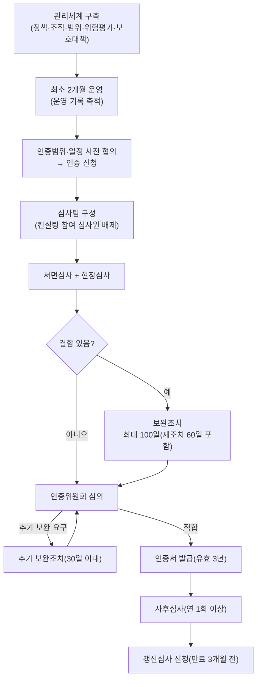
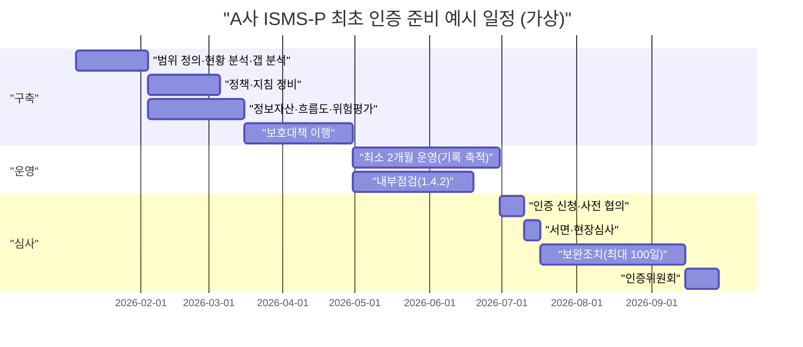

# 3주차-01. ISMS-P 제도와 인증 절차

| 구분 | 내용 |
|---|---|
| 고객사 | A사(민간, ISMS-P 인증 준비) |
| 관련 산출물 | 인증 준비 일정표(이 챕터 4절 gantt), `./deliverables/04_ISMS-P_갭분석표.md` (범위 확정 후 사용) |
| 선행 챕터 | 2주차 전체 (내부 관리계획·수탁사 점검 결과가 인증 증적으로 이어짐) |
| 예상 학습 시간 | 3시간 (읽기 1.5시간 + 실습 1.5시간) |

---

## 1. 학습 목표

1. ISMS와 ISMS-P의 차이, ISMS 인증 의무대상 판단 기준을 근거 조문과 함께 설명할 수 있다.
2. 인증 신청부터 인증서 발급·사후심사·갱신까지의 절차와 법정 기한을 순서대로 설명할 수 있다.
3. 고객사의 인증 목표일에서 거꾸로 계산해 준비 일정표 초안을 만들 수 있다.

---

## 2. 현장 비유와 기초 개념

> 🏗️ **현장 비유**: ISMS-P 인증은 **운전면허 시험**과 닮았다. 학원에서 연습(관리체계 구축·2개월 운영)을 마쳐야 시험을 볼 수 있고, 필기(서면심사)와 실기(현장심사)를 모두 보며, 따고 나서도 정기적성검사(사후심사)와 갱신이 있다. 컨설턴트는 학원 강사이지 시험관이 아니다.

> 📌 **기초 개념 짚기**
> 정보보호 및 개인정보보호 관리체계 인증(ISMS-P)은 신청인의 정보보호·개인정보보호 조치와 활동이 인증기준에 적합함을 KISA 또는 인증기관이 증명하는 것이다. 신청인은 ISMS-P 인증과 ISMS 인증 중 하나를 선택해 신청한다. 인증 유효기간은 3년이다.
> - 근거: ISMS-P 고시 제2조제1호·제2호, 제18조제1항, 제32조제3항[^isms] · 「개인정보 보호법」 제32조의2제2항[^law322]

CPPG에서 배운 것은 "ISMS-P가 있다"까지입니다. 현장에서는 **"이 고객사가 왜 인증을 받으려 하는가(의무인가, 자율인가)"**와 **"언제까지 무엇을 끝내야 하는가"**를 착수 첫 주에 정리해야 합니다.

---

## 3. 근거 법령·기준

### 3-1. ISMS와 ISMS-P

| 구분 | ISMS 인증 | ISMS-P 인증 |
|---|---|---|
| 근거 | 정보통신망법 제47조 | 정보통신망법 제47조 + 개인정보 보호법 제32조의2 |
| 적용 인증기준 | 별표 7 가목·나목 (관리체계 16 + 보호대책 64 = **80개**) | 별표 7 가목~다목 (**101개**, 개인정보 처리 단계별 요구사항 21개 추가) |
| 인증 의무 | **있음**: 정보통신망법 제47조제2항 의무대상자 | **의무대상 없음**. 다만 ISMS 의무대상자가 ISMS-P를 받으면 ISMS 인증 의무를 이행한 것으로 봄 |
| 출처 | [^net47] [^isms] | [^isms] [^ismsg7] |

### 3-2. ISMS 인증 의무대상 (정보통신망법 제47조제2항, 시행령 제49조제2항)

| 의무대상 | 기준 | 출처 |
|---|---|---|
| 주요정보통신서비스 제공자 | 법 제47조제2항제1호 | [^net47] |
| 집적정보통신시설 사업자 | 법 제47조제2항제2호 | [^net47] |
| 매출액·이용자 수 기준 해당자 | 시행령 제49조제2항: ① 전년도 매출액 또는 세입 1,500억 원 이상인 상급종합병원 또는 재학생 1만 명 이상 대학 ② **정보통신서비스 부문 전년도 매출액 100억 원 이상**(금융회사 제외) ③ **전년도 일일평균 이용자 수 100만 명 이상**(금융회사 제외) | [^net47] [^netd49] |

- 고시는 "의무대상자에 해당하는 자는 **다음 해 8월 31일까지** 인증을 받아야 한다"고 정합니다.[^isms19]

> ⚠️ **확인 필요**: "다음 해"를 어느 연도(실적 연도 / 의무대상이 된 연도)를 기준으로 세는지는 고시 문언만으로 확정되지 않습니다. 고객사 기한을 안내하기 전에 KISA 안내 또는 심사수행기관에 확인하고, PM이 확정합니다.
- 의무대상은 전기통신사업자와, 전기통신사업자의 전기통신역무를 이용해 정보를 제공하거나 제공을 매개하는 자 중 위 기준에 해당하는 자입니다.[^net47]

### 3-3. 인증 절차 관련 조문

| 근거 | 요지 | 쉬운 풀이 (현장에서 확인할 것) | 출처 |
|---|---|---|---|
| 고시 제17조 | 신청 전 관리체계를 구축해 **최소 2개월 이상 운영**. 심사용 문서·증거자료, 장소·시설·장비 준비 | "구축 완료일 + 2개월 ≤ 신청일" | [^isms] |
| 고시 제18조 | ISMS-P 또는 ISMS 선택 신청, 인증범위와 일정을 심사수행기관과 **사전 협의**. 준비가 미흡하면 보완 요구 가능 | 범위 정의서가 신청 전에 확정되어야 함 | [^isms] |
| 고시 제20조 | ISO/IEC 27001 인증, 주요정보통신기반시설 취약점 분석·평가를 받은 경우 별표 5 범위 내 심사 일부 생략 신청 가능 (범위 포함·유효성 요건) | 고객사가 ISO 27001을 갖고 있으면 확인 | [^isms] |
| 고시 제24조 | 심사원 모집으로 심사팀 구성. **신청인의 정보보호·개인정보보호 컨설팅에 참여**했거나 이해관계가 있는 심사원은 사전 소명하고 **심사팀에서 배제** | 우리 회사 컨설턴트가 인증심사원 자격이 있어도 이 고객사 심사에는 들어갈 수 없음 | [^isms] |
| 고시 제25조 | 서면심사 + 현장심사 병행. 결함은 심사종료 다음 날부터 **최대 100일(재조치 요구 60일 포함)** 내 보완조치. 인증위원회 심의 결과에 따라 위원회 종료 다음 날부터 **30일 이내** 추가 보완 요구 가능 | 심사 후 일정 계산 기준 | [^isms] |
| 고시 제26조 | 심사 지연·방해, **준비가 되었다고 볼 수 없는 경우**, 보완조치 미완료 등은 심사 중단 사유 | "일단 신청하고 보자"는 위험 | [^isms] |
| 고시 제29조·제30조 | 인증위원회(35인 이내, 회의마다 6인 이상)가 최초·갱신심사 결과 적합 여부 심의·의결 | 보완조치 후 위원회 일정 확인 | [^isms] |
| 고시 제32조 | 인증위원회에서 적합 판정 시 인증서 발급, 유효기간 **3년** | | [^isms] |
| 고시 제27조·제28조 | 유효기간 중 **연 1회 이상 사후심사** 신청. 유효기간 만료 **3개월 전** 갱신심사 신청, 미신청 시 효력 상실 | 인증 후 연간 일정에 넣음 | [^isms] |
| 고시 제35조·제36조 | 인증 취소 사유(거짓·부정 취득, 기준 미달, 사후·갱신심사 미수검, 보완조치 미이행, 허위 홍보 등). 결과 통보일부터 **15일 이내** 이의신청 | | [^isms] |

> ⚠️ **확인 필요**: 이 레포의 ISMS-P 고시는 제2024-8호(2024.7.24.)입니다. 그 뒤 개인정보 보호법 시행령 제34조의2(2026.9.) 등이 개정되었으므로, 실제 신청 전에 KISA ISMS-P 누리집에서 최신 고시와 신청 서식을 다시 확인하세요.

---

## 4. 컨설팅 수행 절차

### 4-1. 인증 절차 흐름



### 4-2. A사 인증 준비 일정 (예시, 역산)



> 위 일정은 **예시 일정**입니다. 고시가 정한 기간(2개월 운영, 100일 보완 등)만 고정값이고, 나머지는 고객사 상황과 심사수행기관 일정에 따라 달라집니다.

### 단계별 설명 (컨설팅 관점)

| 단계 | 하는 일 | 입력 자료 | 결과물 | 소요 (예시) |
|---|---|---|---|---|
| 1. 의무 여부 확인 | ISMS 의무대상인지, ISMS-P를 선택할 이유가 무엇인지 정리 | 매출·이용자 수 자료 | 인증 유형 검토 메모 | 1일 |
| 2. 범위 정의 | 서비스·시스템·조직·장소 범위 | 조직도, 시스템 목록 | 범위 정의서 초안 | 1주 |
| 3. 일정 역산 | 목표 인증일 → 2개월 운영 → 구축 완료일 | 고시 기한 | 준비 일정표 | 1일 |
| 4. 구축 지원 | 갭 분석, 정책·자산·위험평가, 보호대책 | 3주차-02~05 | 각 산출물 | 수개월 |
| 5. 심사 대응 | 증적 매핑, 결함 보완 | 3주차-04·06 | 증적 매핑표, 보완조치 결과 | 심사 전후 |

### Windows 11 실무 도구 팁

| 작업 | 도구·경로 | 방법 |
|---|---|---|
| 기한 계산 (2개월 운영, 100일 보완) | Excel | 2개월: `=EDATE(구축완료일,2)` / 100일: `=심사종료일+1+99` (첫날 포함 여부는 심사수행기관 안내 기준 확인) |
| 갱신 신청 마감일 | Excel | `=EDATE(유효기간만료일,-3)` |
| 일정 알림 | Outlook 일정 → 미리 알림 2주 전 설정 | 사후심사 신청·갱신 신청 기한 누락 방지 |

---

## 5. 업무 분담표

| 단계 | 🙋 신입 담당 | 🧑‍💼 PM·선임 담당 | 🏢 고객사 담당 |
|---|---|---|---|
| 의무 여부 | 매출·이용자 수 자료 요청·정리, 조문 대조표 | **의무 여부 판단 의견** | 수치 제공, 최종 판단 |
| 범위 정의 | 시스템·조직·장소 목록 정리 | 범위 제안·협의 | 범위 결정, 심사수행기관 협의 |
| 일정 | 기한 역산표·gantt 초안 | 일정 확정 | 경영진 승인 |
| 심사 대응 | 증적 정리, 심사 일정 관리 | 결함 대응 전략 | 신청·심사 수검 (신청 주체) |

> 🚫 **신입이 혼자 결정하지 않는 것**: ISMS 의무대상 여부 결론, 인증범위 확정, "이 정도면 인증 받습니다" 같은 결과 예측
> ⚠️ **독립성**: 우리가 컨설팅한 고객사의 인증심사에 우리 회사 인증심사원이 참여할 수 없습니다(고시 제24조제3항). 심사 일정 문의에 "아는 심사원이 있다"는 식의 말을 하지 않습니다.

---

## 6. 고객 커뮤니케이션 예시

### 6-1. 인증 유형 판단 자료 요청 메일

```text
제목: [A사 ISMS-P 준비] 인증 의무대상 검토용 자료 요청 (2026-01-09까지)

김○○ 과장님, 안녕하세요. ○○컨설팅 홍길동입니다.

ISMS 인증 의무대상 해당 여부를 정리하기 위해 아래 수치를 요청드립니다.
(정보통신망법 제47조제2항, 같은 법 시행령 제49조제2항 기준)

 1. 전년도(2025년) 정보통신서비스 부문 매출액 (재무팀 확인 수치)
 2. 전년도 일일평균 이용자 수 (산정 방법 포함)
 3. 전년도 전체 매출액
 4. 현재 보유 중인 인증 (ISO/IEC 27001 등, 인증 범위·유효기간 포함)

수치가 기준 근처에 있으면 산정 방법에 따라 결론이 달라질 수 있어, 산정 근거를 함께 부탁드립니다.
```

### 6-2. 결과 설명 멘트 (PM 확정 후)

> "A사는 전년도 정보통신서비스 부문 매출이 기준(100억 원)을 넘어 ISMS 인증 의무대상에 해당하는 것으로 정리됩니다. 의무는 ISMS 인증이지만, 회원 개인정보를 많이 처리하시니 개인정보 처리 단계별 요구사항까지 포함한 ISMS-P로 받으시면 ISMS 의무도 함께 이행한 것으로 인정됩니다. 다만 인증기준이 80개에서 101개로 늘어나니, 준비 일정은 이 차이를 반영해 잡았습니다. 신청 전에 관리체계를 최소 2개월 운영해야 해서, 목표일에서 거꾸로 계산하면 보호대책 이행을 6월 말까지 마치셔야 합니다."

---

## 7. 처분 사례와 인증 결함 사례

### 처분 사례: SK텔레콤 (2025.8. 의결) — ISMS-P 인증 범위

| 구분 | 내용 |
|---|---|
| 사건 개요 | SKT는 일부 고객관리시스템(T world 등)에 대해서만 ISMS-P 인증을 받은 상태였고, 유출사고는 인증 범위 밖인 이동통신 네트워크 인프라 영역에서 발생함. |
| 처분·결과 | 과징금 1,347억 9,100만 원 등. 사고 발생 이동통신 네트워크·시스템에 대한 ISMS-P 인증 취득(인증 범위 확대) **개선권고** |
| 출처 | 2025.8.28. 보도자료 「개인정보위, 'SK텔레콤 개인정보 유출사고' 제재처분 의결」, 2025.8.27. 의결[^skt] |

**컨설팅 시사점**: 인증서가 있어도 **인증 범위 밖**은 보호받지 못합니다. 범위를 정할 때 "심사 받기 쉬운 범위"가 아니라 "개인정보 처리가 일어나는 범위"를 기준으로 고객사와 논의합니다.

### 인증 결함 사례: 1.4.2 관리체계 점검 (독립성)

인증기준 안내서는 관리체계 점검팀이 **위험평가나 취약점 점검 등 관리체계 구축 과정에 참여한 내부 직원 및 외부 컨설턴트로만 구성**되어 점검의 독립성이 확보되었다고 볼 수 없는 경우를 결함사례로 듭니다.[^ismsg142]

**컨설팅 시사점**: 구축을 맡은 우리 팀이 내부점검(1.4.2)까지 단독으로 수행하면 결함이 될 수 있습니다. 내부점검은 고객사 감사 부서나 구축에 참여하지 않은 인력이 맡거나 함께 구성하도록 일정 단계에서 미리 제안합니다.

---

## 8. 오답노트

| ❌ 신입의 실수 | ✅ 올바른 수행 | 근거 |
|---|---|---|
| "개인정보를 많이 처리하면 ISMS-P가 의무"라고 고객사에 설명 | ISMS-P는 의무대상이 없고, 의무는 ISMS(정보통신망법 제47조제2항)에 있음. ISMS 의무대상자가 ISMS-P를 받으면 ISMS 의무 이행으로 인정 | 고시 제19조제3항[^isms19] |
| 보호대책 이행이 끝난 다음 날 신청 일정을 잡음 | 신청 전 **최소 2개월 운영** 기간을 확보하고 운영 기록이 쌓이게 함 | 고시 제17조제1항[^isms] |
| 인증범위를 신청 직전에 정함 | 착수 단계에서 범위 정의서를 만들고, 심사수행기관과 사전 협의 | 고시 제18조제3항[^isms] |
| 우리 회사 인증심사원이 이 고객사 심사에 들어갈 수 있다고 안내 | 컨설팅 참여 심사원은 소명 후 배제 | 고시 제24조제3항[^isms] |
| 구축팀이 내부점검까지 단독 수행하도록 일정 수립 | 독립성 있는 점검 인력 구성을 제안 | 인증기준 안내서 1.4.2 결함사례[^ismsg142] |
| 인증 후 사후심사·갱신 일정을 고객사에 알리지 않고 종료 | 연 1회 사후심사, 만료 3개월 전 갱신 신청 일정을 완료 보고서에 명시 | 고시 제27조·제28조[^isms] |

---

## 9. 고객사 점검용 체크리스트: 인증 준비도

| No | 점검 항목 | 확인 방법 | 요청 증적 | 판정 기준 |
|---|---|---|---|---|
| 1 | ISMS 의무대상 여부를 수치·근거로 판단했다 | 문서 | 매출·이용자 수 산정 자료, 검토 메모 | 🟢 수치·근거 · 🟡 수치만 · 🔴 미검토 |
| 2 | 인증범위(서비스·시스템·조직·장소)가 문서로 정의되어 있다 | 문서 | 범위 정의서 | 🟢 정의·승인 · 🟡 초안 · 🔴 없음 |
| 3 | 관리체계 구축 완료일과 2개월 운영 기간이 일정에 반영되어 있다 | 문서 | 준비 일정표 | 🟢 반영 · 🔴 미반영 |
| 4 | 내부점검(1.4.2) 수행 인력의 독립성이 확보되어 있다 | 문서·인터뷰 | 내부점검 계획서(인력 구성) | 🟢 독립 인력 포함 · 🔴 구축 참여자로만 구성 |
| 5 | 기존 인증(ISO/IEC 27001 등)의 범위·유효기간을 확인해 일부 생략 가능성을 검토했다 | 문서 | 인증서, 범위 | 🟢 검토 · ⚪ 기존 인증 없음 |
| 6 | 인증 후 사후심사·갱신 일정 관리 체계가 있다 | 문서 | 연간 일정표 | 🟢 있음 · 🔴 없음 · ⚪ 최초 인증 전 |

---

## 10. 실무 산출물 연계 팁

| 이 챕터의 결과 | 들어가는 산출물 | 위치 |
|---|---|---|
| 인증 유형 검토 메모 | 착수 보고서 | '인증 추진 방향' |
| 범위 정의서 초안 | 인증 신청서류, 갭 분석표 헤더 | `./deliverables/04_ISMS-P_갭분석표.md` 문서 정보 |
| 준비 일정 (gantt) | 착수 보고서·주간 보고 | '추진 일정' |
| 독립성 확보 방안 | 내부점검 계획서 | 1.4.2 증적 |

---

## 11. 실습 과제 / 퀴즈

> 정답과 해설은 [answers_and_explanations.md](../../answers_and_explanations.md)의 **「3주차-01. ISMS-P 제도와 인증 절차」** 절에 있습니다.

### 객관식

**Q1.** ISMS 인증과 ISMS-P 인증에 대한 설명으로 옳은 것은?

① ISMS-P 인증은 개인정보를 100만 명 이상 처리하는 자의 의무다.
② ISMS 인증은 101개, ISMS-P 인증은 80개 인증기준을 적용한다.
③ ISMS 인증 의무대상자가 ISMS-P 인증을 받은 경우에도 ISMS 인증 의무를 이행한 것으로 본다.
④ ISMS-P 인증의 유효기간은 1년이다.

**Q2.** 인증심사에서 결함이 발견되었다. 고시상 보완조치 기간으로 옳은 것은?

① 심사종료 다음 날부터 최대 30일
② 심사종료 다음 날부터 최대 60일
③ 심사종료 다음 날부터 최대 100일(재조치 요구 60일 포함)
④ 인증위원회 종료 후 1년

**Q3.** 우리 회사 소속 컨설턴트 甲은 인증심사원 자격이 있고, A사 ISMS-P 구축 컨설팅에 참여했다. 다음 중 옳은 것은?

① 甲은 A사 사정을 잘 알므로 A사 인증심사팀에 들어가는 것이 바람직하다.
② 甲은 사전에 소명해야 하고, 심사수행기관은 甲을 A사 인증심사팀에서 배제해야 한다.
③ 甲이 서면심사만 맡으면 문제없다.
④ 甲이 퇴사하면 즉시 A사 심사에 참여할 수 있다.

### 실습

**상황**: A사가 "2027년 3월 말까지 ISMS-P 인증을 받고 싶다"고 했다. 아래 자료로 인증 유형 검토와 준비 일정을 정리하라.

**제공 자료**

```text
[A사 수치 (2025년 기준)]
- 전체 매출액: 1,200억 원
- 정보통신서비스 부문 매출액: 310억 원 (온라인 쇼핑몰)
- 전년도 일일평균 이용자 수: 30만 명
- 보유 인증: 없음
- 회사 형태: 금융회사 아님

[현재 상태 (2026-04-01)]
- 정보보호 정책은 있으나 2021년 이후 개정 없음
- 정보자산 목록 없음, 위험평가 수행 이력 없음
- 내부 관리계획 개정 진행 중 (2주차 결과)
- 고객사 희망: 구축은 우리 컨설팅 팀이, 내부점검도 우리 팀이 해 주길 원함
```

**과제**

1. A사가 ISMS 인증 의무대상인지 판단하고, 근거 조문과 수치를 표로 정리하시오. 의무대상이라면 인증 기한에 관한 고시 규정을 인용하고, 고객사가 희망한 목표일(2027-03-31)과 관련해 PM에게 확인을 요청할 사항을 쓰시오.
2. 목표일(2027-03-31)에서 역산해 주요 마일스톤 5개 이상의 일정표를 쓰시오. (2개월 운영, 최대 100일 보완 기간을 반영할 것)
3. "내부점검도 우리 팀이 해 달라"는 요청에 대해 PM에게 올릴 검토 의견을 3줄로 쓰시오.

**작성 양식**: 4-2 gantt 또는 표, 검토 의견

---

## 12. 더 읽을거리

| 자료 | references 파일명 | 읽을 부분 |
|---|---|---|
| ISMS-P 고시 | [`정보보호 및 개인정보보호 관리체계 인증 등에 관한 고시(개인정보보호위원회고시)(제2024-8호)(20240724).pdf`](<../../references/정보보호 및 개인정보보호 관리체계 인증 등에 관한 고시(개인정보보호위원회고시)(제2024-8호)(20240724).pdf>) | 제17조~제36조 |
| ISMS-P 인증기준 안내서 | [`ISMS-P 인증기준 안내서(2023.11.23).pdf`](<../../references/ISMS-P 인증기준 안내서(2023.11.23).pdf>) | p.1~8 '제1장 인증기준 개요', 1.1.4 범위 설정, 1.4.2 관리체계 점검 |
| 정보통신망법·시행령 | [`정보통신망 이용촉진 및 정보보호 등에 관한 법률(법률)(제21988호)(20261002).pdf`](<../../references/정보통신망 이용촉진 및 정보보호 등에 관한 법률(법률)(제21988호)(20261002).pdf>), `…시행령(대통령령)(제36728호)(20261002).pdf` | 법 제47조, 영 제49조 |
| SKT 처분 보도자료 | [`250828 (석간) 개인정보위  ‘SK텔레콤 개인정보 유출사고’ 제재처분 의결(조사2과)_최종(붙임 포함).pdf`](<../../references/250828 (석간) 개인정보위  ‘SK텔레콤 개인정보 유출사고’ 제재처분 의결(조사2과)_최종(붙임 포함).pdf>) | 4. 처분 내용 및 의의 |

---

## 각주

[^isms]: [출처: [정보보호 및 개인정보보호 관리체계 인증 등에 관한 고시(개인정보보호위원회고시)(제2024-8호)(20240724).pdf](<../../references/정보보호 및 개인정보보호 관리체계 인증 등에 관한 고시(개인정보보호위원회고시)(제2024-8호)(20240724).pdf>), 제2조, 제17조~제36조]
[^isms19]: [출처: [정보보호 및 개인정보보호 관리체계 인증 등에 관한 고시(개인정보보호위원회고시)(제2024-8호)(20240724).pdf](<../../references/정보보호 및 개인정보보호 관리체계 인증 등에 관한 고시(개인정보보호위원회고시)(제2024-8호)(20240724).pdf>), 제19조]
[^ismsg7]: [출처: [ISMS-P 인증기준 안내서(2023.11.23).pdf](<../../references/ISMS-P 인증기준 안내서(2023.11.23).pdf>), p.2~3 '인증기준 개요·구성']
[^ismsg142]: [출처: [ISMS-P 인증기준 안내서(2023.11.23).pdf](<../../references/ISMS-P 인증기준 안내서(2023.11.23).pdf>), p.46, 1.4.2 관리체계 점검 결함사례 3]
[^law322]: [출처: [개인정보 보호법(법률)(제21445호)(20260911).pdf](<../../references/개인정보 보호법(법률)(제21445호)(20260911).pdf>), 제32조의2]
[^net47]: [출처: [정보통신망 이용촉진 및 정보보호 등에 관한 법률(법률)(제21988호)(20261002).pdf](<../../references/정보통신망 이용촉진 및 정보보호 등에 관한 법률(법률)(제21988호)(20261002).pdf>), 제47조]
[^netd49]: [출처: [정보통신망 이용촉진 및 정보보호 등에 관한 법률 시행령(대통령령)(제36728호)(20261002).pdf](<../../references/정보통신망 이용촉진 및 정보보호 등에 관한 법률 시행령(대통령령)(제36728호)(20261002).pdf>), 제49조제2항]
[^skt]: [출처: [250828 (석간) 개인정보위  ‘SK텔레콤 개인정보 유출사고’ 제재처분 의결(조사2과)_최종(붙임 포함).pdf](<../../references/250828 (석간) 개인정보위  ‘SK텔레콤 개인정보 유출사고’ 제재처분 의결(조사2과)_최종(붙임 포함).pdf>), p.11~12, 2025.8.27. 의결]
