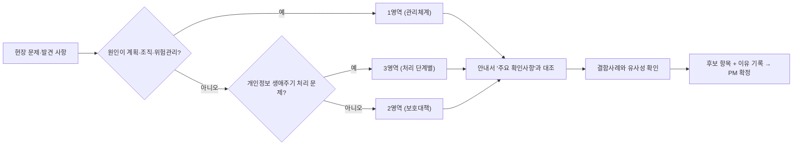

# 3주차-02. 인증기준 구조 이해

| 구분 | 내용 |
|---|---|
| 고객사 | A사(민간, ISMS-P 인증 준비) |
| 관련 산출물 | `./deliverables/04_ISMS-P_갭분석표.md` (영역·분야·항목 구조) |
| 선행 챕터 | 3주차-01. ISMS-P 제도와 인증 절차 |
| 예상 학습 시간 | 3시간 (읽기 1.5시간 + 실습 1.5시간) |

---

## 1. 학습 목표

1. ISMS-P 인증기준 101개의 3개 영역·21개 분야 구조와 영역별 성격 차이를 설명할 수 있다.
2. 인증기준 안내서의 항목 구성(인증기준, 주요 확인사항, 관련 법규, 세부 설명, 증거자료 예시, 결함사례)을 활용해 항목을 해석할 수 있다.
3. 1~2주차에서 찾은 현장 문제를 해당 인증기준 항목에 정확히 매핑할 수 있다.

---

## 2. 현장 비유와 기초 개념

> 🏗️ **현장 비유**: 인증기준 101개는 **건물 점검표**다. 1영역은 "건물 관리 조직과 계획이 있는가"(관리 사무소), 2영역은 "기둥·전기·소방이 안전한가"(설비), 3영역은 "입주자 개인 물건을 어떻게 다루는가"(개인정보 생애주기)다. 같은 누수라도 원인이 관리 계획이면 1영역, 배관이면 2영역에 적는다.

> 📌 **기초 개념 짚기**
> ISMS-P 인증기준은 「1. 관리체계 수립 및 운영」(16개), 「2. 보호대책 요구사항」(64개), 「3. 개인정보 처리 단계별 요구사항」(21개) 3개 영역, 총 101개다. ISMS 인증은 1·2영역 80개, ISMS-P 인증은 3영역을 포함한 101개를 적용한다.
> - 근거: ISMS-P 고시 제23조제1항, 별표 7[^isms23] [^isms7], 인증기준 안내서 p.2~3[^ig2]

시험에서 "101개"라는 숫자를 외웠다면, 현장에서는 **"이 문제는 몇 번 항목인가"**를 바로 답할 수 있어야 합니다. 결함 보고서, 갭 분석표, 증적 매핑표가 모두 항목 번호로 움직이기 때문입니다.

---

## 3. 근거 법령·기준

### 3-1. 영역·분야 구조 (별표 7)

| 영역 | 분야 | 항목 수 | 성격 |
|---|---|---|---|
| **1. 관리체계 수립 및 운영 (16)** | 1.1 관리체계 기반 마련 | 6 | 경영진 참여, 최고책임자, 조직, **범위**, 정책, 자원 |
| | 1.2 위험 관리 | 4 | **정보자산 식별, 현황·흐름분석, 위험 평가, 보호대책 선정** |
| | 1.3 관리체계 운영 | 3 | 보호대책 구현·공유, 운영현황 관리 |
| | 1.4 관리체계 점검 및 개선 | 3 | 법적 요구사항 준수 검토, **관리체계 점검(내부점검)**, 개선 |
| **2. 보호대책 요구사항 (64)** | 2.1 정책, 조직, 자산 관리 | 3 | |
| | 2.2 인적 보안 | 6 | 주요 직무자, 직무 분리, 서약, **교육**, 퇴직, 위반 조치 |
| | 2.3 외부자 보안 | 4 | 외부자 현황, 계약, **이행 관리**, 계약 만료 |
| | 2.4 물리 보안 | 7 | |
| | 2.5 인증 및 권한관리 | 6 | 계정, 식별, 인증, 비밀번호, 특수 계정, **접근권한 검토** |
| | 2.6 접근통제 | 7 | |
| | 2.7 암호화 적용 | 2 | |
| | 2.8 정보시스템 도입 및 개발 보안 | 6 | 시험 데이터 보안 등 |
| | 2.9 시스템 및 서비스 운영관리 | 7 | **로그 및 접속기록 관리·점검** 등 |
| | 2.10 시스템 및 서비스 보안관리 | 9 | |
| | 2.11 사고 예방 및 대응 | 5 | |
| | 2.12 재해복구 | 2 | |
| **3. 개인정보 처리 단계별 요구사항 (21)** | 3.1 개인정보 수집 시 보호조치 | 7 | **수집·이용(동의)**, 수집 제한, 주민등록번호, 민감·고유식별, 간접수집, 영상정보처리기기, 마케팅 |
| | 3.2 개인정보 보유 및 이용 시 보호조치 | 5 | 현황관리, 품질보장, 단말기 접근, 목적 외 이용·제공, 가명정보 |
| | 3.3 개인정보 제공 시 보호조치 | 4 | 제공, **처리 업무 위탁(공개)**, 영업양도, 국외이전 |
| | 3.4 개인정보 파기 시 보호조치 | 2 | 파기, 처리목적 달성 후 보유 시 조치 |
| | 3.5 정보주체 권리보호 | 3 | **처리방침 공개**, 권리보장, 정보주체 통지 |

> 전체 101개 항목명은 `./deliverables/04_ISMS-P_갭분석표.md`의 B표에 있습니다.[^isms7]

### 3-2. 인증기준 안내서의 항목 구성

| 구성 요소 | 내용 | 컨설팅에서 쓰는 곳 |
|---|---|---|
| 항목·인증기준 | 항목 번호와 기준 문장 (별표 7과 같음) | 갭 분석표 "항목명" |
| 주요 확인사항 | 심사원이 확인하는 질문 (보통 2~5개) | **인터뷰 질문지와 갭 분석 판정 단위** |
| 관련 법규 | 연결되는 법령·고시 조항 | 법령 근거 각주 |
| 세부 설명 | 확인사항별 해설과 예시 | 개선 과제 문안 |
| 증거자료 예시 | 이행을 보여주는 문서·기록 예 | **자료 요청 목록, 증적 매핑표** |
| 결함사례 | 실제 심사에서 결함으로 볼 수 있는 상황 | **오답노트, 모의 심사 체크** |

> 예: 1.1.4 범위 설정의 증거자료 예시는 범위 정의서, 정보자산 및 개인정보 목록, 문서 목록, 서비스 흐름도, 개인정보 흐름도, 전사 조직도, 시스템 및 네트워크 구성도입니다.[^ig114]

### 3-3. 운영명세서

인증기준 안내서 1.3.1은 인증기준별로 보호대책 구현과 운영 현황을 기록한 **운영명세서**를 구체적으로 작성하도록 요구합니다. 운영명세서에는 ① 인증기준 선정 여부(관리체계 수립 및 운영 영역은 필수) ② 운영 현황 ③ 관련 문서(문서명·세부 문서번호) ④ 기록(증거자료) ⑤ 인증기준 미선정 시 사유를 적습니다.[^ig131]

| 운영명세서 요소 | 이 레포의 산출물 |
|---|---|
| 선정 여부·미선정 사유 | 갭 분석표 "⚪ 해당 없음 + 사유" |
| 운영 현황 | 갭 분석표 "현황 요약" |
| 관련 문서·기록(증거자료) | 증적 매핑표 |

### 3-4. 헷갈리기 쉬운 항목 짝

| 현장 문제 | 맞는 항목 | 헷갈리는 항목 | 구분 기준 |
|---|---|---|---|
| 수탁자 목록을 처리방침에 공개하지 않음 | 3.3.2 개인정보 처리 업무 위탁 | 2.3.3 외부자 보안 이행 관리 | 3.3.2는 **공개·통지**, 2.3.3은 **관리·감독**[^ig233] [^ig332] |
| 수탁사 점검을 하지 않음 | 2.3.3 | 3.3.2 | 위와 같음 |
| 접속기록 점검 결과가 없음 | 2.9.5 로그 및 접속기록 점검 | 2.9.4 로그 및 접속기록 관리 | 2.9.4는 보관·관리, 2.9.5는 검토·모니터링 |
| 퇴직자 계정이 남아 있음 | 2.5.1 사용자 계정 관리 / 2.2.5 퇴직 및 직무변경 관리 | 2.5.6 접근권한 검토 | 정기 검토에서 걸러내지 못했다면 2.5.6도 함께 검토 |
| 처리방침 내용이 실제와 다름 | 3.5.1 개인정보 처리방침 공개 | 3.1.1 개인정보 수집·이용 | 동의 고지 문제면 3.1.1 |
| 교육 계획에 직무별 교육이 없음 | 2.2.4 인식제고 및 교육훈련 | — | |
| 개인정보 흐름도가 실제와 다름 | 1.2.2 현황 및 흐름분석 | — | |

> 하나의 문제가 여러 항목에 걸칠 때 어느 항목에 귀속할지는 PM이 정합니다. 신입은 **후보 항목과 이유**를 함께 적어 올립니다.

---

## 4. 컨설팅 수행 절차



### 단계별 설명

| 단계 | 하는 일 | 입력 자료 | 결과물 | 소요 (예시) |
|---|---|---|---|---|
| 1. 구조 익히기 | 21개 분야를 외우지 말고 갭 분석표 B표에 표시하며 읽기 | 별표 7, 안내서 목차 | 개인 학습 노트 | 2시간 |
| 2. 항목 해석 | 안내서의 주요 확인사항을 질문 형태로 정리 | 안내서 | 항목별 질문 목록 | 항목당 5분 |
| 3. 매핑 | 1~2주차 발견 사항을 항목에 매핑 | 진단표·점검표 | 매핑표 | 0.5일 |
| 4. 확정 | 후보 항목을 PM과 확정 | 매핑표 | 갭 분석표 반영 | — |

### Windows 11 실무 도구 팁

| 작업 | 도구·경로 | 방법 |
|---|---|---|
| 안내서에서 항목 바로 찾기 | Edge로 PDF 열기 → `Ctrl + F` → "항 목 2.9.5" (띄어쓰기 주의) | 항목 페이지 이동 |
| 항목별 질문 목록 만들기 | OneNote 또는 Excel에 항목 번호를 행으로, 주요 확인사항을 열로 | 인터뷰 질문지로 재사용 |
| 별표 7 텍스트 추출 | PDF를 Word로 열기(파일 → 열기 → PDF) | 표 구조가 깨질 수 있어 항목명은 갭 분석표 양식을 우선 사용 |

---

## 5. 업무 분담표

| 단계 | 🙋 신입 담당 | 🧑‍💼 PM·선임 담당 | 🏢 고객사 담당 |
|---|---|---|---|
| 구조 정리 | 항목별 질문 목록, 증거자료 예시 목록 작성 | 고객사 맞춤 우선 항목 선정 | — |
| 매핑 | 발견 사항 → 후보 항목 + 이유 | **귀속 항목 확정** | — |
| 미선정 항목 | 미선정 후보와 사유 초안 | 미선정 판단 | 범위 확인 |

> 🚫 **신입이 혼자 결정하지 않는 것**: 항목 미선정(해당 없음) 확정, 여러 항목에 걸친 문제의 귀속 항목

---

## 6. 고객 커뮤니케이션 예시

### 6-1. 인터뷰 질문 리스트 (주요 확인사항을 질문으로 바꾼 예: 1.2.3 위험 평가)

| No | 질문 | 질문 의도 (주요 확인사항) | 답변 후 요청할 증적 |
|---|---|---|---|
| 1 | 위험을 어떤 방법으로 식별·평가하시나요? 방법이 문서로 있나요? | 위험평가 방법 정의 | 위험관리 지침 |
| 2 | 올해 위험관리계획에 수행 인력·기간·대상·예산이 정해져 있나요? | 위험관리계획 매년 수립 | 위험관리 계획서 |
| 3 | 마지막 위험평가는 언제였고, 범위는 어디까지였나요? | 연 1회 이상, 전 영역 | 위험평가 결과보고서 |
| 4 | 수용 가능한 위험 수준(DoA)은 어떻게 정하셨나요? | 목표 위험수준 | 경영진 승인 문서 |
| 5 | 평가 결과를 경영진에게 보고하셨나요? | 경영진 보고 | 위원회 회의록 |

> 질문은 인증기준 안내서 1.2.3의 주요 확인사항을 그대로 바꾼 것입니다.[^ig123]

### 6-2. 결과 설명 멘트 (실무 담당자 대상)

> "인증기준 101개를 한 번에 보시면 부담스러우실 텐데, 세 덩어리로 보시면 쉽습니다. 1영역 16개는 '관리 체계가 돌아가는가', 2영역 64개는 '보안 설비와 운영', 3영역 21개는 '개인정보를 받고, 쓰고, 넘기고, 지우는 과정'입니다. 지난번 처리방침 진단에서 나온 수탁사 누락은 3영역의 3.3.2, 수탁사 점검 미실시는 2영역의 2.3.3으로 각각 들어갑니다."

---

## 7. 인증 결함 사례: 3.5.1 개인정보 처리방침 공개

인증기준 안내서가 3.5.1의 결함사례로 든 내용입니다.[^ig351]

| 결함사례 (안내서 요약) | 1주차에서 배운 진단 방법 |
|---|---|
| 처리방침에 공개된 수집·제3자 제공 내역이 실제 수집·제공 내역과 다름 | 1주차-03 C표 불일치 대조 |
| CPO 변경, 수탁자 변경 등이 생겼는데 처리방침에 반영하지 않음 | 수탁사 목록·조직도 대조 |
| 명칭이 '개인정보 처리방침'이 아니라 '개인정보 보호정책'이고, 쉽게 찾을 수 있도록 되어 있지 않음 | 진단표 B4, B5 |
| 여러 차례 개정했지만 이전 처리방침 내용을 확인할 수 있게 공개하지 않음 | 진단표 A24 |
| 다른 법령에 따라 보관하는 개인정보의 보존 근거와 항목을 처리방침에 공개하지 않음 | 진단표 A6 |

**컨설팅 시사점**

- 1주차 처리방침 진단 결과는 버리지 않고 **3.5.1 갭 분석 근거**로 그대로 씁니다. 같은 고객사라면 같은 증적 파일을 재사용합니다.
- 결함사례는 "이런 상황이면 결함"이라는 판정 기준표로 쓸 수 있습니다. 갭 분석 판정 근거에 "결함사례 ○와 유사"라고 적어 두면 PM 검토가 빨라집니다.

---

## 8. 오답노트

| ❌ 신입의 실수 | ✅ 올바른 수행 | 근거 |
|---|---|---|
| 수탁사 점검 미실시를 3.3.2(위탁)로 매핑 | 감독·점검은 2.3.3, 공개·통지는 3.3.2 | 안내서 2.3.3, 3.3.2[^ig233] [^ig332] |
| ISMS 인증 고객사 갭 분석에 3영역 21개까지 넣음 | ISMS는 1·2영역 80개 적용 (ISMS-P일 때 101개) | 고시 제23조제1항[^isms23] |
| 1영역 항목을 "해당 없음"으로 처리 | 관리체계 수립 및 운영 영역은 운영명세서상 **필수** | 안내서 1.3.1[^ig131] |
| 항목명만 보고 판정해 주요 확인사항 일부를 놓침 | 주요 확인사항 하나하나를 판정 단위로 쪼개 확인 | 안내서 항목 구성 |
| 하나의 문제를 임의로 한 항목에만 넣고 끝냄 | 후보 항목 여러 개와 이유를 적고 PM이 귀속 확정 | 결함 보고서 일관성 |
| 안내서(2023.11.)의 법령 인용을 그대로 씀 | 안내서는 발간 시점(2023년 10월) 기준이므로 법령·고시 인용은 최신 원문으로 다시 확인 | 안내서 안내 문구[^ig0] |

---

## 9. 고객사 점검용 체크리스트: 인증기준 적용 준비

| No | 점검 항목 | 확인 방법 | 요청 증적 | 판정 기준 |
|---|---|---|---|---|
| 1 | 적용할 인증 구분(ISMS 80개 / ISMS-P 101개)이 정해져 있다 | 문서 | 인증 추진 계획 | 🟢 결정 · 🔴 미정 |
| 2 | 인증기준별 운영명세서(또는 같은 구조의 문서)가 있다 | 문서 | 운영명세서 | 🟢 전 항목 · 🟡 일부 · 🔴 없음 |
| 3 | 미선정 항목에 구체적 사유가 있다 | 문서 | 운영명세서 미선정 사유 | 🟢 구체적 · 🟡 형식적 · 🔴 없음 · ⚪ 미선정 없음 |
| 4 | 각 항목의 관련 문서가 문서명·문서번호로 연결되어 있다 | 문서 | 문서 목록 | 🟢 연결 · 🟡 일부 · 🔴 없음 |
| 5 | 내부 정책·지침이 인증기준 구조와 대응표로 연결되어 있다 | 문서 | 정책-인증기준 대응표 | 🟢 있음 · 🔴 없음 |

---

## 10. 실무 산출물 연계 팁

| 이 챕터의 결과 | 들어가는 산출물 | 위치 |
|---|---|---|
| 항목별 질문 목록 | 인터뷰 질문지 | 3주차-03 갭 분석 인터뷰 |
| 증거자료 예시 목록 | 자료 요청 목록 | `./deliverables/01_자료요청_목록.md` ISM 영역 확장 |
| 1~2주차 발견 사항 매핑 | 갭 분석표 | `./deliverables/04_ISMS-P_갭분석표.md` B표 |
| 미선정 후보·사유 | 운영명세서 | 미선정 사유 열 |

---

## 11. 실습 과제 / 퀴즈

> 정답과 해설은 [answers_and_explanations.md](../../answers_and_explanations.md)의 **「3주차-02. 인증기준 구조 이해」** 절에 있습니다.

### 객관식

**Q1.** ISMS-P 인증기준의 영역별 항목 수로 옳은 것은?

① 관리체계 수립 및 운영 16 / 보호대책 요구사항 64 / 개인정보 처리 단계별 요구사항 21
② 관리체계 수립 및 운영 12 / 보호대책 요구사항 64 / 개인정보 처리 단계별 요구사항 25
③ 관리체계 수립 및 운영 16 / 보호대책 요구사항 60 / 개인정보 처리 단계별 요구사항 25
④ 관리체계 수립 및 운영 21 / 보호대책 요구사항 64 / 개인정보 처리 단계별 요구사항 16

**Q2.** "수탁사에 보안교육 실시 공문만 보내고 교육 수행 여부를 확인하지 않음"은 어느 항목에 가장 가까운가?

① 3.3.2 개인정보 처리 업무 위탁
② 2.3.3 외부자 보안 이행 관리
③ 3.5.1 개인정보 처리방침 공개
④ 1.1.4 범위 설정

**Q3.** 인증기준 안내서의 항목 구성 요소 중 **자료 요청 목록과 증적 매핑표를 만들 때** 가장 직접적으로 쓰는 것은?

① 관련 법규
② 증거자료 예시
③ 항목 번호
④ 결함사례

### 실습

**상황**: 1~2주차 A사 진단·점검에서 나온 발견 사항이다. 각각을 인증기준 항목에 매핑하라.

**제공 자료**

```text
[A사 발견 사항]
1. 처리방침 수탁자 목록에 재수탁사 C사, 클라우드 D사 누락
2. 수탁사 7곳 중 하반기 점검 미실시
3. 접속기록 점검 결과서가 12회 중 9회분만 있음
4. 퇴직자 2명 계정이 활성 상태
5. 회원가입 동의서에서 거부권 고지 누락
6. 개인정보 흐름도가 2023년 작성본이며 신규 앱 결제 흐름이 없음
7. 교육 계획에 개발자 대상 직무별 교육 없음
8. 마케팅 문자 수신 동의를 회원가입 필수 동의에 포함
9. 운영 DB 데이터를 테스트 서버에 복사해 사용
10. 내부 관리계획 이행 점검을 구축 컨설턴트만으로 수행할 예정
```

**과제**

1. 10개 발견 사항 각각에 대해 "주 항목 / 함께 검토할 항목 / 이유"를 표로 쓰시오. (항목 번호와 항목명 모두)
2. 이 중 인증기준 안내서 결함사례와 거의 같은 상황인 것 3개를 골라 해당 결함사례를 요약하시오.

**작성 양식**: 3-4 표 형식 (현장 문제 / 맞는 항목 / 함께 검토할 항목 / 이유)

---

## 12. 더 읽을거리

| 자료 | references 파일명 | 읽을 부분 |
|---|---|---|
| ISMS-P 인증기준 안내서 | [`ISMS-P 인증기준 안내서(2023.11.23).pdf`](<../../references/ISMS-P 인증기준 안내서(2023.11.23).pdf>) | p.1~8 '인증기준 개요', 1.3.1(운영명세서), 3.5.1 |
| ISMS-P 고시 별표 7 | [`[별표 7] 인증기준(제23조 관련)(정보보호 및 개인정보보호 관리체계 인증 등에 관한 고시).pdf`](<../../references/[별표 7] 인증기준(제23조 관련)(정보보호 및 개인정보보호 관리체계 인증 등에 관한 고시).pdf>) | 전문 |
| ISMS-P 고시 | [`정보보호 및 개인정보보호 관리체계 인증 등에 관한 고시(개인정보보호위원회고시)(제2024-8호)(20240724).pdf`](<../../references/정보보호 및 개인정보보호 관리체계 인증 등에 관한 고시(개인정보보호위원회고시)(제2024-8호)(20240724).pdf>) | 제23조 |

---

## 각주

[^isms23]: [출처: [정보보호 및 개인정보보호 관리체계 인증 등에 관한 고시(개인정보보호위원회고시)(제2024-8호)(20240724).pdf](<../../references/정보보호 및 개인정보보호 관리체계 인증 등에 관한 고시(개인정보보호위원회고시)(제2024-8호)(20240724).pdf>), 제23조제1항]
[^isms7]: [출처: [\[별표 7\] 인증기준(제23조 관련)(정보보호 및 개인정보보호 관리체계 인증 등에 관한 고시).pdf](<../../references/[별표 7] 인증기준(제23조 관련)(정보보호 및 개인정보보호 관리체계 인증 등에 관한 고시).pdf>)]
[^ig0]: [출처: [ISMS-P 인증기준 안내서(2023.11.23).pdf](<../../references/ISMS-P 인증기준 안내서(2023.11.23).pdf>), 표지 뒤 안내 문구 (발간시점 2023년 10월 기준)]
[^ig2]: [출처: [ISMS-P 인증기준 안내서(2023.11.23).pdf](<../../references/ISMS-P 인증기준 안내서(2023.11.23).pdf>), p.2~3 '제1장 인증기준 개요']
[^ig114]: [출처: [ISMS-P 인증기준 안내서(2023.11.23).pdf](<../../references/ISMS-P 인증기준 안내서(2023.11.23).pdf>), p.18, 1.1.4 범위 설정 증거자료 예시]
[^ig123]: [출처: [ISMS-P 인증기준 안내서(2023.11.23).pdf](<../../references/ISMS-P 인증기준 안내서(2023.11.23).pdf>), p.32, 1.2.3 위험 평가 주요 확인사항]
[^ig131]: [출처: [ISMS-P 인증기준 안내서(2023.11.23).pdf](<../../references/ISMS-P 인증기준 안내서(2023.11.23).pdf>), p.37~38, 1.3.1 보호대책 구현 (운영명세서)]
[^ig233]: [출처: [ISMS-P 인증기준 안내서(2023.11.23).pdf](<../../references/ISMS-P 인증기준 안내서(2023.11.23).pdf>), p.71~72, 2.3.3 외부자 보안 이행 관리]
[^ig332]: [출처: [ISMS-P 인증기준 안내서(2023.11.23).pdf](<../../references/ISMS-P 인증기준 안내서(2023.11.23).pdf>), p.233, 3.3.2 개인정보 처리 업무 위탁]
[^ig351]: [출처: [ISMS-P 인증기준 안내서(2023.11.23).pdf](<../../references/ISMS-P 인증기준 안내서(2023.11.23).pdf>), p.248, 3.5.1 개인정보 처리방침 공개 결함사례]
