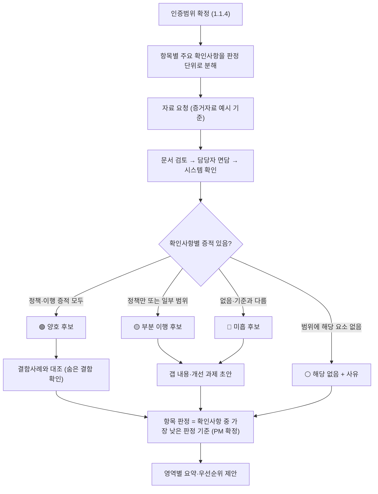

# 3주차-03. 현황 분석과 갭 분석

| 구분 | 내용 |
|---|---|
| 고객사 | A사(민간, ISMS-P 인증 준비) |
| 관련 산출물 | `./deliverables/04_ISMS-P_갭분석표.md` |
| 선행 챕터 | 3주차-02. 인증기준 구조 이해 |
| 예상 학습 시간 | 4시간 (읽기 1.5시간 + 실습 2.5시간) |

---

## 1. 학습 목표

1. 인증기준 항목의 주요 확인사항을 판정 단위로 쪼개 현황을 조사할 수 있다.
2. 증적에 근거해 항목별 이행 여부를 🟢🟡🔴⚪로 판정하고 갭 내용을 쓸 수 있다.
3. 갭을 개선 과제로 바꾸고, 우선순위 제안 근거(법적 의무, 결함 가능성, 난이도)를 정리할 수 있다.

---

## 2. 현장 비유와 기초 개념

> 🏗️ **현장 비유**: 갭 분석은 **이사 전 체크리스트**다. 새집(인증기준)에 필요한 것과 지금 가진 것(현황)을 나란히 놓고, 없는 것·고쳐야 할 것·버릴 것을 표시한다. "아마 있을 거예요"는 체크하지 않는다.

> 📌 **기초 개념 짚기**
> 인증심사는 정책·지침·절차와 이행의 증거자료를 검토하는 서면심사와, 담당자 면담·시스템 확인·취약점 점검으로 기술적 요소를 보는 현장심사로 진행된다. 갭 분석은 심사 전에 같은 방식으로 스스로 확인하는 일이다.
> - 근거: ISMS-P 고시 제25조제2항·제3항[^isms25]

시험에서는 "인증기준을 충족해야 한다"까지 배웠습니다. 현장의 갭 분석은 **101개 × 주요 확인사항 2~5개 = 수백 개의 판정**을 증적과 함께 하는 일입니다. 신입이 가장 많이 맡는 업무이자, 실수가 가장 많이 나는 업무입니다.

---

## 3. 근거 법령·기준

| 근거 | 요지 | 쉬운 풀이 (현장에서 확인할 것) | 출처 |
|---|---|---|---|
| 고시 제23조 · 별표 7 | 인증 구분별 적용 인증기준 | 갭 분석 대상 항목 수 (ISMS 80 / ISMS-P 101) | [^isms23] |
| 고시 제25조제2항·제3항 | 서면심사(정책·지침·절차, 이행 증거자료), 현장심사(면담·시스템 확인·취약점 점검) | 갭 분석도 **문서 + 면담 + 시스템** 3가지로 확인 | [^isms25] |
| 인증기준 안내서 (각 항목) | 주요 확인사항, 증거자료 예시, 결함사례 | 판정 단위·증적 기준·판정 근거 | [^ig] |
| 인증기준 안내서 1.3.1 | 운영명세서: 선정 여부, 운영 현황, 관련 문서, 기록(증거자료), 미선정 사유 | 갭 분석표 열 구성의 근거 | [^ig131] |
| 인증기준 안내서 1.2.4 | 위험 처리 전략(감소·회피·전가·수용), 우선순위·일정·담당·예산을 포함한 이행계획, 경영진 승인 | 갭 → 개선 과제 → 이행계획으로 연결 | [^ig124] |
| 인증기준 안내서 1.4.1 | 준수해야 할 법적 요구사항을 주기적으로 파악해 규정에 반영하고 준수 여부를 지속 검토 | 법령 개정(예: 2026 안전성 기준 개정) 반영 여부도 갭 | [^isms7] |

---

## 4. 컨설팅 수행 절차



### 판정 단위 분해 예시: 2.5.6 접근권한 검토

| 주요 확인사항 (요지) | 확인 방법 | 증거자료 예시 (안내서) | 판정 예 |
|---|---|---|---|
| 접근권한 검토 기준·절차(방법·주기·보고체계·오남용 기준)가 정의되어 있는가 | 문서 | 접근권한 검토 기준 및 절차 | 지침에 "정기 검토"만 있고 주기 없음 → 🟡 |
| 정기적으로 검토하고 있는가 | 문서·시스템 | 접근권한 검토 이력 | 최근 1년 1회 → 기준 대비 판정 |
| 검토 결과 문제에 후속조치를 했는가 | 문서 | 검토 결과보고서 및 후속조치 내역 | 과다 권한 발견 후 조치 기록 없음 → 🔴 |

> 증거자료 예시와 결함사례 출처: 인증기준 안내서 2.5.6[^ig256]

### 개선 과제 우선순위 제안 기준 (예시)

| 기준 | 질문 | 상 | 하 |
|---|---|---|---|
| 법적 의무 | 법령·고시가 직접 요구하는가? | 법 위반 상태 | 권고 수준 |
| 결함 가능성 | 안내서 결함사례와 같은 상황인가? | 거의 같음 | 관련 없음 |
| 영향 범위 | 인증범위 전체에 영향을 주는가? | 전 시스템 | 일부 |
| 난이도·기간 | 2개월 운영 기간 전에 끝낼 수 있는가? | 장기 과제 (먼저 착수) | 즉시 가능 |

> 우선순위 기준과 최종 순위는 PM이 고객사와 정합니다. [출처: 일반 지식, 원문 확인 권장]

### 단계별 설명

| 단계 | 하는 일 | 입력 자료 | 결과물 | 소요 (예시) |
|---|---|---|---|---|
| 1. 분해 | 항목별 주요 확인사항을 판정 단위로 | 인증기준 안내서 | 판정 단위 목록 | 1~2일 |
| 2. 자료 요청 | 증거자료 예시 기준으로 요청 | 판정 단위 목록 | 자료 요청 목록 ISM 영역 | 0.5일 |
| 3. 조사 | 문서·면담·시스템 확인 | 제출 자료 | 현황 메모 | 2~3주 |
| 4. 판정 | 확인사항별 → 항목별 판정 초안 | 현황 메모, 증적 | 갭 분석표 B표 | 1주 |
| 5. 과제화 | 갭 → 개선 과제, 우선순위 제안 | 판정 결과 | 개선 과제 목록 | 2~3일 |

### Windows 11 실무 도구 팁

| 작업 | 도구·경로 | 방법 |
|---|---|---|
| 영역별 판정 집계 (A표) | Excel | `=COUNTIFS(항목열,"2.5.*",판정열,"*미흡*")` 처럼 분야 접두어로 집계 |
| 판정 색상 | Excel 조건부 서식 → 텍스트 포함 | 양호 `#3cb371` / 부분 이행 `#daa520` / 미흡 `#c35b5b` / 해당 없음 `#808080` |
| 판정 값 통일 | 데이터 → 데이터 유효성 검사 → 목록 `🟢 양호,🟡 부분 이행,🔴 미흡,⚪ 해당 없음` | 표기 흔들림 방지 |
| 여러 사람이 동시에 작성 | 고객사 승인된 공유 위치(OneDrive/SharePoint)에서 Excel 공동 편집 + 버전 기록 | 버전 충돌 방지. 개인정보가 들어간 내용은 넣지 않음 |

---

## 5. 업무 분담표

| 단계 | 🙋 신입 담당 | 🧑‍💼 PM·선임 담당 | 🏢 고객사 담당 |
|---|---|---|---|
| 분해·자료 요청 | 판정 단위 목록, 자료 요청 목록 | 고객사 맞춤 조정 | 자료 제출 |
| 조사 | 문서 검토, 면담 기록, 시스템 확인 캡처 | 주요 면담 진행 | 면담·시연 |
| 판정 | 확인사항별 판정 초안·근거·결함사례 대조 | **항목 판정 확정** | 사실 관계 확인 |
| 과제화 | 개선 과제 초안, 우선순위 기준별 평가 | 우선순위 확정, 로드맵 | 실행 가능성·예산 검토 |

> 🚫 **신입이 혼자 결정하지 않는 것**: 항목 판정 확정, 미선정(해당 없음) 확정, 위험 수용 판단

---

## 6. 고객 커뮤니케이션 예시

### 6-1. 갭 분석 면담 요청 메일

```text
제목: [A사 ISMS-P] 갭 분석 담당자 면담 일정 요청 (5/11~5/15)

김○○ 과장님, 안녕하세요. ○○컨설팅 홍길동입니다.

제출해 주신 1차 자료 검토를 마치고, 문서만으로 확인이 어려운 부분을 담당자분들께 여쭙고자 합니다.
```

| 면담 대상 | 관련 항목 | 시간 | 준비 요청 |
|---|---|---|---|
| 인프라팀 | 2.5(인증·권한), 2.6(접근통제) | 60분 | 관리자 콘솔 화면 시연 가능 환경 |
| 개발팀 | 2.8(개발 보안) | 60분 | 개발·테스트 서버 목록 |
| 마케팅팀 | 3.1.7(마케팅 수집·이용) | 30분 | 문자 발송 대상 추출 절차 |

```text
면담은 사실 확인 목적이며, 판정 결과는 종합 검토 후 보고서로 공유드리겠습니다.
```

### 6-2. 결과 설명 멘트 (PM 확정 후, CISO·CPO 대상)

> "101개 항목 기준으로 양호 48개, 부분 이행 31개, 미흡 18개, 해당 없음 4개입니다. 미흡 18개 중 7개가 1영역(관리체계)에 몰려 있습니다. 특히 위험평가는 수행 이력이 없어서, 2.x 보호대책을 아무리 갖춰도 '위험평가 결과에 따라 선정한 보호대책'이라는 연결 고리가 빠집니다. 그래서 1순위 과제로 위험관리계획 수립과 위험평가를 제안드리고, 이 결과가 나와야 보호대책 이행계획(1.2.4)을 경영진 승인받을 수 있습니다."

---

## 7. 인증 결함 사례: 1.2.3 위험 평가

인증기준 안내서가 든 1.2.3 결함사례 중, 갭 분석에서 "있다"고 착각하기 쉬운 것들입니다.[^ig123]

| 결함사례 (안내서 요약) | 갭 분석 때 놓치는 이유 | 확인 방법 |
|---|---|---|
| 위험관리계획서에 기간·대상·방법은 있으나 **수행 인력과 예산 등 구체적 실행계획**이 누락 | 계획서가 "있다"는 것만 확인 | 계획서 목차를 주요 확인사항(인력·기간·대상·방법·예산)과 대조 |
| 전년도에는 위험평가를 했으나 **올해는 자산 변경이 없다는 이유로 미수행** | 작년 보고서를 올해 증적으로 착각 | 증적 날짜(유효성 '기간') 확인 |
| 관리적·물리적 위험평가 없이 **기술적 취약점 진단 결과로 위험평가를 갈음** | 진단 보고서가 두꺼워 위험평가로 보임 | 관리적·물리적·법적 위험 식별 여부 확인 |
| 내부 지침의 위험평가 방법과 실제 수행 방법이 다름 | 결과보고서만 봄 | 지침과 결과보고서 방법론 대조 (유효성 '연결성') |
| 수용 가능한 목표 위험수준(DoA)을 타당한 사유 없이 과도하게 높여 주요 위험이 수용 위험이 됨 | 경영진 승인만 확인 | DoA 산정 근거·수용 위험 목록 검토 |

**컨설팅 시사점**: 갭 분석 판정 근거란에 "결함사례 ○와 유사 여부"를 한 줄 적는 습관을 들이면, 🟢로 잘못 판정하는 일을 크게 줄일 수 있습니다.

---

## 8. 오답노트

| ❌ 신입의 실수 | ✅ 올바른 수행 | 근거 |
|---|---|---|
| 항목명만 보고 한 번에 판정 | 주요 확인사항별로 판정하고, 항목 판정은 PM과 정함 | 안내서 항목 구성 |
| 정책 문서가 있으니 🟢 | 정책 + **이행 증적**이 모두 있어야 🟢. 정책만 있으면 🟡 | 고시 제25조제2항 (이행의 증거자료)[^isms25] |
| 작년 위험평가 보고서를 올해 증적으로 인정 | 연 1회 이상이므로 기간을 확인 | 안내서 1.2.3 결함사례[^ig123] |
| 취약점 진단 결과서를 위험평가로 인정 | 관리적·물리적·법적 영역 위험 식별 여부 확인 | 안내서 1.2.3 결함사례[^ig123] |
| 해당 없음 항목에 사유를 "해당 없음"이라고만 씀 | 인증범위 내 서비스·시스템이 그 항목과 관련 없다는 구체적 사유를 씀 | 안내서 1.3.1 (미선정 사유)[^ig131] |
| 2026년 개정 법령을 반영하지 않고 안내서(2023) 기준으로만 판정 | 1.4.1에 따라 최신 법령 반영 여부를 확인하고, 안내서와 다른 부분은 PM에 보고 | 안내서 안내 문구 (2023.10. 기준) |

---

## 9. 고객사 점검용 체크리스트: 갭 분석 품질 점검 (신입 셀프 체크)

| No | 점검 항목 | 확인 방법 | 요청 증적 | 판정 기준 |
|---|---|---|---|---|
| 1 | 모든 🟢 판정에 이행 증적 ID가 있다 | 문서 | 갭 분석표, 증적 매핑표 | 🟢 100% · 🔴 증적 없는 🟢 존재 |
| 2 | 모든 ⚪ 판정에 구체적 사유가 있다 | 문서 | 갭 분석표 | 🟢 전부 · 🔴 사유 없음 |
| 3 | 증적의 기간(최근 1년 등)이 확인되었다 | 문서 | 증적 매핑표 유효성 열 | 🟢 확인 · 🟡 일부 · 🔴 미확인 |
| 4 | 판정 근거에 결함사례 대조 결과가 있다 | 문서 | 갭 분석표 | 🟢 🟢판정 전부 · 🟡 일부 |
| 5 | 개선 과제가 대상·조치·담당·기한 수준으로 구체적이다 | 문서 | 개선 과제 목록 | 🟢 구체적 · 🟡 추상적 |
| 6 | 1~2주차 진단 결과(처리방침·동의·내부 관리계획·수탁사)가 해당 항목에 반영되었다 | 문서 | 갭 분석표 | 🟢 반영 · 🔴 누락 |

---

## 10. 실무 산출물 연계 팁

| 이 챕터의 결과 | 들어가는 산출물 | 위치 |
|---|---|---|
| 항목별 판정 | `./deliverables/04_ISMS-P_갭분석표.md` | A표·B표 |
| 개선 과제·우선순위 | 보호대책 이행계획 (1.2.4 증적) | 과제 목록 |
| 현황 요약 | 운영명세서 "운영 현황" | 항목별 |
| 해당 없음 사유 | 운영명세서 "미선정 사유" | 항목별 |
| 증적 ID | `./deliverables/05_증적_매핑표.md` | 3주차-04 |

---

## 11. 실습 과제 / 퀴즈

> 정답과 해설은 [answers_and_explanations.md](../../answers_and_explanations.md)의 **「3주차-03. 현황 분석과 갭 분석」** 절에 있습니다.

### 객관식

**Q1.** 갭 분석에서 "정보보호 정책 문서는 결재까지 완료되어 있으나, 정책에 따른 운영 기록이 없다"면 가장 적절한 판정 초안은?

① 🟢 양호
② 🟡 부분 이행
③ ⚪ 해당 없음
④ 판정 불가로 비워 둔다

**Q2.** 다음 중 인증기준 안내서의 1.2.3 위험 평가 결함사례에 해당하는 것은?

① 연 1회 위험평가를 하고 결과를 경영진에게 보고함
② 전년도에는 위험평가를 했으나 올해는 자산 변경이 없다는 이유로 하지 않음
③ 위험평가에 관리적·물리적·기술적 위험을 모두 포함함
④ 위험관리계획에 수행 인력과 예산을 명시함

**Q3.** "⚪ 해당 없음" 판정에 대한 설명으로 옳은 것은?

① 관리체계 수립 및 운영 영역(1.x)도 해당 없음으로 처리할 수 있다.
② 증적을 구하기 어려운 항목은 해당 없음으로 처리한다.
③ 인증범위 내 서비스·시스템이 해당 항목과 전혀 관련이 없는 경우 구체적 사유와 함께 처리한다.
④ 해당 없음 항목은 사유를 쓸 필요가 없다.

### 실습

**상황**: A사 갭 분석 현황 메모다. 갭 분석표 B표의 해당 행을 작성하라.

**제공 자료**

```text
[A사 현황 메모 (2026-05)]
1.1.4 범위: 범위 정의서 있음. 개발·테스트 서버와 외주 개발자 PC가 범위 목록에 없음
1.2.1 정보자산: 자산 목록(2026-04 작성) 있음. 클라우드 D사의 가상서버·오브젝트 스토리지 누락
1.2.3 위험평가: 2025-11 외부 업체 취약점 진단 보고서만 있음, 위험관리계획 없음
1.4.2 내부점검: 계획 없음. 고객사는 컨설팅 팀이 구축 후 점검까지 하길 원함
2.2.4 교육: 연간 교육 계획 있음(전 직원 인식 교육만), 개발자·CPO 직무 교육 없음, 이수 명단 있음
2.5.6 접근권한 검토: 지침에 "정기 검토" 문구만, 검토 이력 없음
2.9.5 접속기록 점검: 내부 관리계획 "월 1회", 결과서 9/12회, 다운로드 사유 확인 기록 있음
2.10.4 전자거래·핀테크: 자체 결제 기능 없음, 결제는 I결제(PG)에 위탁
3.1.1 수집·이용: 동의서 거부권 고지 누락, 항목 "~등" 표기
3.5.1 처리방침: 수탁자 누락, 이전 버전 미공개
```

**과제**

1. 10개 항목의 B표 행(현황 요약 / 확인 방법 / 판정 / 갭 내용·개선 과제)을 작성하시오. 판정 근거에 안내서 결함사례와의 유사 여부를 한 줄씩 넣을 것.
2. 4절 우선순위 기준으로 상위 3개 과제를 고르고 이유를 쓰시오.

**작성 양식**: `./deliverables/04_ISMS-P_갭분석표.md` B표

---

## 12. 더 읽을거리

| 자료 | references 파일명 | 읽을 부분 |
|---|---|---|
| ISMS-P 인증기준 안내서 | [`ISMS-P 인증기준 안내서(2023.11.23).pdf`](<../../references/ISMS-P 인증기준 안내서(2023.11.23).pdf>) | 1.2.3(p.32~34), 1.2.4(p.35~36), 1.3.1(p.37~38), 2.5.6 |
| ISMS-P 고시 | [`정보보호 및 개인정보보호 관리체계 인증 등에 관한 고시(개인정보보호위원회고시)(제2024-8호)(20240724).pdf`](<../../references/정보보호 및 개인정보보호 관리체계 인증 등에 관한 고시(개인정보보호위원회고시)(제2024-8호)(20240724).pdf>) | 제23조, 제25조 |

---

## 각주

[^isms23]: [출처: [정보보호 및 개인정보보호 관리체계 인증 등에 관한 고시(개인정보보호위원회고시)(제2024-8호)(20240724).pdf](<../../references/정보보호 및 개인정보보호 관리체계 인증 등에 관한 고시(개인정보보호위원회고시)(제2024-8호)(20240724).pdf>), 제23조, 별표 7]
[^isms25]: [출처: [정보보호 및 개인정보보호 관리체계 인증 등에 관한 고시(개인정보보호위원회고시)(제2024-8호)(20240724).pdf](<../../references/정보보호 및 개인정보보호 관리체계 인증 등에 관한 고시(개인정보보호위원회고시)(제2024-8호)(20240724).pdf>), 제25조제2항·제3항]
[^isms7]: [출처: [\[별표 7\] 인증기준(제23조 관련)(정보보호 및 개인정보보호 관리체계 인증 등에 관한 고시).pdf](<../../references/[별표 7] 인증기준(제23조 관련)(정보보호 및 개인정보보호 관리체계 인증 등에 관한 고시).pdf>), 1.4.1]
[^ig]: [출처: [ISMS-P 인증기준 안내서(2023.11.23).pdf](<../../references/ISMS-P 인증기준 안내서(2023.11.23).pdf>), 제2장 항목별 설명]
[^ig123]: [출처: [ISMS-P 인증기준 안내서(2023.11.23).pdf](<../../references/ISMS-P 인증기준 안내서(2023.11.23).pdf>), p.32~34, 1.2.3 위험 평가 (주요 확인사항·결함사례)]
[^ig124]: [출처: [ISMS-P 인증기준 안내서(2023.11.23).pdf](<../../references/ISMS-P 인증기준 안내서(2023.11.23).pdf>), p.35~36, 1.2.4 보호대책 선정]
[^ig131]: [출처: [ISMS-P 인증기준 안내서(2023.11.23).pdf](<../../references/ISMS-P 인증기준 안내서(2023.11.23).pdf>), p.37~38, 1.3.1 보호대책 구현 (운영명세서)]
[^ig256]: [출처: [ISMS-P 인증기준 안내서(2023.11.23).pdf](<../../references/ISMS-P 인증기준 안내서(2023.11.23).pdf>), 2.5.6 접근권한 검토 (증거자료 예시·결함사례)]
