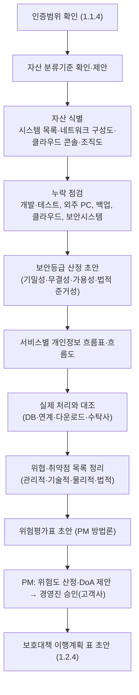

# 3주차-05. 정보자산, 흐름도, 위험평가 보조

| 구분 | 내용 |
|---|---|
| 고객사 | A사(민간, ISMS-P 인증 준비) |
| 관련 산출물 | 정보자산 목록(이 챕터 4절 양식), `./deliverables/07_개인정보_흐름표.md` (흐름표 양식 재사용), 위험 식별표 |
| 선행 챕터 | 3주차-03. 현황 분석과 갭 분석 |
| 예상 학습 시간 | 4시간 (읽기 1.5시간 + 실습 2.5시간) |

---

## 1. 학습 목표

1. 인증범위 내 정보자산을 분류기준에 따라 빠짐없이 식별하고 목록을 작성할 수 있다.
2. 서비스 단위 개인정보 흐름표·흐름도를 작성하고 실제 처리와 대조해 현행화할 수 있다.
3. 위험평가에서 신입이 맡는 보조 업무(자산·위협·취약점 정리, 평가표 작성)를 수행할 수 있다.

---

## 2. 현장 비유와 기초 개념

> 🏗️ **현장 비유**: 정보자산 목록은 **집의 물건 목록**, 흐름도는 **물건이 집 안팎을 오가는 동선도**, 위험평가는 **"도둑이 들면 어디가 제일 위험한가"를 따지는 일**이다. 목록에 없는 방은 잠글 생각도 못 한다.

> 📌 **기초 개념 짚기**
> ISMS-P 1.2(위험 관리) 분야는 정보자산 식별(1.2.1), 현황 및 흐름분석(1.2.2), 위험 평가(1.2.3), 보호대책 선정(1.2.4)의 4개 항목이다. 위험평가는 관리체계 전 영역에 대해 **연 1회 이상** 하고, 수용 가능한 위험은 경영진 승인을 받는다.
> - 근거: ISMS-P 인증기준(별표 7) 1.2.1~1.2.4[^isms7], 인증기준 안내서[^ig121] [^ig123]

시험에서는 "자산 식별 → 위협·취약점 → 위험도 → 보호대책"이라는 순서를 배웠습니다. 현장에서 신입이 하는 일은 **그 순서의 앞부분(빠짐없는 목록과 정확한 흐름)**이고, 여기가 틀리면 뒤의 위험평가가 전부 틀립니다.

---

## 3. 근거 법령·기준

| 근거 | 요지 | 쉬운 풀이 (현장에서 확인할 것) | 출처 |
|---|---|---|---|
| 1.2.1 정보자산 식별 | 분류기준 수립, 범위 내 **모든** 자산 식별, 법적 요구사항·업무 영향을 고려한 중요도·보안등급, 정기 조사로 **최신** 유지. 클라우드는 특성을 반영한 분류기준(가상서버, 오브젝트 스토리지 등) | 자산 유형: 서버, 데이터(DBMS), 응용프로그램, SW, 네트워크, 보안시스템, PC, 정보, 설비, 시설 등. 보안등급은 기밀성·무결성·가용성·법적 준거성 등 | [^ig121] |
| 1.2.2 현황 및 흐름분석 | 정보서비스 현황·업무 흐름 문서화, 개인정보 처리 현황과 흐름을 **흐름도 등**으로 문서화, 주기적 검토로 최신성 유지. 현황분석은 **GAP 분석표**로 인증기준과 운영현황 비교 | 개인정보 흐름도는 수집·보유·이용·제공·파기 단계별 흐름을 한눈에 보이게 한 개념도. 안내서 예시는 영향평가 수행안내서 양식을 인용 | [^ig122] |
| 1.2.3 위험 평가 | 위험평가 방법 정의(베이스라인, 상세위험 분석, 복합, 위협·시나리오 기반 등), 수행인력·기간·대상·방법·예산을 담은 위험관리계획 매년 수립, **연 1회 이상** 및 중요한 변화 시 평가, 목표 위험수준(DoA) 설정, 경영진 보고 | 위험관리 수행인력에 외부 전문컨설턴트도 참여 가능 (이해관계자 참여 필요) | [^ig123] |
| 1.2.4 보호대책 선정 | 위험 처리 전략(감소·회피·전가·수용), 우선순위·일정·담당·예산을 포함한 이행계획, 경영진 승인 | 신입은 이행계획 표 초안 | [^ig124] |
| 안전성 기준 제4조제1항제15호 | 내부 관리계획에 "위험 분석 및 관리에 관한 사항" 포함 | ISMS-P 위험평가 결과가 내부 관리계획 위험 분석과 연결 | [^safe4] |
| 영향평가 수행안내서 | 흐름표(수집·보유이용·제공파기)와 흐름도 작성 방법, 범례(온라인 실선·오프라인 점선 등) | 4주차-05에서 자세히. 여기서는 같은 양식 재사용 | [^piag] |

---

## 4. 컨설팅 수행 절차



### 정보자산 목록 양식 (예시)

| 자산 ID | 유형 | 자산명 | 용도 | 위치 (IP·리전) | 처리 개인정보 | 관리 부서 / 책임자 | C | I | A | 법적 준거성 | 보안등급 | 최종 확인일 |
|---|---|---|---|---|---|---|---|---|---|---|---|---|
| SV-001 | 서버 | 회원관리 WAS | 회원 가입·조회 | 10.0.1.11 | 이름, 휴대전화, 이메일 | 인프라팀 / 팀장 | 3 | 3 | 3 | 개인정보 처리 | 상 | 2026-05-10 |
| DB-001 | 데이터 | MEMBER 테이블 | 회원 정보 | DB-01 | 이름, 휴대전화, 이메일, 비밀번호(일방향), 계좌번호(암호화) | 인프라팀 | 3 | 3 | 2 | 개인정보·암호화 대상 | 상 | 2026-05-10 |
| CL-001 | 클라우드 | 오브젝트 스토리지 버킷 | 주문 증빙 이미지 | 클라우드 D사 리전 | 이름, 주소 (이미지) | 개발팀 | 3 | 2 | 2 | 개인정보 처리 | 상 | 2026-05-10 |

> 등급 척도(1~3)와 보안등급 산정 방식은 **고객사 분류기준**을 따릅니다. 위 값은 예시입니다. [출처: 일반 지식, 원문 확인 권장]

### 자주 빠지는 자산 (안내서 결함사례 기반)

| 빠지는 자산 | 안내서 근거 |
|---|---|
| 개발·시험 시스템, 개발자 PC, 테스트용 단말기, 외주업체 직원 PC | 1.1.4 결함사례 1·3[^ig114] |
| 출력물 보안, 문서암호화, USB 매체제어 등 내부정보 유출통제 시스템 | 1.2.1 결함사례 1[^ig121] |
| 제3자로부터 제공받은 개인정보 | 1.2.1 결함사례 2[^ig121] |
| 외부에 위탁한 IT 서비스(웹호스팅, 서버호스팅, 클라우드 등) — 인증범위 내 | 1.2.1 결함사례 4[^ig121] |
| 고유식별정보를 저장한 백업서버 (등급을 낮게 매기는 실수) | 1.2.1 결함사례 5[^ig121] |

### 위험평가에서 신입이 맡는 표 (위협·취약점 정리 예)

| 자산 ID | 위협 | 취약점 (현황) | 관련 인증기준·법령 | 영역 | 비고 |
|---|---|---|---|---|---|
| DB-001 | 내부자 대량 조회·유출 | 다운로드 사유 확인 일부 누락 | 2.9.5, 안전성 기준 제8조 | 기술적 | 갭 분석 결과 연결 |
| SV-001 | 퇴직자 계정 악용 | 퇴직자 계정 2개 활성 | 2.5.1, 2.2.5, 안전성 기준 제5조 | 관리적 | |
| 전체 | 수탁사 관리 소홀 | 하반기 점검 미실시 | 2.3.3, 법 제26조제4항 | 관리적 | |
| 문서 캐비닛 | 서류 무단 반출 | 잠금 미흡 | 2.4.x, 안전성 기준 제10조 | 물리적 | |
| 전체 | 법 개정 미반영 | 내부 관리계획 2022년 버전 | 1.4.1 | 법적 | |

> 위험도 산정 공식, 척도, DoA는 **PM이 정한 방법론**을 따릅니다. 신입이 임의로 점수를 매기지 않습니다.

### 단계별 설명

| 단계 | 하는 일 | 입력 자료 | 결과물 | 소요 (예시) |
|---|---|---|---|---|
| 1. 자산 식별 | 목록 작성, 누락 점검 | 시스템 목록, 구성도, 클라우드 콘솔 캡처 | 정보자산 목록 | 1주 |
| 2. 등급 초안 | 분류기준에 따른 C·I·A·법적 준거성 | 분류기준 | 보안등급 초안 | 2~3일 |
| 3. 흐름 분석 | 서비스별 흐름표·흐름도, 실제 대조 | DB 정의서, 인터페이스 정의서, 인터뷰 | 흐름표·흐름도 | 1주 |
| 4. 위협·취약점 | 갭 분석·점검 결과를 위험 식별표로 | 갭 분석표 | 위험 식별표 | 2~3일 |
| 5. 이행계획 초안 | 보호대책·우선순위·일정·담당·예산 표 | 위험평가 결과 (PM) | 이행계획 초안 | 2일 |

### Windows 11 실무 도구 팁

| 작업 | 도구·경로 | 방법 |
|---|---|---|
| 흐름도 그리기 | PowerPoint SmartArt 또는 Visio(보유 시), 또는 Mermaid를 지원하는 편집기 | 범례(온라인 실선·오프라인 점선·암호화 굵은 선)를 먼저 정하고 시작 |
| 자산 목록 누락 점검 | Excel `=COUNTIF(자산목록!C:C, 구성도목록!B2)=0` | 구성도·클라우드 목록에는 있는데 자산 목록에 없는 항목 표시 |
| 업무 PC 자산 정보 수집 (샘플) | PowerShell `Get-ComputerInfo -Property CsName, OsName, OsVersion` | 고객사 승인하에 담당자가 실행, 결과만 수령 |
| 설치 프로그램 확인 (내부정보 유출통제 SW 존재 확인) | 설정 → 앱 → 설치된 앱, 또는 `Get-Package` | DLP·매체제어 SW 설치 여부 → 자산 누락 확인 |

---

## 5. 업무 분담표

| 단계 | 🙋 신입 담당 | 🧑‍💼 PM·선임 담당 | 🏢 고객사 담당 |
|---|---|---|---|
| 자산 식별 | 목록 초안, 누락 점검표 | 분류기준 제안 | 자산 정보 제공, 목록 확정 |
| 보안등급 | 기준에 따른 초안 | 등급 기준 해석 | **등급 확정** |
| 흐름 분석 | 흐름표·흐름도 초안, 실제 대조 | 검토 | 업무 설명, 확인 |
| 위험평가 | 위협·취약점 정리, 평가표 칸 채우기 | **방법론·위험도 산정·DoA 제안** | 위험 수용 결정(경영진 승인) |
| 보호대책 선정 | 이행계획 표 초안 | 우선순위 제안 | 일정·담당·예산 확정, 경영진 승인 |

> 🚫 **신입이 혼자 결정하지 않는 것**: 위험도 점수, DoA, 위험 수용 여부, 보안등급 확정

---

## 6. 고객 커뮤니케이션 예시

### 6-1. 자산 식별 인터뷰 질문 리스트 (인프라·개발팀)

| No | 질문 | 질문 의도 | 답변 후 요청할 증적 |
|---|---|---|---|
| 1 | 운영 외에 개발·테스트·스테이징 서버가 있나요? 운영 데이터가 들어가나요? | 개발·시험 시스템 누락 방지 (1.1.4), 시험 데이터 보안 (2.8.4) | 서버 목록, 테스트 데이터 정책 |
| 2 | 클라우드에서 쓰는 서비스(가상서버, 스토리지, DB 등)를 콘솔에서 보여 주실 수 있나요? | 클라우드 자산 누락 방지 (1.2.1) | 콘솔 리소스 목록 캡처 |
| 3 | 백업은 어디에, 어떤 형태로 보관되나요? | 백업 자산·등급 | 백업 정책, 백업 서버 목록 |
| 4 | 외주 인력이 쓰는 PC나 계정이 있나요? | 외주 PC 누락 방지 | 외주 인력·장비 목록 |
| 5 | 다른 회사·기관에서 받아 오는 개인정보가 있나요? | 제3자 제공받은 개인정보 자산 (1.2.1) | 제공 계약, 연계 정의서 |

### 6-2. 결과 설명 멘트 (실무 담당자 대상)

> "자산 목록 초안을 구성도·클라우드 콘솔과 대조해 보니 23개 자산이 빠져 있었습니다. 대부분 개발 서버와 클라우드 스토리지입니다. 인증기준 안내서의 결함사례에 그대로 나오는 유형이라, 위험평가 전에 목록을 먼저 확정하시는 게 좋겠습니다. 흐름도는 신규 앱 결제 흐름이 빠져 있어 PG사 연계 구간을 추가한 초안을 드렸으니, 실제와 다른 부분을 표시해 주세요."

---

## 7. 처분 사례와 인증 결함 사례

### 처분 사례: ㈜엘지유플러스 (2023.7. 의결) — 개발·검수 환경의 운영 데이터

보도자료는 엘지유플러스가 고객인증시스템 운영기의 실제 운영 데이터(개인정보 포함)를 **개발기·검수기로 옮겨 테스트한 뒤 일부 데이터를 방치**해, 2008년에 생성된 정보 등 1천만 건 이상의 개인정보가 조사 시점까지 남아 있었다고 밝혔습니다. 과징금 68억 원·과태료 2,700만 원과 시정명령이 부과되었습니다.[^lgu]

**컨설팅 시사점**: 개발·검수 서버가 자산 목록과 흐름도에서 빠지면, 그곳의 개인정보는 위험평가와 파기 관리 대상에서도 빠집니다. 자산 식별 인터뷰 1번 질문을 빼먹지 않습니다.

### 인증 결함 사례: 1.2.2 현황 및 흐름분석

인증기준 안내서 1.2.2 결함사례: ① 범위 내 주요 서비스의 업무 절차·흐름과 현황이 문서화되지 않음 ② 개인정보 흐름도를 작성했으나 **실제 흐름과 다른 부분이 다수**이거나 중요한 흐름이 누락 ③ 최초 작성 이후 **현행화가 이루어지지 않아** 변화된 흐름이 반영되지 않음.[^ig122]

---

## 8. 오답노트

| ❌ 신입의 실수 | ✅ 올바른 수행 | 근거 |
|---|---|---|
| 고객사가 준 서버 목록을 그대로 자산 목록으로 씀 | 구성도·클라우드 콘솔·보안시스템·PC·외주 장비와 대조해 누락 점검 | 1.2.1, 1.1.4 결함사례[^ig121] [^ig114] |
| 백업서버를 "운영 아님"이라며 낮은 등급으로 매김 | 저장된 정보(고유식별정보 등)를 기준으로 등급 산정 | 1.2.1 결함사례 5[^ig121] |
| 2023년 흐름도를 그대로 증적으로 등록 | 현재 서비스·연계와 대조해 현행화 | 1.2.2 결함사례 3[^ig122] |
| 기술적 취약점 진단 결과만으로 위험 식별표를 채움 | 관리적·물리적·법적 위험도 함께 식별 (갭 분석·점검 결과 활용) | 1.2.3 결함사례 6[^ig123] |
| 위험도 점수와 DoA를 신입이 정해서 보고서에 넣음 | 점수·DoA는 PM 방법론과 고객사 경영진 승인 대상 | 1.2.3 (경영진 승인) |
| 흐름도에 오프라인 흐름(서류, 팩스)을 빼먹음 | 온라인·오프라인을 구분해 모두 그림 (범례로 구분) | 영향평가 수행안내서 흐름도 범례[^piag] |

---

## 9. 고객사 점검용 체크리스트

| No | 점검 항목 | 확인 방법 | 요청 증적 | 판정 기준 |
|---|---|---|---|---|
| 1 | 정보자산 분류기준이 문서로 정해져 있다 | 문서 | 자산 분류 기준 | 🟢 있음 · 🔴 없음 |
| 2 | 범위 내 자산(개발·클라우드·백업·보안시스템·외주 PC 포함)이 목록에 있다 | 문서·시스템 | 자산 목록, 구성도, 콘솔 캡처 | 🟢 누락 없음 · 🟡 일부 누락 · 🔴 다수 누락 |
| 3 | 보안등급이 기준에 따라 합리적으로 산정되었다 | 문서 | 자산 목록 등급 열 | 🟢 합리적 · 🟡 일부 부적절 · 🔴 기준 불일치 |
| 4 | 자산 목록이 정기적으로 최신화된다 | 문서 | 최종 확인일, 변경 절차 | 🟢 1년 이내·절차 있음 · 🟡 절차 없음 · 🔴 오래됨 |
| 5 | 서비스별 개인정보 흐름도가 실제와 일치한다 | 문서·인터뷰·시스템 | 흐름표·흐름도, 연계 정의서 | 🟢 일치 · 🟡 일부 누락 · 🔴 다수 불일치 |
| 6 | 위험관리계획(인력·기간·대상·방법·예산)이 올해 수립되었다 | 문서 | 위험관리 계획서 | 🟢 5요소 · 🟡 일부 · 🔴 없음 |
| 7 | 위험평가가 연 1회 이상, 관리적·기술적·물리적·법적 영역을 포함해 수행되었다 | 문서 | 위험평가 결과보고서 | 🟢 충족 · 🟡 일부 영역 · 🔴 미수행 |
| 8 | DoA와 수용 위험이 경영진 승인을 받았다 | 문서 | 승인 문서, 위원회 회의록 | 🟢 승인 · 🔴 미승인 |

---

## 10. 실무 산출물 연계 팁

| 이 챕터의 결과 | 들어가는 산출물 | 위치 |
|---|---|---|
| 정보자산 목록 | 1.2.1 증적, 갭 분석표 | `./deliverables/05_증적_매핑표.md` |
| 흐름표·흐름도 | 1.2.2 증적 | `./deliverables/07_개인정보_흐름표.md` 양식 재사용 |
| 위험 식별표 | 위험평가 결과보고서 부록 | PM 방법론 양식 |
| 보호대책 이행계획 초안 | 1.2.4 증적 | 경영진 승인 대상 |
| 누락 자산 목록 | 1.1.4 범위 정의서 수정 | 범위 정의서 |

> 💡 흐름표·흐름도 양식은 4주차 영향평가와 같은 것을 씁니다. 민간·공공 어느 쪽 프로젝트든 한 번 익혀 두면 계속 씁니다.

---

## 11. 실습 과제 / 퀴즈

> 정답과 해설은 [answers_and_explanations.md](../../answers_and_explanations.md)의 **「3주차-05. 정보자산, 흐름도, 위험평가 보조」** 절에 있습니다.

### 객관식

**Q1.** 인증기준 안내서 1.2.1의 결함사례에 해당하지 **않는** 것은?

① 인증범위 내 클라우드 자산 식별 누락
② 고유식별정보를 저장한 백업서버의 기밀성 등급을 (하)로 산정
③ 자산 목록에 자산명·용도·위치·책임자를 기재
④ 제3자로부터 제공받은 개인정보에 대한 자산 식별 누락

**Q2.** 위험평가에서 신입 컨설턴트가 맡기에 가장 적절한 업무는?

① 수용 가능한 목표 위험수준(DoA) 결정
② 위험 수용 여부 최종 승인
③ 갭 분석·점검 결과를 바탕으로 위협·취약점 목록 정리
④ 위험평가 방법론 선정

**Q3.** 인증기준 안내서 1.2.3이 위험관리계획에 구체화하도록 한 항목이 **아닌** 것은?

① 수행인력
② 기간
③ 예산
④ 심사원 명단

### 실습

**상황**: A사 인프라팀이 준 서버 목록과 인터뷰 결과다. 자산 목록 누락을 찾고 흐름표·위험 식별표를 작성하라.

**제공 자료**

```text
[A사 서버 목록 (인프라팀 제공)]
SV-001 회원관리 WAS / SV-002 주문관리 WAS / DB-01 회원·주문 DB / FW-01 방화벽

[인터뷰 결과]
- 개발 서버 2대(DEV-01, DEV-02)가 있고, 월 1회 운영 DB 일부를 복사해 테스트
- 클라우드 D사: 가상서버 4대(위 WAS·DB 포함), 오브젝트 스토리지 1개(주문 증빙 이미지: 이름·주소 보임), 백업 스토리지 1개(DB 일일 백업)
- 콜센터 B사는 A사 상담 시스템(웹)에 접속해 고객 이름·연락처·주문내역 조회, 엑셀 다운로드 가능
- 마케팅팀은 월 1회 회원 DB에서 이름·휴대전화를 추출해 E문자에 파일로 전송
- 고객지원팀은 반품 신청서(종이)를 받아 스캔 후 캐비닛 보관
- DLP·매체제어 솔루션 사용 중 (목록에 없음)
```

**과제**

1. 서버 목록에서 빠진 자산을 모두 찾아 4절 자산 목록 양식으로 추가하시오. (C·I·A·보안등급은 근거를 한 줄씩)
2. "회원 마케팅 문자 발송" 업무의 수집·보유이용·제공파기 흐름표를 `./deliverables/07_개인정보_흐름표.md` 양식으로 쓰시오.
3. 위 자료에서 위험 식별표(4절 양식)를 5행 이상 쓰시오. 관리적·기술적·물리적·법적 영역이 모두 들어가게 할 것.

**작성 양식**: 4절 자산 목록·위험 식별표, `./deliverables/07_개인정보_흐름표.md`

---

## 12. 더 읽을거리

| 자료 | references 파일명 | 읽을 부분 |
|---|---|---|
| ISMS-P 인증기준 안내서 | [`ISMS-P 인증기준 안내서(2023.11.23).pdf`](<../../references/ISMS-P 인증기준 안내서(2023.11.23).pdf>) | 1.2.1~1.2.4 (p.24~36), 1.1.4 |
| 개인정보 영향평가 수행안내서 | [`개인정보 영향평가 수행안내서(25.10.).pdf`](<../../references/개인정보 영향평가 수행안내서(25.10.).pdf>) | p.34~56 '개인정보 흐름 분석' |
| 엘지유플러스 처분 보도자료 | [`230713 (조간) 개인정보위, ㈜엘지유플러스 개인정보 유출사고에 대해 과징금 68억 원, 과태료 2,700만 원 및 시정명령 부과(조사2과)FN.pdf`](<../../references/230713 (조간) 개인정보위, ㈜엘지유플러스 개인정보 유출사고에 대해 과징금 68억 원, 과태료 2,700만 원 및 시정명령 부과(조사2과)FN.pdf>) | 둘째 위반 사항 (개발기·검수기) |

---

## 각주

[^isms7]: [출처: [\[별표 7\] 인증기준(제23조 관련)(정보보호 및 개인정보보호 관리체계 인증 등에 관한 고시).pdf](<../../references/[별표 7] 인증기준(제23조 관련)(정보보호 및 개인정보보호 관리체계 인증 등에 관한 고시).pdf>), 1.2.1~1.2.4]
[^ig114]: [출처: [ISMS-P 인증기준 안내서(2023.11.23).pdf](<../../references/ISMS-P 인증기준 안내서(2023.11.23).pdf>), p.18, 1.1.4 범위 설정 결함사례]
[^ig121]: [출처: [ISMS-P 인증기준 안내서(2023.11.23).pdf](<../../references/ISMS-P 인증기준 안내서(2023.11.23).pdf>), p.24~25, 1.2.1 정보자산 식별 (세부 설명·결함사례)]
[^ig122]: [출처: [ISMS-P 인증기준 안내서(2023.11.23).pdf](<../../references/ISMS-P 인증기준 안내서(2023.11.23).pdf>), p.26~31, 1.2.2 현황 및 흐름분석 (세부 설명·결함사례)]
[^ig123]: [출처: [ISMS-P 인증기준 안내서(2023.11.23).pdf](<../../references/ISMS-P 인증기준 안내서(2023.11.23).pdf>), p.32~34, 1.2.3 위험 평가]
[^ig124]: [출처: [ISMS-P 인증기준 안내서(2023.11.23).pdf](<../../references/ISMS-P 인증기준 안내서(2023.11.23).pdf>), p.35~36, 1.2.4 보호대책 선정]
[^safe4]: [출처: [개인정보의 안전성 확보조치 기준(개인정보보호위원회고시)(제2026-9호)(20260701).pdf](<../../references/개인정보의 안전성 확보조치 기준(개인정보보호위원회고시)(제2026-9호)(20260701).pdf>), 제4조제1항제15호]
[^piag]: [출처: [개인정보 영향평가 수행안내서(25.10.).pdf](<../../references/개인정보 영향평가 수행안내서(25.10.).pdf>), p.41~54 '개인정보 흐름표·흐름도 작성']
[^lgu]: [출처: [230713 (조간) 개인정보위, ㈜엘지유플러스 개인정보 유출사고에 대해 과징금 68억 원, 과태료 2,700만 원 및 시정명령 부과(조사2과)FN.pdf](<../../references/230713 (조간) 개인정보위, ㈜엘지유플러스 개인정보 유출사고에 대해 과징금 68억 원, 과태료 2,700만 원 및 시정명령 부과(조사2과)FN.pdf>), p.1~2, 2023.7.12. 의결]
