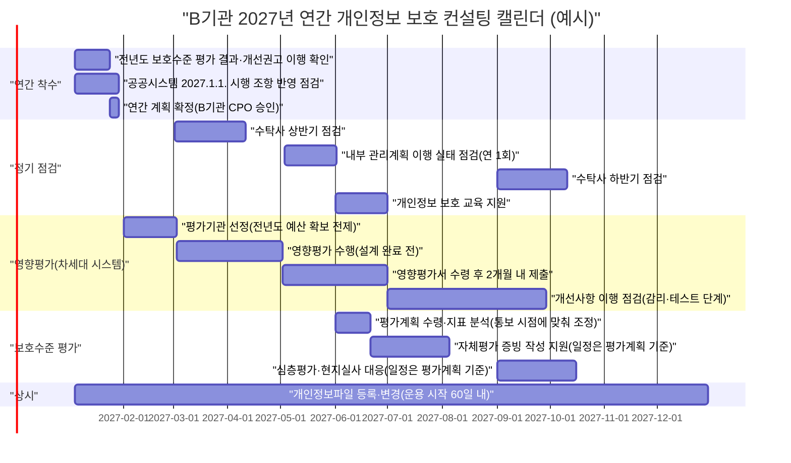
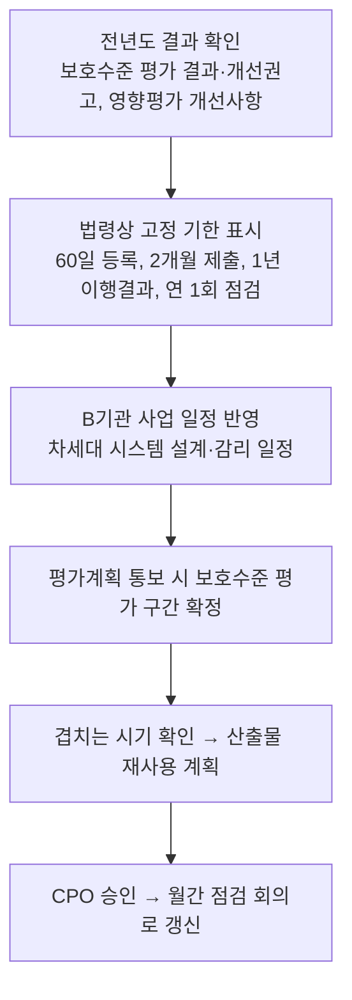

# 4주차-01. 공공기관 연간 컨설팅 캘린더

| 구분 | 내용 |
|---|---|
| 고객사 | B기관(공공, 매년 고정 연간 컨설팅) |
| 관련 산출물 | B기관 연간 컨설팅 캘린더(이 챕터 4절 gantt), `./deliverables/06_보호수준평가_증빙_관리표.md` |
| 선행 챕터 | 1~3주차 전체 |
| 예상 학습 시간 | 3시간 (읽기 1.5시간 + 실습 1.5시간) |

---

## 1. 학습 목표

1. B기관이 1년 동안 지켜야 하는 개인정보 보호 의무 일정(보호수준 평가, 영향평가, 정기 점검, 파일 등록 등)을 근거와 함께 나열할 수 있다.
2. 법령상 고정 기한과 평가계획 통보 후 확정되는 일정을 구분해 연간 캘린더(gantt)를 그릴 수 있다.
3. 일정이 겹치는 시기에 산출물을 재사용하는 방법을 제안할 수 있다.

---

## 2. 현장 비유와 기초 개념

> 🏗️ **현장 비유**: 공공기관 연간 컨설팅은 **학교 학사력**과 같다. 중간고사(보호수준 평가), 수행평가(영향평가), 정기 건강검진(내부 점검)이 정해진 시기에 겹쳐 오므로, 학기 초에 달력을 짜 두지 않으면 시험 전날 밤을 새운다.

> 📌 **기초 개념 짚기**
> 공공기관은 민간 처리자의 의무에 더해 **개인정보 보호수준 평가**(매년), **개인정보 영향평가**(대상 개인정보파일), **개인정보파일 등록**(운용 시작일부터 60일 이내) 등 공공 특유의 의무가 있다. 공공시스템운영기관은 안전성 기준 제3장의 추가 조치도 해야 한다.
> - 근거: 「개인정보 보호법」 제11조의2, 제32조, 제33조[^law], 시행령 제13조의2, 제34조, 제35조[^dec], 안전성 기준 제14조~제18조[^safe]

민간 고객사는 "인증 심사일" 하나가 큰 기준점이라면, B기관은 **여러 의무가 1년 내내 맞물려** 돌아갑니다. 신입이 연간 캘린더를 정확히 관리하면 PM의 부담이 크게 줄어듭니다.

---

## 3. 근거 법령·기준

| 의무 | 근거 | 기한·주기 | 출처 |
|---|---|---|---|
| 개인정보 보호수준 평가 | 법 제11조의2, 영 제13조의2 | **매년**. 보호위원회가 평가 전에 평가대상·기준·방법·지표를 포함한 **평가계획을 통보** | [^law] [^dec] |
| 2026년 보호수준 평가단 위촉 | 2026 평가단 위촉 보도자료 | 2026.8.24. 위촉식. 평가단은 현지실사, 결과 평정, 우수·미흡 사례 발굴 수행 예정 | [^lvl] |
| 개인정보 영향평가 | 법 제33조, 영 제35조·제38조, 영향평가 고시 | 대상 파일 구축·변경 시 **설계 완료 전** 수행. 영향평가서를 받은 날부터 **2개월 이내** 보호위원회 제출. 개선사항 이행결과는 2개월 이내, 이후 조치분은 **1년 이내** 제출 | [^law] [^dec] [^pia] |
| 영향평가 예산 | 수행안내서 | 영향평가 사업은 **직전 연도에 예산 확보**, 당해 연도에 평가기관 선정 | [^piag18] |
| 개인정보파일 등록 | 법 제32조, 영 제34조제1항 | 운용 시작일부터 **60일 이내** 등록 신청, 변경 시에도 같음 | [^law] [^dec] |
| 내부 관리계획 이행 실태 점검 | 안전성 기준 제4조제4항 | **연 1회 이상** | [^safe] |
| 개인정보 보호 교육 | 안전성 기준 제4조제2항, 안내서 | 정기 실시 (안내서: **연 1회 이상**) | [^safe] [^g55] |
| 수탁자 교육·감독 | 법 제26조제4항 | 내부 관리계획에서 정한 주기 | [^law] |
| 공공시스템운영기관 추가 조치 | 안전성 기준 제14조~제18조, 부칙 | 제15조제5호·제18조는 **2027.1.1. 시행** | [^safe] |
| 처리방침 | 법 제30조 | 공공기관은 **등록 대상 개인정보파일**에 대해 정함. 변경 시 공개 | [^law] |

> ⚠️ **확인 필요**: 보호수준 평가의 자체평가 제출, 심층평가, 현지실사, 결과 통보 등 **세부 일정은 보호위원회가 매년 통보하는 평가계획**으로 확정됩니다. 이 레포의 references에는 2026년 평가단 위촉일(8.24.) 외의 세부 일정이 없으므로, 아래 캘린더의 보호수준 평가 구간은 **평가계획 수령 후 바꿔 넣는 자리표시**입니다.

---

## 4. 컨설팅 수행 절차

### 4-1. B기관 연간 캘린더 (gantt, 예시)



> 영향평가 기간·보호수준 평가 구간 등은 **예시 일정**입니다. 법령으로 고정된 것은 "설계 완료 전 수행", "영향평가서 수령 후 2개월 내 제출", "이행결과 1년 내 제출", "파일 운용 시작 60일 내 등록", "내부 관리계획 연 1회 점검" 같은 **기한 규칙**입니다.

### 4-2. 캘린더를 만드는 순서



### 4-3. 산출물 재사용 지도

| 한 번 만든 산출물 | 다시 쓰이는 곳 |
|---|---|
| 내부 관리계획 이행 점검 결과 (2주차-02) | 보호수준 평가 안전조치 관련 증빙 후보, 영향평가 대상기관 관리체계 평가(별표 5 영역 I·II) |
| 수탁사 점검 결과·이행 확인 (2주차-04·05) | 보호수준 평가 심층평가 "위·수탁의 적절성 및 사후관리" 증빙 후보, 영향평가 "위탁" 분야 |
| 처리방침 진단 (1주차-03) | 보호수준 평가 "처리방침 및 열람·정정·삭제·처리정지 등", 영향평가 "개인정보 처리방침" 분야 |
| 개인정보 흐름표·흐름도 (4주차-05) | 영향평가 산출물, 개인정보파일 등록사항 확인 |

> 보호수준 평가 지표의 세부 증빙 요구는 평가계획으로 확인합니다. 위 표의 "증빙 후보"는 평가 항목 이름을 기준으로 한 연결 후보입니다.

### Windows 11 실무 도구 팁

| 작업 | 도구·경로 | 방법 |
|---|---|---|
| 기한 자동 계산 | Excel | 파일 등록: `=운용시작일+60` / 영향평가서 제출: `=EDATE(수령일,2)` / 이행결과: `=EDATE(수령일,12)` |
| 공유 캘린더 | Outlook → 일정 → 일정 추가 → 새 빈 일정 → B기관 담당자와 공유 | 기한 2주 전 미리 알림 |
| 월간 현황판 | Excel 조건부 서식 → 데이터 막대 / 아이콘 집합 | 진행률 표시 |

---

## 5. 업무 분담표

| 단계 | 🙋 신입 담당 | 🧑‍💼 PM·선임 담당 | 🏢 B기관 담당 |
|---|---|---|---|
| 연간 계획 | 의무 목록·기한 정리, gantt 초안 | 우선순위·투입 인력 계획 | CPO 승인, 부서별 담당 지정 |
| 일정 관리 | 월간 현황 갱신, 기한 알림 | 일정 충돌 조정 | 내부 일정 공유 |
| 평가계획 반영 | 평가계획 수령 후 지표·일정 정리 | 대응 전략 | 평가계획 공문 공유 |
| 산출물 재사용 | 재사용 지도 관리, 증빙 연결 | 재사용 적정성 판단 | 원본 보관 |

> 🚫 **신입이 혼자 결정하지 않는 것**: 보호수준 평가 일정 추정치를 B기관에 "확정"처럼 안내, 영향평가 대상 여부 판단, 평가기관 선정 관련 의견 제시

---

## 6. 고객 커뮤니케이션 예시

### 6-1. 연간 착수 회의 질문 리스트 (B기관 개인정보 보호 담당)

| No | 질문 | 질문 의도 | 답변 후 요청할 증적 |
|---|---|---|---|
| 1 | 전년도 보호수준 평가 결과와 개선권고 내용, 조치 결과 회신 여부를 공유해 주실 수 있나요? | 감점 ⑧(개선권고 미이행) 예방 | 결과 통보 공문, 조치 결과 |
| 2 | 올해 새로 구축하거나 크게 바꾸는 개인정보 처리 시스템이 있나요? 예산은 확보되었나요? | 영향평가 대상·시기 | 사업계획서, 예산 자료 |
| 3 | 지난 영향평가 개선사항 중 이행이 끝나지 않은 것이 있나요? | 1년 이내 이행결과 제출 관리 | 이행확인서 |
| 4 | 공공시스템운영기관에 해당하나요? | 2027.1.1. 시행 조항 대응 | 공공시스템 지정 관련 자료 |
| 5 | 올해 새로 운용을 시작했거나 변경한 개인정보파일이 있나요? | 60일 내 등록 | 파일 등록 현황 |

### 6-2. 결과 설명 멘트 (PM 확정 후, CPO 대상)

> "올해 캘린더에서 가장 바쁜 시기는 하반기입니다. 차세대 시스템 영향평가 개선사항 이행 점검과 보호수준 평가 대응이 겹칠 가능성이 큽니다. 그래서 상반기에 내부 관리계획 이행 점검과 수탁사 점검을 끝내 두고, 그 결과를 보호수준 평가 증빙과 영향평가 관리체계 평가에 함께 쓰는 계획을 드렸습니다. 보호수준 평가 세부 일정은 평가계획 공문을 받는 대로 바로 반영하겠습니다."

---

## 7. 처분 사례: SK텔레콤 유출 통지 지연 (2025.8. 의결)

| 구분 | 내용 |
|---|---|
| 사건 개요 | SKT는 2025.4.19.경 데이터 외부 전송 사실을 확인해 유출을 인지했음에도 법령상 **72시간 내** 이용자 통지를 하지 않았음. 보호위원회가 즉시 통지를 긴급 의결(5.2.)했으나 5.9.에 유출 "가능성" 통지, 7.28.에야 유출 "확정" 통지를 함. |
| 위반 내용 | 유출 통지 위반 → 과태료 960만 원 (안전조치의무 위반 과징금 1,347억 9,100만 원과 별도) |
| 출처 | 2025.8.28. 보도자료 「개인정보위, 'SK텔레콤 개인정보 유출사고' 제재처분 의결」, 2025.8.27. 의결[^skt] |

**컨설팅 시사점**

- 유출 통지·신고 기한(72시간)은 1년 중 **언제든** 닥칠 수 있는 기한입니다. 연간 캘린더에 "유출 대응 절차 점검·모의훈련"을 고정 일정으로 넣습니다.
- 보호수준 평가에는 "유출 등 사고 발생", "유출등사고 대응조치 미흡" 감점 항목이 있습니다(4주차-02).[^lvl] 대응 절차가 문서로만 있고 훈련 기록이 없으면 심층평가 "유출 등 사고 예방과 대응 노력"에서도 설명하기 어렵습니다.

---

## 8. 오답노트

| ❌ 신입의 실수 | ✅ 올바른 수행 | 근거 |
|---|---|---|
| 작년 보호수준 평가 일정을 그대로 올해 캘린더에 "확정"으로 넣음 | 평가계획 통보 전에는 "예정·자리표시"로 표시하고, 통보 후 바꿔 넣음 | 영 제13조의2제3항[^dec] |
| 영향평가를 시스템 개발이 끝난 뒤로 일정에 넣음 | **설계 완료 전** 수행하도록 사업 일정과 맞춤 | 영향평가 고시 제9조의2[^pia] |
| 영향평가 예산을 당해 연도에 확보하면 된다고 안내 | 직전 연도 예산 확보 → 당해 연도 평가기관 선정 흐름을 안내 | 수행안내서 p.18[^piag18] |
| 새 개인정보파일 운용 시작 후 파일 등록을 연말에 몰아서 하도록 일정 수립 | 운용 시작일부터 60일 이내 등록 신청 | 영 제34조제1항[^dec] |
| 영향평가서 제출 후 개선사항 이행 관리를 캘린더에서 뺌 | 이행결과 2개월·1년 기한까지 일정에 유지 | 영향평가 고시 제12조[^pia] |
| 전년도 개선권고 이행 여부를 확인하지 않고 올해 평가 준비 시작 | 연간 착수 첫 업무로 전년도 결과·개선권고 이행 확인 | 법 제11조의2제4항, 2026 지표 감점 ⑧[^law] [^lvl] |

---

## 9. 고객사 점검용 체크리스트: 연간 관리 체계

| No | 점검 항목 | 확인 방법 | 요청 증적 | 판정 기준 |
|---|---|---|---|---|
| 1 | 전년도 보호수준 평가 결과·개선권고와 조치 결과가 관리되고 있다 | 문서 | 결과 공문, 조치 결과 | 🟢 조치·회신 완료 · 🟡 진행 중 · 🔴 미조치 · ⚪ 개선권고 없음 |
| 2 | 영향평가 대상 사업이 사업계획 단계에서 식별되고 예산이 확보되었다 | 문서 | 사업계획서, 예산 | 🟢 식별·예산 · 🟡 식별만 · 🔴 미식별 · ⚪ 대상 사업 없음 |
| 3 | 영향평가 개선사항 이행 일정(2개월·1년)이 관리된다 | 문서 | 이행확인서, 일정표 | 🟢 관리 · 🔴 미관리 · ⚪ 해당 없음 |
| 4 | 개인정보파일이 운용 시작 60일 이내에 등록·변경된다 | 문서·시스템 | 파일 등록 현황, 운용 시작일 | 🟢 기한 내 · 🔴 지연·미등록 |
| 5 | 내부 관리계획 이행 점검·교육·수탁자 점검이 연간 일정에 있다 | 문서 | 연간 계획 | 🟢 모두 · 🟡 일부 · 🔴 없음 |
| 6 | 공공시스템운영기관 해당 여부와 2027.1.1. 시행 조항 대응 계획이 있다 | 문서 | 대응 계획 | 🟢 있음 · 🔴 없음 · ⚪ 비해당 |
| 7 | 유출 대응 절차 점검·훈련이 연간 일정에 있다 | 문서 | 훈련 계획·결과 | 🟢 계획·결과 · 🟡 계획만 · 🔴 없음 |

---

## 10. 실무 산출물 연계 팁

| 이 챕터의 결과 | 들어가는 산출물 | 위치 |
|---|---|---|
| 연간 캘린더 | 연간 컨설팅 착수 보고서 | '연간 추진 일정' |
| 산출물 재사용 지도 | 보호수준 평가 증빙 관리표 | `./deliverables/06_보호수준평가_증빙_관리표.md` 증빙자료명 열 |
| 전년도 개선권고 이행 현황 | 보호수준 평가 증빙 관리표 | E표 |
| 영향평가 기한 관리 | 영향평가 이행 점검표 | 4주차-04 |

---

## 11. 실습 과제 / 퀴즈

> 정답과 해설은 [answers_and_explanations.md](../../answers_and_explanations.md)의 **「4주차-01. 공공기관 연간 컨설팅 캘린더」** 절에 있습니다.

### 객관식

**Q1.** 공공기관이 개인정보파일을 운용하기 시작했을 때 보호위원회에 등록을 신청해야 하는 기한은?

① 운용 시작일부터 30일 이내
② 운용 시작일부터 60일 이내
③ 운용 시작일부터 90일 이내
④ 다음 해 보호수준 평가 전까지

**Q2.** 영향평가서를 제출받은 대상기관이 보호위원회에 영향평가서를 제출해야 하는 기한은?

① 영향평가서를 제출받은 날부터 1개월 이내
② 영향평가서를 제출받은 날부터 2개월 이내
③ 시스템 오픈 후 1년 이내
④ 다음 해 8월 31일까지

**Q3.** 보호수준 평가의 세부 일정을 연간 캘린더에 확정하는 가장 적절한 시점은?

① 전년도 일정을 그대로 복사한 연초
② 보호위원회가 평가계획을 통보한 뒤
③ 평가 결과가 공개된 뒤
④ 컨설턴트가 예상한 날짜로 아무 때나

### 실습

**상황**: B기관 2027년 연간 컨설팅을 시작한다. 아래 정보로 연간 캘린더를 만들라.

**제공 자료**

```text
[B기관 2027년 정보]
- 2026년 보호수준 평가 결과: B등급, 개선권고 2건(① 접속기록 점검 결과 보고 체계 미흡 ② 수탁사 점검 미흡), 조치 결과 회신 안 함
- 차세대 지원금 포털: 2027-03 분석·설계 착수, 2027-07 설계 완료, 2027-11 오픈 예정, 감리 대상 사업
  · 정보주체 약 120만 명, 주민등록번호 처리
  · 영향평가 예산: 2026년에 확보함
- 신규 개인정보파일 '긴급지원 신청자 파일': 2027-02-15 운용 시작 예정
- 공공시스템운영기관 해당 여부: 미확인
- 내부 관리계획상 수탁사 점검 주기: 반기 1회
```

**과제**

1. 법령상 고정 기한이 있는 일정 5개를 근거 조문과 함께 날짜로 계산하시오. (영향평가서 수령일은 2027-06-30로 가정)
2. 4-1 형식의 gantt를 작성하시오. (모든 작업명·섹션명은 쌍따옴표, 보호수준 평가 구간은 자리표시로 표시)
3. 연간 착수 회의에서 CPO에게 보고할 "우선 처리 사항" 3개를 근거와 함께 쓰시오.

**작성 양식**: 4-1 gantt, 기한 계산표 (일정 | 근거 | 계산 | 날짜)

---

## 12. 더 읽을거리

| 자료 | references 파일명 | 읽을 부분 |
|---|---|---|
| 2026 보호수준 평가단 위촉 보도자료 | `[260824 15시보도] 2026년 공공기관 개인정보 보호수준 평가단 위촉(자율보호정책과)_최종.pdf` | 본문, 붙임1 |
| 개인정보 영향평가 수행안내서 | `개인정보 영향평가 수행안내서(25.10.).pdf` | p.13~18 (평가 시기·수행 체계·절차 요약), p.86~87 (이행단계) |
| 개인정보 영향평가에 관한 고시 | `개인정보 영향평가에 관한 고시(개인정보보호위원회고시)(제2025-7호)(20250905).pdf` | 제9조~제12조의2 |
| 표준 개인정보 보호지침 | `표준 개인정보 보호지침(개인정보보호위원회고시)(제2025-4호)(20250411).pdf` | 제49조~제61조 (개인정보파일 등록) |
| 개인정보의 안전성 확보조치 기준 | `개인정보의 안전성 확보조치 기준(개인정보보호위원회고시)(제2026-9호)(20260701).pdf` | 제14조~제18조, 부칙 |

---

## 각주

[^law]: [출처: 개인정보 보호법(법률)(제21445호)(20260911).pdf, 제11조의2, 제26조제4항, 제30조, 제32조, 제33조]
[^dec]: [출처: 개인정보 보호법 시행령(대통령령)(제36804호)(20261110).pdf, 제13조의2, 제34조제1항, 제35조, 제38조]
[^safe]: [출처: 개인정보의 안전성 확보조치 기준(개인정보보호위원회고시)(제2026-9호)(20260701).pdf, 제4조, 제14조~제18조, 부칙]
[^g55]: [출처: 개인정보의 안전성 확보조치 기준 안내서(2026.11).pdf, p.55]
[^pia]: [출처: 개인정보 영향평가에 관한 고시(개인정보보호위원회고시)(제2025-7호)(20250905).pdf, 제9조의2, 제9조의3, 제12조]
[^piag18]: [출처: 개인정보 영향평가 수행안내서(25.10.).pdf, p.13, p.18 '평가 시기', '영향평가 수행 절차 요약']
[^lvl]: [출처: [260824 15시보도] 2026년 공공기관 개인정보 보호수준 평가단 위촉(자율보호정책과)_최종.pdf, p.1~3]
[^skt]: [출처: 250828 (석간) 개인정보위  ‘SK텔레콤 개인정보 유출사고’ 제재처분 의결(조사2과)_최종(붙임 포함).pdf, p.6·11, 2025.8.27. 의결]
