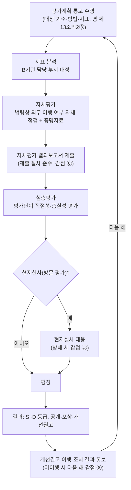

# 4주차-02. 보호수준 평가 제도와 지표

| 구분 | 내용 |
|---|---|
| 고객사 | B기관(공공) |
| 관련 산출물 | `./deliverables/06_보호수준평가_증빙_관리표.md` |
| 선행 챕터 | 4주차-01. 공공기관 연간 컨설팅 캘린더 |
| 예상 학습 시간 | 2.5시간 (읽기 1.5시간 + 실습 1시간) |

---

## 1. 학습 목표

1. 개인정보 보호수준 평가의 근거 조문, 평가 대상, 평가 기준, 평가 방법을 설명할 수 있다.
2. 2026년 평가 지표 구조(정량·정성·가점·감점, 배점, 등급)를 설명하고 B기관에 적용할 수 있다.
3. 평가 결과에 따른 후속 절차(결과 공개, 포상, 개선권고와 조치 결과 통보)를 연간 업무와 연결할 수 있다.

---

## 2. 현장 비유와 기초 개념

> 🏗️ **현장 비유**: 보호수준 평가는 **공공기관의 개인정보 보호 성적표**다. 시험지(평가계획·지표)는 매년 미리 나눠 주고, 스스로 채점(자체평가)한 답안지를 외부 채점관(평가단)이 다시 보고(심층평가), 필요하면 교실까지 찾아온다(현지실사).

> 📌 **기초 개념 짚기**
> 보호위원회는 공공기관 중 중앙행정기관과 그 소속기관, 지방자치단체, 그 밖에 대통령령으로 정하는 기관을 대상으로 **매년** 개인정보 보호 정책·업무의 수행과 법 의무 준수 여부를 평가한다. 결과는 공개할 수 있고, 우수기관은 포상, 필요하면 개선을 권고하며, 권고받은 기관은 조치 결과를 알려야 한다.
> - 근거: 「개인정보 보호법」 제11조의2[^law]

CPPG 범위에서는 거의 다루지 않는 제도입니다. 공공 컨설팅에서는 **1년 업무의 결과가 이 평가로 점수화**되므로, 지표 구조를 알아야 연간 컨설팅의 우선순위를 정할 수 있습니다.

---

## 3. 근거 법령·기준

### 3-1. 법령

| 근거 | 요지 | 쉬운 풀이 | 출처 |
|---|---|---|---|
| 법 제11조의2제1항 | 중앙행정기관·소속기관, 지자체, 대통령령으로 정하는 기관을 **매년** 평가 | B기관은 대상인지 먼저 확인 | [^law] |
| 영 제13조의2제1항 | 대통령령으로 정하는 기관: ① 「공공기관의 운영에 관한 법률」 제4조 공공기관 ② 지방공사·지방공단 ③ 보호위원회가 고시하는 기준에 해당하는 공공기관 | B기관(공운법상 공공기관)은 ①에 해당 | [^dec] |
| 영 제13조의2제2항 | 평가 기준 5가지: ① 정책·업무 수행실적과 개선 정도 ② 관리체계의 적정성 ③ 정보주체 권리보장 조치·이행 ④ 침해방지·안전성 확보조치 이행 ⑤ 그 밖의 필요한 조치 준수 | 지표 분야와 연결됨 | [^dec] |
| 영 제13조의2제3항 | 평가 전에 평가대상·기준·방법·**평가지표**를 포함한 평가계획을 평가대상기관에 통보 | 지표의 세부 내용은 평가계획으로 확인 | [^dec] |
| 영 제13조의2제4항 | 전문가를 포함한 **평가단** 구성·운영 가능 | 2026년 평가단 100명 | [^dec] [^lvl] |
| 영 제13조의2제5항 | 제출 요구 자료: ① 자체 점검 결과와 증명자료 ② 증명자료 검증에 필요한 자료 ③ 그 밖에 필요한 자료 | 자체평가 결과 + 증빙 | [^dec] |
| 영 제13조의2제6항 | 제출 자료 기준 평가 또는 기관 **방문** 평가 | 현지실사 대비 | [^dec] |
| 영 제13조의2제7항 | 중앙행정기관·지자체의 장에게 소관 평가대상기관의 평가 준비·결과 조치 지원 요청 가능 | 주무부처 지원 가능성 | [^dec] |
| 영 제13조의2제8항 | 세부 사항은 보호위원회 고시 | 고시 원문은 별도 확인 | [^dec] |
| 법 제11조의2제3항·제4항 | 결과 공개 가능, 우수기관 포상, **개선권고** → 이행 노력, 조치 결과 통보 | 다음 해 감점 ⑧과 연결 | [^law] |

### 3-2. 2026년 평가 개요 (보도자료 붙임1)

| 항목 | 내용 |
|---|---|
| 법적 근거 | 개인정보보호법 제11조의2 |
| 평가 대상 | 총 1,458개 기관: 중앙부처 51, 소속기관 453, 지자체 241, 공공기관 340, 지방공기업 167, 시·도교육청 16 및 교육지원청 176, 학교·특수법인 10, 공공시스템 운영기관 4 |
| 평가 방법 | **자체평가**(법령상 의무사항 이행 여부를 기관이 스스로 점검) + **심층평가**(외부 전문가 평가단이 업무수행의 적절성·충실성 평가) |
| 평가 결과 | S·A·B·C·D 5개 등급 — S 90점 이상, A 90~80점, B 80~70점, C 70~60점, D 60점 미만 |
| 평가단 | 100명, 2026.8.24. 위촉. 현지실사, 결과 평정, 우수·미흡 사례 발굴, 평가기준·지표 개선 자문 |

출처: [^lvl]

### 3-3. 2026년 평가 지표

**정량 지표 (자체평가, 40개 · 50점)**

| 분야 | 평가 항목 | 지표 수 |
|---|---|---|
| 개인정보 관리체계 (5개) | 1. 개인정보 책임자의 역할 수행 | 2 |
| | 2. 개인정보 영향평가 수행 등 | 3 |
| 정보주체 권리보장 (7개) | 4. 개인정보 처리방침 및 열람·정정·삭제·처리정지 등 | 3 |
| | 5. 수집·이용과 제공 | 4 |
| 개인정보 안전조치 (28개) | 6. 접근권한 관리 및 접속기록 점검 | 8 |
| | 7. 개인정보 침해사고 방지조치 및 대응 절차 | 11 |
| | 8. 암호화 조치 | 5 |
| | 9. 영상정보처리기기 운영 | 4 |

> ⚠️ **확인 필요**: 보도자료 지표표의 평가 항목 번호는 1·2·4·5… 순서로 **3번이 없습니다**(원문 표기 그대로). 지표 수 합계는 40개로 맞습니다.

**정성 지표 (심층평가, 6개 · 50점)** — 분야: 개인정보 중점관리 업무

| 평가 항목 | 배점 |
|---|---|
| 1. 개인정보보호 인력·조직 및 예산 | 10점 |
| 2. 개인정보처리시스템 및 파일 관리의 적절성 | 10점 |
| 3. 개인정보 보호 활동 확대를 위한 기관장 노력 | 10점 |
| 4. 개인정보 처리 및 정보주체 권리 보장의 적절성 | 5점 |
| 5. 개인정보 처리업무 위·수탁의 적절성 및 사후관리 | 5점 |
| 6. 개인정보 유출 등 사고 예방과 대응 노력 | 10점 |

**기타 지표**

| 구분 | 항목 | 배점 |
|---|---|---|
| 가점 | AI 등 신기술 환경에서 개인정보의 안전한 활용 및 리스크 관리 | 최대 10점 |
| 감점 ① | 개인정보 유출 등 사고 발생 | 건당 최대 -20점 |
| 감점 ② | 유출등사고가 아닌 기타 개인정보 관련 사건·사고 발생 | 건당 최대 -10점 |
| 감점 ③ | 유출등사고 대응조치 미흡 | 건당 최대 -5점 |
| 감점 ④ | 과징금·과태료·시정명령·시정권고·공표(명령)·개선권고 등 | 건당 최대 -5점 |
| 감점 ⑤ | 공정한 평가를 방해하는 행위 (유출신고 고의 누락, 현지실사 방해 등) | 최대 -20점 |
| 감점 ⑥ | 자체평가 결과보고서 제출 절차 미준수 | 최대 -5점 |
| 감점 ⑦ | 개인정보처리시스템 선정 기준 미준수 | 최대 -5점 |
| 감점 ⑧ | 전년도 보호수준 평가 결과 개선권고 미이행 | 최대 -20점 |

출처: [^lvl]

---

## 4. 컨설팅 수행 절차



### 영 제13조의2제2항 평가 기준 ↔ 2026 지표 분야 대응

| 평가 기준 (영) | 대응되는 2026 지표 분야·항목 |
|---|---|
| ① 정책·업무 수행실적과 개선 정도 | 정성 1·3 (인력·조직·예산, 기관장 노력), 감점 ⑧ |
| ② 관리체계의 적정성 | 정량 관리체계(1·2), 정성 2 |
| ③ 정보주체 권리보장 | 정량 정보주체 권리보장(4·5), 정성 4 |
| ④ 침해방지·안전성 확보조치 | 정량 안전조치(6~9), 정성 6, 감점 ①~③ |
| ⑤ 그 밖의 준수 | 정성 5 (위·수탁), 감점 ④~⑦ |

> 위 대응표는 평가 기준과 지표 분야의 이름을 맞춰 본 **학습용 정리**입니다. 공식 대응 관계는 평가계획으로 확인합니다.

### 단계별 설명 (컨설팅 관점)

| 단계 | 하는 일 | 입력 자료 | 결과물 | 소요 (예시) |
|---|---|---|---|---|
| 1. 지표 분석 | 평가계획의 지표를 증빙 관리표로 옮김 | 평가계획 공문 | 증빙 관리표 A·B표 | 2~3일 |
| 2. 담당 배정 | 지표별 B기관 담당 부서 지정 지원 | 조직도 | 담당 배정표 | 1일 |
| 3. 감점 사전 점검 | 감점 ①~⑧ 해당 사실 확인 | 사고·처분·개선권고 이력 | D표·E표 | 1일 |
| 4. 증빙 지원 | 4주차-03 | — | — | — |

### Windows 11 실무 도구 팁

| 작업 | 도구·경로 | 방법 |
|---|---|---|
| 배점 시뮬레이션 | Excel | 정량 50 + 정성 50 + 가점 − 감점 합계, 등급 구간 `=IFS(점수>=90,"S",점수>=80,"A",점수>=70,"B",점수>=60,"C",TRUE,"D")` |
| 평가계획 공문 지표 추출 | 공문 PDF → Edge로 열기 → 표 복사 → Excel `텍스트 나누기` | 증빙 관리표로 옮김 |

> 등급 구간의 경계값(예: 정확히 80점) 처리는 보도자료 표기("90점~80점")만으로는 명확하지 않으므로 평가계획으로 확인합니다.

---

## 5. 업무 분담표

| 단계 | 🙋 신입 담당 | 🧑‍💼 PM·선임 담당 | 🏢 B기관 담당 |
|---|---|---|---|
| 지표 분석 | 지표 목록·배점 정리, 증빙 관리표 작성 | 지표 해석, 대응 전략 | 평가계획 공유 |
| 담당 배정 | 지표별 담당 부서 후보 | 배정 조정 | 부서 지정·통보 |
| 감점 점검 | 사고·처분·개선권고 이력 자료 정리 | 감점 위험 판단 | 사실 확인 |
| 결과 후속 | 개선권고 이행 관리표 | 이행 전략 | 조치·결과 통보 |

> 🚫 **신입이 혼자 결정하지 않는 것**: 자체평가 점수 산정, 감점 해당 여부 판단, B기관을 대신한 자료 제출

---

## 6. 고객 커뮤니케이션 예시

### 6-1. 지표 담당 부서 배정 요청 메일

```text
제목: [B기관 보호수준 평가] 2027년 평가 지표별 담당 부서 지정 요청

○○○ 주무관님, 안녕하세요. ○○컨설팅 홍길동입니다.

보내 주신 2027년 평가계획을 바탕으로 지표별 담당 부서 후보를 정리했습니다(첨부).
부서 지정이 확정되면, 지표별 증빙 작성 일정과 검토 일정을 안내드리겠습니다.

■ 우선 확인이 필요한 사항
 1. 2026년 개선권고 2건의 조치 결과를 보호위원회에 알리셨는지 (미이행 시 감점 ⑧, 최대 -20점)
 2. 2026년 중 개인정보 유출 등 사고, 과태료·개선권고 등 처분 이력 유무 (감점 ①~④)
```

### 6-2. 결과 설명 멘트 (PM 확정 후, B기관 CPO 대상)

> "평가는 정량 50점과 정성 50점으로 나뉘는데, 정성 지표는 6개 항목에 평가단이 직접 '얼마나 충실했는지'를 봅니다. 그래서 문서를 갖추는 것만으로는 점수가 잘 나오지 않고, 실제로 무엇을 했고 그 결과 무엇이 바뀌었는지가 증빙에 드러나야 합니다. 또 감점 항목 중 '전년도 개선권고 미이행'이 최대 20점이라, 작년 개선권고 2건의 조치 결과 회신부터 이번 주 안에 처리하시는 것을 권해 드립니다."

---

## 7. 처분 사례: 메타, 정당한 사유 없는 열람 거절 (2024.11. 의결)

| 구분 | 내용 |
|---|---|
| 사건 개요 | 메타는 이용자의 개인정보 열람 요구(개인정보를 처리한 기간, 페이스북 로그인을 통한 제공 현황, 외부활동 정보 수집 근거·동의 내역 등)를 보호법상 열람 대상이 아니라는 이유 등으로 거절함. 보호위원회는 시행령 제41조제1항이 보유·이용 기간, 제3자 제공 현황, 처리에 동의한 사실·내용을 열람 대상으로 정하고 있어 정당한 사유가 없다고 판단함. |
| 위반 조항 | 개인정보의 열람 §35③ (민감정보 처리 제한 §23①, 안전조치의무 §29와 함께, 舊 보호법 기준) |
| 처분·결과 | 과징금 216억 1,300만 원, 과태료 1,020만 원, 시정명령 (이용자 열람 요구에 성실히 응할 것 등) |
| 출처 | 2024.11.5. 보도자료 「개인정보위, 합법 처리근거 없이 민감정보를 수집·활용한 메타 제재」, 2024.11.4. 의결[^meta] |

**컨설팅 시사점**

- 보호수준 평가 정량 지표 "4. 개인정보 처리방침 및 열람·정정·삭제·처리정지 등"과 정성 지표 "4. 개인정보 처리 및 정보주체 권리 보장의 적절성"은 **권리 행사 요구를 실제로 어떻게 처리했는지**를 보는 항목입니다. B기관의 열람 요구 처리 대장에 "거절" 건이 있으면, 거절 사유가 법령상 정당한지 확인합니다.
- 처분을 받으면 그 자체가 감점 ④ 대상이 될 수 있습니다.

---

## 8. 오답노트

| ❌ 신입의 실수 | ✅ 올바른 수행 | 근거 |
|---|---|---|
| 지난해 지표로 올해 증빙 준비를 시작함 | 올해 평가계획의 지표로 증빙 관리표를 다시 만듦 | 영 제13조의2제3항[^dec] |
| "정량 지표만 잘하면 된다"고 안내 | 정성 50점은 평가단이 적절성·충실성을 보므로 실행 결과·후속조치까지 증빙 | 2026 평가 개요[^lvl] |
| 전년도 개선권고 조치 결과 통보를 확인하지 않음 | 연간 착수 첫 주에 확인 (감점 ⑧ 최대 -20점) | 법 제11조의2제4항[^law], 지표[^lvl] |
| 유출 사고를 평가 기간에 "보고 미루기"를 제안 | 유출 신고 고의 누락은 "공정한 평가 방해" 감점 ⑤ 대상이며 법 위반. 법정 기한대로 신고·통지 | 지표 감점 ⑤[^lvl], 법 제34조 |
| 보도자료 지표표 번호를 임의로 1~8로 다시 매김 | 원문 번호(1·2·4·5…)를 그대로 쓰고, 이상한 점은 ⚠️로 표시 | 원문 확인 원칙 |
| 컨설팅사가 B기관 이름으로 자체평가 결과를 제출 | 제출 주체는 평가대상기관. 컨설턴트는 검토·지원 | 영 제13조의2제5항[^dec] |

---

## 9. 고객사 점검용 체크리스트: 평가 대비 기본 사항

| No | 점검 항목 | 확인 방법 | 요청 증적 | 판정 기준 |
|---|---|---|---|---|
| 1 | B기관이 평가 대상임을 근거와 함께 확인했다 | 문서 | 기관 유형 근거, 평가계획 공문 | 🟢 확인 · 🔴 미확인 |
| 2 | 올해 평가계획(지표 포함)을 수령해 증빙 관리표로 옮겼다 | 문서 | 평가계획, 증빙 관리표 | 🟢 완료 · 🟡 진행 중 · 🔴 미수령 |
| 3 | 지표별 담당 부서가 지정되었다 | 문서 | 담당 배정표 | 🟢 전 지표 · 🟡 일부 · 🔴 없음 |
| 4 | 전년도 개선권고 조치 결과를 보호위원회에 알렸다 | 문서 | 조치 결과 통보 공문 | 🟢 통보 · 🔴 미통보 · ⚪ 개선권고 없음 |
| 5 | 감점 ①~⑧ 해당 사실 유무를 확인했다 | 문서·인터뷰 | 사고·처분 이력 | 🟢 확인 · 🔴 미확인 |
| 6 | 정보주체 권리 행사(열람 등) 처리 대장과 거절 사유가 관리된다 | 문서 | 처리 대장 | 🟢 관리·사유 적정 · 🟡 대장만 · 🔴 없음 |

---

## 10. 실무 산출물 연계 팁

| 이 챕터의 결과 | 들어가는 산출물 | 위치 |
|---|---|---|
| 지표 구조·배점 | `./deliverables/06_보호수준평가_증빙_관리표.md` | 평가 구조 표, A·B·C표 |
| 감점 사전 점검 | 같은 관리표 | D표 |
| 전년도 개선권고 | 같은 관리표 | E표 |
| 지표별 담당 배정 | 연간 캘린더 | 4주차-01 보호수준 평가 구간 |

---

## 11. 실습 과제 / 퀴즈

> 정답과 해설은 [answers_and_explanations.md](../../answers_and_explanations.md)의 **「4주차-02. 보호수준 평가 제도와 지표」** 절에 있습니다.

### 객관식

**Q1.** 시행령 제13조의2제1항에 따라 보호수준 평가 대상이 되는 "대통령령으로 정하는 기관"이 **아닌** 것은?

① 「공공기관의 운영에 관한 법률」 제4조에 따른 공공기관
② 「지방공기업법」에 따른 지방공사와 지방공단
③ 보호위원회가 고시하는 기준에 해당하는 공공기관
④ ISMS-P 인증을 받은 민간기업

**Q2.** 2026년 보호수준 평가 지표에 대한 설명으로 옳은 것은?

① 정량 지표 40개 50점, 정성 지표 6개 50점으로 구성된다.
② 정성 지표는 기관이 스스로 점수를 매긴다.
③ 가점은 최대 20점이다.
④ 등급은 A~E 5개다.

**Q3.** 다음 중 2026년 감점 항목 가운데 **최대 감점이 가장 큰 그룹**으로 옳게 묶은 것은?

① 자체평가 결과보고서 제출 절차 미준수, 개인정보처리시스템 선정 기준 미준수
② 개인정보 유출 등 사고 발생(건당), 공정한 평가를 방해하는 행위, 전년도 개선권고 미이행
③ 유출등사고 대응조치 미흡(건당), 과징금·과태료 등(건당)
④ 기타 개인정보 관련 사건·사고(건당), 자체평가 결과보고서 제출 절차 미준수

### 실습

**상황**: B기관이 받은 평가계획을 아직 공유받지 못한 상태다. 보도자료 기준으로 사전 준비를 하라.

**제공 자료**

```text
[B기관 2026년 현황]
- 2025년 평가 결과: C등급, 개선권고 1건(수탁사 관리·감독 미흡) → 조치 결과 통보 안 함
- 2026년 사건: 3월 직원 실수로 민원인 3명 개인정보 오발송(유출 신고·통지 완료), 6월 과태료 처분 없음
- 열람 요구 처리 대장: 2026년 42건 중 거절 3건(사유 "내부 규정상 불가")
- 수탁사 점검: 2026년 하반기 미실시
- AI 챗봇 민원 서비스 시범 운영 중 (개인정보 처리 여부 미검토)
```

**과제**

1. `./deliverables/06_보호수준평가_증빙_관리표.md` D표(감점 사전 점검)와 E표(전년도 개선권고)를 작성하시오.
2. 정성 지표 6개 중 B기관이 가장 취약해 보이는 2개를 고르고, 위 현황에서 근거를 들어 설명하시오.
3. 가점 항목과 관련해 B기관에 확인할 질문 3개를 쓰시오.

**작성 양식**: `./deliverables/06_보호수준평가_증빙_관리표.md` D·E표

---

## 12. 더 읽을거리

| 자료 | references 파일명 | 읽을 부분 |
|---|---|---|
| 2026 보호수준 평가단 위촉 보도자료 | [`[260824 15시보도] 2026년 공공기관 개인정보 보호수준 평가단 위촉(자율보호정책과)_최종.pdf`](<../../references/[260824 15시보도] 2026년 공공기관 개인정보 보호수준 평가단 위촉(자율보호정책과)_최종.pdf>) | 전문, 붙임1·2 |
| 개인정보 보호법 | [`개인정보 보호법(법률)(제21445호)(20260911).pdf`](<../../references/개인정보 보호법(법률)(제21445호)(20260911).pdf>) | 제11조의2 |
| 개인정보 보호법 시행령 | [`개인정보 보호법 시행령(대통령령)(제36804호)(20261110).pdf`](<../../references/개인정보 보호법 시행령(대통령령)(제36804호)(20261110).pdf>) | 제13조의2 |
| 메타 처분 보도자료 | [`241105 (석간) 개인정보위  합법 처리근거 없이 민감정보를 수집·활용한 메타 제재(조사1과).pdf`](<../../references/241105 (석간) 개인정보위  합법 처리근거 없이 민감정보를 수집·활용한 메타 제재(조사1과).pdf>) | 정당한 사유 없는 개인정보 열람 거절 |

---

## 각주

[^law]: [출처: [개인정보 보호법(법률)(제21445호)(20260911).pdf](<../../references/개인정보 보호법(법률)(제21445호)(20260911).pdf>), 제11조의2]
[^dec]: [출처: [개인정보 보호법 시행령(대통령령)(제36804호)(20261110).pdf](<../../references/개인정보 보호법 시행령(대통령령)(제36804호)(20261110).pdf>), 제13조의2]
[^lvl]: [출처: [\[260824 15시보도\] 2026년 공공기관 개인정보 보호수준 평가단 위촉(자율보호정책과)_최종.pdf](<../../references/[260824 15시보도] 2026년 공공기관 개인정보 보호수준 평가단 위촉(자율보호정책과)_최종.pdf>), p.1~3, 붙임1 '2026년 공공기관 개인정보 보호수준 평가 개요']
[^meta]: [출처: [241105 (석간) 개인정보위  합법 처리근거 없이 민감정보를 수집·활용한 메타 제재(조사1과).pdf](<../../references/241105 (석간) 개인정보위  합법 처리근거 없이 민감정보를 수집·활용한 메타 제재(조사1과).pdf>), p.1~2, 2024.11.4. 의결]
