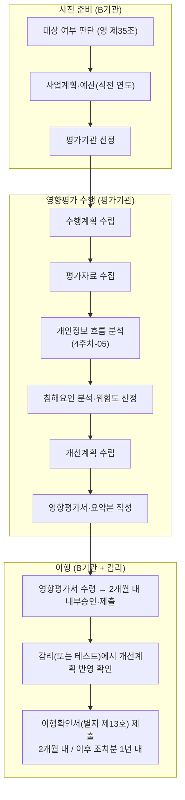

# 4주차-04. 영향평가 개요와 보조 업무

| 구분 | 내용 |
|---|---|
| 고객사 | B기관(공공, 차세대 지원금 포털 구축) |
| 관련 산출물 | 영향평가 이행 점검표(이 챕터 9절), `./deliverables/07_개인정보_흐름표.md` (4주차-05) |
| 선행 챕터 | 4주차-01. 공공기관 연간 컨설팅 캘린더 |
| 예상 학습 시간 | 3.5시간 (읽기 2시간 + 실습 1.5시간) |

> ⚠️ 이 챕터는 영향평가의 **보조 업무**만 다룹니다. 위험도 산정, 개선계획 확정, 영향평가서 작성 책임은 영향평가 수행인력 자격을 갖춘 선임이 맡습니다.

---

## 1. 학습 목표

1. 영향평가 대상(시행령 제35조), 수행 주체, 절차(사전 준비 → 수행 → 이행)와 법정 기한을 설명할 수 있다.
2. 영향평가에서 신입이 맡는 보조 업무와 맡지 않는 업무를 구분할 수 있다.
3. 영향평가 개선사항 이행 점검표를 정리하고 이행확인서(고시 별지 제13호서식) 초안을 준비할 수 있다.

---

## 2. 현장 비유와 기초 개념

> 🏗️ **현장 비유**: 영향평가는 **건물 설계 단계의 안전 심의**다. 다 지은 뒤 벽을 허무는 것보다 설계도에서 비상구를 고치는 것이 훨씬 싸다. 그래서 "설계 완료 전"에 한다.

> 📌 **기초 개념 짚기**
> 공공기관의 장은 일정 기준에 해당하는 개인정보파일의 운용으로 정보주체의 개인정보 침해가 우려되는 경우 위험요인 분석과 개선 사항 도출을 위한 영향평가를 하고, 결과를 보호위원회에 제출해야 한다. 영향평가는 보호위원회가 지정한 **평가기관에 의뢰**해야 한다.
> - 근거: 「개인정보 보호법」 제33조제1항·제2항[^law33], 시행령 제35조[^dec]

CPPG 시험에서는 영향평가 대상 기준(5만·50만·100만)을 외웠습니다. 현장의 신입은 **평가팀의 손발**로서 자료를 모으고, 흐름을 정리하고, 개선사항이 실제로 반영됐는지 추적하는 일을 합니다.

---

## 3. 근거 법령·기준

| 근거 | 요지 | 쉬운 풀이 (현장에서 확인할 것) | 출처 |
|---|---|---|---|
| 영 제35조 | 대상: ① 5만 명 이상 **민감정보 또는 고유식별정보** 처리 파일 ② 연계 결과 **50만 명** 이상 ③ **100만 명** 이상 파일 ④ 영향평가 후 운용체계 변경 시 변경 부분 | B기관 차세대 포털(120만 명, 주민등록번호)은 ①·③ 검토 대상 | [^dec] |
| 법 제33조제2항 · 영향평가 고시 제3조·제5조·제6조 | 지정 평가기관에 의뢰. 평가기관 유효기간 3년. 수행인력은 일반·고급 수행인력, 전문교육 이수·전문인력 인증서 필요 | 우리 회사가 지정 평가기관이고, 인증서 있는 인력이 수행 | [^law33] [^pia] |
| 영향평가 고시 제9조 | 사전 준비(사업계획·예산·평가기관 선정) → 수행(침해요인 분석·개선계획·영향평가서) → 이행(개선계획 반영 점검) | 3단계 | [^pia] |
| 영향평가 고시 제9조의2 | **설계 완료 전** 수행, 결과를 반영한 조치 이행 | 사업 일정과 맞춤 | [^pia] |
| 영향평가 고시 제9조의3 | 개선계획 반영 여부를 **정보시스템 감리 시** 확인, 감리 없으면 **테스트 단계**에서 확인 | 이행 점검 시점 | [^pia] |
| 영향평가 고시 제10조·제11조, 별표 5 | 평가영역 5개·평가분야 29개. 1년 이내 다른 시스템 영향평가를 받았으면 대상기관 관리체계 평가 생략 가능, 1년 이내 평가받고 변경 없는 항목 제외 | 평가항목 선정의 기준 | [^pia] [^pia5] |
| 영 제38조제2항 | 영향평가서 내용: ① 대상·범위 ② 평가 분야·항목 ③ 위험요인 분석·평가 ④ 조치 내용·개선계획 ⑤ 결과 ⑥ 요약 | 영향평가서 목차 | [^dec] |
| 영향평가 고시 제12조 | 영향평가서를 받은 날부터 **2개월 이내** 내부승인 후 영향평가서·요약본 제출. 개선사항 이행결과·계획은 별지 제13호서식으로 같은 기간 내, 이후 조치분은 **1년 이내** | 이행 관리 기한 | [^pia] |
| 영향평가 고시 제12조의2 | 요약본 공개 가능 (비공개 대상 정보 확인) | 요약본에 시스템 구조 상세·접근통제 방식 등 노출 금지 | [^pia] [^piag18] |
| 수행안내서 | 평가기관의 평가수행 인력은 반드시 **상주**, 품질관리 담당자는 비상주 가능 | 투입 계획 | [^piag28] |

---

## 4. 컨설팅 수행 절차



### 신입의 보조 업무 범위

| 단계 | 🙋 신입이 맡는 보조 업무 | 🚫 신입이 맡지 않는 업무 |
|---|---|---|
| 수행계획 | 일정표·참석자 연락처, 자료 요청 목록 초안 | 평가 범위·평가항목 확정 |
| 평가자료 수집 | 사업계획서·RFP·요구사항 정의서·ERD·테이블 정의서·화면 설계서·시스템 구조도 요청·정리 (수행안내서 p.34 목록) | 자료의 적정성 최종 판단 |
| 흐름 분석 | 인터뷰 회의록, 처리업무표·흐름표·흐름도 **초안** | 영향도 등급 확정 |
| 침해요인 분석 | 평가항목별 확인 결과(사실·근거·증적) 정리 | **위험도 산정, 침해요인 확정** |
| 개선계획 | 개선계획표 서식 정리, 담당·일정 칸 채우기 | **개선 방안 결정** |
| 영향평가서 | 표·부록 편집, 오탈자·각주 검수, 요약본 비공개 정보 1차 표시 | 본문 작성 책임, 결과 판단 |
| 이행 | **이행 점검표 정리, 이행확인서 초안, 기한 관리** | 이행 여부 최종 확인 서명 |

> 근거: 영향평가 수행인력 자격·인증서 요건(고시 제5조·제6조)[^pia]

### 단계별 설명 (보조 업무 중심)

| 단계 | 하는 일 | 입력 자료 | 결과물 | 소요 (예시) |
|---|---|---|---|---|
| 1. 자료 수집 | 수행안내서 자료 목록 기준으로 요청·정리 | 사업 산출물 | 자료 목록·보관 | 1주 |
| 2. 인터뷰 보조 | 개발·운영·현업 담당자 인터뷰 회의록 | 질문지 | 회의록 | 1~2주 |
| 3. 항목 확인 정리 | 별표 5 평가분야별 확인 결과를 사실·근거·증적으로 | 평가항목표 | 확인 결과표 | 1~2주 |
| 4. 문서 편집 | 영향평가서 표·부록, 요약본 비공개 정보 표시 | 초안 | 편집본 | 1주 |
| 5. 이행 관리 | 개선과제별 이행 점검표, 이행확인서 초안 | 영향평가서 개선계획 | 이행 점검표 | 수개월 |

### Windows 11 실무 도구 팁

| 작업 | 도구·경로 | 방법 |
|---|---|---|
| 기한 계산 | Excel | 제출: `=EDATE(영향평가서수령일,2)` / 이행결과: `=EDATE(영향평가서수령일,12)` |
| 요약본 비공개 정보 찾기 | Word → `Ctrl + H` 찾기 → "IP", "VPN", "방화벽", "암호화 알고리즘", "구조도" | 공개 전 삭제·일반화 후보 표시 (최종 판단은 PM·B기관) |
| 대용량 산출물 관리 | 파일 탐색기 → 폴더 우클릭 → 속성 → 고급 → 내용 암호화 (EFS, 기관 정책 허용 시) | 평가 자료 보안 보관. 기관 보안 정책 우선 |

---

## 5. 업무 분담표

| 단계 | 🙋 신입 담당 | 🧑‍💼 PM·선임(영향평가 수행인력) 담당 | 🏢 B기관 담당 |
|---|---|---|---|
| 사전 준비 | — | 제안·수행계획 | 대상 판단, 예산, 평가기관 선정 |
| 자료·인터뷰 | 자료 요청·정리, 회의록 | 인터뷰 진행, 범위 확정 | 자료 제공, 담당자 지정 |
| 분석·평가 | 흐름표 초안, 항목별 확인 결과 정리 | **침해요인·위험도·개선계획 확정** | 사실 확인 |
| 영향평가서 | 편집·검수, 요약본 비공개 정보 표시 | 작성 책임 | 내부승인, 2개월 내 제출 |
| 이행 | 이행 점검표, 이행확인서 초안, 기한 알림 | 이행 검토 | 개선 조치, 감리 확인, 이행확인서 제출 |

> 🚫 **신입이 혼자 결정하지 않는 것**: 영향평가 대상 여부, 위험도·영향도 점수, 개선계획, 요약본 공개 범위

---

## 6. 고객 커뮤니케이션 예시

### 6-1. 평가자료 요청 메일 (평가기관 명의, PM 검토 후 발송)

```text
제목: [B기관 차세대 포털 개인정보 영향평가] 평가자료 요청 (2027-03-19까지)

○○○ 사무관님, 안녕하세요. ○○컨설팅 영향평가팀 홍길동입니다.

영향평가 수행계획에 따라 평가자료를 요청드립니다.

■ 사업 설명자료: 사업추진계획서, 제안요청서(RFP), 요구사항 정의서
■ 외부 연계: 위탁계획서, 연계계획서, 인터페이스 정의서
■ 개발 산출물: 업무 흐름도, 기능 정의서, ERD, 테이블 정의서, 화면 설계서, 메뉴 구조도, 시스템 구조도
■ 관리체계: 개인정보 보호 관련 규정, 내부 관리계획, 개인정보파일 등록 현황

※ 시스템 구조도 등 보안 자료는 보안 USB 또는 기관 지정 방식으로 전달 부탁드립니다.
```

### 6-2. 이행 점검 결과 설명 멘트 (PM 확정 후, 사업 담당자 대상)

> "영향평가 개선과제 18건 중 감리에서 반영이 확인된 것은 14건입니다. 남은 4건 중 2건은 오픈 전 테스트 단계에서 확인할 예정이고, 2건(접속기록 자동 분석, 수탁사 관리·감독 절차)은 오픈 이후 조치 예정이라 이행확인서에 '이행계획'으로 적어 제출하시고, 조치가 끝나면 영향평가서를 받으신 날부터 1년 안에 이행결과를 제출하셔야 합니다."

---

## 7. 처분 사례: ㈜카카오 오픈채팅 (2024.5. 의결) — 설계 단계의 개인정보 침해 가능성

| 구분 | 내용 |
|---|---|
| 사건 개요 | 카카오는 익명채팅으로 홍보한 오픈채팅을 일반채팅과 **같은 회원일련번호로 식별**하도록 구현했고, 일부 오픈채팅방은 임시ID를 암호화하지 않았거나 암호화를 해제해 노출하는 취약점이 있어 회원일련번호를 쉽게 확인할 수 있었음. 해커가 이를 이용해 이용자 정보를 결합한 개인정보 파일을 만들어 판매함. |
| 위반 조항 | 안전조치의무(§29), 유출 신고·통지 의무(§39의4①) (舊 보호법 기준) |
| 처분·결과 | 과징금 151억 4,196만 원, 과태료 780만 원, 시정명령, 결과 공표 |
| 출처 | 2024.5.23. 보도자료 「개인정보위, ㈜카카오에 과징금 151억 원, 과태료 780만 원 부과」, 2024.5.22. 의결[^kakao] |

**컨설팅 시사점**

- 보호위원회는 이 처분을 계기로 "**설계·개발 과정에서 발생할 수 있는 개인정보 침해 가능성**에 대해서도 지속적인 점검과 노력이 필수적"이라고 밝혔습니다. 영향평가를 **설계 완료 전**에 하는 이유와 같습니다.
- 흐름 분석 때 "식별자(회원번호 등)가 서로 다른 서비스 사이에서 연결되는가"를 확인 질문에 넣습니다.

---

## 8. 오답노트

| ❌ 신입의 실수 | ✅ 올바른 수행 | 근거 |
|---|---|---|
| 차세대 시스템 개발이 끝난 뒤 영향평가를 하면 된다고 안내 | 설계 완료 전 수행, 결과를 설계·개발에 반영 | 고시 제9조의2[^pia] |
| 신입이 침해요인의 위험도 점수를 매겨 보고서에 넣음 | 확인 결과(사실·근거·증적)만 정리하고 위험도는 수행인력이 산정 | 고시 제5조·제6조 (수행인력 자격)[^pia] |
| 영향평가서 제출 후 이행 관리를 종료 | 감리·테스트 단계 반영 확인, 이행확인서 2개월·1년 기한 관리 | 고시 제9조의3, 제12조[^pia] |
| 요약본에 시스템 구조도와 접근통제 방식을 그대로 넣음 | 비공개 대상 정보(시스템 구조도 상세, 접근통제 방식, 암호화 세부사항 등) 여부 확인 후 공개 | 수행안내서 p.18[^piag18] |
| "120만 명이니 100만 명 기준(③)만 해당"이라고 정리 | 주민등록번호(고유식별정보) 5만 명 이상 기준(①)도 함께 검토해 근거를 모두 적음 | 영 제35조[^dec] |
| 1년 이내 다른 시스템 영향평가를 받았는데도 대상기관 관리체계 평가를 전부 다시 계획 | 고시 제10조 단서(생략 가능), 제11조(변경 없는 항목 제외)를 PM에 보고 | 고시 제10조·제11조[^pia] |

---

## 9. 고객사 점검용 체크리스트: 영향평가 이행 점검표

| No | 점검 항목 | 확인 방법 | 요청 증적 | 판정 기준 |
|---|---|---|---|---|
| 1 | 영향평가 대상 여부가 영 제35조 근거로 판단되어 사업계획에 반영되었다 | 문서 | 사업계획서 | 🟢 반영 · 🔴 미반영 |
| 2 | 영향평가가 설계 완료 전에 수행되었다 | 문서 | 영향평가 일정, 설계 완료일 | 🟢 설계 완료 전 · 🔴 이후 |
| 3 | 영향평가서를 받은 날부터 2개월 이내 내부승인·제출했다 | 문서 | 수령일, 제출 기록 | 🟢 기한 내 · 🔴 지연 |
| 4 | 개선과제별 반영 여부를 감리(또는 테스트)에서 확인했다 | 문서 | 감리 보고서, 테스트 결과 | 🟢 전 과제 · 🟡 일부 · 🔴 미확인 |
| 5 | 이행확인서(별지 제13호서식)를 기한 내 제출했다 | 문서 | 이행확인서, 제출 기록 | 🟢 기한 내 · 🟡 일부 · 🔴 미제출 · ⚪ 개선과제 없음 |
| 6 | 2개월 이후 조치분의 이행결과를 1년 이내 제출할 계획이 있다 | 문서 | 이행 계획 | 🟢 있음 · 🔴 없음 · ⚪ 해당 없음 |
| 7 | 영향평가 결과를 개인정보파일 등록 시 첨부했다 | 문서 | 파일 등록 내역 | 🟢 첨부 · 🔴 미첨부 |
| 8 | 요약본 공개 시 비공개 대상 정보를 확인했다 | 문서 | 요약본, 검토 기록 | 🟢 확인 · 🔴 미확인 · ⚪ 미공개 |

### 이행확인서 정리 양식 (고시 별지 제13호서식 열 구성)

| 평가영역 | 개선과제명 | 개선요구내용 | 이행계획(또는 결과) | 완료일(또는 예정일) | 담당자 확인 |
|---|---|---|---|---|---|
| | | | | | |

출처: [^piag86]

---

## 10. 실무 산출물 연계 팁

| 이 챕터의 결과 | 들어가는 산출물 | 위치 |
|---|---|---|
| 평가자료 목록 | 영향평가 수행계획서 | 자료 목록 |
| 인터뷰 회의록·흐름표 초안 | 영향평가서 | 개인정보 흐름 분석 장 (4주차-05) |
| 항목별 확인 결과 | 영향평가서 | 평가항목별 결과 |
| 이행 점검표·이행확인서 초안 | B기관 제출 서류 | 별지 제13호서식 |
| 영향평가 이행 현황 | 보호수준 평가 증빙 후보 | 정량 2 "개인정보 영향평가 수행 등" |

---

## 11. 실습 과제 / 퀴즈

> 정답과 해설은 [answers_and_explanations.md](../../answers_and_explanations.md)의 **「4주차-04. 영향평가 개요와 보조 업무」** 절에 있습니다.

### 객관식

**Q1.** 시행령 제35조에 따른 영향평가 대상 개인정보파일이 **아닌** 것은?

① 5만 명 이상의 정보주체에 관한 민감정보 또는 고유식별정보 처리가 수반되는 파일
② 다른 파일과 연계한 결과 50만 명 이상의 정보주체에 관한 개인정보가 포함되는 파일
③ 100만 명 이상의 정보주체에 관한 개인정보파일
④ 1만 명 이상의 정보주체에 관한 이메일 주소만 있는 파일

**Q2.** 영향평가 개선계획의 반영 여부를 확인하는 시점으로 고시에 정한 것은?

① 시스템 오픈 1년 후
② 정보시스템 감리 시 (감리를 하지 않으면 테스트 단계)
③ 보호수준 평가 현지실사 때
④ 영향평가서 작성 전

**Q3.** 영향평가에서 신입 컨설턴트가 맡기에 적절한 업무는?

① 침해요인별 위험도 산정
② 개선 방안 최종 결정
③ 개선과제별 이행 점검표 정리와 이행확인서 초안 작성
④ 영향평가서 결과에 대한 최종 서명

### 실습

**상황**: B기관 차세대 지원금 포털 영향평가가 끝났다. 이행 점검표와 이행확인서 초안을 정리하라.

**제공 자료**

```text
[사업 정보]
- 정보주체 약 120만 명, 주민등록번호·계좌번호 처리, 감리 대상 사업
- 영향평가서 수령일: 2027-06-30 / 설계 완료: 2027-07-15 / 감리: 2027-10 / 오픈: 2027-11-15

[영향평가 개선과제 (평가팀 확정)]
1. (대상시스템 기술적 보호조치) 관리자 페이지 외부 접속 시 OTP 적용
2. (접속기록) 대량 조회·다운로드 자동 탐지 규칙 적용
3. (수집) 신청서의 불필요한 '가족관계' 항목 삭제
4. (위탁) 콜센터 수탁사 위탁 계약서에 재위탁 제한·감독 조항 추가
5. (파기) 보유기간 경과 신청 데이터 자동 파기 배치 구현

[감리 결과 (2027-10)]
- 1, 3, 5 반영 확인 / 2 미반영(오픈 후 2028-02 예정) / 4 계약 변경 협의 중(2027-12 예정)
```

**과제**

1. 영향평가 대상 근거(영 제35조 해당 호)를 모두 쓰시오.
2. 법정 기한 3개(영향평가서 제출, 이행결과 1차 제출, 이후 조치분 제출 기한)를 날짜로 계산하시오.
3. 9절 이행확인서 양식으로 5개 과제를 정리하시오. (완료·예정 구분)

**작성 양식**: 9절 이행 점검표·이행확인서 양식

---

## 12. 더 읽을거리

| 자료 | references 파일명 | 읽을 부분 |
|---|---|---|
| 개인정보 영향평가 수행안내서 | [`개인정보 영향평가 수행안내서(25.10.).pdf`](<../../references/개인정보 영향평가 수행안내서(25.10.).pdf>) | p.10~18 (총론·절차 요약), p.21~33 (사전 준비·수행계획·자료 수집), p.57~75 (침해요인·개선계획·영향평가서), p.86~87 (이행) |
| 개인정보 영향평가에 관한 고시 | [`개인정보 영향평가에 관한 고시(개인정보보호위원회고시)(제2025-7호)(20250905).pdf`](<../../references/개인정보 영향평가에 관한 고시(개인정보보호위원회고시)(제2025-7호)(20250905).pdf>) | 제5조, 제6조, 제9조~제12조의2 |
| 영향평가 고시 별표 5 | [`[별표 5] 개인정보 영향평가의 평가영역 및 평가분야 (제9조~제11조 관련)(개인정보 영향평가에 관한 고시).pdf`](<../../references/[별표 5] 개인정보 영향평가의 평가영역 및 평가분야 (제9조~제11조 관련)(개인정보 영향평가에 관한 고시).pdf>) | 전문 |
| 카카오 처분 보도자료 | [`240523 (석간) 개인정보위, ㈜카카오에 과징금 151억 원, 과태료 780만 원 부과(조사2과) FN.pdf`](<../../references/240523 (석간) 개인정보위, ㈜카카오에 과징금 151억 원, 과태료 780만 원 부과(조사2과) FN.pdf>) | 전문 |

---

## 각주

[^law33]: [출처: [개인정보 보호법(법률)(제21445호)(20260911).pdf](<../../references/개인정보 보호법(법률)(제21445호)(20260911).pdf>), 제33조]
[^dec]: [출처: [개인정보 보호법 시행령(대통령령)(제36804호)(20261110).pdf](<../../references/개인정보 보호법 시행령(대통령령)(제36804호)(20261110).pdf>), 제35조, 제38조]
[^pia]: [출처: [개인정보 영향평가에 관한 고시(개인정보보호위원회고시)(제2025-7호)(20250905).pdf](<../../references/개인정보 영향평가에 관한 고시(개인정보보호위원회고시)(제2025-7호)(20250905).pdf>), 제3조, 제5조, 제6조, 제9조~제12조의2]
[^pia5]: [출처: [\[별표 5\] 개인정보 영향평가의 평가영역 및 평가분야 (제9조~제11조 관련)(개인정보 영향평가에 관한 고시).pdf](<../../references/[별표 5] 개인정보 영향평가의 평가영역 및 평가분야 (제9조~제11조 관련)(개인정보 영향평가에 관한 고시).pdf>)]
[^piag18]: [출처: [개인정보 영향평가 수행안내서(25.10.).pdf](<../../references/개인정보 영향평가 수행안내서(25.10.).pdf>), p.18 '영향평가 수행 절차 요약' (요약본 비공개 대상 정보)]
[^piag28]: [출처: [개인정보 영향평가 수행안내서(25.10.).pdf](<../../references/개인정보 영향평가 수행안내서(25.10.).pdf>), p.28 (평가수행 인력 상주)]
[^piag86]: [출처: [개인정보 영향평가 수행안내서(25.10.).pdf](<../../references/개인정보 영향평가 수행안내서(25.10.).pdf>), p.86~87 '이행단계', 이행확인서 양식(고시 별지 제13호서식)]
[^kakao]: [출처: [240523 (석간) 개인정보위, ㈜카카오에 과징금 151억 원, 과태료 780만 원 부과(조사2과) FN.pdf](<../../references/240523 (석간) 개인정보위, ㈜카카오에 과징금 151억 원, 과태료 780만 원 부과(조사2과) FN.pdf>), p.1~3, 2024.5.22. 의결]
