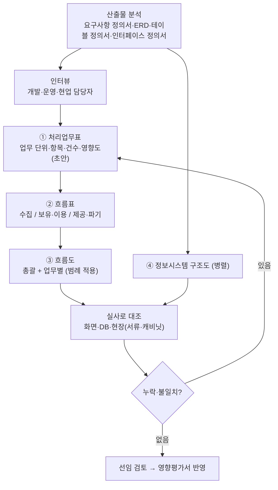
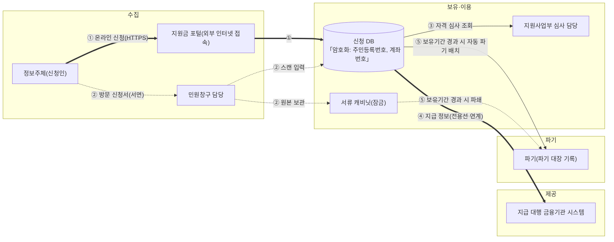

# 4주차-05. 개인정보 흐름표와 흐름도 작성

| 구분 | 내용 |
|---|---|
| 고객사 | B기관(공공, 차세대 지원금 포털 영향평가) |
| 관련 산출물 | `./deliverables/07_개인정보_흐름표.md` |
| 선행 챕터 | 4주차-04. 영향평가 개요와 보조 업무 · 3주차-05 (ISMS-P 1.2.2와 같은 양식) |
| 예상 학습 시간 | 4시간 (읽기 1시간 + 실습 3시간) |

---

## 1. 학습 목표

1. 영향평가 흐름 분석 4단계(처리업무 분석 → 흐름표 → 흐름도 → 정보시스템 구조도)의 순서와 산출물을 설명할 수 있다.
2. 수행안내서 양식에 맞춰 처리업무표와 수집·보유이용·제공파기 흐름표를 작성할 수 있다.
3. 수행안내서 범례 규칙에 따라 업무별 개인정보 흐름도 초안을 그리고, 실제 처리와 대조해 누락을 찾을 수 있다.

---

## 2. 현장 비유와 기초 개념

> 🏗️ **현장 비유**: 흐름표는 **택배 송장 목록**(무엇이, 어디서, 어디로, 어떻게)이고, 흐름도는 **배송 경로 지도**다. 송장 목록 없이 지도를 그리면 빠진 경로를 알아챌 수 없다. 그래서 반드시 표 → 그림 순서로 만든다.

> 📌 **기초 개념 짚기**
> 개인정보 생명주기(Life-Cycle)는 통상 수집 → 보유 → 이용·제공 → 파기의 4단계로 구분한다. 처리란 수집·생성·연계·연동·기록·저장·보유·가공·편집·검색·출력·정정·복구·이용·제공·공개·파기 등을 말한다.
> - 근거: 「개인정보 보호법」 제2조제2호[^law2], 영향평가 수행안내서 p.41[^p41]

CPPG에서 배운 "처리 단계별 의무"를 **한 업무의 실제 데이터 이동**에 적용하는 연습입니다. 신입이 가장 많이 받는 영향평가 보조 업무이며, ISMS-P 1.2.2 증적에도 같은 양식을 씁니다.[^ig122]

---

## 3. 근거 법령·기준

| 근거 | 요지 | 쉬운 풀이 (현장에서 확인할 것) | 출처 |
|---|---|---|---|
| 수행안내서 3. 개인정보 흐름 분석 | ① 처리업무 분석(영향도 등급표, 처리업무표, 업무 흐름도) ② 흐름표 ③ 흐름도 ④ 정보시스템 구조도. 산출물: 영향도 등급표, 처리업무표, 처리업무 흐름도, 흐름표, 흐름도, 정보시스템 구조도 | 4단계 순서를 지킴. 구조도는 병렬 진행 가능 | [^p34] |
| 수행안내서 p.35 | 제시된 양식은 예시이며 평가기관 방법론에 따라 추가·변형 가능. 단, 단계별 기본 절차는 준수 | 양식 변형은 PM 승인 | [^p35] |
| 수행안내서 3.1 | 인터뷰 대상에 개발·운영 담당자와 현장 업무담당자 포함. 운영 중 시스템은 실사로 정합성·누락 검증 (업무 현장 + 화면·DB) | 흐름표는 인터뷰 + 실사로 검증 | [^p36] |
| 수행안내서 p.37~39 | 처리업무표: 평가업무명 / 처리 목적 / 처리 개인정보 / 주관부서 / 건수(고유식별정보 수) / 영향도. 유사 항목은 대표화하지 말고 구분, 중복 제거 건수, 신규는 1년 내 예상 건수 | 양식: `./deliverables/07_개인정보_흐름표.md` B표 | [^p37] |
| 수행안내서 p.42~46 | 수집 흐름표(동의 없이 / 동의받아 구분, 근거·목적·항목·경로·대상·주기·담당), 보유·이용 흐름표(보유 형태·암호화 항목·이용 목적·항목·취급자·방법), 제공·파기 흐름표(목적·제공자·수신자·정보·방법·주기·암호화·근거·보유기간·파기담당·절차·분리보관) | 동의 없이 수집은 **법령 조항**을 구체적으로 | [^p42] |
| 수행안내서 p.49~54 | 총괄 흐름도와 업무별 흐름도를 함께 작성. 범례: 온라인 **실선**, 오프라인 **점선**, 암호화 수단 **붉은 굵은 선**, 외부 인터넷 접속 시스템은 내부와 다른 색, 캐비닛 등 오프라인 저장소 점선, 암호화 보관 항목 박스 표시, 전달 개인정보 항목은 숫자로 표시하고 우측에 목록. 좌측 생명주기, 상단 업무명·취급자·부서·정보주체, 하단 업무흐름 설명·우려사항 | 업무별로 **별도의 상세 흐름도** 필요 | [^p49] |
| 수행안내서 p.55 | 정보시스템 구조도는 비공개로 처리하더라도 구조·정보보호 현황 분석은 충실히 | 요약본 공개 시 비공개 | [^p55] |

---

## 4. 컨설팅 수행 절차



### 업무별 흐름도 예시: B기관 "지원금 신청 접수" (가상)

> 아래는 Mermaid로 그린 **예시**입니다. 수행안내서 범례의 "붉은 굵은 선(암호화 수단)"은 여기서 **굵은 선(`==>`)**으로, 오프라인 흐름은 **점선(`-.->`)**으로 표시했습니다. 숫자 ①~⑤는 우측 항목 목록과 대응합니다.



| 번호 | 전달 개인정보 항목 (예) |
|---|---|
| ① | 성명, 주민등록번호, 휴대전화번호, 주소, 계좌번호 |
| ② | 성명, 주민등록번호, 주소, 서명 (신청서) |
| ③ | 성명, 소득 구간, 심사 결과 |
| ④ | 성명, 계좌번호, 지급액 |
| ⑤ | 신청 정보 전체 |

**하단 설명 (예)**: 온라인 신청은 HTTPS로 전송되고 주민등록번호·계좌번호는 암호화 저장됨. 방문 신청서는 스캔 후 원본을 캐비닛에 보관함.
**우려사항 (예)**: 방문 신청서 원본 보관기간과 파쇄 기록 관리 여부 확인 필요. 심사 담당자 조회 화면의 주민등록번호 마스킹 여부 확인 필요.

> 위 흐름도의 처리 방식·보호조치는 학습용 가상 예시입니다. 실제 영향평가에서는 B기관 산출물과 실사로 확인한 사실만 그립니다.

### 흐름 분석 체크포인트 (누락이 잦은 곳)

| 체크포인트 | 확인 질문 |
|---|---|
| 자동 생성 정보 | 처리 과정에서 자동 생성·수집되는 항목(접속 로그, 처리 이력)을 흐름표에 적었는가?[^p42] |
| 오프라인 흐름 | 서면 신청서, 팩스, 우편, 캐비닛 보관을 점선으로 그렸는가?[^p49] |
| 연계·연동 | 다른 기관·시스템에서 받아 오는 수집 경로(제공받음·연계)를 적었는가? |
| 테스트·개발 환경 | 운영 데이터가 개발·테스트로 복사되는가? |
| 다운로드·출력 | 취급자가 엑셀로 내려받아 PC에 저장하는 흐름이 있는가? |
| 제공 범위 | 제공 대상자 범위가 목적에 필요한 정보주체로 한정되는가? (7절 사례) |
| 파기·분리보관 | 법령에 따라 보관하는 정보를 분리 보관하는가?[^p42] |

### 단계별 설명

| 단계 | 하는 일 | 입력 자료 | 결과물 | 소요 (예시) |
|---|---|---|---|---|
| 1. 산출물 분석 | 요구사항·ERD·테이블·인터페이스 정의서에서 개인정보 항목·흐름 추출 | 개발 산출물 | 항목 목록 | 2~3일 |
| 2. 인터뷰 | 업무별 실제 처리 방식 확인 | 질문지 | 회의록 | 3~5일 |
| 3. 처리업무표 | 업무 단위·항목·건수·영향도 초안 | 1·2 결과 | 처리업무표 | 1일 |
| 4. 흐름표 | 3종 흐름표 | 처리업무표 | 흐름표 | 2~3일 |
| 5. 흐름도 | 총괄·업무별 흐름도 | 흐름표 | 흐름도 | 2~3일 |
| 6. 실사 대조 | 화면·DB·현장으로 검증 | 흐름표·흐름도 | 수정본 | 1~2일 |

### Windows 11 실무 도구 팁

| 작업 | 도구·경로 | 방법 |
|---|---|---|
| 테이블 정의서에서 개인정보 컬럼 찾기 | Excel → 필터 → 텍스트 필터 → 포함 "주민", "phone", "addr", "birth", "acct" | 컬럼명 규칙에 맞게 키워드 조정 |
| 흐름도 그리기 | PowerPoint (도형 + 연결선: 실선·점선·굵기) 또는 Visio | 범례를 슬라이드 첫 장에 고정 |
| 흐름도 버전 비교 | PowerPoint → 검토 → 비교 | 현행화 전후 변경점 확인 |
| 항목 번호 목록 자동화 | Excel `=TEXTJOIN(", ",TRUE,범위)` | 흐름 번호별 전달 항목 목록 생성 |

---

## 5. 업무 분담표

| 단계 | 🙋 신입 담당 | 🧑‍💼 PM·선임(수행인력) 담당 | 🏢 B기관 담당 |
|---|---|---|---|
| 산출물 분석 | 개인정보 항목·흐름 추출 | 범위 확인 | 산출물 제공 |
| 인터뷰 | 질문지 초안, 회의록 | 인터뷰 진행 | 담당자 참석 |
| 처리업무표 | 초안 (항목·건수) | **영향도 확정** | 건수 확인 |
| 흐름표·흐름도 | 초안 작성, 범례 적용 | 검토·보완 | 사실 확인 |
| 실사 대조 | 화면·현장 확인 기록 | 실사 진행 | 시스템 시연, 현장 안내 |

> 🚫 **신입이 혼자 결정하지 않는 것**: 영향도 등급, 평가업무 단위 확정, 흐름도에 "우려사항"으로 적을 침해요인 판단(초안 제안은 가능)

---

## 6. 고객 커뮤니케이션 예시

### 6-1. 흐름 확인 인터뷰 질문 리스트 (지원사업부·정보화팀)

| No | 질문 | 질문 의도 | 확인할 자료 |
|---|---|---|---|
| 1 | 신청은 온라인 말고 어떤 경로로도 받나요? (방문, 우편, 팩스) | 오프라인 수집 경로 | 신청서 양식, 접수 대장 |
| 2 | 신청 자격 확인을 위해 다른 기관 시스템과 연계하나요? 어떤 항목을 주고받나요? | 연계·연동 흐름 | 인터페이스 정의서 |
| 3 | 심사 담당자는 화면에서 어떤 항목을 보고, 엑셀로 내려받을 수 있나요? | 이용·다운로드 흐름 | 심사 화면, 다운로드 권한 |
| 4 | 지급 대행 기관에는 어떤 방식으로, 얼마나 자주 보내나요? 암호화하나요? | 제공 방법·주기·암호화 | 연계 계획서 |
| 5 | 보유기간이 지나면 시스템 데이터와 종이 신청서는 각각 어떻게 파기하나요? | 파기 절차·분리보관 | 파기 절차서, 파기 대장 |
| 6 | 개발·테스트 서버에 운영 데이터가 들어가나요? | 테스트 환경 흐름 | 테스트 데이터 정책 |

### 6-2. 결과 설명 멘트 (실무 담당자 대상)

> "흐름표와 흐름도 초안을 보내 드립니다. 산출물과 인터뷰 내용으로 그렸기 때문에, 실제와 다른 부분을 꼭 표시해 주세요. 특히 방문 신청서 처리 흐름(점선)과 심사 담당자 다운로드 흐름은 산출물에 없던 내용이라 확인이 필요합니다. 다음 주 실사 때 화면과 서류 보관 장소를 함께 보면서 최종 확정하겠습니다."

---

## 7. 처분 사례: 카카오페이, 목적에 필요한 범위를 넘은 전체 이용자 정보 전송 (2025.1. 의결)

| 구분 | 내용 |
|---|---|
| 사건 개요 | 카카오페이 전체 이용자 중 애플에 카카오페이를 결제수단으로 등록한 이용자는 **20% 미만**이었으나, 카카오페이는 애플 미이용자를 포함한 **전체 이용자(약 4천만 명)**의 정보를 동의 없이 매일 알리페이로 전송함(누적 약 542억 건). 이용자는 자신의 정보가 국외로 이전·처리된다는 사실을 알기 어려웠음. |
| 위반 내용 | 적법 처리 근거 없는 국외이전 (보도자료 기준) |
| 처분·결과 | 카카오페이 과징금 59억 6,800만 원, 시정명령, 공표명령 |
| 출처 | 2025.1.23. 보도자료 「개인정보위, 개인정보 무단 국외 이전한 카카오페이·애플에 총 83억 7,520만 원 과징금·과태료 부과」, 2025.1.22. 의결[^kp] |

**컨설팅 시사점**

- 제공·파기 흐름표의 "제공 정보"와 "수신자"만 적지 말고, **"누구의 정보를 보내는가(대상 범위)"**를 함께 확인합니다. 목적에 필요한 정보주체보다 넓은 범위를 보내는 흐름은 흐름도 하단 "우려사항"에 적을 후보입니다.
- 매일 자동 전송되는 연계는 산출물에 "배치"로만 적혀 있는 경우가 많습니다. 인터페이스 정의서의 **추출 조건**을 확인합니다.

---

## 8. 오답노트

| ❌ 신입의 실수 | ✅ 올바른 수행 | 근거 |
|---|---|---|
| 흐름표 없이 흐름도부터 그림 | 처리업무표 → 흐름표 → 흐름도 순서 | 수행안내서 흐름 분석 4단계[^p34] |
| "주소, 수급자주소, 자택주소"를 "주소"로 묶음 | 의미가 다르면 구분해 기재, 같은 뜻이면 한 용어로 통일 | 수행안내서 p.38[^p37] |
| 동의 없이 수집하는 항목의 근거를 "관련 법령"으로만 씀 | 법령명과 조항을 구체적으로 | 수행안내서 p.42~43[^p42] |
| 온라인 흐름만 그리고 서면·팩스·캐비닛을 뺌 | 오프라인 흐름·저장소는 점선으로 표시 | 수행안내서 p.50~53[^p49] |
| 총괄 흐름도 하나로 모든 업무를 대신함 | 업무별로 별도의 상세 흐름도 작성 | 수행안내서 p.54[^p49] |
| 산출물만 보고 흐름도를 확정 | 인터뷰·실사로 정합성과 누락 검증 | 수행안내서 3.1[^p36] |
| 건수에 중복을 포함하거나 신규 사업 건수를 비워 둠 | 중복 제거 건수, 신규는 1년 내 예상 건수 | 수행안내서 p.38[^p37] |

---

## 9. 고객사 점검용 체크리스트: 흐름 분석 산출물 품질

| No | 점검 항목 | 확인 방법 | 요청 증적 | 판정 기준 |
|---|---|---|---|---|
| 1 | 처리업무표가 업무 단위로 작성되고 항목·건수·영향도가 있다 | 문서 | 처리업무표 | 🟢 완비 · 🟡 일부 빈칸 · 🔴 없음 |
| 2 | 수집 흐름표가 동의 없이 / 동의받아 구분되고 법적 근거가 구체적이다 | 문서 | 수집 흐름표 | 🟢 구분·조항 · 🟡 구분만 · 🔴 구분 없음 |
| 3 | 보유·이용 흐름표에 보유 형태·암호화 항목·취급자가 있다 | 문서 | 보유·이용 흐름표 | 🟢 완비 · 🟡 일부 · 🔴 없음 |
| 4 | 제공·파기 흐름표에 수신자·방법·암호화·근거·보유기간·파기 절차·분리보관이 있다 | 문서 | 제공·파기 흐름표 | 🟢 완비 · 🟡 일부 · 🔴 없음 |
| 5 | 총괄 흐름도와 업무별 흐름도가 모두 있다 | 문서 | 흐름도 | 🟢 모두 · 🟡 총괄만 · 🔴 없음 |
| 6 | 범례(온라인·오프라인·암호화·외부 접속 시스템)가 일관되게 적용되었다 | 문서 | 흐름도 | 🟢 일관 · 🟡 일부 · 🔴 범례 없음 |
| 7 | 흐름표·흐름도가 실사 결과와 일치한다 | 문서·시스템·현장 | 실사 기록 | 🟢 일치 · 🟡 일부 불일치 · 🔴 다수 불일치 |

---

## 10. 실무 산출물 연계 팁

| 이 챕터의 결과 | 들어가는 산출물 | 위치 |
|---|---|---|
| 처리업무표·흐름표 | `./deliverables/07_개인정보_흐름표.md` → 영향평가서 | 개인정보 흐름 분석 장 |
| 흐름도 (총괄·업무별) | 영향평가서 | 개인정보 흐름 분석 장 |
| 흐름도 우려사항 | 침해요인 분석 (선임) | 침해요인 후보 |
| 처리업무표 | 개인정보파일 등록사항 확인 | 표준지침 제52조 등록 항목과 대조 |
| 같은 양식 | ISMS-P 1.2.2 증적, 보호수준 평가 정성 2 증빙 후보 | 3주차-05, 4주차-03 |

---

## 11. 실습 과제 / 퀴즈

> 정답과 해설은 [answers_and_explanations.md](../../answers_and_explanations.md)의 **「4주차-05. 개인정보 흐름표와 흐름도 작성」** 절에 있습니다.

### 객관식

**Q1.** 영향평가 수행안내서의 개인정보 흐름 분석 순서로 옳은 것은?

① 흐름도 → 흐름표 → 처리업무 분석
② 처리업무 분석 → 흐름표 → 흐름도 (정보시스템 구조도는 병렬 가능)
③ 정보시스템 구조도 → 흐름도 → 처리업무 분석
④ 흐름표 → 처리업무 분석 → 흐름도

**Q2.** 수행안내서 흐름도 범례 설명으로 옳지 **않은** 것은?

① 온라인 흐름은 실선, 오프라인 흐름은 점선으로 구분한다.
② 암호화된 수단을 사용하는 경우 선을 붉은색으로 굵게 표시한다.
③ 캐비닛 등 오프라인 저장소는 점선으로 구분한다.
④ 총괄 흐름도가 있으면 업무별 흐름도는 작성하지 않는다.

**Q3.** 처리업무표의 "개인정보 건수" 작성 방법으로 옳은 것은?

① 중복을 포함한 전체 레코드 수를 쓴다.
② 중복을 제거한 건수를 쓰고, 고유식별정보가 있으면 괄호에 그 개수를 추가로 쓴다.
③ 신규 사업은 건수를 비워 둔다.
④ 가장 적은 항목 기준으로 쓴다.

### 실습

**상황**: B기관 차세대 포털 "긴급지원 신청" 업무의 인터뷰 결과다. 처리업무표·흐름표·흐름도를 작성하라.

**제공 자료**

```text
[긴급지원 신청 업무 인터뷰 결과]
- 신청: 포털 온라인(본인인증 후) 또는 주민센터 방문(종이 신청서) — 연간 약 3만 명 예상, 신규 사업
- 수집 항목: 성명, 주민등록번호, 휴대전화번호, 주소, 가구원 수, 소득 증빙(PDF 업로드), 계좌번호
- 근거: 주민등록번호·소득 정보는 {긴급지원 근거 법령 ○○조}에 따라 처리, 마케팅 알림 수신은 별도 동의
- 주민센터는 종이 신청서를 스캔해 포털에 대리 입력, 원본은 주민센터 캐비닛에 1년 보관
- 자격 확인: 소득 정보를 {연계 기관} 시스템과 실시간 조회 연계(전용선)
- 심사 담당 6명이 화면 조회, 엑셀 다운로드 가능(사유 입력 없음)
- 지급: 매주 금요일 성명·계좌번호·지급액을 지급 대행 금융기관에 전용선 파일 전송(암호화)
- DB: 주민등록번호·계좌번호 암호화, 소득 증빙 PDF는 파일 서버에 평문 저장
- 보유: 지급 완료 후 5년(근거 법령 확인 중), 이후 자동 파기 배치 예정
```

**과제**

1. `./deliverables/07_개인정보_흐름표.md` 양식으로 처리업무표와 3종 흐름표를 작성하시오. (근거 법령은 `{ }` 그대로 두어도 됨)
2. 4절 예시처럼 Mermaid로 업무별 흐름도를 그리시오. (모든 노드·라벨은 쌍따옴표, 온라인 실선·오프라인 점선·암호화 굵은 선, 번호와 항목 목록 포함)
3. 흐름도 하단에 적을 "우려사항" 후보 3개를 쓰시오. (침해요인 확정이 아니라 선임 검토용 후보)

**작성 양식**: `./deliverables/07_개인정보_흐름표.md`, 4절 흐름도 예시

---

## 12. 더 읽을거리

| 자료 | references 파일명 | 읽을 부분 |
|---|---|---|
| 개인정보 영향평가 수행안내서 | `개인정보 영향평가 수행안내서(25.10.).pdf` | p.34~56 '개인정보 흐름 분석' (예시: p.39 처리업무표, p.47~48 흐름표, p.51·54 흐름도) |
| ISMS-P 인증기준 안내서 | `ISMS-P 인증기준 안내서(2023.11.23).pdf` | 1.2.2 현황 및 흐름분석 (흐름표·흐름도 예시 인용) |
| 카카오페이·애플 처분 보도자료 | `250123 (석간) 개인정보위, 개인정보 무단 국외 이전한 카카오페이·애플에 총 83억 7,520만 원 과징금·과태료 부과(조사3팀).pdf` | 조사 결과 |

---

## 각주

[^law2]: [출처: 개인정보 보호법(법률)(제21445호)(20260911).pdf, 제2조제2호]
[^ig122]: [출처: ISMS-P 인증기준 안내서(2023.11.23).pdf, p.26~29, 1.2.2 현황 및 흐름분석]
[^p34]: [출처: 개인정보 영향평가 수행안내서(25.10.).pdf, p.34 '3. 개인정보 흐름 분석']
[^p35]: [출처: 개인정보 영향평가 수행안내서(25.10.).pdf, p.35]
[^p36]: [출처: 개인정보 영향평가 수행안내서(25.10.).pdf, p.36 '3.1 개인정보 처리업무 현황 분석']
[^p37]: [출처: 개인정보 영향평가 수행안내서(25.10.).pdf, p.37~39 '개인정보 처리 업무표']
[^p41]: [출처: 개인정보 영향평가 수행안내서(25.10.).pdf, p.41 '개인정보 생명주기(Life-Cycle)']
[^p42]: [출처: 개인정보 영향평가 수행안내서(25.10.).pdf, p.42~46 '개인정보 흐름표 양식']
[^p49]: [출처: 개인정보 영향평가 수행안내서(25.10.).pdf, p.49~54 '개인정보 흐름도 작성' (범례 설명)]
[^p55]: [출처: 개인정보 영향평가 수행안내서(25.10.).pdf, p.55 '정보시스템 구조도']
[^kp]: [출처: 250123 (석간) 개인정보위, 개인정보 무단 국외 이전한 카카오페이·애플에 총 83억 7,520만 원 과징금·과태료 부과(조사3팀).pdf, p.2~3, 2025.1.22. 의결]
