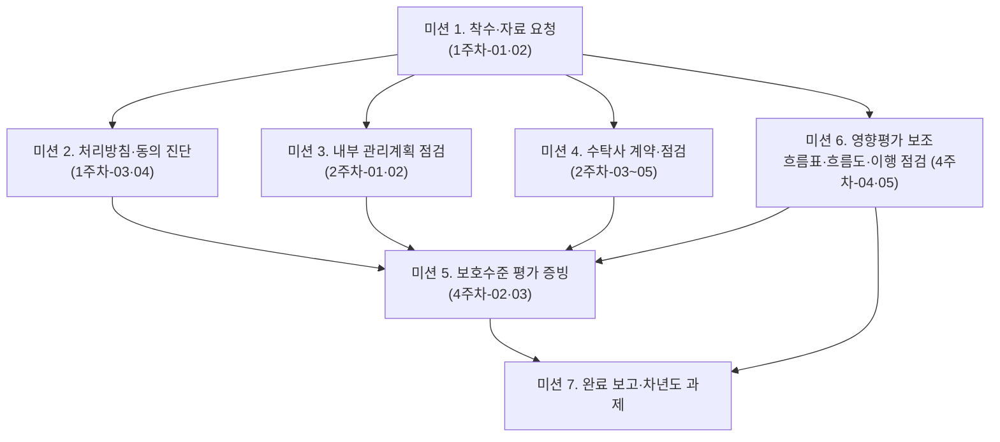
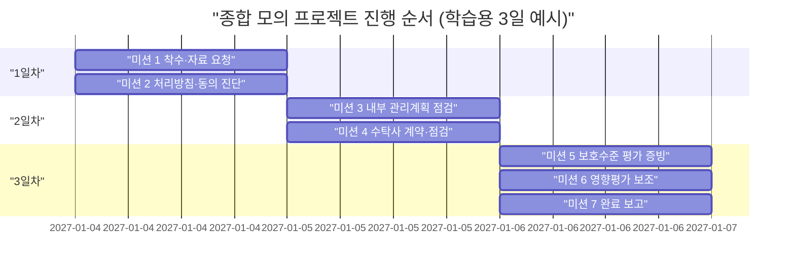

# 4주차-06. 종합 모의 프로젝트

| 구분 | 내용 |
|---|---|
| 고객사 | B기관(공공, 연간 정기 컨설팅) |
| 관련 산출물 | `./deliverables/01`~`07` 전부 |
| 선행 챕터 | 1~4주차 전체 |
| 예상 학습 시간 | 2~3일 (미션 7개) |

---

## 1. 학습 목표

1. B기관 연간 컨설팅을 착수부터 완료 보고까지 순서대로 수행하고, 단계마다 맞는 산출물 양식을 골라 쓸 수 있다.
2. 한 번 만든 산출물(처리방침 진단, 내부 관리계획 점검, 수탁사 점검, 흐름표)을 보호수준 평가 증빙과 영향평가 산출물로 재사용할 수 있다.
3. 단계마다 신입이 결정하지 않고 PM에게 넘겨야 할 판단을 구분해 보고할 수 있다.

---

## 2. 현장 비유와 기초 개념

> 🏗️ **현장 비유**: 종합 모의 프로젝트는 **운전면허 도로주행 시험**이다. 장내에서 하나씩 연습한 기능(1~4주차)을 실제 도로(B기관 1년)에서 순서대로, 끊김 없이 해내야 한다.

> 📌 **기초 개념 짚기**
> 공공기관은 민간 처리자의 의무(처리방침, 동의, 안전조치, 위탁 감독 등)에 더해 개인정보파일 등록, 영향평가, 보호수준 평가 의무가 있다. 공공기관의 처리방침은 **등록 대상 개인정보파일**에 대해 정한다.
> - 근거: 「개인정보 보호법」 제11조의2, 제30조제1항 후단, 제32조, 제33조[^law]

이 챕터에는 새 이론이 거의 없습니다. 지금까지 배운 것을 **한 고객사의 한 해**로 엮는 연습입니다.

---

## 3. 근거 법령·기준

미션별 근거는 각 챕터를 그대로 따릅니다. 아래는 공공기관 특유의 근거만 다시 모은 것입니다.

| 근거 | 요지 | 미션 | 출처 |
|---|---|---|---|
| 법 제30조제1항 후단 | 공공기관은 등록 대상 개인정보파일에 대해 처리방침을 정함 | 미션 2 | [^law] |
| 법 제32조, 영 제34조제1항 | 개인정보파일 등록, 운용 시작일부터 60일 이내 | 미션 1·6 | [^law] [^dec] |
| 영 제28조제3항제2호 | 위탁 공개: 홈페이지 게재가 어려우면 관보(공공기관) 등 | 미션 4 | [^dec] |
| 영 제13조의2 | 보호수준 평가 대상·기준·평가계획·자료 제출 | 미션 5 | [^dec] |
| 영 제35조, 영향평가 고시 제9조~제12조 | 영향평가 대상·절차·기한 | 미션 6 | [^dec] [^pia] |
| 안전성 기준 제4조, 제14조~제18조 | 내부 관리계획, 공공시스템운영기관 추가 조치(일부 2027.1.1. 시행) | 미션 3 | [^safe] |
| 작성지침 부록3 | 공공기관 개인정보 처리방침 작성 방안 및 예시 | 미션 2 | [^ppg147] |

---

## 4. 컨설팅 수행 절차





### 미션별 산출물

| 미션 | 산출물 | 양식 |
|---|---|---|
| 1 | 착수 확인 질문, 자료 요청 목록, PM 보고 메일 | 1주차-01 6절, `./deliverables/01_자료요청_목록.md` |
| 2 | 처리방침 진단표, 동의서 진단 결과표 | `./deliverables/02_처리방침_진단표.md`, 1주차-04 9절 |
| 3 | 18개 사항 매핑표, 이행 점검표 | 2주차-01 4절, 2주차-02 9절 |
| 4 | 계약서 검토표, 수탁사 0단계 등급표, 개선 요구 | 2주차-03 9절, `./deliverables/03_수탁사_점검_체크리스트.md` |
| 5 | 감점 사전 점검, 전년도 개선권고 이행, 증빙 검토 의견 | `./deliverables/06_보호수준평가_증빙_관리표.md` |
| 6 | 처리업무표·흐름표·흐름도, 이행확인서 초안 | `./deliverables/07_개인정보_흐름표.md`, 4주차-04 9절 |
| 7 | 완료 보고 요약, 차년도 과제, PM 확인 요청 목록 | 7절 양식 |

### Windows 11 실무 도구 팁

| 작업 | 도구·경로 | 방법 |
|---|---|---|
| 미션 폴더 생성 | PowerShell | `1..7 \| ForEach-Object { New-Item -ItemType Directory -Force "D:\B기관_모의\미션$_" }` |
| 산출물 재사용 추적 | Excel 시트 "재사용 지도": 산출물 / 원래 미션 / 재사용 미션 / 증적 ID | 미션 5에서 증빙 후보 찾기 |
| 최종 점검 | Word → 검토 → 맞춤법 검사, 탐색 창으로 제목 구조 확인 | 보고서 제출 전 |

---

## 5. 업무 분담표

| 미션 | 🙋 신입(나) | 🧑‍💼 PM(가상) | 🏢 B기관(가상) |
|---|---|---|---|
| 1 | 질문·자료 요청 목록·보고 메일 | 범위 확정 | 자료 제공 |
| 2 | 진단표·불일치 대조·개선안 초안 | 판정 확정 | 처리방침 개정 |
| 3 | 매핑·이행 점검표·판정 초안 | 판정 확정 | 개정·결재 |
| 4 | 검토표·등급표 사실 정보·개선 요구 초안 | 등급 기준·판정 | 수탁사 통보 |
| 5 | 감점 점검·증빙 검토 의견 | 감점 위험 판단 | 증빙 작성·제출 |
| 6 | 흐름표·흐름도 초안·이행 점검표 | 영향도·위험도·개선계획 | 감리·이행 |
| 7 | 보고서 표·부록, PM 확인 요청 목록 | 결론·우선순위 | 차년도 계획 승인 |

> 🚫 각 미션 결과물 끝에 **"PM 확인 요청 사항"**을 3개 이상 적습니다. 이번 프로젝트의 평가 기준 중 하나입니다.

---

## 6. 고객 커뮤니케이션 예시

### 6-1. 완료 보고 결과 설명 멘트 (PM 확정 후, B기관 CPO 대상, 예시)

> "올해 연간 컨설팅 결과를 세 줄로 말씀드리면, 첫째 처리방침과 실제 처리 현황의 차이 4건은 개정으로 해소되었고, 둘째 수탁사 12곳 점검에서 나온 미흡 9건 중 7건이 이행 확인되었으며, 셋째 차세대 포털 영향평가 개선과제 중 2건이 오픈 이후 조치 예정이라 내년 6월까지 이행결과를 제출하셔야 합니다. 보호수준 평가 증빙에 이 결과들을 그대로 쓰실 수 있도록 증적 목록을 함께 드렸습니다. 내년 착수 첫 주에는 올해 개선권고 이행 여부부터 확인하겠습니다."

### 6-2. 미션 중 PM 확인 요청 메일 (예시)

```text
제목: [B기관 모의] 미션 4 진행 중 PM 확인 요청 3건

PM님, 미션 4 진행 중 제가 판단하면 안 되는 사항이 있어 확인 요청드립니다.

1. 콜센터 수탁사의 야간 재위탁(C사) — B기관 동의 문서 없음. 개선 요구 수준(즉시 중단 요청 vs 동의 절차 진행) 판단 부탁드립니다.
2. 클라우드 D사 — 실질적 접근권한 여부 확인 전이라 수탁자 해당 여부 판단 보류했습니다.
3. 등급 기준 — 고유식별정보 처리 또는 10만 명 이상을 '상'으로 가정했습니다. 기준 확정 부탁드립니다.
```

---

## 7. 처분 사례: ㈜엘지유플러스 (2023.7. 의결) — 종합 관점

| 구분 | 내용 |
|---|---|
| 사건 개요 | 고객인증시스템 관리 부실로 개인정보 유출. 개발·검수기에 운영 데이터 방치, 접근권한·접속기록 관리 부실, 보유기간 경과 정보 미파기, 유출 통지 지연. 최근 3년 내 **수탁자 관리·감독 소홀** 등 처분 이력도 있었음. |
| 처분·결과 | 과징금 68억 원, 과태료 2,700만 원. **CPO 역할·위상 강화, 보호 조직 전문성 제고, 내부관리계획 재정립, 전반적 시스템 점검·취약요소 개선** 시정명령, 결과 공표 |
| 출처 | 2023.7.12. 보도자료 「개인정보위, ㈜엘지유플러스 개인정보 유출사고에 대해 과징금 68억 원, 과태료 2,700만 원 및 시정명령 부과」[^lgu] |

**컨설팅 시사점 (4주 학습 정리)**

| 처분 내용 | 이 레포에서 다룬 곳 |
|---|---|
| 개발·검수기 운영 데이터 방치 | 3주차-05 자산 식별, 4주차-05 흐름 분석 체크포인트 |
| 접근권한·접속기록 관리 부실 | 2주차-02 이행 점검, 3주차-06 결함 유형 |
| 보유기간 경과 정보 미파기 | 1주차-03 보유기간 대조, 4주차-05 제공·파기 흐름표 |
| 유출 통지 지연 | 2주차-01 유출사고 대응 계획, 4주차-01 연간 캘린더 |
| 수탁자 관리·감독 소홀 이력 | 2주차-04·05 수탁사 점검·이행 확인 |
| CPO·조직·내부관리계획 재정립 | 1주차-01 착수(관할 범위), 2주차-01 내부 관리계획 |

> 하나의 처분 사례가 4주 동안 배운 거의 모든 업무와 연결됩니다. 신입이 맡는 작은 확인 하나하나가 이런 사고를 막는 일입니다.

---

## 8. 오답노트 (종합 프로젝트에서 자주 하는 실수)

| ❌ 신입의 실수 | ✅ 올바른 수행 | 근거 |
|---|---|---|
| 미션마다 자료를 새로 요청해 B기관에 같은 자료를 여러 번 요구 | 미션 1에서 통합 자료 요청 목록을 만들고 증적 ID로 공유 | 1주차-02 |
| 공공기관 처리방침을 민간 기준(서비스 전체)으로만 진단 | 등록 대상 개인정보파일 기준으로 진단, 파일 등록 현황과 대조 | 법 제30조제1항 후단[^law] |
| 보호수준 평가 증빙을 평가 시즌에 처음부터 만듦 | 미션 2~4·6 산출물을 증빙 후보로 재사용 | 4주차-01·03 |
| 영향평가 개선과제 이행 관리를 완료 보고에서 빠뜨림 | 2개월·1년 기한까지 차년도 과제로 넘김 | 영향평가 고시 제12조[^pia] |
| 각 미션의 판정을 신입이 확정한 것처럼 보고서에 씀 | "판정(초안)"으로 표시하고 PM 확인 요청 사항을 함께 적음 | 업무 분담 원칙 |
| 가상 자료에 없는 사실(법령 조항, 평가 일정)을 지어내 채움 | 모르는 것은 `{ }`나 ⚠️ 확인 필요로 남김 | 레포 작성 원칙 |

---

## 9. 고객사 점검용 체크리스트: 연간 컨설팅 완료 점검 (자기 점검)

| No | 점검 항목 | 확인 방법 | 요청 증적 | 판정 기준 |
|---|---|---|---|---|
| 1 | 미션 1~7 산출물이 모두 정해진 양식으로 있다 | 문서 | 미션 폴더 | 🟢 7개 · 🟡 5~6개 · 🔴 4개 이하 |
| 2 | 모든 판정에 근거(조문·항목)와 증적 ID가 있다 | 문서 | 진단표·점검표 | 🟢 전부 · 🟡 일부 · 🔴 다수 없음 |
| 3 | 산출물 재사용 지도가 있고 보호수준 평가 증빙에 연결되었다 | 문서 | 재사용 지도, 증빙 관리표 | 🟢 연결 · 🔴 없음 |
| 4 | 기한이 있는 후속 과제(영향평가 이행결과, 파일 등록, 개선권고)가 차년도 계획에 있다 | 문서 | 차년도 과제 목록 | 🟢 반영 · 🔴 누락 |
| 5 | 각 미션에 PM 확인 요청 사항이 3개 이상 있다 | 문서 | 미션 결과물 | 🟢 전 미션 · 🟡 일부 · 🔴 없음 |
| 6 | 지어낸 사실 없이, 불확실한 내용이 표시되어 있다 | 문서 | 전 산출물 | 🟢 표시 · 🔴 단정 |

---

## 10. 실무 산출물 연계 팁

| 미션 산출물 | 연간 완료 보고서 위치 |
|---|---|
| 착수·범위 | 1장 '컨설팅 범위 및 제한사항' |
| 처리방침·동의 진단 | 2장 '정보주체 권리보장' |
| 내부 관리계획 점검 | 3장 '안전조치' |
| 수탁사 점검 | 4장 '위탁 관리' |
| 보호수준 평가 대응 | 5장 '보호수준 평가 대응 결과' |
| 영향평가 보조 | 6장 '영향평가 및 이행 관리' |
| 차년도 과제 | 7장 '차년도 개선 과제와 일정' (4주차-01 캘린더로 연결) |

---

## 11. 실습 과제 / 퀴즈

> 정답과 해설은 [answers_and_explanations.md](../../answers_and_explanations.md)의 **「4주차-06. 종합 모의 프로젝트」** 절에 있습니다.

### 객관식

**Q1.** 공공기관 처리방침 진단의 출발점으로 가장 적절한 자료는?

① 민간 쇼핑몰 처리방침 예시
② 등록 대상 개인정보파일 목록과 개인정보파일 등록 현황
③ 기관 홍보 책자
④ ISMS-P 인증서

**Q2.** 다음 중 보호수준 평가 증빙 후보로 **재사용하기 어려운** 것은?

① 결재 완료된 수탁사 점검 결과보고서와 이행 확인표
② 내부 관리계획 이행 실태 점검 결과(CPO 보고)
③ 처리방침 진단 후 개정·공개 기록
④ 결재 없는 컨설턴트 개인 메모

**Q3.** 종합 프로젝트 결과물에서 "PM 확인 요청 사항"으로 올려야 할 것은?

① 오탈자 수정 여부
② 수탁자 해당 여부가 애매한 클라우드 사업자의 판단
③ 파일명 규칙 적용 여부
④ 표 정렬 방식

### 실습 (종합 미션)

**상황**: 당신은 B기관 2027년 연간 컨설팅의 신입 컨설턴트다. 아래 자료 묶음으로 미션 1~7을 순서대로 수행하라.

**제공 자료 (B기관 자료 묶음, 가상)**

```text
[기관 개요]
- 「공공기관의 운영에 관한 법률」상 공공기관, 대국민 지원금 포털 운영, 이용자 약 120만 명
- CPO: 기획조정실장 / 개인정보 보호 담당: 정보보호팀 2명
- 2026년 보호수준 평가: C등급, 개선권고 2건(① 수탁사 관리·감독 미흡 ② 접속기록 점검 결과 보고 체계 미흡), 조치 결과 회신 안 함

[개인정보파일 등록 현황]
- 지원금 신청자 파일(등록), 민원 상담 파일(등록), 긴급지원 신청자 파일(2027-02-15 운용 시작 예정, 미등록)

[처리방침 (발췌)]
- 처리 파일: 지원금 신청자 파일, 민원 상담 파일
- 위탁: "콜센터 등"
- 국외 이전: 해당 없음
- 변경 이력: 2024-05 이후 없음

[내부 관리계획]
- 2023-03 원장 결재, 이후 개정 없음
- 접속기록 점검 월 1회 규정 / 2026년 실제 점검 결과서 5회분
- 수탁자 관리·감독 조항 없음
- 공공시스템운영기관 해당 여부: 미확인

[수탁사]
- 콜센터 B사(야간 재위탁 C사, 동의 문서 없음), 시스템 유지보수 J사(상주, 운영 DB 접근), 클라우드 D사(가상서버, 접근권한 여부 미확인), 문자 발송 E사
- 계약서: B사·J사는 2024-12-31 만료, 자동갱신 조항 없음, 계속 업무 중

[차세대 포털 영향평가]
- 2027-03 분석·설계 착수, 2027-07-15 설계 완료, 감리 대상
- 영향평가서 수령 예정 2027-06-30
- 개선과제 중 '수탁사 감독 절차 수립', '접속기록 자동 분석' 2건은 오픈 후 조치 예정

[2026년 사건]
- 2026-03 민원 회신 오발송 3명(신고·통지 완료)
```

**미션**

1. **착수·자료 요청**: 착수 확인 질문 6개와 자료 요청 목록(15행 이상)을 작성하고, PM 보고 메일을 쓰시오.
2. **처리방침 진단**: 처리방침 발췌를 진단표 A(해당 행)·C로 진단하시오. 등록 현황과의 대조를 반드시 포함할 것.
3. **내부 관리계획**: 18개 사항 매핑 결과 중 미흡·불충분 5개와 이행 점검표(접속기록·수탁자)를 작성하시오.
4. **수탁사**: 4개 수탁사의 0단계 등급표, B사·J사 계약 상태 검토 의견, 개선 요구 3건(4요소)을 쓰시오.
5. **보호수준 평가**: 증빙 관리표 D표(감점 사전 점검)·E표(개선권고 이행)를 작성하고, 미션 2~4 결과 중 증빙 후보를 연결하시오.
6. **영향평가 보조**: 영향평가 대상 근거, 법정 기한 3개, 이행확인서 초안(오픈 후 조치 2건 포함)을 쓰시오.
7. **완료 보고**: 결과 요약 5줄, 차년도 과제 5개(기한·근거 포함), PM 확인 요청 사항 5개를 쓰시오.

**작성 양식**: 4절 "미션별 산출물" 표의 양식

---

## 12. 더 읽을거리

| 자료 | references 파일명 | 읽을 부분 |
|---|---|---|
| 개인정보 처리방침 작성지침 | `2026 개인정보 처리방침 작성지침.pdf` | p.147~ '부록3 공공기관 개인정보 처리방침 작성 방안 및 예시' |
| 표준 개인정보 보호지침 | `표준 개인정보 보호지침(개인정보보호위원회고시)(제2025-4호)(20250411).pdf` | 제49조~제61조 (개인정보파일) |
| 엘지유플러스 처분 보도자료 | `230713 (조간) 개인정보위, ㈜엘지유플러스 개인정보 유출사고에 대해 과징금 68억 원, 과태료 2,700만 원 및 시정명령 부과(조사2과)FN.pdf` | 전문 |
| 1~4주차 각 챕터 | — | 미션별 해당 챕터 |

---

## 각주

[^law]: [출처: 개인정보 보호법(법률)(제21445호)(20260911).pdf, 제11조의2, 제30조제1항, 제32조, 제33조]
[^dec]: [출처: 개인정보 보호법 시행령(대통령령)(제36804호)(20261110).pdf, 제13조의2, 제28조제3항, 제34조제1항, 제35조]
[^safe]: [출처: 개인정보의 안전성 확보조치 기준(개인정보보호위원회고시)(제2026-9호)(20260701).pdf, 제4조, 제14조~제18조, 부칙]
[^pia]: [출처: 개인정보 영향평가에 관한 고시(개인정보보호위원회고시)(제2025-7호)(20250905).pdf, 제9조~제12조]
[^ppg147]: [출처: 2026 개인정보 처리방침 작성지침.pdf, p.147 '부록3 공공기관 개인정보 처리방침 작성 방안 및 예시']
[^lgu]: [출처: 230713 (조간) 개인정보위, ㈜엘지유플러스 개인정보 유출사고에 대해 과징금 68억 원, 과태료 2,700만 원 및 시정명령 부과(조사2과)FN.pdf, p.1~3, 2023.7.12. 의결]
